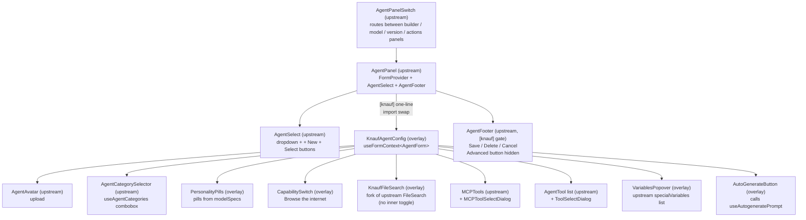
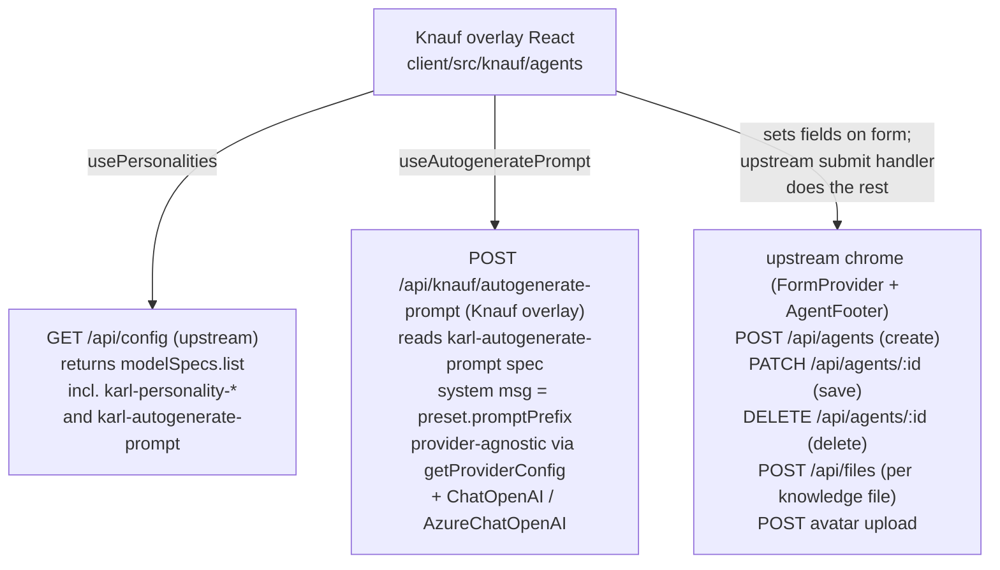
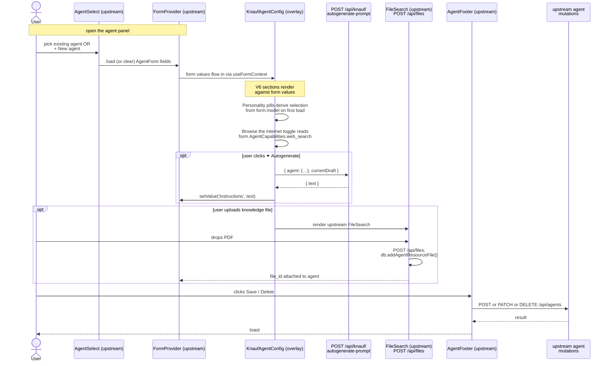
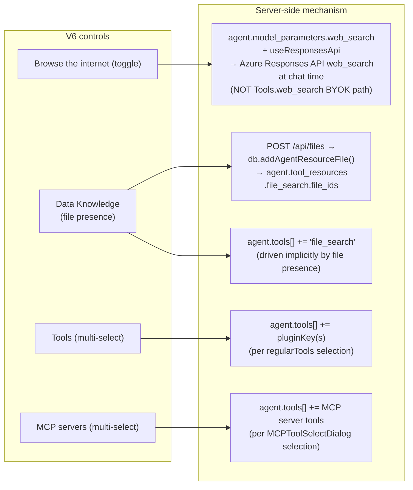
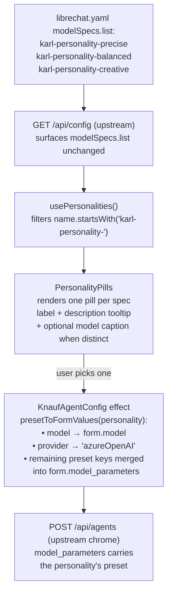
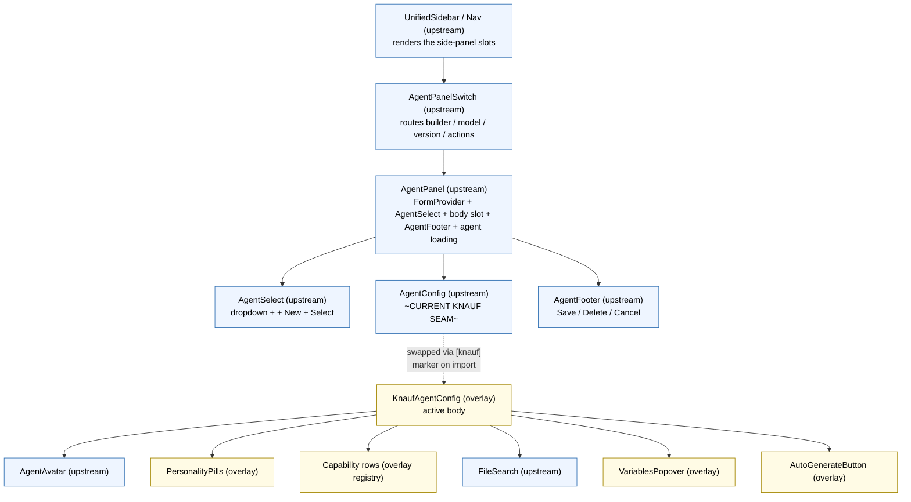
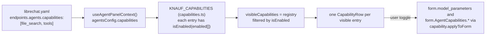

# Knauf client overlay (Tier 5)

Knauf-specific React code that runs inside the upstream LibreChat tree. See [CUSTOMIZATION_STRATEGY.md](../../../../CUSTOMIZATION_STRATEGY.md) Tier 5 for the discipline this folder follows.

## What has changed in LibreChat source code

Three `[knauf]` markers in upstream files. The first two are single-line **mount-point seams** (the lowest-cost Tier 5 pattern) — every line of Knauf logic lives outside upstream. The third is a small inline gate that hides the Advanced footer button.

| Upstream file | Line | Change | What it does |
|---|---|---|---|
| [client/src/components/SidePanel/Agents/AgentPanel.tsx](../../components/SidePanel/Agents/AgentPanel.tsx) | 32 | Import swap — `./AgentConfig` → `~/knauf/components/Agents/KnaufAgentConfig` | Replaces the inner form body of upstream's AgentPanel with the V6 layout. **Everything else** in upstream's AgentPanel (the `<FormProvider>`, the `<AgentSelect>` dropdown, the create / select / save / delete chrome via `<AgentFooter>`, the version panel, the agent-loading query) stays native. |
| [api/server/index.js](../../../../api/server/index.js) | 189 | One `app.use('/api/knauf', require('./routes/knauf'))` line | Mounts the Knauf-only Express router. Currently exposes `POST /api/knauf/autogenerate-prompt` (the ✦ Autogenerate Prompt endpoint). |
| [client/src/components/SidePanel/Agents/AgentFooter.tsx](../../components/SidePanel/Agents/AgentFooter.tsx) | ~22, 80 | `KNAUF_HIDE_ADVANCED` constant + gated `<AdvancedButton>` render | Hides the **Advanced** entry-point on the agent-builder footer. The simplified Knauf builder doesn't expose advanced graph editing. Flip the constant to `false` to restore upstream behaviour. |

**What is NOT touched in upstream code:**

- `librechat.yaml` — Knauf-controlled config file (it's already entirely workspace-owned, not part of upstream's distribution). Adds personality + autogenerate-drafter modelSpecs and tunes the agents endpoint capabilities.
- No upstream API controllers edited.
- No upstream middleware chain edited.
- No upstream Zod schemas extended.
- No upstream tests modified.

**What `KnaufAgentConfig` overrides vs upstream's `AgentConfig`:**

| Section | Upstream `AgentConfig` | `KnaufAgentConfig` (overlay) |
|---|---|---|
| Avatar | `<AgentAvatar>` (real upload) | **Same** — render upstream's `<AgentAvatar>` directly |
| Name | `<input>` bound to `form.name` | **Same** — bound to `form.name` |
| Description | `<input>` bound to `form.description` | **Same** — bound to `form.description` |
| Category | `<AgentCategorySelector>` (combobox over `useAgentCategories`) | **Same** — render upstream's `<AgentCategorySelector>` directly inside a Knauf section. Default `'general'` for new agents. |
| Model picker | Provider/model dropdowns | **Hidden** — Personality drives the model |
| Personality | (not present) | **New** — pills sourced from `modelSpecs.list` filtered by `karl-personality-*` prefix; each pill optionally shows the model in a small caption (only when personalities span multiple models). On change, writes `model` + `model_parameters` to the form. |
| Capabilities | 5+ separate sections (CodeForm, SearchForm, FileContext, Artifacts, FileSearch) | **Reduced** — capability registry (`KNAUF_CAPABILITIES` in [components/Agents/capabilities.ts](components/Agents/capabilities.ts)). Today: one row, "Browse the internet", which writes `web_search: true` + `useResponsesApi: true` into `model_parameters`. |
| Data Knowledge | `<FileSearch>` (with inner `<FileSearchCheckbox>` toggle, gated by `fileSearchEnabled`) | **`<KnaufFileSearch>`** (Tier 5 fork — drops the inner heading + checkbox). The `file_search` form field is driven implicitly by `knowledge_files.length > 0`; no separate toggle. |
| MCP servers | `<MCPTools>` + `<MCPToolSelectDialog>` | **Same** — rendered inside a Knauf section when `availableMCPServers.length > 0`. |
| Tools | `<AgentTool>` list + `<ToolSelectDialog>` (`<Action>` rows alongside) | **Tools shown** — `<AgentTool>` rows + "Add Tools" button (loading skeleton while `regularTools` resolves). **Actions hidden** — deliberately not surfaced (see [librechat.yaml](../../../../librechat.yaml) comment). |
| Instructions | `<Instructions>` (with upstream's variables popover) | **Knauf variant** — same `Controller`-bound textarea, same upstream `specialVariables` list, but adds a ✦ Autogenerate button that calls `/api/knauf/autogenerate-prompt` and a `<VariablesPopover>` that inserts the canonical tokens. |
| Support contact | Email field | **Hidden** for v1 |

**Knauf-only files (additive):**

- `client/src/knauf/` — overlay folder. `KnaufAgentConfig.tsx` is the body that AgentPanel.tsx imports. Hooks (`usePersonalities`, `useAutogeneratePrompt`) and section components live alongside.
- `api/server/routes/knauf/` — Knauf router folder. Currently one route: `autogenerate-prompt`.

## Architecture diagrams

### Component tree (who owns what)



### Routes touched



### Edit / create / save flow



### Capability mapping (V6 control → server)



### Personality flow (modelSpec → agent payload)



## Mount points (upstream files that touch the overlay)

| Upstream file | Line | What it does |
|---|---|---|
| [client/src/components/SidePanel/Agents/AgentPanel.tsx](../../components/SidePanel/Agents/AgentPanel.tsx) | 32 | Imports `KnaufAgentConfig` instead of upstream's `AgentConfig` — replaces the inner form body. |
| [client/src/components/SidePanel/Agents/AgentFooter.tsx](../../components/SidePanel/Agents/AgentFooter.tsx) | ~22, 80 | `KNAUF_HIDE_ADVANCED` constant + gated render of `<AdvancedButton>`. Hides the Advanced footer entry-point. |
| [api/server/index.js](../../../../api/server/index.js) | 189 | Mounts `api/server/routes/knauf/` under `/api/knauf` — currently serves `POST /api/knauf/autogenerate-prompt` for the ✦ Autogenerate Prompt button. |

Three `[knauf]` markers total. The overlay uses LibreChat's native theme tokens (`bg-surface-*`, `text-text-*`, `border-border-*`) with no Knauf brand colour overrides — every visual matches the rest of the app.

## Folder layout

The overlay mirrors upstream's layer split (`components/`, `data-provider/`, `common/`) so anyone navigating the LibreChat tree finds Knauf code in the place they'd expect to find equivalent upstream code.

```
knauf/                                           # client overlay (Tier 5)
├── README.md
├── common/
│   ├── agents-types.ts                          # KnaufPersonality + Zod schema (mirrors upstream common/agents-types.ts)
│   └── constants.ts                             # KARL_PERSONALITY_PREFIX, KARL_AUTOGENERATE_SPEC_NAME, KARL_DEFAULT_PERSONALITY_NAME
├── components/
│   └── Agents/                                  # mirrors upstream components/SidePanel/Agents/
│       ├── KnaufAgentConfig.tsx                 # mount-point seam target — body of upstream's AgentPanel
│       ├── KnaufFileSearch.tsx                  # Tier 5 fork of upstream FileSearch (no inner heading/checkbox)
│       ├── capabilities.ts                      # KNAUF_CAPABILITIES registry (entries with icon + applyToForm)
│       ├── KnaufSection.tsx                     # label + info badge + optional action slot
│       ├── KnaufInfoBadge.tsx                   # Radix HoverCard tooltip
│       ├── PersonalityPills.tsx                 # personality toggle (sourced from usePersonalities)
│       ├── CapabilitySwitch.tsx                 # row + upstream <Switch>
│       ├── VariablesPopover.tsx                 # + Variables popover (upstream specialVariables list)
│       └── AutoGenerateButton.tsx               # ✦ Auto-generate / Polish & expand
└── data-provider/                              # mirrors upstream packages/data-provider/src/
    ├── api-endpoints.ts                         # URL builders (apiBaseUrl-aware)
    ├── data-service.ts                          # request.* wrappers + wire-format types
    └── Agents/                                  # mirrors upstream data-provider/Agents/
        ├── usePersonalities.ts                  # filter modelSpecs by KARL_PERSONALITY_PREFIX
        └── useAutogeneratePrompt.ts             # react-query mutation around dataService.postAutogeneratePrompt

api/server/routes/knauf/                         # server overlay (additive, isolated)
├── index.js                                     # Express router
└── autogeneratePrompt.js                        # POST /api/knauf/autogenerate-prompt
```

Why split this way:

- **`common/`** — types and constants only, no React or DOM imports. Upstream uses the same convention; sharing these between client and (future) Knauf workspace is straightforward.
- **`components/Agents/`** — UI for the agent surface. The folder name `Agents` matches upstream's `components/SidePanel/Agents/` so a developer searching for "where does the agent builder live" finds both at once.
- **`data-provider/Agents/`** — network hooks. Same naming as upstream's `data-provider/Agents/mutations.ts` etc.

What's NOT in the overlay anymore (deleted when Decision 1 landed — upstream owns these now):

- `AgentPanelSwitch.tsx` — upstream's `AgentPanelSwitch` runs again. Our import-line marker in `useSideNavLinks.ts:22` was reverted.
- `KnaufAgentBuilder.tsx` — replaced by `KnaufAgentConfig.tsx` which slots into upstream's `AgentPanel`.
- `buildPayload.ts` + `useKnaufAgentMutation.ts` — upstream's `composeAgentUpdatePayload` + `useCreateAgentMutation` / `useUpdateAgentMutation` own the submit.
- `KnowledgeUploader.tsx` — replaced by upstream's `<FileSearch>` (real upload, real listing, real deletion).
- `AvatarTile.tsx` — replaced by upstream's `<AgentAvatar>` (real upload).

## Personalities — backed by upstream modelSpecs

The 3 personality presets live in [librechat.yaml](../../../../librechat.yaml) under `modelSpecs.list` with the `karl-personality-` name prefix. Each entry's `preset` carries the model + parameters that flow into the new agent's `model_parameters` at create time. No Knauf-specific YAML schema; no extra config-route plumbing.

To add a new personality: add another `modelSpecs.list[]` entry whose `name` starts with `karl-personality-`, set the `label`, `description`, and `preset` (model, reasoning_effort, etc.). The agent builder will pick it up on next reload.

## Capability map — UI label → LibreChat mechanism

Every toggle in the V6 panel is a friendly rename of an existing LibreChat capability. We don't add new agent abilities; we relabel and rewire the UI so non-technical users don't see jargon (BYOK badges, Tools enums, Responses-API flags).

| UI label (V6) | Section | LibreChat mechanism | Where it's gated |
|---|---|---|---|
| **Browse the internet** | What it can do | `model_parameters.web_search: true` + `model_parameters.useResponsesApi: true`. OpenAI's Responses API resolves the web_search tool server-side. **Not** the `Tools.web_search` (BYOK Serper) path. | KnaufAgentConfig sets these flags on the form whenever the toggle flips. The selected personality's preset can also pre-set them. Not gated by `endpoints.agents.capabilities`. |
| **Data Knowledge** | Data Knowledge | Files POSTed to `/api/files` with `agent_id` + `tool_resource: file_search`. Server-side `db.addAgentResourceFile()` writes them to `agent.tool_resources.file_search.file_ids`. The form's `file_search` field is mirrored to `knowledge_files.length > 0` automatically; on save, `Tools.file_search` is pushed onto the agent's `tools` array. | `endpoints.agents.capabilities` must include `file_search` (it does). |
| **Tools** | Tools | Adding a tool writes its `pluginKey` into `form.tools[]`. On save, the array is normalised by upstream's `composeAgentUpdatePayload`. Curated by [librechat.yaml top-level `includedTools`](../../../../librechat.yaml). | `endpoints.agents.capabilities` must include `tools`. |
| **MCP servers** | MCP servers | Selecting tools from a connected MCP server writes them into `form.tools[]` namespaced by server. Server-side they resolve to the right MCP server at chat time. | Section auto-hides when `availableMCPServers.length === 0`. Configure servers via top-level `mcpServers:` in librechat.yaml. |
| **Category** | Category | `<AgentCategorySelector>` writes `form.category` (default `'general'`). Drives sorting in the marketplace browse view when `interface.marketplace.use: true`. | Always visible. Categories sourced from `useAgentCategories` (upstream). |

### Why "Browse the internet" goes via model spec, not via `Tools.web_search`

Two paths exist in upstream LibreChat:

1. **Model-level web search.** Set `model_parameters.web_search: true` + `model_parameters.useResponsesApi: true`. At chat time, [packages/api/src/endpoints/openai/llm.ts](../../../../packages/api/src/endpoints/openai/llm.ts) (lines 148–275) injects `{ type: 'web_search' }` into the request tools. This is what the existing `karl-web` modelSpec already uses. **No external search-provider key needed** — Azure handles it.
2. **Agent-tool web search.** Add `Tools.web_search` to the agent's `tools[]` array. This requires `endpoints.agents.capabilities` to include `web_search`, AND a Serper / Searxng / etc. API key in `.env`. BYOK badge surfaces in the upstream UI.

The Knauf V6 uses path **1** because it's friction-free for end users and Knauf admins (no extra keys, no badge to explain). KnaufAgentConfig writes the flags onto `form.model_parameters` whenever the toggle flips. The selected personality's `preset` can also override or pre-set them — see librechat.yaml `karl-personality-*` entries.

### Adding a new capability (template)

1. Add the capability to `endpoints.agents.capabilities` in librechat.yaml (e.g. `execute_code` for Code Interpreter).
2. Add a `<CapabilitySwitch>` row in `KnaufAgentConfig.tsx`'s "What it can do" section.
3. Wire its `onChange` to `setValue(AgentCapabilities.<name>, next)` so upstream's `composeAgentUpdatePayload` picks it up at submit. If the capability also needs `model_parameters` adjustments (like `web_search` does), do those `setValue` calls in the same handler.

## Autogenerate Prompt (✦) — implementation

The **✦ Autogenerate / Polish & expand** button is wired end-to-end. **All tunable knobs live in librechat.yaml** under the `karl-autogenerate-prompt` modelSpec — the model, the system prompt, and the max-token budget. Knauf admins can tune any of them without a code deploy.

### What the button should do

When the textarea is empty: generate a draft system prompt from scratch using the current builder context.
When the textarea has text: rewrite/polish the existing draft, preserving the user's intent.

### Prompt assembly (client-side)

Compose a single completion request whose user message contains:

- The agent's name (`s.name`).
- The description, if present (`s.description`).
- The selected personality's **label** AND **description** (from `usePersonalities`). Optionally include the personality's `additional_instructions` so the assistant matches the tone the personality presets nudge toward.
- The list of enabled capabilities by **friendly label** (so the assistant doesn't see internal tool names): "Browse the internet", "Knowledge base (N attached docs)", etc.
- The user's existing draft (if any), wrapped in a clear delimiter.

Example (pseudocode):

```ts
const prompt = userDraft
  ? `Polish and expand this agent's instructions. Keep the user's intent and voice; make it clearer, friendlier, more thorough. Use second person ("You are…"). Plain English, under 180 words, no markdown headings or bullets.

Agent: ${name}
${desc ? `What it's for: ${desc}\n` : ''}Personality: ${persLabel} — ${persDescription}
What it can do: ${capabilityLabels.join(', ') || 'reply from its own knowledge only'}
${knowledgeFileCount ? `Knowledge: ${knowledgeFileCount} attached document(s).\n` : ''}
Draft:
"""
${userDraft}
"""

Return only the polished instructions.`
  : `Write friendly system instructions for an AI agent on Karl, Knauf's internal AI platform. Use second person ("You are…"), under 160 words, plain English, no markdown headings or bullets. Naturally weave in when to use what the agent can do.

Agent: ${name}
${desc ? `What it's for: ${desc}\n` : ''}Personality: ${persLabel} — ${persDescription}
What it can do: ${capabilityLabels.join(', ') || 'reply from its own knowledge only'}
${knowledgeFileCount ? `Knowledge: ${knowledgeFileCount} attached document(s).\n` : ''}
Return only the instructions text.`;
```

### Backend route

`POST /api/knauf/autogenerate-prompt` lives at [api/server/routes/knauf/autogeneratePrompt.js](../../../../api/server/routes/knauf/autogeneratePrompt.js). It:

- Requires JWT auth (`requireJwtAuth`).
- Accepts a JSON body: `{ agent: { name, description, personality, capabilities, knowledgeFileCount }, currentDraft }`. Every field is clamped (defence in depth — the input flows into a prompt).
- Loads `appConfig` and looks up the `karl-autogenerate-prompt` modelSpec in `modelSpecs.list`. Pulls `preset.endpoint`, `preset.model`, `preset.max_completion_tokens`, and `preset.promptPrefix` from there.
- **Provider-agnostic.** Walks the same `getProviderConfig({ provider, appConfig })` path that `packages/api/src/agents/initialize.ts:327-345` uses for every chat turn. The resolved `getOptions` returns a langchain-shaped `llmConfig` (env-var API key, Azure deployment mapping via `mapModelToAzureConfig`, headers, baseURL) which is fed straight into `ChatOpenAI` / `AzureChatOpenAI` from `@langchain/openai`. Branch is on `llmConfig.azureOpenAIApiInstanceName` — Azure groups go through the Azure subclass, everything else (openAI, custom xAI/deepseek/openrouter) goes through `ChatOpenAI`. Anthropic/Google/Bedrock-shaped llmConfigs are detected and rejected up-front.
- `streaming: false` + `disableStreaming: true` are forced on the client so we get the full text in one shot. `preset.max_completion_tokens` is injected via `modelKwargs` (forward-compatible across gpt-4o and gpt-5+).
- Sends `[SystemMessage(spec.preset.promptPrefix), HumanMessage(<dynamic context>)]` via `client.invoke(...)`.
- Returns `{ text }`.
- Logs and 5xx-fails on missing config or provider errors.

The route is mounted at [api/server/index.js:189](../../../../api/server/index.js#L189) via `app.use('/api/knauf', require('./routes/knauf'))` — one `[knauf]` line, additive folder.

### YAML configuration (`librechat.yaml`)

The route is a thin shell — all behaviour comes from one modelSpec entry:

```yaml
modelSpecs:
  list:
    - name: 'karl-autogenerate-prompt'
      label: 'KARL · Autogenerate Prompt (internal)'
      default: false
      description: 'Used by the agent builder to draft system instructions.'
      preset:
        endpoint: 'azureOpenAI'
        model: 'gpt-4o'                # → resolves to deploymentName via Azure group
        max_completion_tokens: 800
        promptPrefix: |
          You are helping a non-technical user write the system instructions
          for an AI agent on KARL …
          [the full system prompt — admins tune this]
```

To swap the drafter to a faster/cheaper model, change `preset.model` (must be hosted in the Azure group). To shape the drafter's voice, edit `preset.promptPrefix`. No code change.

The spec is intentionally `default: false` and labelled `(internal)` — it appears in the standard model-spec dropdown but is not preselected. If hiding it from end users becomes a hard requirement, we'll add a Knauf-side filter (single client-side change).

### Client wiring

[data-provider/Agents/useAutogeneratePrompt.ts](data-provider/Agents/useAutogeneratePrompt.ts) wraps the call in a TanStack mutation. [components/Agents/KnaufAgentConfig.tsx](components/Agents/KnaufAgentConfig.tsx) supplies:

- `name`, `description` — read via `getValues()` from upstream's react-hook-form context.
- `personality` object (looked up from `usePersonalities()` by the locally-tracked selected pill).
- `capabilityLabels: string[]` — friendly labels from the visible `KNAUF_CAPABILITIES` registry plus `'Knowledge base (N attached documents)'` when files are present.
- `knowledgeFileCount` — from `useGetAgentFiles(agent_id)`-derived `knowledge_files`.
- `tools: string[]` — display names for the agent's selected regular tools (resolved from `regularTools[].name`, falls back to `pluginKey`).
- `mcpServers: string[]` — connected MCP server names (from `useVisibleTools`).
- `currentDraft` — the form's `instructions` field value (drives the polish-vs-fresh-draft branch in the prompt).

The server route additionally appends an `Available variables: {{current_date}}, …` line sourced from the canonical `specialVariables` constant in `librechat-data-provider`, so the drafter can emit substitution tokens where genuinely useful.

On success the response text replaces `form.instructions` via `setValue()`. On error, a toast is shown.

### Out of scope (future iterations)

- Streaming the response into the textarea (would need a new SSE endpoint or upstream chat plumbing).
- Variable-token highlighting in the rendered draft (the prototype's ghost-layer trick — deferred indefinitely; the popover does the same job).
- Filtering `karl-autogenerate-prompt` out of the user-facing model-spec dropdown (visible-but-labelled-internal is fine for v1).

## Variables in instructions

The `+ Variables` popover sources its tokens from `librechat-data-provider`'s exported `specialVariables` constant. Server-side substitution lives in `packages/data-provider/src/parsers.ts` `replaceSpecialVars()` and runs at agent init (`packages/api/src/agents/initialize.ts`). Tokens are double-brace format: `{{current_date}}`, `{{current_user}}`, `{{iso_datetime}}`, `{{current_datetime}}`. Adding a new token requires both a new entry in `specialVariables` AND a substitution case in `replaceSpecialVars` — out of scope for this overlay.

## Rules of engagement

- **Never** import from this folder back into upstream code outside the documented mount points above.
- **Never** put branding (logos, favicons, colours) here — that's Tier 2 ([Dockerfile.knauf](../../../../Dockerfile.knauf) + [assets/knauf/](../../../../assets/knauf/)). The overlay uses LibreChat's native theme tokens — no Knauf colour layer.
- **Never** add Knauf-only npm dependencies to [client/package.json](../../../package.json). Use the (future) `packages/knauf/` workspace.
- When wrapping an upstream component, keep the same default export name and prop signature so the seam stays a one-line import swap.
- All Tailwind colour utilities should use LibreChat's native tokens (`bg-surface-secondary`, `text-text-primary`, `border-border-medium`, etc.). Don't introduce Knauf-namespaced CSS variables, and don't reach for `bg-brand-purple` — keep the overlay neutral so it matches the rest of the side panel chrome.

---

## Known bad practices in this overlay

An honest list, post-Decision 1 (the chrome integration that landed 2026-04-30). Several earlier sins were retired by switching to upstream's `FormProvider` + `AgentFooter` chrome — they're noted at the bottom for the record.

### Correctness / state-management

1. **Personality selection is a duplicated source of truth.** It's tracked in `useState` AND derived from `form.model` on first load. If the user picks "Creative" then later edits `model_parameters` directly (e.g., a future advanced toggle), the selected pill won't reflect that. Acceptable for v1 — admins won't bypass the pills — but flag it.
2. **Render-time type predicate now backed by Zod.** ✓ Resolved with [common/agents-types.ts](common/agents-types.ts) — `usePersonalities` calls `safeParse` on each entry and warns in dev when shape mismatches.
3. **No abort signal on autogenerate.** `useAutogeneratePrompt` starts a fetch without an `AbortController`. If the user closes the panel mid-draft, the request still completes server-side and the response is discarded silently. One-line fix.
4. **`as unknown as AgentForm['model_parameters']` cast.** [components/Agents/capabilities.ts](components/Agents/capabilities.ts) casts via `unknown` because upstream's `AgentModelParameters` type doesn't list `web_search`, `reasoning_effort`, etc. — but the runtime field accepts them. If upstream tightens the type, the cast hides the regression. Fix: contribute the keys upstream OR maintain a Knauf-side superset type.

### Boundary / wire-format

5. **Magic prefix string consolidated.** ✓ Resolved with [common/constants.ts](common/constants.ts). Server-side mirror still lives in `api/server/routes/knauf/autogeneratePrompt.js` (separate runtime; would consolidate via a future `packages/knauf/` workspace).
6. **Spec name `karl-autogenerate-prompt` is duplicated.** Once in `librechat.yaml`, once in [common/constants.ts](common/constants.ts), once in [api/server/routes/knauf/autogeneratePrompt.js](../../../../api/server/routes/knauf/autogeneratePrompt.js) as `SPEC_NAME`. Acceptable — spec names are admin-controlled — but a YAML comment pointing at the route would help future-you.
7. **Friendly capability labels live alongside their behaviour.** ✓ Resolved with [components/Agents/capabilities.ts](components/Agents/capabilities.ts) — each registry entry carries its own user-facing label.

### UX / user-visible

8. **`karl-autogenerate-prompt` and `karl-personality-*` modelSpecs leak into the user-facing chat-time model picker.** They're labelled "(internal)" but still appear. Filter the chat-time picker — separate UI concern, single client-side change.
9. **Autogenerate is clickable before personalities load.** If the user clicks ✦ before `useGetStartupConfig` resolves, `personalities` is empty → server gets empty `personality.label` and produces a tone-less draft. Disable the button while `personalities.length === 0`.
10. **Errors from autogenerate render as raw `err.message`.** Fine for dev, exposes server-side details to end users. Map known error codes to friendly copy.
11. **No loading state on the personality pills.** They're interactive immediately, even before `useGetStartupConfig` resolves — briefly look empty. (The Tools section *does* now show a "Loading tools…" skeleton; pills haven't been similarly wired.)

### Server-side

13. **No rate limiting on `/api/knauf/autogenerate-prompt`.** A user with a JWT can hammer Azure OpenAI on Knauf's bill. Add `express-rate-limit` per-user. Upstream has the same library installed.
14. **Logged prompt content is unredacted.** On Azure error or empty completion, the warning logs include user-provided fields indirectly via `err.message`. Low risk for an internal tool but real if logs ship to a third-party ingest.
15. **`new ChatOpenAI(...)` per request.** Cheap (HTTP keep-alive helps) but unnecessary. Cache the client per (provider, deployment, apiVersion) tuple — only worth doing if profiling shows it matters.
16. **Generic 500 message hides the actual config issue.** Three different failure modes (missing spec, `getProviderConfig` throw, non-OpenAI-compatible llmConfig) all return the same "Autogenerate is not configured on this deployment." text. Distinguish "config missing" from "provider call failed" client-side.

### Tests / dev workflow

17. **Zero tests on the overlay.** No specs for `usePersonalities`, the route handler, or the personality → form-write effect in `KnaufAgentConfig`. The autogenerate route is purely deterministic given inputs — perfect Jest target.
18. **i18n is partially wired.** `KnaufAgentConfig` uses upstream's `useLocalize()` for upstream-shared strings (`com_ui_name`, `com_ui_description`, `com_ui_instructions`, `com_ui_category`, `com_assistants_add_tools`, `com_ui_add_mcp_server`), but the V6-specific strings (section titles, info-badge tooltips, custom labels, placeholder copy) are hardcoded English. Phase 7 in the plan.

### Retired by Decision 1 (left here for the record)

The earlier overlay had its own state machine, its own submit pipeline, its own knowledge uploader, and its own avatar tile — all with their own corner-case bugs. Replacing the panel body with `KnaufAgentConfig` (which slots into upstream's `<FormProvider>`) deleted those problems wholesale:

- ✓ "Setting state during render" (the personality default check) — replaced by a `useEffect` that watches `defaultPersonalityName`.
- ✓ "Two state types that should be one" — `BuilderState`/`BuilderUIState` deleted along with `KnaufAgentBuilder.tsx`.
- ✓ "Type assertion at the buildPayload boundary" — `buildPayload.ts` deleted; upstream's `composeAgentUpdatePayload` owns submit.
- ✓ "Two-phase create + per-file upload glue" — `useKnaufAgentMutation.ts` deleted; upstream's `<FileSearch>` does the upload.
- ✓ "Client-generated file_id / temp_file_id" — `<FileSearch>` handles its own ids.
- ✓ "Knowledge uploader was UI-only" — replaced with the real `<FileSearch>`. Files persist on the agent record.
- ✓ "Partial upload failure UX is a single toast" — `<FileSearch>` handles per-file errors with upstream's standard pattern.

---

## Code organisation

The overlay mirrors upstream's layer split (`components/`, `data-provider/`, `common/`). The directory structure is laid out under [Folder layout](#folder-layout) above. A developer searching upstream's tree for "where does the agent builder live?" finds upstream code at `client/src/components/SidePanel/Agents/` and the matching Knauf overrides at `client/src/knauf/components/Agents/` — same nesting, same naming convention.

What we landed (originally listed as "easy wins" — done now):

- ✓ **Constants file** — [common/constants.ts](common/constants.ts) holds the librechat.yaml-tied identifiers (`KARL_PERSONALITY_PREFIX`, `KARL_DEFAULT_PERSONALITY_NAME`, `KARL_AUTOGENERATE_SPEC_NAME`). HTTP route URLs live separately in [data-provider/api-endpoints.ts](data-provider/api-endpoints.ts), mirroring upstream's split between `api-endpoints.ts` (URL builders) and the rest. No more magic strings sprinkled across files.
- ✓ **Capability registry** — [components/Agents/capabilities.ts](components/Agents/capabilities.ts) holds `KNAUF_CAPABILITIES` with `{ id, label, description, icon, isEnabled, readFromForm, applyToForm }`. KnaufAgentConfig iterates the registry; per-capability behaviour (the Browse-the-internet → `web_search` write) lives next to its UI metadata.
- ✓ **Personality typed against a Zod schema** — [common/agents-types.ts](common/agents-types.ts) defines `knaufPersonalitySchema` and `KnaufPersonality`. `usePersonalities` calls `safeParse` on each modelSpec entry; warns in dev when an entry fails validation.
- ✓ **YAML-gated capability visibility** — Each capability's `isEnabled(enabled[])` decides whether to render given upstream's `endpoints.agents.capabilities` array. Adding `execute_code` to YAML auto-shows a "Code interpreter" row once a registry entry exists.

Still on the wishlist:

- **Cross-runtime constants** — `KARL_AUTOGENERATE_SPEC_NAME` lives in both `common/constants.ts` (client) and `api/server/routes/knauf/autogeneratePrompt.js` (server). Hand-synced today; would deduplicate via a future `packages/knauf/` workspace (Tier 4).
- **Feature subfolders within `components/Agents/`** — once we add share-scope (Phase 5) or per-agent chat-upload persistence (Phase 6), the folder will have ~10 files and benefit from a sub-grouping (e.g., `components/Agents/personality/`, `components/Agents/capabilities/`). Defer until that file count actually arrives.
- **Tests** — `usePersonalities` is purely deterministic given a startup-config object; perfect Jest target. `applyToForm` for each capability entry is a pure function over a mock `setValue`. None written yet.

---

## Override hierarchy — what's overridden, what's available to override later

The agent panel is a tree. Each level has a name, an upstream owner, and a "Knauf override status." Today we override exactly one node: `AgentConfig`. Anything else can become a future seam if requirements grow.



### Override registry (current)

| Node | Upstream owner | Knauf overrides? | Mechanism |
|---|---|---|---|
| `Nav / UnifiedSidebar` | upstream | **No** | — |
| `useSideNavLinks` (icon registration) | upstream | **No** (reverted with Decision 1) | Was a `[knauf]` import-line swap until 2026-04-30; rolled back when the better seam below took over. |
| `AgentPanelSwitch` (panel routing) | upstream | **No** | Native — switches between builder / model / version / actions panels. |
| `AgentPanel` (form shell) | upstream | **No** | Native — owns `FormProvider`, agent loading, the body slot. |
| `AgentSelect` (dropdown + create / select) | upstream | **No** | Native. |
| `AgentConfig` (form body) | upstream | **YES** | One-line import swap in `AgentPanel.tsx:32` → our `KnaufAgentConfig`. |
| `AgentFooter` (Save / Delete / Cancel) | upstream | **Inline gate** | One-line `KNAUF_HIDE_ADVANCED` constant + conditional render around `<AdvancedButton>`. Save / Delete / Cancel chrome unchanged. |
| `AgentAvatar` (upload UI) | upstream | **No** | Used directly inside `KnaufAgentConfig`. |
| `AgentCategorySelector` (combobox) | upstream | **No** | Used directly inside `KnaufAgentConfig`'s Category section. |
| `FileSearch` (knowledge upload) | upstream | **Forked → `KnaufFileSearch`** | Tier 5 fork omitting the inner `<label>` heading and `<FileSearchCheckbox>`. The form's `file_search` field is mirrored from `knowledge_files.length > 0` by an effect in `KnaufAgentConfig`. |
| `Instructions` (textarea + Variables) | upstream | **Replaced inside `KnaufAgentConfig`** | We render our own textarea bound to `form.instructions`, with a Knauf `<VariablesPopover>` (sources upstream's `specialVariables`) and the ✦ Autogenerate button. The upstream `Instructions.tsx` component is no longer rendered. |
| `Personality` (V6 concept) | doesn't exist upstream | **New** | Knauf-only section sourced from `modelSpecs.list` filtered by `karl-personality-` prefix. |
| `Capability rows` | upstream renders 5+ separate forms | **Reduced to a registry** | Knauf `capabilities.ts` registry. Today: one row (Browse the internet). |
| `MCPTools` + `MCPToolSelectDialog` | upstream | **No** | Used directly inside `KnaufAgentConfig`'s MCP servers section. Auto-hidden when no servers are configured. |
| `AgentTool` + `ToolSelectDialog` | upstream | **No** | Used directly inside `KnaufAgentConfig`'s Tools section. YAML-gated by `endpoints.agents.capabilities` containing `tools`. Shows a loading skeleton while `regularTools` resolves. |
| `Action` rows | upstream | **Hidden** | Deliberately not surfaced — see librechat.yaml comment about the curated integrations catalogue. |
| `VersionPanel` (version history) | upstream | **No** | Native — mounted via `AgentPanelSwitch`. |
| `ActionsPanel` | upstream | **No** | Native — not surfaced in V6 but still mounts via `AgentPanelSwitch` if a user navigates to it. |
| `useAgentCapabilities` hook | upstream | **No** | Read by upstream components. The Knauf capability registry consults the same `endpoints.agents.capabilities` array via `useAgentPanelContext`. |

### Possible future seam points (in order of cost)

If a future requirement comes in, here's where to put the marker:

1. **A new Knauf-only API route.** Extend `api/server/routes/knauf/index.js` (purely additive, no marker). Already handles `/autogenerate-prompt`.
2. **A new agent-builder section that needs new form fields not in `AgentForm`.** Add a Knauf-side state + handler inside `KnaufAgentConfig`. No new marker — we're already inside the body slot.
3. **Hide the autogenerate / personality modelSpecs from the chat-time spec picker.** Filter inside the component that renders the picker (likely `ModelSpecsMenu` or similar). One new `[knauf]` marker, single import swap or `useMemo`.
4. **Customise `AgentFooter`** further (already gated for the Advanced button). For larger changes — adding a "Duplicate agent" button, a Knauf-specific danger zone, etc. — promote the inline gate to a full import swap (`AgentFooter` → `KnaufAgentFooter`) the same way we did for `AgentConfig`.
5. **Customise `AgentSelect`** (e.g., group agents by category, add favourites). One new `[knauf]` marker — replace `AgentSelect` import in `AgentPanel.tsx`.
6. **Customise the entire `AgentPanel` shell** (e.g., add a Knauf banner at the top). Replace `AgentPanel` import in `AgentPanelSwitch.tsx`. Heavier — you'd own the FormProvider wiring.
7. **Customise `AgentPanelSwitch`** (e.g., add a new Knauf-only sub-panel alongside builder / model / version). Replace it in `useSideNavLinks.ts:96`. Same as the original Phase 0 seam.
8. **New top-level side-panel slot** (e.g., a separate Knauf agents marketplace). Add a row to `useSideNavLinks` — additive change with one `[knauf]` line, no replacement of an existing component.

The seam you choose should be the **smallest scope that contains your change**. Replacing `AgentConfig` to add a Personality section is correct; replacing the entire `AgentPanel` would be overshoot.

### Capability flow (current — single registry)



Adding a new capability:
1. (If needed) flip the YAML — e.g., add `execute_code` to `endpoints.agents.capabilities`.
2. Add an entry to `KNAUF_CAPABILITIES` in [components/Agents/capabilities.ts](components/Agents/capabilities.ts): `{ id, label, description, icon, isEnabled, readFromForm, applyToForm }`.
3. The row appears automatically in the V6 panel. No `KnaufAgentConfig.tsx` change.

Capabilities that are **model-level** (like Browse the internet) return `true` from `isEnabled` unconditionally — they don't need a YAML flag because they ride on `model_parameters` not on the agent's `tools[]` array.
