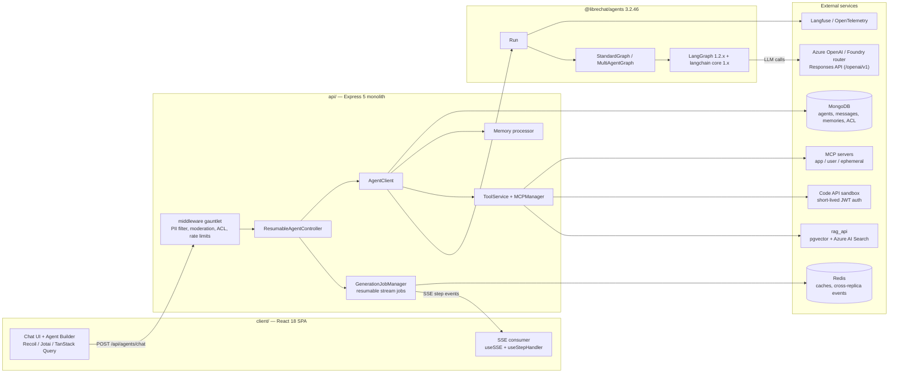
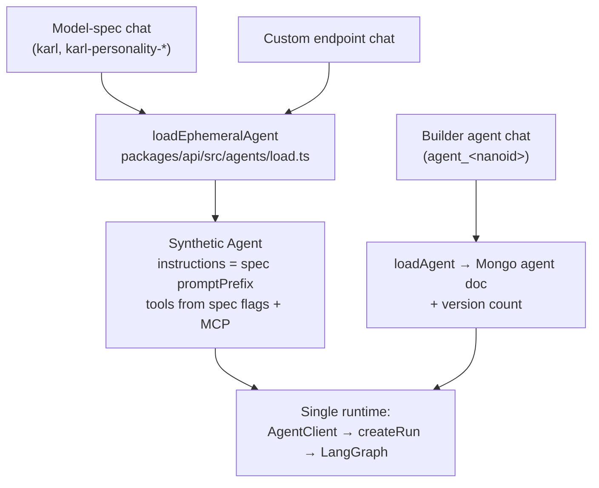
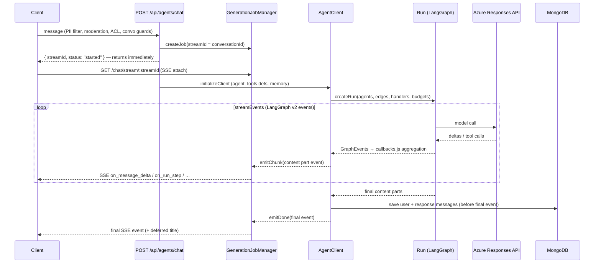
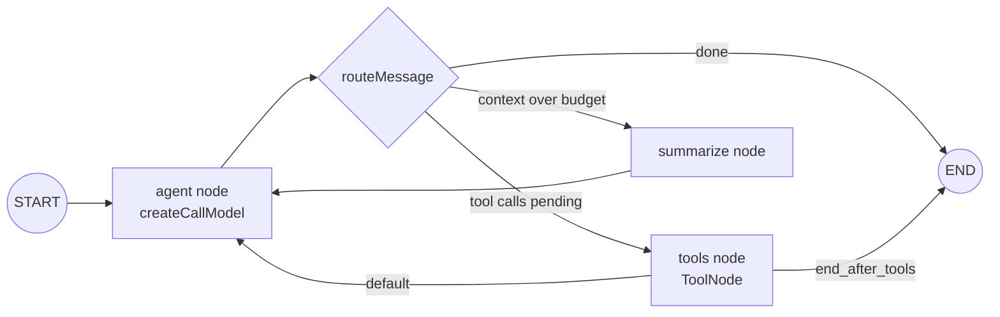
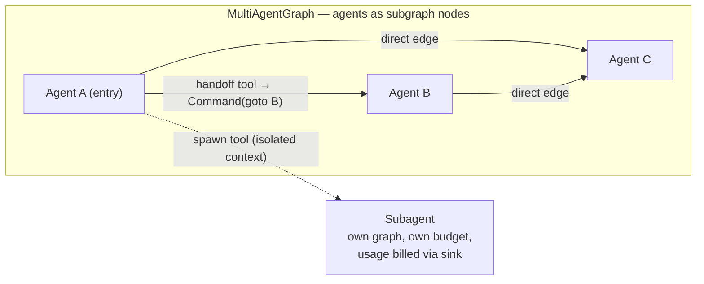
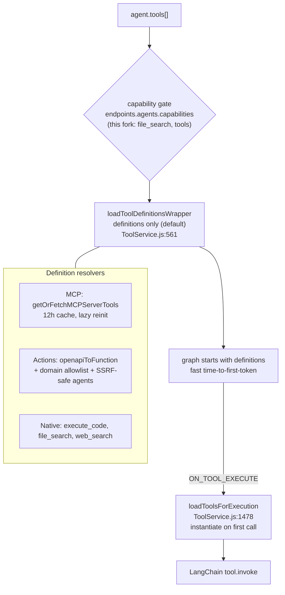
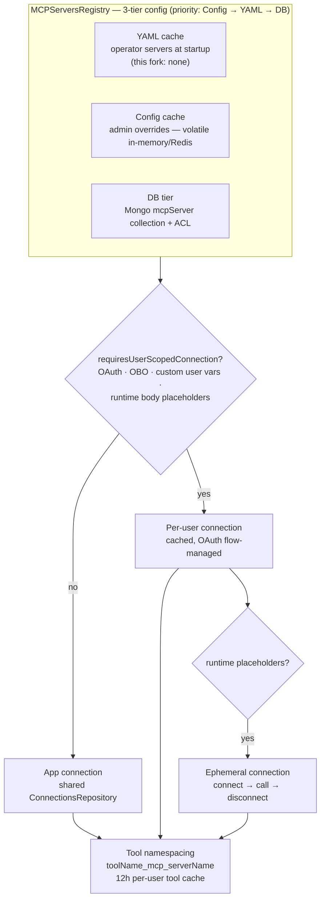
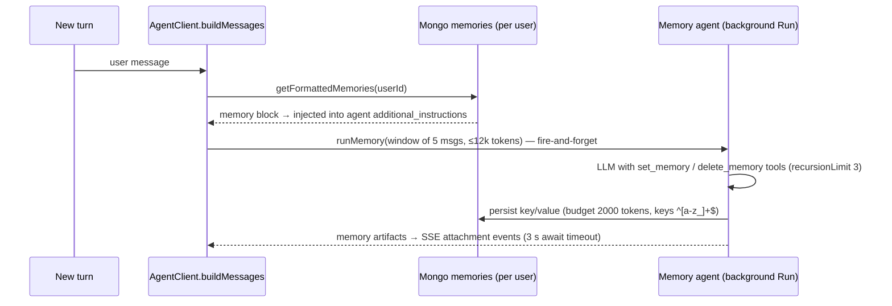

# KARL Agents Architecture — Deep Dive

> **Status:** analysis document (KK20 — architecture reference)
> **Date:** 2026-07-24 · pinned to commit `270396d07` (branch `docs/KK20-108-code-interpreter-artifacts-rollout`)
> **Baseline:** LibreChat `v0.8.7` fork · `@librechat/agents` **3.2.46 installed** (manifest declares `^3.2.65` — see §16) · LangGraph `^1.2.9` · `@langchain/core` `1.1.48`
>
> All `file:line` references were verified against the pinned commit. Line numbers drift with upstream syncs — treat them as anchors, not contracts.

---

## 1. Executive summary

KARL's agent runtime is **not a bolt-on feature — it is the single execution path for every chat in the product**. Even a plain "azureOpenAI" model-spec conversation (the default `karl` experience) is wrapped server-side into an *ephemeral agent* and executed by the same controller, graph runtime, tool loader, and streaming pipeline as a full builder-created agent.

The runtime is built on **LangGraph 1.2.x** (via the `@librechat/agents` SDK), which as of mid-2026 is the de-facto enterprise standard for graph-based agent orchestration. The architecture is strongly aligned with current SOTA on most axes — MCP-first tooling, handoff-based multi-agent, isolated-context subagents, Responses-API migration, in-graph context summarization, built-in Langfuse/OTel observability, resumable streaming — and lags on two: **durable execution** (no graph checkpointing; a pod restart kills an in-flight run) and **guardrails/evals** (moderation middleware only, no eval harness).

Verdict up front: **the architecture is sound, modern, and in places ahead of comparable open-source products**. Its real risks are operational, not conceptual: a live dependency version skew, several strata of deprecated legacy code, capability gating spread across three configuration layers, and heavy complexity concentration in a few god-modules that make Tier-5 customization expensive.

---

## 2. System context

Layer map:

| Layer | Where | Role |
|---|---|---|
| Routes + middleware | `api/server/routes/agents/` | Auth, ACL, moderation, PII, rate limits, endpoint-option building |
| Request controller | `api/server/controllers/agents/request.js` | Resumable job lifecycle, title generation, conflict guards |
| Stream job manager | `packages/api/src/stream/GenerationJobManager.ts` | SSE fan-out, reconnect/resume, cross-replica abort, partial persistence |
| Agent client | `api/server/controllers/agents/client.js` | Message building, token accounting, memory hooks, run invocation |
| Run factory | `packages/api/src/agents/run.ts` (`createRun`) | Provider mapping, per-agent config, subagent graphs, Langfuse wiring |
| Graph SDK | `@librechat/agents` (`Run`, `StandardGraph`, `MultiAgentGraph`) | LangGraph state machines, event stream, HITL, summarization |
| Tools | `api/server/services/ToolService.js` + `packages/api/src/mcp/` | Deferred tool resolution, MCP registry/connections, actions, native tools |
| Data model | `packages/data-schemas/` + `api/server/services/PermissionService.js` | Agent schema, versioning, ACL/RBAC, marketplace |
| Client streaming | `client/src/hooks/SSE/` | Event-sourced content-part reducer into the message tree |

---

## 3. The central design fact: every chat is an agent run

`buildOptions` for non-agent endpoints calls `loadAgent` with `Constants.EPHEMERAL_AGENT_ID` (`api/server/services/Endpoints/agents/build.js:14`). `loadEphemeralAgent` (`packages/api/src/agents/load.ts:48-180`) then synthesizes an `Agent` object on the fly:

- Resolves the model spec (e.g. `karl`) from `req.config.modelSpecs.list` and uses its `promptPrefix` as agent instructions — re-read every request per `[knauf]` KK20-201 (`load.ts:113-124`).
- Converts spec/request flags into tools: `web_search`, `file_search`, `execute_code`, `[knauf]` `image_gen_oai` (`load.ts:67-85`), plus selected MCP servers (`load.ts:87-108`).
- Encodes a synthetic id `endpoint__model___sender____index` (`packages/api/src/agents/parsers.ts:549`); anything not starting with `agent_` is ephemeral (`parsers.ts:621`).

**Why this matters:** there is exactly one code path for context management, tool execution, streaming, cost accounting, and observability. Features land once and apply everywhere — the pattern the industry converged on ("everything is an agent loop"), and the reason the Knauf personality/fast-mode work could be implemented purely as `model_parameters` markers interpreted at run level (§13).

---

## 4. Request lifecycle — the resumable job architecture

The chat POST does **not** stream the response on its own connection. It registers a *generation job* and returns immediately; the client attaches to a separate SSE stream that can drop, reconnect, and resume mid-generation.

Key mechanics, all in `api/server/controllers/agents/request.js` and `packages/api/src/stream/GenerationJobManager.ts`:

- **Immediate response** (`request.js:363`): the POST answers with `{streamId, conversationId, status}` so the UI can attach to SSE while tool/MCP loading is still running. `progressOptions.res` is deliberately a no-op stub (`request.js:602-609`) — all streaming goes through the job emitter.
- **Resume**: `GET /chat/stream/:streamId?resume=true` replays a `sync` event (aggregated content + run steps) plus the missed event gap (`routes/agents/index.js:126-147`). The live graph is registered for resume-state extraction (`client.js:1451-1453`).
- **Abort** is a three-path system, each guarded against double-saving: the abort endpoint persists a partial `unfinished:true` message (`routes/agents/index.js:276-322`); `allSubscribersLeft` saves a partial when every SSE client drops (`request.js:396-454`); `abortJob` emits the final abort event with cross-replica propagation (`GenerationJobManager.ts:721-826`).
- **Pre-flight conflict guards** (`[knauf]`): unpersisted-parent, conversation-root and parent conflicts return 409s before any generation starts (`request.js:283-323`); a pending-request concurrency limiter returns 429 (`request.js:332-337`).
- **Titles** run in `immediate` mode in parallel with generation, or deferred to `final` (`request.js:475-478, 519-563, 790-803`).
- The legacy synchronous controller still exists but is dead code — `AgentController` unconditionally delegates to the resumable path (`request.js:878-887`).

This layer is genuinely differentiating: most open-source chat frontends still tie generation to a single HTTP connection. KARL's model survives tab refreshes and load-balancer failover of the *stream*, though not of the *computation* (§14).

---

## 5. The graph runtime (`@librechat/agents`)

`createRun` (`packages/api/src/agents/run.ts:916`) builds per-agent inputs (provider mapping, `[knauf]` response-style rewriting, header resolution, effective context budgets) and assembles a `graphConfig`; `type` becomes `multi-agent` when more than one agent or any edges exist (`run.ts:1157-1167`), else `standard`. `Run.create` then compiles the LangGraph.

### 5.1 StandardGraph — the single-agent loop

State schema is LangGraph-idiomatic: `Annotation.Root({ messages: messagesStateReducer, summarizationRequest })` (`Graph.ts:2439-2451`). Each agent is a **subgraph** of three nodes:

- The **summarize node lives inside the loop** (`Graph.ts:2453-2546`): when the running context crosses the reserve-ratio budget, history is compacted mid-run and control returns to the agent node. This is the "context engineering" pattern (compaction as a first-class graph state) that frameworks only standardized in 2025.
- `recursionLimit` defaults to **50** steps, overridable per agent via `agent.recursion_limit` and capped by `endpoints.agents.maxRecursionLimit` (`packages/api/src/agents/config.ts:3-11`, applied at `client.js:1207`).
- **HITL** exists at SDK level: LangGraph interrupts are captured (`run.ts (SDK):832-855`) and resumed via `Command({resume})`, with a `MemorySaver` checkpointer auto-applied only when HITL is enabled.

### 5.2 MultiAgentGraph — handoffs, direct edges, fan-out

Agents form a graph via the `edges` field on the agent document (`GraphEdge`: `from`/`to`, `edgeType: 'handoff' | 'direct'`, optional condition/prompt — `packages/data-provider/src/types/agents.ts:459-489`). `MultiAgentGraph` (SDK `MultiAgentGraph.ts:42`) categorizes edges and realizes **handoffs as LangGraph tools returning `Command({ goto, graph: Command.PARENT })`** (`MultiAgentGraph.ts:376-379`) — the same primitive OpenAI's Agents SDK calls "handoffs" and LangGraph documents as the swarm pattern. Direct edges give deterministic sequencing with fan-in/fan-out.

Three multi-agent mechanisms coexist (`api/server/services/Endpoints/agents/initialize.js`):

1. **Connected agents / handoffs** — BFS over `agent_ids` discovers the reachable agent set and produces edges (`initialize.js:425-495`). The flat `agent_ids` chain itself is **deprecated** in favor of `edges` (`packages/data-schemas/src/schema/agent.ts:77-81`), and the old sequential-chain machinery (`last_agent_id`, `hide_sequential_outputs` intermediate-output masking, `callbacks.js:371-384`) is marked `@deprecated` throughout.
2. **Parallel added conversations** (multi-convo) — additional agents answer the same turn in parallel (`initialize.js:509`, `packages/api/src/agents/added.ts`).
3. **Subagents** — isolated-context child graphs spawned as tools, gated by `AgentCapabilities.subagents`, built recursively with explicit depth/count limits (`run.ts:696-860`), excluded from the parent's node set (`initialize.js:549-557`), and billed out-of-band through `subagentUsageSink` (`run.ts:956-964`) because they execute outside the parent's `streamEvents` loop. Streaming to the UI flows through `ON_SUBAGENT_UPDATE` envelopes keyed by parent tool-call id.

### 5.3 Event model

The SDK emits a typed event vocabulary (`GraphEvents`: `ON_RUN_STEP`, `ON_MESSAGE_DELTA`, `ON_REASONING_DELTA`, `ON_TOOL_EXECUTE`, `ON_SUMMARIZE_*`, `ON_SUBAGENT_UPDATE`, `ON_CONTEXT_USAGE`, …) layered over LangChain-native events. `api/server/controllers/agents/callbacks.js` maps each into (a) a content-part aggregation buffer that becomes the persisted message, and (b) SSE emissions through the job manager. Token usage is collected per model call with backend-authoritative USD cost (`callbacks.js:37-136, 326`), including `[knauf]` capture of the Azure Model-Router's actual backing model.

---

## 6. Context and token management

- **Budget**: `maxContextTokens` is computed at agent initialization (context window minus max output tokens), then reduced per agent by the summarization reserve ratio: `effectiveMaxContextTokens = min(maxContextTokens, ratioComputed)` (`run.ts:671-682, 1108`).
- **Counting**: `buildMessages` counts every message with the model's encoding into an `indexTokenCountMap` (`client.js:296, 447-477`) used by the graph pruner; recounts are forced when quotes/vision content is present.
- **Calibration**: a measured-vs-estimated **EMA calibration ratio** is persisted per conversation and re-seeded each turn (`client.js:573-579, 1544-1552`) so pruning decisions track the provider's real tokenizer instead of drift-prone estimates.
- **Compaction**: the in-graph summarize node (§5.1) streams `ON_SUMMARIZE_*` to the client and persists a context-usage breakdown on the response metadata (`client.js:953-1013`).

---

## 7. Tool subsystem

### 7.1 Deferred (event-driven) tool loading

The default path loads **tool definitions only** — serializable schemas, no instantiation — and defers real tool construction until the graph actually calls one:

This is the same trade Claude Code makes with deferred tool schemas: startup cost stays flat as the tool surface grows, at the price of a more intricate two-phase loader.

### 7.2 Native tools

| Tool | Mechanism | Notable details |
|---|---|---|
| `execute_code` | External Code API sandbox via `createCodeExecutionTool` (`handleTools.js:342-360`) | `[knauf]` short-lived JWT auth minted per request (EdDSA/RS256, TTL ≤ 300 s, `packages/api/src/auth/codeapi.ts:343-374`) replacing the static API key; session file priming with stale-session re-upload (`Files/Code/process.js:766-953`); a documented first-turn seeding race (`ToolService.js:1012-1036`) |
| `file_search` | Fork-owned RAG tool (`api/server/services/Files/knauf/fileSearchRetrieval.js`) | **Dual backend** (pgvector `/query_multiple` + Azure AI Search `/agent/query-multiple`) fused with **Reciprocal Rank Fusion** (RRF_K=60, max 10 results); per-run query budget (`maxDistinctQueries: 3`) and dedup cache; fail-closed readiness filter on `knauf_asset_id` (KK20-195); anchored citations with limits (30 total / 5 per file / 0.45 min score) |
| `web_search` | **Two distinct mechanisms** | (A) LibreChat provider-backed search (serper/firecrawl/jina) — deliberately unconfigured here; (B) **Azure Responses-API native `web_search`** — spec flag → `Tools.web_search` → translated to `finalModelOptions.web_search = true` for Azure (`initialize.ts:1013-1025`), the KK20-175/KK20-194 production path; companion `[knauf]` `open_url` tool is injected only when the user's message contains a URL (`ToolService.js:516-534`) |
| Actions (OpenAPI) | `ActionService.js` | OpenAPI spec → per-operation tools; domain allowlist + stored-domain vs serverUrl defense-in-depth; SSRF-safe HTTP agents when no allowlist; OAuth (flow manager, refresh, encrypted tokens) and API-key auth. Disabled in this fork (not in capabilities) |
| Skills | `skills`/`skills_enabled` on the agent schema | Allowlisted skill priming, fail-closed when allowlist empties (`methods/agent.ts:334-342`); activated by KK20-108 for artifacts/code-interpreter usage |

### 7.3 Capability gating — three layers (a real footgun)

| Layer | Where | Governs |
|---|---|---|
| `interface.*` flags | `librechat.yaml:368-392` | UI badges + role permission seeding only |
| Role permissions (ACL) | `PermissionTypes`/`Permissions` + `KNAUF_RESTRICT_USER_PERMISSIONS` (`packages/api/src/app/permissions.ts`) | Per-role feature access (admin full, user restricted) |
| `endpoints.agents.capabilities` | `librechat.yaml:476-478` (`[file_search, tools]`) | What the agent builder/runtime will actually load |

The three can disagree — e.g. `interface.runCode: true` while `execute_code` is absent from capabilities — and the runtime logs the mismatch rather than failing (`ToolService.js:1144-1147`). BUG-02 (§9) is the concrete cost of this split.

---

## 8. MCP subsystem

MCP is a first-class citizen with an unusually complete implementation for a self-hosted product:

- Tool names are namespaced `${tool}_mcp_${server}` (`packages/api/src/mcp/tools.ts:92`); per-user tool caches live 12 h (`getCachedTools.js:47`); request-scoped servers are never cached.
- OAuth is fully modeled (discovery-mode listing without auth, interactive flows, token refresh, **on-behalf-of** per-call token refresh — `MCPManager.ts:447-485`), matching the 2025-2026 MCP authorization spec direction.
- This fork configures **no YAML servers**; all MCP servers are UI/DB-created and lazily connected (`initializeMCPs.js:52`), with Entra-integrated ACL on who may use/create/share servers.

**BUG-02 case study** (MCP "visible to users" resets every release): the visibility toggle maps to the `chatMenu` config field, but `omitServerManagedFields` strips `chatMenu` from the UI-writable schema (`packages/data-provider/src/mcp.ts:381-392`), and both create/update controllers validate through that schema before persisting (`api/server/controllers/mcp.js:339, 416`). A UI visibility change is therefore silently dropped; the only tier that could carry it (YAML/config cache) is volatile or unused here. The durable fix is a schema change persisting `chatMenu` into `mcpServer.config`. This is the flagship example of the three-tier config split biting in production.

---

## 9. Memory subsystem

- Read path: memories are injected into the agent's dynamic system tail per agent, gated by user personalization opt-out and the `MEMORIES` permission (`client.js:554-679`).
- Write path: a **separate background agent run** (this fork: `azureOpenAI` / `model-router-chat`, `librechat.yaml:30-40`) with exactly two tools, deliberately conservative default instructions (only explicit "remember/forget" phrasing), hard token budget with `would_exceed` error artifacts, and `[knauf]` Langfuse tenant tagging (`packages/api/src/agents/memory.ts:286-575`).
- Full CRUD REST surface + usage meter for user-facing memory management (`api/server/routes/memories.js`).

This is the ChatGPT-style product memory pattern — tool-mediated, budgeted, user-controllable — rather than research-grade episodic/graph memory (mem0/Letta/Zep). For a corporate assistant that is the right trade.

---

## 10. Agent data model and governance

The agent document (`packages/data-schemas/src/schema/agent.ts`) is agents-as-data with governance built in:

- **Identity/config**: `provider`, `model`, `model_parameters`, `instructions`, `artifacts`, `recursion_limit`, `conversation_starters`, `category`, `support_contact`.
- **Composition**: `tools`, `tool_resources` (execute_code/file_search/image_edit/context), `tool_options` (defer_loading, allowed_callers), `actions`, `mcpServerNames` (denormalized index), `skills` + `skills_enabled`, `edges` (graph), `agent_ids` (deprecated), `subagents`.
- **Governance**: `versions` (full snapshot history), `is_promoted` (marketplace), `tenantId` (multi-tenancy), `[knauf]` `spec` (BUG-01 fix — persisted model-spec name).

**Versioning** is automatic on every update unless the change dedups against the last snapshot (`isDuplicateVersion`, `methods/agent.ts:70-189, 506-542`), with `revert` restoring any snapshot (`:923-967`). File attach/detach flows through the same versioned update path.

**Sharing is a full ACL layer**, not the legacy `projectIds` model: `AclEntry` docs with bitwise permissions (VIEW=1, EDIT=2, DELETE=4, SHARE=8), principals of user/group/public/role, **Entra ID group sync**, public-share roles, and per-route enforcement (`PermissionService.js`, `canAccessAgentResource`, route table in `api/server/routes/agents/v1.js`). Non-owners receive a sanitized agent subset; full config requires the EDIT-gated `/expanded` endpoint. The marketplace is just the ACL-filtered list + categories + `is_promoted`.

A `REMOTE_AGENT` resource type exists alongside `AGENT` (owner grants are written for both), positioning for cross-instance/remote-agent sharing (A2A-adjacent).

---

## 11. Streaming client

`useSSE` routes raw SSE frames; `useStepHandler` (1100 lines) is an **event-sourced reducer** folding typed step events into the message tree: content parts keyed by index (`text`, `think`, `tool_call`, `agent_update`, `summary`), argument streaming into tool calls, out-of-order delta buffering with replay, and subagent progress folded into a per-tool-call Recoil atom that survives stream teardown for auditability. Rendering dispatches per part type (`Part.tsx:47-373`) with specialized tool-call renderers (code execution, file search citations, web search, handoffs, subagents, skills). Reasoning parts default to expanded via a `[knauf]` seam (`client/src/store/showThinking.ts:7`, KK20-128).

The persisted message **is** the aggregated content-part array — the same structure streamed live — so replay, resume, and history render through one model. This mirrors the OpenAI Responses "typed output items" direction rather than legacy flat text.

---

## 12. Knauf customization layer (how the fork rides this architecture)

The fork's discipline (see `CUSTOMIZATION_STRATEGY.md`) keeps Knauf changes at the edges of the runtime:

- **Net-new surfaces** (Tier 3/4): `client/src/knauf/` (simplified agent builder `KnaufAgentConfig`, personality pills, file UX, analytics) and `api/server/routes/knauf/` (autogenerate-prompt, templates, categories, costs) — mounted with a single seam line (`api/server/index.js:328`).
- **Inline seams** (Tier 5, `[knauf]`-marked): the builder swap (`AgentPanel.tsx:32-36` routes admins to the full upstream builder, everyone else to the simplified one — FEAT-03 shipped), `spec` persistence end-to-end (BUG-01 fix), file-index readiness 409 gate, Azure SAS re-signing, avatar cache strategy, Langfuse tenant tags, Code-API JWT auth.
- **Personalities/Fast Mode ride the runtime cleanly**: pills write `knauf_fast_mode` / `knauf_show_reasoning` markers into `model_parameters`; `applyKnaufResponseStyle` (`packages/api/src/agents/run.ts:46-76`) rewrites them into Azure Responses `reasoning` config (or strips reasoning for Fast Mode) and deletes the markers before the provider sees them. Tone comes from the spec's prompt; reasoning effort is a runtime rewrite — exactly the Tier-0-plus-thin-seam shape the strategy doc prescribes.

---

## 13. SOTA alignment (July 2026)

Reference points: the 2026 production shortlist of agent frameworks (LangGraph, OpenAI Agents SDK, Claude Agent SDK, Google ADK, Microsoft Agent Framework), MCP's convergence as the universal tool layer, the deep-agents harness pattern (planning + subagents + persistent context), and OpenAI's Assistants → Responses migration (hard sunset 2026-08-26).

| Trend | Industry direction (mid-2026) | This architecture | Verdict |
|---|---|---|---|
| Graph orchestration | LangGraph 1.x is the enterprise default (Klarna/Uber/LinkedIn scale) | Built directly on LangGraph 1.2.x via `@librechat/agents`; app code stays SDK-abstracted | ✅ Aligned |
| MCP as tool standard | All major frameworks converged on MCP | 3-tier registry, app/user/ephemeral connections, OAuth + OBO, namespacing, ACL on servers | ✅ Aligned — ahead of most self-hosted products |
| Multi-agent = handoffs + subagents | OpenAI-style handoffs; Claude-style isolated subagents; supervisor pattern fading | Handoff edges via `Command(goto)`, direct edges with fan-in/out, isolated-context subagents with usage sinks; legacy chain deprecated | ✅ Aligned |
| Responses API migration | Assistants API removed 2026-08-26; typed output items | Azure Responses (`/openai/v1`, `useResponsesApi`), native `web_search`; content-part message model | ✅ Well positioned (assistants-era code remains as dead weight) |
| Skills | Portable skill folders (Anthropic Agent Skills) | `skills`/`skills_enabled` on agents, allowlists, skill priming; activated by KK20-108 | ✅ Early adopter |
| Context engineering | Compaction/summarization as first-class runtime state | In-graph summarize node, reserve ratios, EMA token calibration, per-index token maps | ✅ Aligned |
| Observability | OTel GenAI conventions; Langfuse/LangSmith default-on | Langfuse + OTel wired in the SDK; `[knauf]` tenant tagging; backend-authoritative cost events | ✅ Aligned |
| Durable execution | Checkpointed graphs, background agents, resumable computation (LangGraph Platform, Temporal-style) | Resumable **streams** + partial persistence + cross-replica abort, but **no graph checkpointing** (MemorySaver only under HITL, in-memory) — a pod restart kills the run | ⚠️ Partial — biggest gap |
| HITL | interrupt/approve primitives in every major SDK | SDK-level interrupt + `Command(resume)` exists; thin product surface on top | ⚠️ Present, underused |
| Memory | Product-grade user memory (ChatGPT-style); mem0/Letta beyond | Tool-mediated memory agent, budgets, opt-out, CRUD UI | ✅ Aligned (product-grade by design) |
| Guardrails + evals | Guardrail hooks in SDKs; evals in CI as table stakes | Moderation + PII middleware only; no guardrail framework; no eval harness (fork CI runs no tests) | ❌ Lagging |
| Sandboxed code execution | Remote per-session sandboxes (ACA dynamic sessions, E2B, code APIs) | External Code API with short-lived JWT; self-host backend decision in flight (KK20-108); SDK peers `@anthropic-ai/sandbox-runtime` | ✅ Aligned direction |
| Agents as governed data | Agent platforms (AgentKit, Copilot Studio): versioned, permissioned, marketplace-distributed agents | Mongo agents with snapshot versioning, bitwise ACL + Entra groups, tenancy, marketplace | ✅ Aligned — stronger governance than most OSS |

---

## 14. Pros and cons

### Pros

1. **One execution path for everything.** Ephemeral agents unify model-spec chats, builder agents, memory runs, and title generation on a single runtime — cross-cutting features (cost, tracing, summarization, tools) land once. This is the single best architectural decision in the system.
2. **Standing on LangGraph without app-level lock-in.** The Express app talks to `Run`/`GraphEvents`, not to LangGraph directly; the SDK boundary has already absorbed one major LangChain major-version migration.
3. **Resumable stream jobs.** Reconnect/resume, multi-replica abort, and three guarded partial-persistence paths put it ahead of most open-source chat products on stream reliability.
4. **Deferred tool loading.** Definitions-first startup keeps time-to-first-token flat regardless of tool-surface size; tools instantiate on first call via `ON_TOOL_EXECUTE`.
5. **Enterprise governance is native, not bolted on.** Bitwise ACL, Entra group sync, tenancy, sanitized read models, automatic versioning with dedup + revert, marketplace promotion — this is agent-platform-grade governance.
6. **MCP depth.** Connection scoping (app/user/ephemeral), OAuth/OBO, discovery without auth, caching, per-server ACL — few products implement the full spec surface.
7. **Serious context engineering.** In-graph compaction, reserve ratios, per-message token maps, and tokenizer drift calibration via EMA.
8. **Cost/usage integrity.** Backend-authoritative USD costs per model call, subagent usage billed through an explicit sink, spend skipped correctly on abort.
9. **Multi-provider portability.** One graph runtime over OpenAI/Azure/Anthropic/Bedrock/Vertex/Mistral/xAI/DeepSeek — provider choice is config, not architecture.
10. **The fork rides it cleanly.** Knauf's personality/fast-mode/spec features are markers + one runtime rewrite function, not forked control flow — evidence the architecture has usable extension seams even without a plugin system.

### Cons

1. **No durable computation.** The resumable layer resumes *delivery*, not *execution*: graph state is never checkpointed (MemorySaver is in-memory and HITL-only), so a deploy or pod kill mid-run loses the run with only a partial message saved. As runs get longer (code interpreter, deep research), this gap grows. LangGraph's checkpointer interface is right there — this is the highest-leverage missing piece.
2. **Legacy strata add real weight.** A dead legacy controller, the `@deprecated` sequential agent chain (`last_agent_id`, `hide_sequential_outputs`) still threaded through client and callbacks, assistants-era `BaseClient` inheritance, and a commented-out TODO block in the hot path (`client.js:1368-1394`). Three coexisting multi-agent mechanisms (edges, added-convo, subagents) each carry separate streaming/billing rules.
3. **Live dependency skew.** `api/package.json` declares `@librechat/agents ^3.2.65` but 3.2.46 is installed; the code contains explicit forward-compat guards (`subagentUsageSink` only exists in SDK > 3.2.33; Langfuse correlation ≥ 3.2.21). Behavior differs from what the manifest implies — a reproducibility and debugging hazard.
4. **Complexity concentration.** `AgentClient` (~1600 lines), `initialize.js` (~1000), `useStepHandler` (~1100), an 84 KB MCP connection module, and abort persistence spread across three guarded paths. Correct, but expensive to modify — and with no plugin system, every product deviation lands as a Tier-5 seam in exactly these files.
5. **Three-layer capability gating.** `interface.*` flags, role permissions, and `endpoints.agents.capabilities` govern overlapping concerns and can silently disagree; BUG-02 (`chatMenu` stripped by the writable schema, no durable home) is this design failing in production.
6. **Guardrails/evals absent.** Moderation and PII filtering are the only input controls; there is no structured guardrail hook, no output validation, and no eval harness — while the fork's CI currently runs no tests at all (`test:coverage` is an echo).
7. **Operational sharp edges.** The `packages/*/src` vs `dist/` build trap (changes silently no-op until `build:packages` + restart); file-search budget state keyed on `req` object identity in a WeakMap; the code-session first-turn seeding race; 12 h MCP tool-cache staleness; a 2-minute blocking OAuth wait in the definitions path.
8. **Monolith coupling.** Chat runtime, product API, and tool execution share one Express process and event loop; scaling is all-or-nothing (mitigated by streams being IO-bound, but heavy tool fan-out competes with request handling).

---

## 15. Does it work well? — operational assessment

**Yes, with qualified confidence.** The load-bearing mechanisms — the graph loop, deferred tools, the resumable job manager, ACL enforcement, token/cost accounting — are coherent, defensively coded (visibility gates, dedup guards, fail-closed filters), and battle-tested upstream at LibreChat's community scale. The Knauf production path (Azure Responses + native web search + file search over dual RAG backends) exercises the runtime's happy path with modest graph complexity (single agent, few tools), well inside its envelope.

The risk register, in priority order:

| # | Risk | Evidence | Severity |
|---|---|---|---|
| 1 | In-flight runs die on restart/deploy | No graph checkpointing (§14.1) | High as long-running tools arrive |
| 2 | Dependency skew | `^3.2.65` declared vs 3.2.46 installed; version-gated features | High (cheap to fix) |
| 3 | Config-tier confusion | BUG-02 `chatMenu`; three capability layers | Medium, recurring |
| 4 | Zero CI test execution | `test:coverage` is an echo stub | Medium (masks regressions in the god-modules) |
| 5 | Legacy dual paths | Deprecated chain + dead controller in hot files | Medium (merge-debt amplifier for upstream syncs) |
| 6 | Known races/staleness | Code-session seeding, WeakMap identity, MCP cache TTL | Low-medium, documented in code |

---

## 16. Recommendations / watch list

1. **Fix the version skew now**: reinstall to satisfy `^3.2.65` (or pin the manifest to what production actually runs) and add a lockfile-vs-manifest check to CI. Everything in §5 was mapped against 3.2.46 behavior.
2. **Adopt a durable checkpointer before long-running workloads ship** (KK20-108 code interpreter makes this concrete): LangGraph's checkpointer interface with a Redis/Mongo backend would upgrade "resumable streams" into "resumable runs" with bounded effort, since HITL already exercises the checkpoint path.
3. **Consolidate multi-agent onto `edges`** at the next upstream sync that removes the deprecated chain; resist building Knauf features on `agent_ids`/`hide_sequential_outputs`.
4. **Persist `chatMenu`** (BUG-02) by adding it to the writable MCP schema and storing it in `mcpServer.config` — and treat it as the template for auditing other admin-configurable fields stranded in the volatile tier.
5. **Stand up a minimal eval harness** for the karl prompts/specs (even promptfoo-level) and wire the existing per-workspace Jest suites into CI — the architecture's complexity concentration makes untested hot-path edits the most likely source of production regressions.
6. **Watch upstream `@librechat/agents`** for the `@anthropic-ai/sandbox-runtime` integration and Responses-API surface growth — both align with KK20-108's code-interpreter direction and may obviate custom work.

---

## Appendix A — key file index

| Concern | File |
|---|---|
| Chat route + middleware | `api/server/routes/agents/chat.js`, `api/server/routes/agents/index.js` |
| Resumable controller | `api/server/controllers/agents/request.js` |
| Stream jobs | `packages/api/src/stream/GenerationJobManager.ts` |
| Agent client | `api/server/controllers/agents/client.js` |
| Event → SSE mapping | `api/server/controllers/agents/callbacks.js` |
| Run factory | `packages/api/src/agents/run.ts` (`createRun`) |
| Agent init (tools, artifacts prompt) | `api/server/services/Endpoints/agents/initialize.js`, `packages/api/src/agents/initialize.ts` |
| Ephemeral agents | `packages/api/src/agents/load.ts`, `packages/api/src/agents/parsers.ts` |
| Graph SDK | `node_modules/@librechat/agents/src/run.ts`, `.../graphs/Graph.ts`, `.../graphs/MultiAgentGraph.ts` |
| Tool orchestration | `api/server/services/ToolService.js`, `api/app/clients/tools/util/handleTools.js` |
| File search (Knauf RAG) | `api/server/services/Files/knauf/fileSearchRetrieval.js`, `api/app/clients/tools/util/fileSearch.js` |
| Code interpreter | `api/server/services/Files/Code/process.js`, `packages/api/src/auth/codeapi.ts` |
| Actions | `api/server/services/ActionService.js` |
| MCP core | `packages/api/src/mcp/` (MCPManager, registry, oauth), `api/server/services/initializeMCPs.js` |
| Memory | `packages/api/src/agents/memory.ts`, `api/server/routes/memories.js`, `packages/data-schemas/src/schema/memory.ts` |
| Agent schema + DAL | `packages/data-schemas/src/schema/agent.ts`, `packages/data-schemas/src/methods/agent.ts` |
| Agent CRUD + ACL | `api/server/routes/agents/v1.js`, `api/server/controllers/agents/v1.js`, `api/server/services/PermissionService.js` |
| Client streaming | `client/src/hooks/SSE/useSSE.ts`, `client/src/hooks/SSE/useStepHandler.ts`, `client/src/components/Chat/Messages/Content/Part.tsx` |
| Knauf builder | `client/src/knauf/components/Agents/KnaufAgentConfig.tsx`, `client/src/components/SidePanel/Agents/AgentPanel.tsx` |
| Knauf response style | `packages/api/src/agents/run.ts:46-76` (`applyKnaufResponseStyle`) |

## Sources (SOTA landscape)

- [AI Agent Frameworks (2026 Update): 8 SDKs Compared](https://www.morphllm.com/ai-agent-framework) — deep-agent harness pattern, framework shortlist
- [Best AI Agent Frameworks 2026](https://alicelabs.ai/en/insights/best-ai-agent-frameworks-2026) — LangGraph enterprise adoption
- [2026 AI Agent Framework Showdown](https://qubittool.com/blog/ai-agent-framework-comparison-2026) — MCP convergence across frameworks
- [OpenAI Assistants migration guide](https://developers.openai.com/api/docs/assistants/migration) and [Assistants API sunset announcement](https://community.openai.com/t/assistants-api-beta-deprecation-august-26-2026-sunset/1354666) — 2026-08-26 removal, Responses API direction
- [Migrate to the Responses API](https://platform.openai.com/docs/guides/migrate-to-responses)
