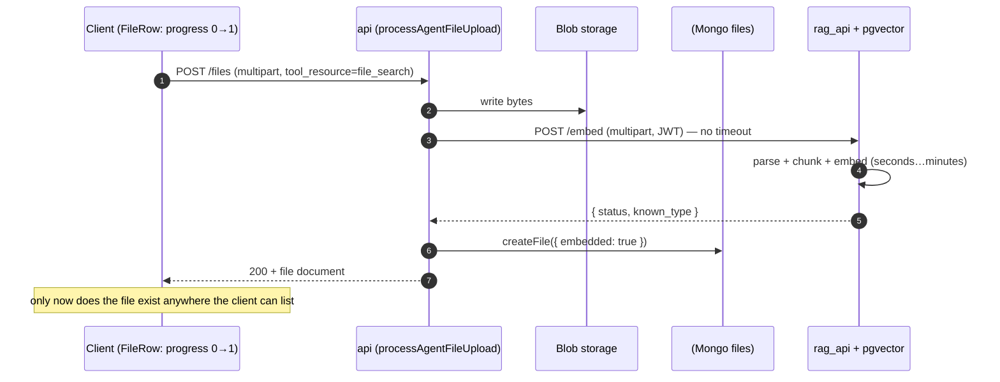
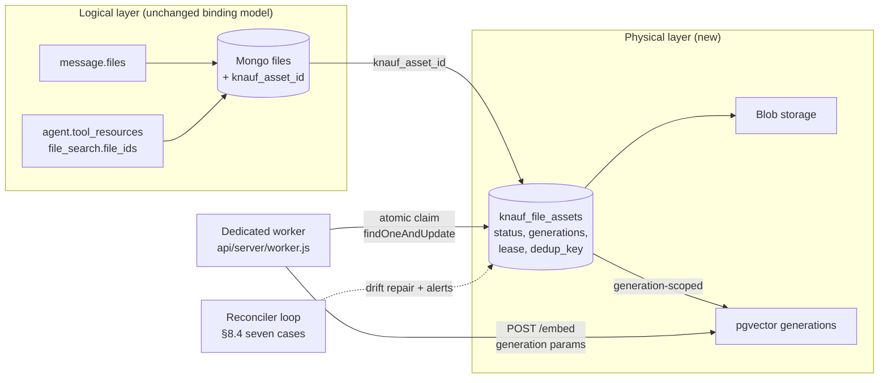
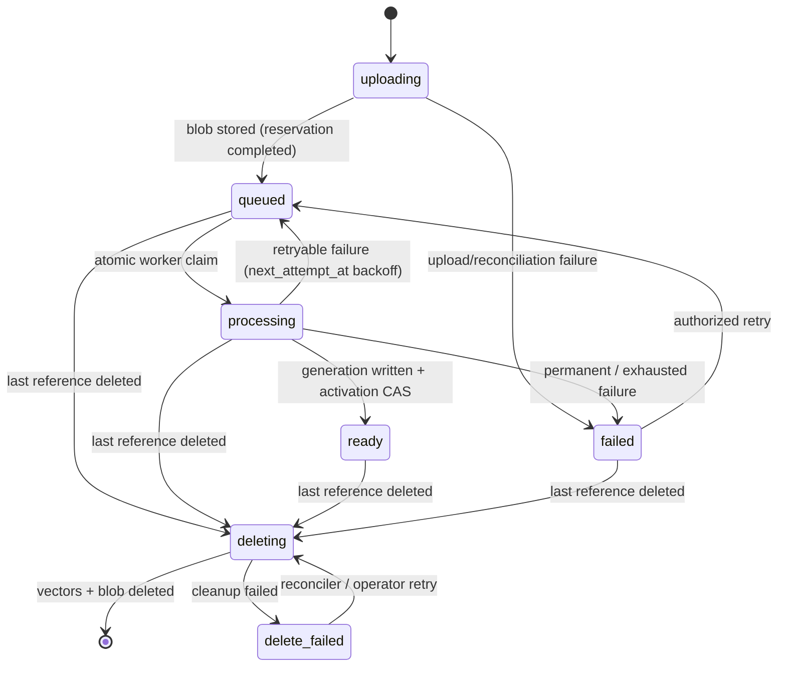
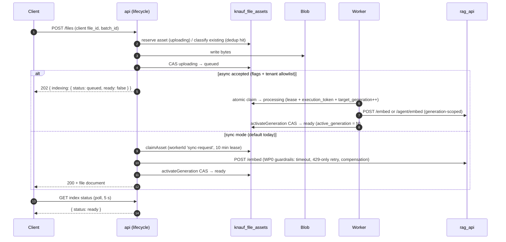

# Files — async indexing (KK20-195): before → after

How File Search ingestion changed from **synchronous embed inside the upload request** to a **durable, state-machined, worker-driven pipeline**. This doc is the before/after companion to the KK20-195 implementation (PR #143); the normative design is the accepted plan `knauf/docs/implementation-plans/async-file-indexing-production.md` (lands with PR #113 — until then see PR #113's branch).

Read [`overview.md`](./overview.md) for the upload-path taxonomy and [`rag-search.md`](./rag-search.md) for the rag_api/pgvector mechanics — both still accurate; this doc covers what sits **between** them: the indexing lifecycle.

---

## 1. The 30-second version

| Dimension | Before (main) | After (KK20-195 branch) |
|---|---|---|
| Embed timing | Inline in the `POST /files` request — the HTTP response waits for rag_api chunk+embed | Reservation-first: blob + `FileAsset` row written, embed either inline (sync mode, default) or by a dedicated worker (async mode, flagged) |
| Indexing state | One boolean: `File.embedded` | 7-state `KnaufFileAsset` machine: `uploading → queued → processing → ready / failed`, plus `deleting / delete_failed` |
| Failure surface | Generic upload error; silent orphans (BUG-05) | Typed `last_error_code` + sanitized detail, per-file status endpoint, user-visible retry |
| Retry | None — re-upload | Authorized retry endpoint → CAS back to `queued`; worker backoff via `next_attempt_at` |
| Concurrency safety | None (dual writes, no fencing) | Single-doc CAS + `execution_token` + generation fencing; no multi-doc transactions |
| Delete | Direct `DELETE /documents` best-effort; vectors orphan on failure | `deleting`/`delete_failed` states + reconciler retries; every delete surface funnels through FileAsset primitives |
| Dedup | Content-hash dedup (KK20-204) coupled to logical File rows | `dedup_key` (authorization scope + content hash) unique index on the physical asset |
| Client UX | Progress bar 0→1, then flash/disappear (BUG-03/04) | Explicit per-file status chip, batch summary, send gating until `ready` |
| Deployment | api container only | api + optional dedicated worker process (`npm run backend:worker`), reconciler loop |

**Nothing changed** about where bytes live (blob, [`storage.md`](./storage.md)), how retrieval works (`POST /query`, the `file_search` tool, citations — [`rag-search.md`](./rag-search.md)), or the message/agent binding model ([`overview.md`](./overview.md) §3).

---

## 2. Before — synchronous embed in the request path

On `main`, a File Search upload (chat-ephemeral §2e or agent knowledge §2f of [`overview.md`](./overview.md)) did everything inside one HTTP request:



What made this a production problem (the motivation for KK20-195):

- **The request held open for the whole embed.** Large files/batches ran into upstream proxy limits (HTTP 520s), and the RAG call had **no timeout** — a hung rag_api hung the upload forever.
- **No observable intermediate state.** The Mongo `files` doc was created only *after* embedding, so mid-ingestion files were invisible to `useGetAgentFiles()` (BUG-04) and the client's only signal was its local `progress` number (BUG-03 flash).
- **Failures were silent and unrecoverable.** An embed failure after blob write left orphaned bytes and sometimes orphaned vectors; the user saw a generic error with no retry (BUG-05). Compensation didn't exist.
- **Dual writes with no fencing.** Blob write, RAG embed, `files` insert, and (for agent knowledge) the `agent.tool_resources.file_search.file_ids` push were all independent writes — any crash between them produced permanent drift that nothing reconciled.
- **`File.embedded` was the entire state model** — a boolean that conflated "attempted", "succeeded", and "safe to query/delete".

### 2.1 WP0 — containment on the sync path (first commit series on this branch)

Before any async machinery, WP0 hardened the existing inline embed: retry **only on HTTP 429**, one overall deadline for the embed call, and compensation (best-effort vector delete) when a partial embed fails. This bounded the old failure modes without changing the architecture — and stays active as the sync path's guardrails.

---

## 3. After — the FileAsset aggregate and the durable backlog

### 3.1 Ownership split: logical `File` vs physical `KnaufFileAsset`

The core structural change: the logical `File` row (what conversations and agents reference) **no longer owns physical state**. A new aggregate owns it:

- **`KnaufFileAsset`** (collection `knauf_file_assets`, [schema](../../../../packages/data-schemas/src/schema/fileAsset.ts)) — one row per **physical object**: blob identity, vector generations, dedup, indexing status, retry/lease bookkeeping, deletion. `File` rows point at it via `knauf_asset_id` (seam in [file.ts](../../../../packages/data-schemas/src/schema/file.ts)); several File rows can share one asset (content dedup).
- **The Mongo row doubles as the work queue.** There is no Redis/queue infra: the worker claims due assets with a single atomic `findOneAndUpdate`. No multi-document transactions anywhere (plan invariant #14 — works on any topology).



### 3.2 The state machine

Implemented exactly as planned (§5 of the plan); the enum lives in [fileAsset.ts](../../../../packages/data-schemas/src/schema/fileAsset.ts), transitions in [methods/fileAsset.ts](../../../../packages/data-schemas/src/methods/fileAsset.ts) — every transition is a CAS (`findOneAndUpdate` filtered on expected status + `execution_token` where applicable), never a blind `save()`.



Searchability rule: an asset is searchable only when `status=ready` **and** `active_generation` is non-null **and** `delete_requested_at` is null.

### 3.3 Fencing: CAS + execution token + generations

Three mechanisms replace transactions:

1. **Single-document CAS** — every state write is conditional on the state it expects; a miss means someone else moved the asset and the writer stops.
2. **`execution_token`** — minted at claim time; heartbeats and completion writes are filtered on it. A worker that lost its lease (token rotated by a reclaim) can no longer write state.
3. **Generation numbers** — each claim increments `target_generation`; vectors are written under that generation and `active_generation` flips only on the activation CAS. A zombie worker finishing a stale generation writes vectors nobody activates — garbage, not corruption — and the reconciler sweeps them.

### 3.4 Upload flow, both modes

Upload is **reservation-first** ([fileSearchAssetLifecycle.js](../../../../api/server/services/Files/knauf/fileSearchAssetLifecycle.js)): reserve/adopt the asset row, write the blob, then either embed inline (sync) or stop at `queued` (async). Client-supplied `file_id` idempotency (WP3a) makes upload retries safe: a replayed request adopts the existing reservation instead of double-writing.



Upload behavior in detail:

- **Reservation branch table** (`classifyExistingAsset`): a dedup hit on a `ready` asset with the current profile is **reused** (no re-embed, mirrors the KK20-204 dedup HIT); `ready` on an older profile → `reuse_stale_profile` (re-index deferred to the worker); `failed` → retry through the same asset; `uploading|queued|processing` → **409 `file_indexing_in_progress`** (someone else's identical upload is in flight); tombstoned/`deleting`/`delete_failed` → conflict.
- **Sync failure keeps the old contract**: if the embed fails and this request created the asset, the lifecycle tombstones and removes it — a failed sync upload leaves nothing behind (plus WP0 compensation deletes the just-written blob).
- **Response code**: 202 only when async was accepted for this request and the asset isn't already `ready`; otherwise 200. The response carries an `indexing` projection `{ status, ready, retryable, error_code, queued_at }`.
- **Admission control** ([indexAdmission.js](../../../../api/server/services/Files/knauf/indexAdmission.js)) bounds the durable backlog per authorization scope before accepting new work: `KNAUF_INDEX_MAX_QUEUED_FILES` (default 20 non-terminal files) and `KNAUF_INDEX_MAX_QUEUED_BYTES` (default 500 MB); rejection is **429 `file_indexing_backlog_full`**.
- **Dedup** ([dedupKey.js](../../../../api/server/services/Files/knauf/dedupKey.js) + [contentDedup.js](../../../../api/server/services/Files/knauf/contentDedup.js)): `dedup_key = u:<user>:h:<sha256>` — authorization scope + content hash only (deliberately **not** the index profile; a profile change re-indexes the same asset through a new generation). Chat scope only; agent-library assets are never deduped.
- **Idempotent replay** ([uploadIdempotency.js](../../../../api/server/services/Files/knauf/uploadIdempotency.js)): a valid client-supplied UUID `file_id` is adopted as the logical idempotency key; a replayed request joins the existing upload (`replay`), while a `file_id` owned by someone else (`file_id_taken`) or carrying different bytes (`different_content`) is a conflict.

### 3.5 Status, retry, and readiness enforcement (WP3c)

New read-side endpoints, registered in [routes/files/files.js](../../../../api/server/routes/files/files.js) and backed by [indexStatus.js](../../../../api/server/services/Files/knauf/indexStatus.js):

| Endpoint | Purpose | Semantics |
|---|---|---|
| `GET /api/files/index-status?batch_id=<id>` | Batch progress | Owner-scoped counts per status + `terminal` flag + `failures[] {file_id, error_code, retryable}` |
| `GET /api/files/:file_id/index-status` | Per-file projection | `fileAccess`-ACL'd `{ status, ready, retryable, error_code, queued_at }` |
| `POST /api/files/:file_id/index/retry` | User-visible retry | CAS `failed → queued` → **202**; already in flight → 202 (join); already `ready` → 200; asset deleting or blob gone → **409** (`file_asset_deleting` / `file_reupload_required`) |

Readiness is enforced server-side, not just in the UI: [knaufFileIndexReadiness.js](../../../../api/server/middleware/knaufFileIndexReadiness.js) (registered in [routes/agents/chat.js](../../../../api/server/routes/agents/chat.js) before `buildEndpointOption`) rejects a chat send referencing not-ready File Search files with **409 `file_indexing_not_ready`**, and [fileSearch.js](../../../../api/app/clients/tools/util/fileSearch.js) drops not-ready assets at tool-hydration time as defense in depth. The client gate (§6) is UX; these are the enforcement.

### 3.6 Delete lifecycle (§8.1–§8.3)

Every File Search delete surface funnels through [fileAssetDelete.js](../../../../api/server/services/Files/knauf/fileAssetDelete.js): the direct `DELETE /api/files` path and the conversation cascade (both via [cascadeDeleteConvoFiles.js](../../../../api/server/services/Files/knauf/cascadeDeleteConvoFiles.js)'s dedup-aware GC), the process.js delete seam (`finalizeAssetsAfterRowDelete` — the §8.1 last-reference recount after File rows are removed), and the reconciler. The sequence is always: `tombstoneForDelete` CAS (stamps `delete_requested_at` — instantly non-searchable and blocks claims/activation mid-delete) → physical cleanup (vectors by asset id, then blob) → `removeAsset` only on confirmed success, else `delete_failed` for the reconciler to retry. Failures are recorded, never silently orphaned. This closes the "delete is metadata-only" GDPR gap of [`overview.md`](./overview.md) §5 **for File Search assets** (other paths unchanged).

### 3.7 The reconciler — §8.4, seven cases

A bounded periodic loop ([indexingReconciler.js](../../../../api/server/services/Files/knauf/indexingReconciler.js)) runs inside the worker process (default every 15 min, ≤100 docs per case per pass, each case isolated so one bad doc can't stall the pass). It repairs what it safely can and **alerts** on what it can't — every alert logs a grep-stable marker `[indexingReconciler][alert][<case>]` for the WP6 monitors:

| # | Case | Detects | Action |
|---|---|---|---|
| 1 | `stale_uploading` | `uploading` reservation older than 1 h | Unreferenced → GC; referenced with blob intent → queue; referenced without intent → visible failed/re-upload state |
| 2 | `expired_lease` | `processing` lease expired ≥30 min and never reclaimed | Alert (worker fleet not draining) |
| 3 | `dangling_file_refs` | File rows pointing at a missing asset | Alert |
| 4 | `orphan_assets` | `ready`/`failed` asset ≥24 h old with no File references | Tombstone + cleanup + remove |
| 5 | `delete_failed` | Failed physical cleanup due for retry (15 min) | `retryDelete` CAS → cleanup → remove, or re-mark + alert |
| 6 | `ready_without_generation` | `ready` with `active_generation: null` | Alert (invariant violation) |
| 7 | `migration_inconsistent` | Backfilled asset whose legacy state disagrees | Alert (needs re-upload) |

Every case advances a rotating `_id` cursor so successive passes sweep the whole space (not just the first page) even when a case leaves rows in place. The three alert-only cases (2, 6, 7) additionally report a **complete count** (a full indexed `countDocuments`, not the bounded page) so the alerted metric is never truncated at `batchLimit` and survives a worker redeploy; the bounded page just names a rotating sample for triage.

### 3.8 Generation-safe RAG contract

[generationRagClient.js](../../../../api/server/services/Files/knauf/generationRagClient.js) implements the plan-§7.2 write contract used by `agentic-karl-rag-api#16`: `embedGeneration` POSTs to the asset's `embed_route` (`/embed` or `/agent/embed`) with `generation` + `index_profile`, validates the complete `ready` response before activation, and `deleteGeneration` issues an idempotent backend-scoped `DELETE /generation`. New physical assets receive an immutable server UUID independent of the reusable logical File id, so late cleanup from an old incarnation cannot delete a new generation. The persisted sanitized filename preserves the extension used by RAG parser/OCR routing. File Search sends every physical asset with its Mongo-selected `active_generation`; generation 0 includes legacy vectors without generation metadata.

---

## 4. Feature flags and rollout modes

Three **independent** switches ([asyncIndexingConfig.js](../../../../api/server/services/Files/knauf/asyncIndexingConfig.js)) — acceptance and execution are deliberately separate so rollback can stop new async uploads while queued work drains:

| Env var | Meaning | Default |
|---|---|---|
| `KNAUF_ASYNC_FILE_INDEXING_ACCEPT` | Upload returns 202 after blob + `queued` (async acceptance) | off |
| `KNAUF_INDEXING_WORKER_ENABLED` | The dedicated worker claims queued work | off |
| `KNAUF_ASYNC_INDEXING_TENANTS` | Optional tenant allow-list gating acceptance during canary (empty = all) | empty |
| `KNAUF_INDEX_PROFILE` | Server-selected index profile stamped on new reservations | `legacy-v0` |

| Mode | ACCEPT | WORKER | Behavior |
|---|---|---|---|
| **Today (both off)** | off | off | Sync-through-the-asset: inline embed with WP0 guardrails, but every file now has a FileAsset row + status |
| Drain / rollback | off | on | No new async uploads; worker finishes the queued backlog |
| Canary / production | on | on | 202-accept + worker indexing (requires WP1 RAG contract + WP6 deploy/monitors) |

The worker is a separate process: `npm run backend:worker` → [api/server/worker.js](../../../../api/server/worker.js) — claim loop + reconciler, graceful SIGTERM drain (`KNAUF_WORKER_GRACE_MS`, default 60 s: stop claiming, finish in-flight work, then exit). It authenticates to rag_api exactly like the api does — `generateShortLivedToken(<owning user>)` ([`rag-search.md`](./rag-search.md) §3).

It exposes a small probe surface on `KNAUF_WORKER_PORT` (default 3081), extracted into [workerProbes.js](../../../../api/server/services/Files/knauf/workerProbes.js) so the readiness rule and the metrics mount are unit-tested:

| Probe | Meaning |
|---|---|
| `GET /health` | Liveness — the process is up (always 200). |
| `GET /ready` | Readiness — **Mongo connected AND the loop made progress recently**, where "progress" is an idle/claim tick **or** a live heartbeat during an in-flight claim. A valid long OCR/embed job (which blocks the loop in `await processNextDue` but keeps renewing its lease) therefore keeps `/ready` green; only a genuinely wedged loop trips it. Staleness window = `max(5·pollMs, 3·heartbeatMs)`. 200 when ready, 503 with `{ status, mongo, loop_last_progress_ms_ago }` otherwise. |
| `GET /metrics` | Prometheus scrape (mounted at `/metrics`), served only when `METRICS_SECRET` is set. |

Worker tuning knobs ([indexingWorker.js](../../../../api/server/services/Files/knauf/indexingWorker.js) `getWorkerConfig`; process/timeout knobs in [worker.js](../../../../api/server/worker.js) + [generationRagClient.js](../../../../api/server/services/Files/knauf/generationRagClient.js)), all env-overridable:

| Knob | Default | Meaning |
|---|---|---|
| `KNAUF_WORKER_PORT` | 3081 | Port for the `/health`, `/ready`, `/metrics` probes |
| `KNAUF_WORKER_GRACE_MS` | 60 s | SIGTERM drain window: stop claiming, finish in-flight, then exit |
| `KNAUF_WORKER_POLL_MS` | 5 s | Idle sleep between claim attempts (one asset per iteration) |
| `KNAUF_WORKER_LEASE_MS` | 5 min | Claim lease; expired `processing` leases become reclaimable |
| `KNAUF_WORKER_HEARTBEAT_MS` | 30 s | Token-fenced lease renewal; a CAS miss = ownership lost, stop writing state. Also feeds `/ready` liveness |
| `KNAUF_WORKER_EMBED_TIMEOUT_MS` | 30 min | Per-embed request cap (its OWN budget — NOT `RAG_EMBED_SYNC_TIMEOUT_MS`; async exists to allow long OCR) |
| `KNAUF_WORKER_ATTEMPT_CAP` | 5 | Retryable failures before `failed` (`embed_attempts_exhausted`) |
| `KNAUF_WORKER_AUTH_ATTEMPT_CAP` | 2 | 401/403 budget — fails fast to `embed_auth_config` and logs at error level |
| `KNAUF_WORKER_BACKOFF_BASE_MS` / `_MAX_MS` | 10 s / 10 min | Full-jitter exponential backoff on `next_attempt_at` |

Reconciler tuning knobs ([indexingReconciler.js](../../../../api/server/services/Files/knauf/indexingReconciler.js) `getReconcilerConfig`), env-overridable:

| Knob | Default | Meaning |
|---|---|---|
| `KNAUF_RECONCILE_INTERVAL_MS` | 15 min | Period between passes (one pass at boot, then on this interval) |
| `KNAUF_RECONCILE_BATCH_LIMIT` | 100 | Max docs scanned per case per pass (bounded, indexed) |
| `KNAUF_RECONCILE_STALE_UPLOADING_MS` | 1 h | Case 1: `uploading` reservation older than this is stale |
| `KNAUF_RECONCILE_STALE_LEASE_MS` | 30 min | Case 2: a `processing` lease expired this long ago = fleet not draining → alert |
| `KNAUF_RECONCILE_ORPHAN_ASSET_MS` | 24 h | Case 4: `ready`/`failed` asset older than this with no File refs is an orphan |
| `KNAUF_RECONCILE_DELETE_RETRY_MS` | 15 min | Case 5: `delete_failed`/`deleting` due for another cleanup attempt |

Admission + upload-path knobs ([indexAdmission.js](../../../../api/server/services/Files/knauf/indexAdmission.js), [fileSearchAssetLifecycle.js](../../../../api/server/services/Files/knauf/fileSearchAssetLifecycle.js)):

| Knob | Default | Meaning |
|---|---|---|
| `KNAUF_INDEX_MAX_QUEUED_FILES` | 20 | Per-scope non-terminal file cap; over it → 429 `file_indexing_backlog_full` |
| `KNAUF_INDEX_MAX_QUEUED_BYTES` | 500 MB | Per-scope non-terminal byte cap. Reserve-first: a reservation records `reserved_bytes` before the blob exists, so concurrent uploads converge on the cap instead of each reading 0 |
| `KNAUF_ASSET_RECLAIM_STALE_MS` | 15 min | Flags-off only: how old an abandoned `uploading`/`queued` reservation must be before the upload path reclaims its dedup slot |

Error classification mirrors the plan §5.3 table: 408/429/5xx/connection-reset → retryable (backoff, honors `Retry-After`); other 4xx → permanent (`embed_permanent`); 401/403 → configuration/auth (limited retry + alert); heartbeat/completion CAS miss → ownership lost (no state write, clean own generation only).

**Observability (WP0):** three Prometheus metrics in [packages/api/src/app/metrics.ts](../../../../packages/api/src/app/metrics.ts), registered only when `METRICS_SECRET` is set and carrying bounded tags only (route/outcome/status class — never ids or filenames): `knauf_file_index_embed_duration_seconds`, `knauf_file_index_provider_errors_total`, `knauf_file_index_embed_retries_total`.

---

## 5. Running locally (worker + async mode)

Local dev runs the API and the worker **on the host**, against the compose datastores. The `api` compose service stays off (`profiles: [manual-start]`, see [CLAUDE.md](../../../../CLAUDE.md)). Nothing here needs the two flags on — with both off you still get the full FileAsset lifecycle on the sync path; turn them on only to exercise the worker/queue.

> **WP1 caveat — read first.** The deployed and local `rag_api` do **not** implement the generation-safe contract yet (`generation`/`index_profile` fields, `DELETE /generation`; §3.8). So with async **on**, the worker's embed call fails against the legacy image (4xx/404) and the asset rides the §5.3 retry/backoff path. That is the expected local outcome until WP1: end-to-end "queued → ready" indexing is **not** verifiable locally today. What you *can* verify locally: reservation + `queued`, the atomic claim, lease/heartbeat, retry/backoff + `stale_generations`, the reconciler passes, the probes, and SIGTERM drain. (The spec suites cover the embed happy-path against an in-memory fake RAG.)

### 5.1 Datastores

```bash
docker compose up -d mongodb meilisearch vectordb rag_api
```

Host ports (from [docker-compose.override.yml](../../../../docker-compose.override.yml)): Mongo `localhost:27018`, rag_api `localhost:8010`.

### 5.2 `.env`

The API and the worker read the **same** `.env`. For a host run set:

```bash
MONGO_URI=mongodb://localhost:27018/LibreChat
RAG_API_URL=http://localhost:8010
# Worker execution ON so the claim loop runs (safe: acceptance below is still off,
# so the queue stays empty until you opt a file in).
KNAUF_INDEXING_WORKER_ENABLED=true
# Acceptance OFF by default — flip to true only for the async walkthrough in §5.4.
KNAUF_ASYNC_FILE_INDEXING_ACCEPT=false
# Optional: serve /metrics on the worker probe port.
# METRICS_SECRET=<any-non-empty-value>
```

Leave both flags `false` to keep production defaults; §5.4 flips acceptance on temporarily.

### 5.3 Run the API and the worker

```bash
# terminal 1 — API on :3080
npm run backend:dev

# terminal 2 — worker on :3081 (exits cleanly if KNAUF_INDEXING_WORKER_ENABLED != true)
npm run backend:worker
```

Expected worker boot: `Connected to MongoDB` → `health/ready/metrics listener on :3081` → one reconciler pass → idle claim loop (`pollMs`). Probe it:

```bash
curl -s localhost:3081/health           # -> ok
curl -s localhost:3081/ready            # -> {"status":"ready","mongo":true,...} (200)
curl -s localhost:3081/metrics          # knauf_file_index_* (only if METRICS_SECRET is set)
```

SIGTERM drain (§5.2 semantics): `kill -TERM <worker-pid>` → logs `stop claiming, draining in-flight work` → clean exit within `KNAUF_WORKER_GRACE_MS`.

### 5.4 Exercise the async path (queue + claim)

1. Set `KNAUF_ASYNC_FILE_INDEXING_ACCEPT=true` and restart the API (the worker can keep running).
2. Upload a document to a chat's File Search (or an agent's knowledge). The response is **202** `{ indexing: { status: "queued", ready: false } }`; the row shows "Indexing…"; the asset is `queued`.
3. The worker claims it (`claimed <asset_id> … generation N`), calls the embed route, and — per the WP1 caveat — the legacy rag_api rejects it → the worker requeues with backoff (`next_attempt_at`) or, after the attempt cap, marks it `failed`. Watch the asset transition and `attempt_count`/`stale_generations` in Mongo, and the reconciler pass counts in the worker log.
4. The file's retry endpoint (`POST /api/files/:file_id/index/retry`) answers `202` (re-queue) while the worker is enabled, or `409 indexing_worker_unavailable` when it is off.
5. **Turn acceptance back OFF** (`KNAUF_ASYNC_FILE_INDEXING_ACCEPT=false`) and restart the API — the sync path resumes for everyone else.

### 5.5 In-cluster (WP6, after Part A merges)

Dev deploys the worker as its own service with the acceptance flag off (an enabled worker polling an empty queue safely validates image/command/probes/metrics/SIGTERM in-cluster). `argocd app diff agentic-karl-dev-agentic-karl-worker` → sync → pod `Ready` via `/ready`; `kubectl logs` show the idle claim loop; `kubectl exec … curl localhost:3081/metrics` shows `knauf_file_index_*`. Tracked in the WP6 deployment plan, not this branch.

---

## 6. Client — from progress bar to status machine

Before: `ExtendedFile.progress` (0→1) was the only signal; `progress === 1` meant "done" even while ingestion was still running or had failed.

After (WP5a/WP5b):

- **`ExtendedFile` carries an `indexing` projection** (plus `knauf_upload_batch_id`), captured from the upload response body by `useFileHandling` and kept fresh by polling — status comes from the server, not inferred from upload progress. Predicates live in [fileIndexing.ts](../../../../client/src/knauf/common/fileIndexing.ts).
- **[useKnaufIndexStatus.ts](../../../../client/src/knauf/hooks/Files/useKnaufIndexStatus.ts)** polls per-file index status every 5 s — only for files whose upload finished (`progress ≥ 1`) but whose indexing is still pending — and stops when nothing is pending. `ready` flips the file's `embedded` flag.
- **Send gating**: `ChatForm` disables the send button while any attachment is still indexing (`hasPendingIndexing`), and `useChatFunctions` strips non-ready files from the submitted message (`filterIndexReadyFiles`) — mirroring the server 409 gate.
- **Agent knowledge UX**: each row renders inline state ([KnaufFileIndexingStatus.tsx](../../../../client/src/knauf/components/Files/KnaufFileIndexingStatus.tsx)): spinner while pending, error + retry button on `failed`, nothing when ready. Multi-file uploads share one `knauf_upload_batch_id`; [KnaufBatchIndexSummary.tsx](../../../../client/src/knauf/components/Files/KnaufBatchIndexSummary.tsx) polls the batch endpoint and shows "X of Y ready" until the batch is terminal. Strings in `com_knauf_file_indexing_*` keys (en/de).

This resolves the BUG-03/BUG-04 flash-and-disappear class and gives BUG-05 (silent CSV failure) a visible error + retry.

---

## 7. What deliberately did NOT change

- **Retrieval presentation** — ranking, citations and `RAG_USE_FULL_CONTEXT` are unchanged ([`rag-search.md`](./rag-search.md)); query requests now add the authoritative active-generation filter described in §3.8.
- **Storage** — `fileStrategy` adapters, SAS serving: untouched ([`storage.md`](./storage.md)). FileAsset stores a **stable blob identity**, never a SAS URL.
- **Binding model** — message-level vs agent-level visibility ([`overview.md`](./overview.md) §3).
- **Non-File-Search paths** — vision, upload-as-text, code files, provider uploads: no FileAsset involvement.
- **Legacy files** — a File row without `knauf_asset_id` projects as `ready` (legacy compatibility); WP2d backfills FileAsset rows for existing File Search files (batched, resumable, admin-triggered via [routes/knauf/fileAssetMigration.js](../../../../api/server/routes/knauf/fileAssetMigration.js)).

## 8. Open ends (tracked, not in this repo/branch)

- **WP1** — merge and deploy the generation-safe contract in `agentic-karl-rag-api#16`, then pass its integration/fault-test gate before enabling async acceptance.
- **WP6** — worker deployment (agk-deployment-configs), monitors on the reconciler alert markers, fault-injection tests; only then flip the two flags.
- **§17 assumption ledger** in the plan — naming, dedup scope, admission caps, worker identity — awaiting ratification by the plan owner.
