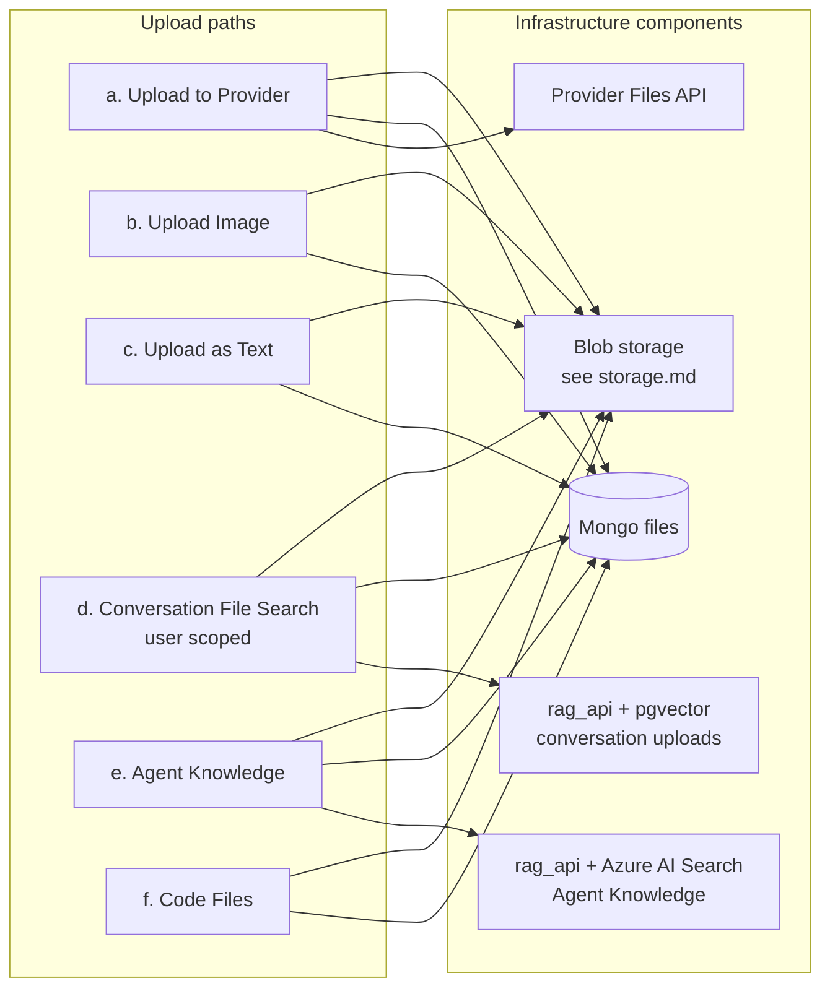
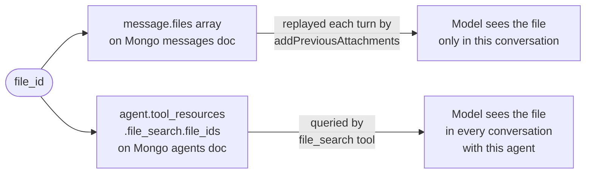
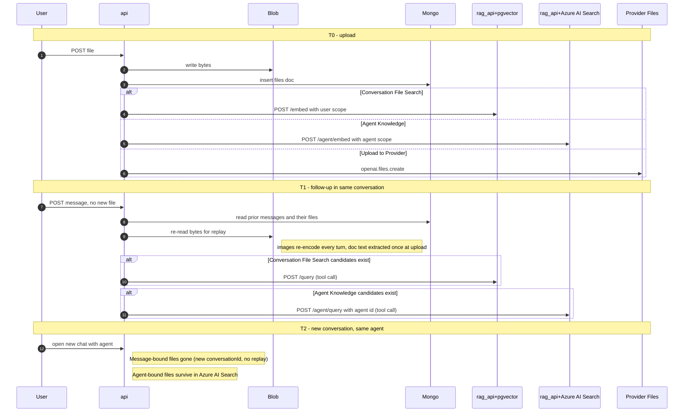

# Files — overview & upload taxonomy

The **map** of file handling in KARL: every way a file can enter, what each path does, what the model actually receives, and how long the file survives. Start here, then follow the links into the two domain docs for depth.

> This doc owns the cross-cutting picture (the diagrams, the binding model, lifecycle, delete, config). It deliberately does **not** repeat storage or retrieval mechanics:
> - **[`storage.md`](./storage.md)** — where the bytes live: the `fileStrategy` adapters and the Azure SAS / serving / refresh machinery.
> - **[`rag-search.md`](./rag-search.md)** — how file search splits user conversation uploads into pgvector and persistent Agent Knowledge into Azure AI Search (`rag_api`, embed/query, the `file_search` tool, citations).
> - **[`async-indexing.md`](./async-indexing.md)** — how File Search ingestion is tracked and executed since KK20-195: the `KnaufFileAsset` state machine, worker + reconciler, status/retry endpoints, and the before/after of the sync-embed era this doc's §2e/§2f used to imply.

---

## 1. The 30-second version

- A file enters KARL through one of **six upload paths**, chosen at upload time by the user (chat composer) or the panel context (agent builder).
- Every path writes to some subset of **five storage components**: blob storage, the Mongo `files` collection, pgvector, Azure AI Search, and the provider's own Files API.
- A file is **bound** to one of two things: a *message* (visible only inside that conversation) or an *agent* (visible in every conversation with that agent). This one distinction answers almost every "why did my file disappear / persist?" question — §3.
- Conversation deletion runs best-effort, reference-aware cleanup for Mongo file rows, blobs, and vector assets. Provider-managed copies and failed cleanup attempts still need operational attention (§5).

If you remember one diagram, remember §3 (binding).

---

## 2. The six upload paths

Picked at upload time. In chat the chooser is [AttachFileMenu.tsx](../../../../client/src/components/Chat/Input/Files/AttachFileMenu.tsx) (around L199-L254); in the agent builder it's the Knauf File Search panel.

### 2a. Which infrastructure each path touches

The five storage components, in one line each (deep-dives linked):

| Component | What it is | Owner doc |
|---|---|---|
| **Blob storage** (`fileStrategy`) | The bytes. `azure_blob` today (private container, SAS-served). | [`storage.md`](./storage.md) |
| **Mongo `files`** | Metadata index — one doc per file (`user`, `file_id`, `context`, `conversationId`, `embedded`, `expiresAt`). [file.ts](../../../../packages/data-schemas/src/schema/file.ts) | this doc (§3, §5) |
| **PostgreSQL/pgvector** | User-scoped embeddings for documents uploaded from conversation turns, including agent chats. | [`rag-search.md`](./rag-search.md) |
| **Azure AI Search** | Agent-scoped embeddings for persistent Agent Knowledge uploaded in the builder. | [`rag-search.md`](./rag-search.md) |
| **Provider Files API** | Azure OpenAI's own file store, via `openai.files.create`. | §2b below |

### 2b. "Upload files" (chat) — *documents → File Search, images → vision* (KK20-190)

- **UI label**: "Upload files" (paperclip menu) — the single chat upload affordance.
- **What it does now:** this item routes **documents to user-scoped pgvector File Search** (§2e) and **images to the vision path** (§2c). The same rule applies inside an agent chat: a file uploaded from the conversation remains a user/message attachment and does not become shared Agent Knowledge. The split is per-file: [AttachFileMenu.tsx](../../../../client/src/components/Chat/Input/Files/AttachFileMenu.tsx) sets `tool_resource: file_search` on the item; [useFileHandling.ts](../../../../client/src/hooks/Files/useFileHandling.ts) drops it back to `undefined` for image files.
- **Gated by:** `isAzureWithResponsesApi && capabilities.fileSearchEnabled` ([AttachFileMenu.tsx](../../../../client/src/components/Chat/Input/Files/AttachFileMenu.tsx)). It deliberately does **not** require `fileSearchAllowedByAgent` — on a fresh ephemeral chat that flag is false, which would leave the picker offering only images + PDF (the chicken-and-egg fix). `interface.fileSearch` is **`false`** and only hides the BYOK chip (§6); it does not gate routing. `useResponsesApi` stays on (it also drives reasoning / web-search) — it's no longer what document upload depends on.
- **Provider whole-document upload (retired from chat):** previously this item sent documents whole to Azure via `uploadOpenAIFile()` ([OpenAI/crud.js#L18](../../../../api/server/services/Files/OpenAI/crud.js#L18)) so the provider parsed them each turn. That path still exists for genuinely document-capable providers (anthropic/openai/google/bedrock) but is **no longer the Knauf chat default**.
- **Binding**: message-level (§3a) for both the file_search docs and the vision images.

### 2c. Image attachment (vision)

- **`tool_resource`**: `undefined`. **Reached via** the "Upload files" item (§2b) for image files, or "Upload Image" on non-document providers.
- **Server entry**: `processImageFile()` ([process.js#L297](../../../../api/server/services/Files/process.js#L297)).
- **Reader at chat time**: `addImageURLs()` ([agents/client.js#L169](../../../../api/server/controllers/agents/client.js#L169)) → `encodeAndFormat()` reads bytes from blob and base64-encodes them. **Re-fetched + re-encoded every turn — no caching**; on `azure_blob` that's a fresh download per turn per image.
- **What the model receives**: an `{ type: 'image_url', image_url: { url: 'data:image/...;base64,...' } }` content part. **Binding**: message-level (§3a).
- **Why images don't use File Search or the provider:** `file_search` rejects images ([process.js#L492](../../../../api/server/services/Files/process.js#L492)), and images never go to the provider Files API — vision is always inline base64, independent of `useResponsesApi`. So "Upload to Provider" is **not needed** for image support. Limited to **PNG/JPG/JPEG/WebP** by the allow-list.

### 2d. Upload as Text (OCR / extraction)

- **UI label**: "Upload as Text". **`tool_resource`**: `context`.
- **When visible**: when `capabilities.contextEnabled` is true. *Not* enabled on the curated `agents` endpoint ([librechat.yaml#L463-L465](../../../../librechat.yaml#L463) lists only `file_search` + `tools`).
- **Server entry**: `processFileUpload()` → text extraction via the configured document_parser / OCR strategy (`pdf-parse`, `mammoth`, Mistral OCR, …).
- **Reader at chat time**: `encodeAndFormatDocuments()` ([BaseClient.js#L1089](../../../../api/app/clients/BaseClient.js#L1089)) injects extracted text inline into the user message. Bounded by `fileConfig.fileTokenLimit`; hard cap **15 MB extracted text** ([process.js#L539](../../../../api/server/services/Files/process.js#L539)).
- **What the model receives**: plain text concatenated into the user message. **Binding**: message-level (§3a).

### 2e. File Search — user-scoped conversation RAG

- **`tool_resource`**: `file_search`. **Surfaced in chat under the "Upload files" label** (§2b) — documents uploaded in chat take this path. Enabled by the `agents` endpoint carrying the `file_search` capability (`capabilities.fileSearchEnabled`), **not** by `interface.fileSearch` (which is `false` and only hides the BYOK chip). The standalone "Upload for File Search" menu item stays hidden (`KNAUF_SHOW_FILE_SEARCH_IN_CHAT = false`) since "Upload files" now serves it.
- **Mechanics**: see [`rag-search.md`](./rag-search.md) — `processAgentFileUpload()` stores `context=message_attachment`, embeds to pgvector under the user scope, and uses `knauf_asset_id` for per-user deduplication. The `file_search` tool queries it and feeds top chunks back.
- **What the model receives**: nothing directly — chunks arrive as a tool result. **Binding**: message-level (§3a).
- **Lifecycle:** chat deletion runs reference-aware cleanup. A shared dedup asset is removed only after no surviving conversation file row references it (§5).

### 2f. Agent Knowledge — *the persistent RAG path*

- **UI**: the Knauf agent builder's File Search panel — [KnaufFileSearch.tsx](../../../../client/src/knauf/components/Agents/KnaufFileSearch.tsx). Handles unsaved (ephemeral) agents by queuing files locally and draining once the agent is saved.
- **`tool_resource`**: `file_search`. Same upload dispatcher as §2e, but `entity_id` is the **real** agent_id, `context=agents`, and the `file_id` is pushed onto `agent.tool_resources.file_search.file_ids`. With `AZURE_SEARCH_ENABLED=true`, vectors go to Azure AI Search; current compatibility behavior falls back to pgvector when the flag is off.
- **Mechanics**: see [`rag-search.md`](./rag-search.md).
- **What the model receives**: top-k chunks via tool call. **Binding**: agent-level (§3b — persists across all conversations with the agent).

### 2g. Code Files

- **UI label**: "Upload for Code Files". **`tool_resource`**: `execute_code`.
- **Server entry**: [Code/process.js](../../../../api/server/services/Files/Code/process.js). Sets `expiresAt = now + 86400000` (24 h) at three call sites (L132, L202, L267) — **the only path that writes `expiresAt`**, so the only path the Mongo TTL index fires for.
- **Note**: `execute_code` is *not* in the curated `agents` capabilities, so it's hidden from end users today. Listed for completeness. **Binding**: message-level (§3a).

---

## 3. The two binding points

The single most important distinction in the system.

### 3a. Message-level binding

The file_id sits on the `message.files` array ([message.ts#L102](../../../../packages/data-schemas/src/schema/message.ts#L102), `Mixed`, `default: undefined`). At chat time, `BaseClient.addPreviousAttachments()` ([BaseClient.js#L1252](../../../../api/app/clients/BaseClient.js#L1252), called at [L694](../../../../api/app/clients/BaseClient.js#L694)) walks the history and re-hydrates each message's files before the whole history goes to the provider; a `seen` Set dedups across replay.

Consequence: **the model sees a message-bound file every turn for as long as that message stays in the replayed history.** New conversation → new conversationId → no replay → not seen.

Applies to: Upload to Provider, Upload Image, Upload as Text, File Search (ephemeral), Code Files.

### 3b. Agent-level binding

The file_id sits on `agent.tool_resources.file_search.file_ids` ([agent.ts](../../../../packages/data-schemas/src/schema/agent.ts)). Every authorized invocation can query the agent's Azure AI Search knowledge via the agent id; the binding is on the agent, not a message, so it persists across all conversations with that agent. Applies to: Agent Knowledge only.

### 3c. Visibility matrix

| Path | Same conversation | New conversation, same agent | New conversation, different agent | After convo deleted |
|---|---|---|---|---|
| Chat docs → pgvector File Search (§2b/§2e) | yes (tool) | no unless explicitly reattached | no | no; reference-aware cleanup runs (§5) |
| Chat images → vision (§2c) | yes (replay) | no | no | no; cleanup runs (§5) |
| Provider upload (retired from chat; non-Azure only) | yes (replay) | no | no | no (file still on provider) |
| Upload as Text (`context`, dormant) | yes | no | no | no |
| Agent Knowledge → Azure AI Search | yes (tool) | **yes** | no | n/a (agent lifecycle, not convo) |

---

## 4. Lifecycle across turns — what fires when

"User uploads at T0, follow-up at T1, new conversation at T2 with the same agent."

- Blob, Mongo `files`, and Mongo `messages` are touched on **every** upload regardless of path.
- pgvector is used by conversation File Search (§2e); Azure AI Search is used by Agent Knowledge (§2f) when enabled.
- One agent run may query both backends because it can contain both persistent agent resources and user conversation uploads.
- Provider Files API only by §2b.
- Images re-fetch + re-encode every turn; document text is extracted once at upload and stored as text on the message.

---

## 5. Conversation delete behaviour

The conversation routes call `deleteConvosWithCleanup()` from [`cascadeDeleteConvoFiles.js`](../../../../api/server/services/Files/knauf/cascadeDeleteConvoFiles.js). It collects file references before deleting messages, then runs best-effort cleanup after the conversation delete succeeds.

### What gets deleted

| # | Step | Where |
|---|---|---|
| 1 | `Conversation` and `Message` documents | upstream conversation delete |
| 2 | Tool call records and shared links | route handler |
| 3 | Unreferenced Mongo `files` rows | Knauf cascade cleanup |
| 4 | Unreferenced Blob objects | Knauf cascade cleanup |
| 5 | Unreferenced pgvector assets | `/documents`, with dedup-aware asset reference counting |
| 6 | Agent vectors encountered by generic file cleanup | `/agent/documents/{file_id}` when Azure AI Search is enabled |

### Residual behavior

Cleanup is deliberately best-effort so a storage outage does not turn a successful conversation delete into a user-visible failure.

| Resource | Survives delete | Why it matters |
|---|---|---|
| Mongo/Blob/vector assets still referenced by another conversation | yes | Shared dedup assets must survive until the last reference is removed |
| Provider Files copies (Upload to Provider) | possibly | Provider lifecycle is separate from the pgvector/Azure AI Search cleanup described here |
| Assets whose cleanup call fails | possibly | Failure is logged; operational reconciliation may still be required |
| Code sandbox files | TTL after 24 h | Only path with automatic cleanup |

---

## 6. `librechat.yaml` knobs that affect files

Cross-cutting config index. Storage-specific and RAG-specific detail lives in the respective domain docs.

### Exposed
- **`fileStrategy`** / **`fileStrategies`** — pick the blob backend (global or per-context). → [`storage.md`](./storage.md)
- **`fileConfig.serverFileSizeLimit`** — global single-upload ceiling (default 512 MB).
- **`fileConfig.fileTokenLimit`** — how much extracted document text can ride inline in a prompt (the "talk-to-doc" budget; §2d).
- **`fileConfig.endpoints.<name>`** — per-endpoint `disabled` / `fileLimit` / `fileSizeLimit` / `totalSizeLimit` / `supportedMimeTypes`. Knauf sets a **restricted allow-list** + distinct limits: chat (`azureOpenAI`) 5 files / 50 MB combined, agent (`agents`) 20 files / 100 MB combined; per-file caps are **per-category** (25 MB docs / 50 MB data / 20 MB images), enforced in code on top of the 50 MB backstop. Exact list → [`processing.md`](./processing.md) §5–6.
- **`fileConfig.ocr|text|stt.supportedMimeTypes`** — MIME routing into OCR / text-parse / speech-to-text. → [`processing.md`](./processing.md).
- **`interface.fileSearch`** — `false` — hides the BYOK file-search **chip** in the composer. It does **not** gate routing: the chat "Upload files" item routes documents to File Search whenever `endpoints.agents.capabilities` includes `file_search` (`capabilities.fileSearchEnabled`) on an Azure-Responses endpoint (§2b/§2e). → [`rag-search.md`](./rag-search.md)
- **`endpoints.agents.capabilities`** — must include `file_search` for the RAG path (`tools` + `file_search` today). → [`rag-search.md`](./rag-search.md)
- **`modelSpecs.list[].preset.useResponsesApi`** — enables the Azure Responses API (reasoning / web-search). No longer gates document upload — chat docs go to File Search regardless (§2b).

### Not exposed
- No retention / TTL / expiry for any path except the 24 h code-sandbox TTL.
- No `expires_after` on the provider Files API call and no operator-facing reconciliation control for best-effort cleanup failures.
- No `cloudfront.*` block — see [`storage.md`](./storage.md).

---

## 7. Enums & schemas worth knowing

| Concern | Path |
|---|---|
| `FileContext` enum (`message_attachment`, `agents`, `execute_code`, …) | [packages/data-provider/src/types/files.ts](../../../../packages/data-provider/src/types/files.ts) |
| `EToolResources` enum (`file_search`, `execute_code`, `context`) | [packages/data-provider/src/types/assistants.ts](../../../../packages/data-provider/src/types/assistants.ts) |
| File schema + TTL on `expiresAt` | [file.ts#L77-L80](../../../../packages/data-schemas/src/schema/file.ts#L77) |
| Message schema (`files` array, Mixed) | [message.ts#L102](../../../../packages/data-schemas/src/schema/message.ts#L102) |
| Agent schema (`tool_resources.file_search.file_ids`) | [agent.ts](../../../../packages/data-schemas/src/schema/agent.ts) |
| `documentSupportedProviders` set | [schemas.ts#L49-L64](../../../../packages/data-provider/src/schemas.ts#L49) |
| YAML schema validation | [packages/data-provider/src/config.ts](../../../../packages/data-provider/src/config.ts) |
| Current librechat.yaml | [librechat.yaml](../../../../librechat.yaml) |
