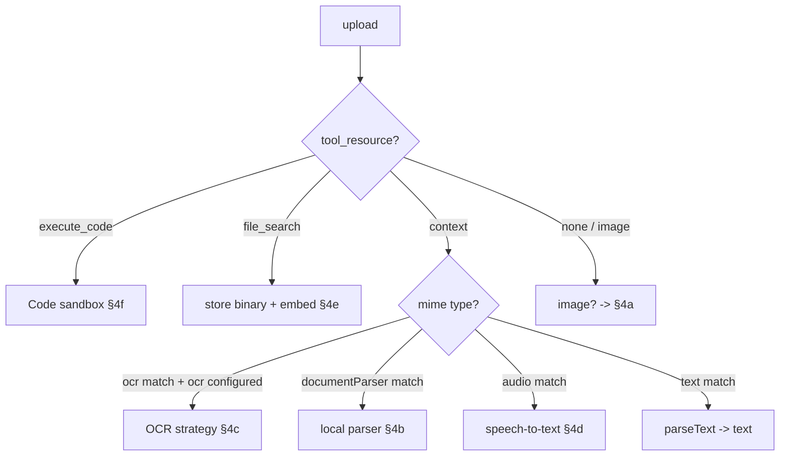

# Files — formats & content processing

Which file **formats** each upload mode accepts, where those allow-lists are defined, and **what happens to the bytes** once a file is accepted — image transforms, document parsing, OCR, speech-to-text, RAG embedding, code files.

> Part of the files docs: [`overview.md`](./overview.md) (taxonomy, binding, lifecycle) · [`storage.md`](./storage.md) (`fileStrategy` / Azure Blob) · [`rag-search.md`](./rag-search.md) (RAG / file search) · **processing.md** (this doc).
> This doc owns formats + content transformation. It does **not** repeat the RAG embed/query contract (see `rag-search.md`) or the blob-storage mechanics (see `storage.md`).

---

## 1. What's actually running today

Several processors exist in the codebase but are **dormant in this deployment** because the config that would route to them isn't set. Read this table first — it's the difference between "the code can do X" and "KARL does X today".

| Processor | Reachable today? | Why |
|---|---|---|
| **Image transform** (sharp resize/convert) | ✅ Active | Runs on every image attachment |
| **RAG embedding** (rag_api) | ✅ Active | Agent Knowledge **and chat** file_search (§4e) |
| **Local document parser** (pdfjs/mammoth/xlsx/yauzl) | ⚠ Dormant | Only the `context` ("Upload as Text") path calls it, and `context` is **not** in `endpoints.agents.capabilities` ([librechat.yaml](../../../../librechat.yaml) = `file_search` + `tools`) |
| **OCR** (Mistral / Azure / Vertex) | ⚠ Dormant | No `ocr:` block in [librechat.yaml](../../../../librechat.yaml) → no OCR strategy configured |
| **Speech-to-text** (OpenAI / Azure) | ⚠ Dormant | No `stt:` / speech block in [librechat.yaml](../../../../librechat.yaml) |
| **Provider-side parsing** (Azure "Upload to Provider") | ⚠ Retired from chat | KK20-190 repurposed the chat "Upload files" item to File Search; the provider whole-document path is no longer the chat default (`useResponsesApi` stays on for reasoning/web-search) |
| **Code files** (sandbox) | ⚠ Dormant | `execute_code` not in agent capabilities |

**The practical consequence:** KARL does **not** parse PDFs locally today. Document understanding happens via **rag_api** — for both agent knowledge *and* chat uploads (the chat "Upload files" item now embeds documents into a chat-scoped File Search corpus; see [`overview.md`](./overview.md) §2b). The local parser, OCR, and STT below are documented because the code is present and a config change would activate them — not because they run now.

---

## 2. The format allow-lists

All canonical lists live in [packages/data-provider/src/file-config.ts](../../../../packages/data-provider/src/file-config.ts) as arrays of regexes. The most important ones (verified against L180-236):

| List | Definition | Covers |
|---|---|---|
| `supportedMimeTypes` (L220-229) | `text` + `excel` + `application` + `image` + `video` + `audio` + `svg` | The general chat/agent upload allow-list |
| `imageMimeTypes` (L190) | `/^image\/(jpeg\|gif\|png\|webp\|heic\|heif)$/` | Vision / image uploads |
| `documentParserMimeTypes` (L208-214) | excel variants, `application/pdf`, `…wordprocessingml.document` (docx), ODS, ODT | What the **local** parser handles — **note: no PPTX** |
| `defaultOCRMimeTypes` (L197-205) | images, excel, pdf, docx, **pptx**, ms-word/powerpoint, epub, ODF | What OCR accepts (broader than the local parser) |
| `defaultTextMimeTypes` (L216) | `/^[\w.-]+\/[\w.-]+$/` — **permissive (any type)** | The `text` leg of the `context` path |
| `defaultSTTMimeTypes` (L218) | `audioMimeTypes` (L192) | Speech-to-text |
| `codeInterpreterMimeTypes` (L231-236) | text + excel + application + image (no video/audio) | Code-interpreter inputs |
| `retrievalMimeTypes` (L390-393) | text + json + pdf + docx/pptx | **UI-sort only** in the builder — *not* a validation gate |

Exact regexes for the families referenced above:

```js
textMimeTypes        = /^(text\/(x-c|x-csharp|tab-separated-values|x-c\+\+|x-h|x-java|html|markdown|x-php|x-python|x-script\.python|x-ruby|x-tex|plain|css|vtt|javascript|csv|xml|calendar))$/
excelMimeTypes       = /^application\/(vnd\.ms-excel|msexcel|x-msexcel|x-ms-excel|x-excel|x-dos_ms_excel|xls|x-xls|vnd\.openxmlformats-officedocument\.spreadsheetml\.sheet)$/
applicationMimeTypes = /^(application\/(epub\+zip|csv|json|msword|pdf|x-tar|x-sh|typescript|sql|yaml|x-parquet|vnd\.apache\.parquet|vnd\.coffeescript|vnd\.openxmlformats-officedocument\.(wordprocessingml\.document|presentationml\.presentation|spreadsheetml\.sheet)|vnd\.oasis\.opendocument\.(text|spreadsheet|presentation|graphics)|xml|zip))$/
imageMimeTypes       = /^image\/(jpeg|gif|png|webp|heic|heif)$/
audioMimeTypes       = /^audio\/(mp3|mpeg|mpeg3|wav|wave|x-wav|ogg|vorbis|mp4|m4a|x-m4a|flac|x-flac|webm|aac|wma|opus)$/
videoMimeTypes       = /^video\/(mp4|avi|mov|wmv|flv|webm|mkv|m4v|3gp|ogv)$/
```

**"Document families" = `applicationMimeTypes` in plain terms** — the `application/*` arm of `supportedMimeTypes` accepts: PDF (`.pdf`), Word (`.doc` = `msword`, `.docx`), PowerPoint (`.pptx`), Excel (`.xls`/`.xlsx`, via `excelMimeTypes`), OpenDocument (`.odt/.ods/.odp/.odg`), EPUB (`.epub`), plus `.json`, `.xml`, `.zip`, `.tar`, `.sh`, `.sql`, `.yaml`, `.ts`, `.parquet`, `.csv`. Combined with the other arms, the upstream `supportedMimeTypes` default is **deliberately broad** — it also allows video, audio, SVG, and ~20 source-code text types. **This deployment overrides it** with a restricted per-endpoint allow-list (§6), so most of that breadth is rejected here. The table below describes the upstream *defaults*; §6 is what's actually enforced.

### How the list is selected per upload mode

Client-side, `validateFiles()` ([client/src/utils/files.ts#L223-L319](../../../../client/src/utils/files.ts#L223)) picks the effective allow-list:

| Mode | Allow-list used |
|---|---|
| Normal chat attachment / file_search / code | `endpointFileConfig.supportedMimeTypes` (the merged per-endpoint list) |
| `tool_resource: context` ("Upload as Text") | **merge** of `text` + `ocr` + `stt` supported types ([files.ts#L276-L282](../../../../client/src/utils/files.ts#L276)) — so it accepts almost anything |
| Images | gated client-side by the file picker `accept="image/*,.heif,.heic"` |

`mergeWithDefault()` in [file-config.ts](../../../../packages/data-provider/src/file-config.ts) hands **document-supported providers** the full `supportedMimeTypes`; **azureOpenAI is excluded unless `useResponsesApi: true`** (which is why the default `karl` spec, with `useResponsesApi: true`, accepts PDFs in chat — see [`overview.md`](./overview.md) §2b). `librechat.yaml` does **not** override `supportedMimeTypes`, `ocr`, `text`, or `stt` — only the 25 MB size caps on `azureOpenAI`/`agents` ([librechat.yaml#L115-L122](../../../../librechat.yaml#L115)). Everything else is the default above.

---

## 3. How a format is routed

`processAgentFileUpload()` ([process.js#L477](../../../../api/server/services/Files/process.js#L477)) branches first on `tool_resource`, then (for `context`) on MIME type:



A guard at [process.js#L488](../../../../api/server/services/Files/process.js#L488) rejects images sent to `file_search` ("Image uploads are not supported for file search tool resources").

---

## 4. Per-format processing

### 4a. Images — **active**

`processImageFile()` ([process.js#L293](../../../../api/server/services/Files/process.js#L293)) → `sharp` resize + convert to the configured `imageOutputType` (default **PNG**, [config.ts#L1106](../../../../packages/data-provider/src/config.ts#L1106)). Resolution tiers in [images/resize.js#L17-L19](../../../../api/server/services/Files/images/resize.js#L17):

- `low` → max 512×512
- `high` (default) → short side ≤ 768, long side ≤ 2000 (**1568** for Anthropic)

**Accepted by the processor:** jpeg, gif, png, webp, heic, heif. HEIC/HEIF are decoded natively by sharp and converted to the output type. At chat time the stored image is re-fetched and base64-encoded **every turn** (see [`overview.md`](./overview.md) §2c). Stored via the active `fileStrategy` (→ [`storage.md`](./storage.md)).

> **Images vs. File Search.** `file_search` **rejects images** ([process.js#L488](../../../../api/server/services/Files/process.js#L488)). That's fine — chat images never use file_search or the provider Files API. They take the **inline vision path**: stored as a `message_attachment` (no `openai.files.create`) and sent to the model as a `data:image/...;base64,...` `image_url` part (`encodeAndFormat`, [images/encode.js#L208-L221](../../../../api/server/services/Files/images/encode.js#L208)) — independent of `useResponsesApi`. The chat "Upload files" item routes documents to file_search and images to this vision path per-file ([`overview.md`](./overview.md) §2b). The **allow-list narrows accepted images to PNG/JPG/JPEG/WebP** (§6), so gif/heic/heif are rejected at validation even though the processor could handle them.

### 4b. Documents — local parser — **dormant**

`parseDocument()` ([packages/api/src/files/documents/crud.ts](../../../../packages/api/src/files/documents/crud.ts)) dispatches by MIME via `getParserForMimeType`:

| Format | Library |
|---|---|
| PDF | `pdfjs-dist` |
| DOCX | `mammoth` |
| XLS / XLSX / ODS | `xlsx` |
| ODT | `yauzl` (streams `content.xml` out of the ZIP) |

Hard cap **15 MB** (`DOCUMENT_PARSER_MAX_FILE_SIZE`, [crud.ts#L9](../../../../packages/api/src/files/documents/crud.ts#L9), enforced [#L29](../../../../packages/api/src/files/documents/crud.ts#L29)). Output is **extracted text** stored as `FileSources.text` — the original binary is not retained by this path. Reachable only through the `context` path, which is disabled here (§1).

### 4c. OCR — **dormant**

Three strategies in [packages/api/src/files/mistral/crud.ts](../../../../packages/api/src/files/mistral/crud.ts): `mistral_ocr`, `azure_mistral_ocr`, `vertexai_mistral_ocr`. Selected by `appConfig.ocr.strategy` at [process.js#L570-L616](../../../../api/server/services/Files/process.js#L570) (falls back to `document_parser` when no OCR is configured). `getDocumentType()` ([crud.ts#L325](../../../../packages/api/src/files/mistral/crud.ts#L325)) sends images as `image_url` and everything else as `document_url`. Accepts images + PDF/office; output is markdown text (+ optional extracted images). No `ocr:` block in config → never runs today.

### 4d. Speech-to-text — **dormant**

`STTService` ([Audio/STTService.js](../../../../api/server/services/Files/Audio/STTService.js)) transcribes audio via OpenAI **or** Azure (one provider at a time). Accepted: mp3/mpeg, wav, m4a/mp4, ogg, webm, flac. Azure enforces a **25 MB** cap. Output is transcript text → `FileSources.text`. No `stt:` block in config → never runs today.

### 4e. RAG embedding — **active**

For Agent Knowledge / file_search, the raw binary is POSTed to rag_api `/embed`; rag_api does its own parsing + chunking. Whether a format is embeddable is decided by the `known_type` field in the response ([VectorDB/crud.js#L88-L101](../../../../api/server/services/Files/VectorDB/crud.js#L88)); an unsupported type surfaces as `File embedding failed. The filetype <mime> is not supported`. The embed/query contract and `entity_id` scoping are owned by [`rag-search.md`](./rag-search.md) — this doc only notes that **format acceptance for RAG is rag_api's call, not the allow-lists in §2**.

**What rag_api actually accepts** (from the external image `librechat-rag-api-dev-lite`; source: `app/utils/document_loader.py` + `known_source_ext` in `app/config.py` of [danny-avila/rag_api](https://github.com/danny-avila/rag_api) — verify against the pinned image tag, not this repo):
- **Dedicated loaders**: PDF (PyPDFLoader), DOCX (Docx2txtLoader), XLSX (UnstructuredExcelLoader), PPTX/PPT (UnstructuredPowerPointLoader), CSV (CSVLoader), Markdown, EPUB, XML, RST, JSON.
- **Text/code via `known_source_ext`**: `txt`-like + ~50 code/config extensions (py, js, ts, tsx, jsx, java, go, c, cpp, cs, rb, php, rs, swift, scala, sql, sh, bash, yaml/yml, ini, conf, env, eml, vue, svelte, …).
- **Not handled**: legacy `.doc` (only `.docx`), and any binary type without a loader → `known_type: false` → the "filetype not supported" error above. KARL therefore **excludes `.doc` from the upload allow-list** (§6) so it's rejected at upload with a clear "unsupported file type" rather than failing later at embed time (users save as `.docx`).

### 4f. Code files — **dormant**

[Code/process.js](../../../../api/server/services/Files/Code/process.js) imposes **no format restriction** — best-effort MIME sniffing, unsupported types logged but stored anyway. Sets a 24 h `expiresAt` (the only path with automatic TTL — see [`overview.md`](./overview.md) §2g). `execute_code` isn't in agent capabilities here, so it's unreachable.

### 4g. Provider-side (Upload to Provider) — **active**

No local processing. The file is sent to Azure OpenAI via `openai.files.create` and **Azure** parses it on its side every turn. The client allow-list is `supportedMimeTypes` (so image + PDF + the document families pass validation); the practical format support is whatever the Azure Responses API ingests. This is the default chat-attach path today (→ [`overview.md`](./overview.md) §2b).

---

## 5. Limits & how to change them

Two different limits are easy to confuse:

| Limit | Default | Configured today (`librechat.yaml`) | Meaning |
|---|---|---|---|
| `fileLimit` | **10** ([file-config.ts#L402](../../../../packages/data-provider/src/file-config.ts#L402)) | chat (`azureOpenAI`) **5**, agent (`agents`) **20**, `gptPlugins` 5 | Max **number of files** in one upload |
| `fileSizeLimit` | 512 MB | **50 MB** on both endpoints | Per-file backstop (see per-category below) |
| `totalSizeLimit` | 512 MB | chat **50 MB**, agent **100 MB** | Max **combined** size in one send (MB) |
| `serverFileSizeLimit` | 512 MB | unset | Hard server-side ceiling for any single upload |

**Per-category per-file caps (KK20-190)** — the schema has only one `fileSizeLimit` per endpoint, so a tighter cap is applied *on top* by `knaufCategorySizeLimit` ([file-config.ts](../../../../packages/data-provider/src/file-config.ts), client `validateFiles` + server `filterFile`), the same for both surfaces:

| Category | Per-file cap |
|---|---|
| Documents (`.pdf .docx .pptx .txt .md .json`) | **25 MB** |
| Data / spreadsheets (`.xlsx .csv`) | **50 MB** |
| Images (`.png .jpg/.jpeg .webp`) | **20 MB** |

`fileLimit`/`totalSizeLimit` are **client-side** (each file is a separate `POST /api/files`; the client validates the batch); per-file + per-category + MIME + encryption are enforced **server-side** too. All under `fileConfig.endpoints.<name>`.

### Different limits for chat vs. agent file search — *configured*

`getEndpointFileConfig()` ([file-config.ts#L547](../../../../packages/data-provider/src/file-config.ts#L547)) resolves the config by **endpoint**:
- **Chat composer** (default `karl` spec) → endpoint `azureOpenAI` → `fileConfig.endpoints.azureOpenAI`.
- **Agent file search** (builder / custom agents) → endpoint `agents` → `fileConfig.endpoints.agents`.

They're separate keys, set independently. The live values (chat tighter than agent knowledge — chat is ad-hoc, agent knowledge curated):

```yaml
fileConfig:
  endpoints:
    azureOpenAI:        # chat composer
      fileLimit: 5
      fileSizeLimit: 50   # backstop; per-category caps (25/50/20) apply on top
      totalSizeLimit: 50
    agents:             # agent file_search / knowledge
      fileLimit: 20
      fileSizeLimit: 50
      totalSizeLimit: 100
```

Values are MB; the loader ([file-config.ts](../../../../packages/data-provider/src/file-config.ts)) converts to bytes. The endpoint `fileLimit`/`fileSizeLimit`/`totalSizeLimit` are **Tier 0** (config only); the per-category caps live in code (`knaufCategorySizeLimit`, Tier 5).

---

## 6. Allow-list & encrypted-file rejection (configured)

> Policy: accept **only** these and reject everything else with a clear error:
> **Documents** `.pdf .docx .txt .md .json .pptx` · **Data** `.csv .xlsx` · **Images** `.png .jpg .jpeg .webp`. **Encrypted / password-protected files are rejected on upload.**

**Allow-list — implemented (Tier 0).** `supportedMimeTypes` is overridden on both `azureOpenAI` (chat) and `agents` (shared via a YAML anchor) in [librechat.yaml](../../../../librechat.yaml). Everything outside the list — video, audio, SVG, **GIF/HEIC/HEIF** (note: WebP **is** allowed), archives, legacy Office binaries `.doc`/`.xls`, the ~50 code/config types — is now rejected:

```yaml
fileConfig:
  endpoints:
    azureOpenAI:
      supportedMimeTypes: &knauf_allowed_mime
        - "^application/pdf$"                                                                 # .pdf
        - "^application/vnd\\.openxmlformats-officedocument\\.wordprocessingml\\.document$"   # .docx
        - "^application/vnd\\.openxmlformats-officedocument\\.presentationml\\.presentation$" # .pptx
        - "^application/vnd\\.openxmlformats-officedocument\\.spreadsheetml\\.sheet$"         # .xlsx
        - "^application/(csv|json)$"                                                          # .json + .csv (application/*)
        - "^text/(plain|markdown|csv)$"                                                       # .txt .md .csv (text/*)
        - "^image/(png|jpeg|webp)$"                                                           # .png .jpg .jpeg .webp
    agents:
      supportedMimeTypes: *knauf_allowed_mime
```

Enforced client-side ([files.ts#L284](../../../../client/src/utils/files.ts#L284)) and server-side ([process.js#L1039](../../../../api/server/services/Files/process.js#L1039)). Caveats: `.jpg`/`.jpeg` are both `image/jpeg`; `.csv` is `text/csv` *or* `application/csv` (both listed). Legacy binary `.doc` is **not** accepted (only `.docx`) — rag_api can't embed it (§4e), so it's excluded from the allow-list rather than failing at embed time.

**Encrypted / password-protected rejection — implemented (Tier 5), PDF + OOXML.** A provider-agnostic guard `detectEncryptedFile(buffer, mimetype)` ([packages/api/src/files/validation.ts](../../../../packages/api/src/files/validation.ts), `[knauf]` block) runs in the upload route ([files.js](../../../../api/server/routes/files/files.js), right after `filterFile`) on **all** endpoints — intentionally not gated to the Knauf endpoints, since an encrypted PDF/OOXML is unprocessable everywhere:
- **PDF** → reject if the bytes contain `/Encrypt`.
- **OOXML** (`.docx/.xlsx/.pptx`) → a normal file is a ZIP (`PK\x03\x04`); an encrypted one is an OLE/CFBF compound file (magic `D0CF11E0`). Declared-OOXML + CFBF magic ⇒ reject.

The user sees *"This file is password-protected or encrypted. Please upload an unprotected copy."* (the `password-protected` fragment is whitelisted in `resolveUploadErrorMessage` so it reaches the client). **Scope notes:** ZIP isn't covered because `.zip` isn't in the allow-list; legacy binary `.doc`/`.xls` aren't in the allow-list either (rag_api can't embed them), so they're out of scope. Replaces the old Anthropic-only `validateAnthropicPdf` gap.

---

## 7. Pointers

| Concern | File |
|---|---|
| Canonical MIME allow-lists + size limits | [packages/data-provider/src/file-config.ts](../../../../packages/data-provider/src/file-config.ts) (L180-236, L399-446) |
| Per-mode allow-list selection (validation) | [client/src/utils/files.ts#L223-L319](../../../../client/src/utils/files.ts#L223) |
| `documentSupportedProviders` gate | [packages/data-provider/src/schemas.ts#L49-L64](../../../../packages/data-provider/src/schemas.ts#L49) |
| Upload routing by tool_resource / mime | [api/server/services/Files/process.js#L477-L733](../../../../api/server/services/Files/process.js#L477) |
| Image resize / convert | [api/server/services/Files/images/](../../../../api/server/services/Files/images/) (`resize.js`, `convert.js`, `encode.js`) |
| Local document parser | [packages/api/src/files/documents/crud.ts](../../../../packages/api/src/files/documents/crud.ts) |
| OCR strategies | [packages/api/src/files/mistral/crud.ts](../../../../packages/api/src/files/mistral/crud.ts) |
| Speech-to-text | [api/server/services/Files/Audio/STTService.js](../../../../api/server/services/Files/Audio/STTService.js) |
| RAG embedding (format = `known_type`) | [api/server/services/Files/VectorDB/crud.js#L88-L101](../../../../api/server/services/Files/VectorDB/crud.js#L88) |
| Code files | [api/server/services/Files/Code/process.js](../../../../api/server/services/Files/Code/process.js) |
