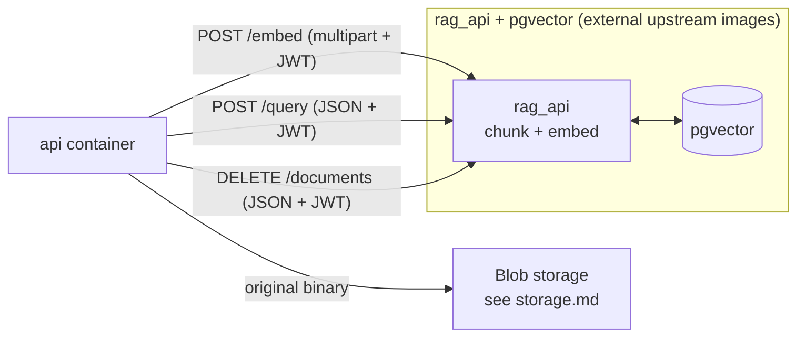
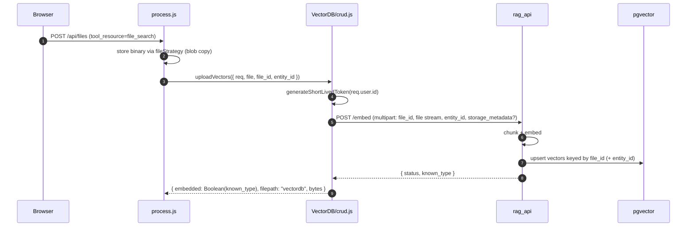
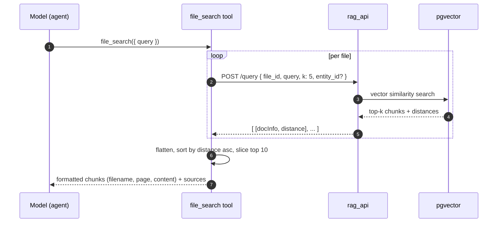

# Files — RAG & file search

How file search works: the `rag_api` + pgvector pipeline, the embed/query/delete HTTP contract, `entity_id` scoping (ephemeral vs persistent agent), the `file_search` tool, and citation rendering. This is the machinery behind the two file_search upload paths in [`overview.md`](./overview.md) §2e / §2f.

> Part of the files docs: [`overview.md`](./overview.md) (taxonomy, binding, lifecycle) · [`storage.md`](./storage.md) (`fileStrategy` / Azure Blob) · **rag-search.md** (this doc).
> Storage of the original bytes is a separate concern — file_search **also** writes the binary to the blob backend (so the original is downloadable). This doc covers only the vector side; see [`storage.md`](./storage.md) for the blob copy.

---

## 1. The 30-second version

- `rag_api` + `vectordb` (pgvector) are **external upstream images** — not in this repo. `rag_api` (`registry.librechat.ai/danny-avila/librechat-rag-api-dev-lite:latest`) owns chunking + embedding; the embedding model is configured *inside* that image via env (an Azure OpenAI text-embedding deployment).
- LibreChat only talks **HTTP** to `rag_api`, JWT-signed via `generateShortLivedToken(userId)`: `POST /embed` to ingest, `POST /query` to retrieve, `DELETE /documents` to clean up.
- Every call carries an **`entity_id`** that scopes the vectors. For Agent Knowledge it's the real `agent_id` (persistent); for chat-time File Search it's an **ephemeral** agent_id that dies with the conversation.
- At chat time the model never sees the document directly — the agent calls the `file_search` **tool**, which queries pgvector and feeds the top chunks back as a tool result. Optional **citations** are filtered by relevance and capped.
- **Now reachable from chat (KK20-190):** the chat "Upload files" item routes documents into this pipeline via an ephemeral agent ([overview.md](./overview.md) §2b). **Lifecycle caveat:** deleting the chat does *not* delete the embedded file — bytes + Mongo doc + pgvector vectors orphan (§5; cascade cleanup is a deferred follow-up).

---

## 2. Architecture



- **Dual write at ingest.** A file_search upload lands in *two* places: the binary in blob storage (downloadable original) and the embeddings in pgvector. `uploadVectors()` returns `filepath: FileSources.vectordb` for the embedding side; the blob copy is handled by the storage strategy.
- **Tenant isolation depends on `entity_id`.** pgvector documents are addressed by `file_id`; isolation between agents/conversations is enforced by passing `entity_id` on every call and filtering on it inside `rag_api`. Application-side, [`filterFilesByAgentAccess()`](../../../../api/server/services/Files/permissions.js) gates which file_ids a user+agent may search.

Only the two file_search paths touch this component. Every other upload path (provider, image, text, code) bypasses it entirely.

---

## 3. Ingest — `POST /embed`

`uploadVectors()` in [VectorDB/crud.js#L67-L120](../../../../api/server/services/Files/VectorDB/crud.js#L67), called from `processAgentFileUpload()` ([process.js#L662](../../../../api/server/services/Files/process.js#L662)).



Request (multipart form-data, `Authorization: Bearer <jwt>`):

| Field | Notes |
|---|---|
| `file_id` | LibreChat-internal UUID — the pgvector key |
| `file` | the raw file stream (`fs.createReadStream(file.path)`) |
| `entity_id` | the agent_id (real or ephemeral) — only sent when present |
| `storage_metadata` | optional JSON, stored alongside the embeddings for the dual-storage pattern |

Response handling: `known_type === false` → throws "filetype not supported"; missing `status` → throws "File embedding failed". On success the file doc's `embedded` flag is set to `Boolean(known_type)` — which is what later gates `deleteVectors` (§6). **Which formats embed is rag_api's call, not the client allow-lists** — see [`processing.md`](./processing.md) §4e.

---

## 4. Parser routing & the rag_api overlay (Azure DI + spreadsheets)

What `rag_api` does with a file *before* embedding is extended by a thin Knauf Docker overlay (`knauf/rag-api-overlay/`, built `FROM` the upstream rag_api image). Its `get_loader()` ([document_loader.py](../../../rag-api-overlay/document_loader.py)) routes by extension:

| Input | Parser | Notes |
|---|---|---|
| pdf, docx, pptx, html | `_AzureDIWithFallback` | Azure AI Document Intelligence (OCR + layout → markdown); on any DI error → upstream loader, so an upload never hard-fails |
| `.xlsx` | `_LeanExcelLoader` | one self-describing record per row + a summary guard for huge workbooks (below) |
| csv, txt, md, json, legacy `.xls` | upstream langchain loaders | DI adds nothing here |

After parsing, the **single** `RecursiveCharacterTextSplitter` (`CHUNK_SIZE=1500`, `CHUNK_OVERLAP=100` — character-based, not table-aware) chunks the text; each chunk is embedded with Azure OpenAI `text-embedding-3-large` into pgvector. Routing choices are evidence-based — see the benchmark harness in [knauf/parser-eval/](../../../parser-eval/).

### Spreadsheets (`.xlsx`) — why they're special
A spreadsheet rendered as one markdown table is a single giant block; the character splitter cuts it mid-table and the header survives only in the first chunk. `_LeanExcelLoader` instead emits **one self-contained line per row** — `(<sheet>) Header: value; Header: value; …` — after dropping empty rows/cols and picking the header row (the most-populated of the first 8, so a title row doesn't poison labels). Each record is `< CHUNK_SIZE`, so every chunk keeps whole rows *with* their headers. **Large-workbook guard:** if the assembled text exceeds `RAG_XLSX_MAX_CHARS` (default 1.5M), it emits a per-sheet summary (first `RAG_XLSX_SUMMARY_ROWS`=50 rows/sheet) so a ~20k-row workbook ingests in seconds instead of becoming ~13k chunks. Such a workbook can be described/sampled but **not counted/aggregated** — that's the text-to-SQL gap below.

### Large tabular data → text-to-SQL (future, out of scope)
Semantic RAG retrieves *similar chunks*; it can't answer "how many users at site C0202?" — counting/filtering across all rows needs structured retrieval. The documented next step: load structured files into relational tables (DuckDB/Postgres), have the LLM generate SQL from the registered schema, run it read-only (statement timeout + row caps), and route on file type (documents → RAG, spreadsheets/structured → text-to-SQL). Not in the current rollout.

**Overlay config + code map:** the authoritative env reference (the DI endpoint gotcha, fallback behaviour, `RAG_AZURE_DI_*`, `RAG_XLSX_*`) lives in [knauf/rag-api-overlay/README.md](../../../rag-api-overlay/README.md); the parser routing / DI fallback / xlsx loader live in [document_loader.py](../../../rag-api-overlay/document_loader.py) (`get_loader`, `_AzureDIWithFallback`, `_LeanExcelLoader`); rollout status is in [rag-azure-di-rollout.md](../../implementation-plans/rag-azure-di-rollout.md).

---

## 5. Retrieve — the `file_search` tool + `POST /query`

The model never receives the document. Instead the agent is given a `file_search` tool ([fileSearch.js#L88](../../../../api/app/clients/tools/util/fileSearch.js#L88)); when it calls the tool with a `query`, the backend fans out one `/query` per file and merges the results.



- **Per-file query, `k: 5`.** Each file is queried independently with `k=5`; results across all files are flattened, sorted by ascending `distance` (closer = more relevant), and the **top 10** overall are kept.
- **`entity_id` is the scope.** Passed through from how the agent was loaded — real agent_id for persistent knowledge, ephemeral for chat-time. Without it, the body omits `entity_id` and relies on `file_id` alone.
- **Access filtering** happens *before* the query: `getFiles` + `filterFilesByAgentAccess()` build the candidate `files` list, so a user can only search file_ids they're entitled to via the agent.
- **Tool context string.** The tool description lists the loaded filenames; files just attached in chat are tagged `(just attached by user)` vs. files that are part of the agent's curated knowledge.

### Automatic context augmentation (separate from the tool)

Beyond the on-demand tool, an attached embedded file **also** gets context injected into the prompt automatically by `createContextHandlers` ([api/app/clients/prompts/createContextHandlers.js](../../../../api/app/clients/prompts/createContextHandlers.js)), invoked only on the **chat / non-agents path** ([agents/client.js#L239](../../../../api/server/controllers/agents/client.js#L239): `!isAgentsEndpoint(endpoint)`). The `RAG_USE_FULL_CONTEXT` env var controls *how much*:

| `RAG_USE_FULL_CONTEXT` | What's injected each turn | Endpoint behaviour |
|---|---|---|
| **`false`** (our setting) | top-k (**k=4**) chunks relevant to the user's message, as bounded `<contextItem><![CDATA[…]]>` blocks (`POST /query`) | chat (`azureOpenAI` ephemeral) only |
| `true` | the **entire** parsed document (`GET /documents/{id}/context`) — heavy for large files | chat only |

> **Asymmetry:** custom **agents** (endpoint `agents`) skip `createContextHandlers` entirely — they're **tool-only** (no auto-injection). The chat path augments context (top-k) *and* exposes the `file_search` tool (k=5). We keep `RAG_USE_FULL_CONTEXT=false` so chat uploads don't dump the whole document into the prompt.

---

## 6. Delete — `DELETE /documents`

`deleteVectors()` in [VectorDB/crud.js#L20](../../../../api/server/services/Files/VectorDB/crud.js#L20). **Guarded by `file.embedded`** — only files that actually embedded are deleted from pgvector:

```js
DELETE {RAG_API_URL}/documents
Authorization: Bearer <jwt>
body: [ file.file_id ]
```

A 404 is tolerated (already gone); other non-2xx statuses throw so the file isn't marked deleted while its vectors linger.

> **Caveat — orphaned vectors.** This only fires on explicit *file* delete. Deleting a **conversation** does not call it (see [`overview.md`](./overview.md) §5), so chat-time file_search vectors (ephemeral agent) orphan in pgvector when the conversation is removed.

---

## 7. Citations

When `interface.fileCitations: true` ([librechat.yaml#L87](../../../../librechat.yaml#L87)), `file_search` results are turned into inline citations by `processFileCitations()` ([Citations/index.js](../../../../api/server/services/Files/Citations/index.js)).

| Knob | Default | Source |
|---|---|---|
| `minRelevanceScore` | `0.45` | `endpoints.agents.minRelevanceScore` ([Citations/index.js#L60](../../../../api/server/services/Files/Citations/index.js#L60)) |
| `maxCitations` | `30` | `endpoints.agents.maxCitations` ([#L57](../../../../api/server/services/Files/Citations/index.js#L57)) |
| `maxCitationsPerFile` | `5` | `endpoints.agents.maxCitationsPerFile` ([#L58](../../../../api/server/services/Files/Citations/index.js#L58)) |

Flow: filter sources by `relevance >= minRelevanceScore` → `applyCitationLimits(sources, maxCitations, maxCitationsPerFile)` → enhance with file metadata (filename, page) → inject into the response. Note the `karl` system prompt also instructs the model to list at most 3 sources ([librechat.yaml#L214](../../../../librechat.yaml#L214)) — that's a *prompt-level* nudge, separate from this *server-level* citation pipeline.

---

## 8. Config & scoping summary

- **`interface.fileSearch`** — `false` (KK20-190): hides the BYOK file-search **chip** only. Routing of the chat **"Upload files"** item to File Search is gated on **`endpoints.agents.capabilities`** carrying `file_search` (`capabilities.fileSearchEnabled`), not on this flag ([overview.md](./overview.md) §2b). The standalone "Upload for File Search" menu item stays hidden (`KNAUF_SHOW_FILE_SEARCH_IN_CHAT = false` in [AttachFileMenu.tsx](../../../../client/src/components/Chat/Input/Files/AttachFileMenu.tsx)) because "Upload files" now serves it.
- **`endpoints.agents.capabilities`** — must include `file_search` for the agent RAG path to exist ([librechat.yaml#L141-L143](../../../../librechat.yaml#L141): `tools` + `file_search`).
- **`endpoints.agents.{minRelevanceScore,maxCitations,maxCitationsPerFile}`** — citation tuning (§6).
- **`RAG_API_URL`** — env var; if unset, `uploadVectors` throws and `file_search` returns an auth/error string. Embedding model + chunking are configured inside the `rag_api` image, not here.

`entity_id` lifecycle, restated:

| Path | `entity_id` | Vectors survive… |
|---|---|---|
| Agent Knowledge (§2f) | real `agent_id` | as long as the agent exists |
| Chat-time File Search (§2e) | ephemeral agent_id | only the conversation (then orphan — §5) |

---

## 9. Where the code lives

| Concern | File |
|---|---|
| Ingest / delete vectors (HTTP to rag_api) | [`api/server/services/Files/VectorDB/crud.js`](../../../../api/server/services/Files/VectorDB/crud.js) |
| Agent file upload dispatcher (calls uploadVectors) | [`api/server/services/Files/process.js`](../../../../api/server/services/Files/process.js) (`processAgentFileUpload` L477, embed call L662) |
| `file_search` tool + `/query` | [`api/app/clients/tools/util/fileSearch.js`](../../../../api/app/clients/tools/util/fileSearch.js) |
| Citation filtering / limits / metadata | [`api/server/services/Files/Citations/index.js`](../../../../api/server/services/Files/Citations/index.js) |
| Agent file access control | [`api/server/services/Files/permissions.js`](../../../../api/server/services/Files/permissions.js) |
| Agent builder File Search panel (UI) | [`client/src/knauf/components/Agents/KnaufFileSearch.tsx`](../../../../client/src/knauf/components/Agents/KnaufFileSearch.tsx) |
| Parser routing / Azure DI / xlsx loader (overlay) | [`knauf/rag-api-overlay/document_loader.py`](../../../rag-api-overlay/document_loader.py) |
| rag_api overlay image + env reference | [`knauf/rag-api-overlay/`](../../../rag-api-overlay/) (`Dockerfile.knauf-rag`, `README.md`) |
| RAG + vectordb container topology | [`docker-compose.yml`](../../../../docker-compose.yml) |
