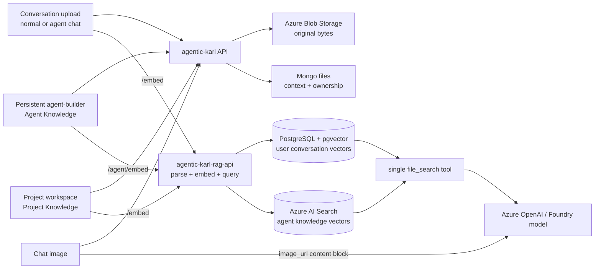

# Files — RAG & file search

This document owns the vector side of uploaded files: ingestion, backend selection, retrieval, deletion, and citations. Original bytes are a separate concern and remain in Azure Blob Storage; see [`storage.md`](./storage.md).

---

## 1. The invariant

| Upload origin                              | Persisted context                        | Owner/scope               | Vector backend      | Available in                                      |
| ------------------------------------------ | ---------------------------------------- | ------------------------- | ------------------- | ------------------------------------------------- |
| A conversation turn in normal KARL         | `message_attachment`                     | user                      | PostgreSQL/pgvector | that user's conversation file context             |
| A conversation turn while using an agent   | `message_attachment`                     | user                      | PostgreSQL/pgvector | that user's conversation file context             |
| Project Knowledge in a chat project        | user-owned file plus `ChatProjectSource` | user (project-associated) | PostgreSQL/pgvector | authorized conversations assigned to that project |
| Persistent agent builder — Agent Knowledge | `agents`                                 | agent                     | Azure AI Search     | every authorized conversation with that agent     |
| Image in any chat                          | `message_attachment`                     | user/message              | none                | direct multimodal message only                    |

The active chat endpoint does not select the vector backend. Upload origin and persisted ownership do. Project Knowledge adds an explicit project association to a user-owned pgvector file; it does not promote the file to Azure AI Search. An agent run may search both its persistent Azure AI Search knowledge and the current user's pgvector conversation uploads.

Do not conflate these services:

- **Azure Blob Storage** stores original bytes.
- **Azure AI Document Intelligence** may parse supported documents.
- **Azure OpenAI embeddings** create vectors.
- **PostgreSQL/pgvector** stores user conversation-upload vectors.
- **Azure AI Search** stores persistent Agent Knowledge vectors.
- **Azure OpenAI/Foundry** runs the model and its content filters. A Prompt Shield error is unrelated to which vector backend stored a file.

---

## 2. Architecture

The Knauf-owned RAG service lives in [`Knauf-Group/agentic-karl-rag-api`](https://github.com/Knauf-Group/agentic-karl-rag-api). It exposes both pgvector and Azure AI Search routes behind the same internal service and JWT middleware.

---

## 3. Ingestion

`processAgentFileUpload()` in [`process.js`](../../../../api/server/services/Files/process.js) decides whether the upload is a chat attachment or persistent Agent Knowledge. `uploadVectors()` in [`VectorDB/crud.js`](../../../../api/server/services/Files/VectorDB/crud.js) selects the RAG route.

### Conversation document

`message_file=true` means the file belongs to a chat turn, even when `agent_id` is also present:

1. Store original bytes in Azure Blob Storage.
2. Persist `context=message_attachment` and the user/conversation metadata in Mongo.
3. Deduplicate by content hash within that user. The physical vector key is `knauf_asset_id ?? file_id`.
4. Call `uploadVectors(..., entity_id=req.user.id, isAgentFile=false)`.
5. RAG API `POST /embed` parses and stores vectors in PostgreSQL/pgvector.

The user remains the scope. Merely chatting with an agent never promotes this file into the agent's shared knowledge base.

### Persistent Agent Knowledge

An agent-builder upload has `tool_resource=file_search`, no `message_file`, an `agent_id`, and agent-edit authorization:

1. Store original bytes in Azure Blob Storage.
2. Persist `context=agents` in Mongo.
3. Add the logical `file_id` to `agent.tool_resources.file_search.file_ids`.
4. Do not apply per-user content-hash deduplication.
5. Call `uploadVectors(..., entity_id=agent_id, isAgentFile=true)`.
6. With `AZURE_SEARCH_ENABLED=true`, RAG API `POST /agent/embed` stores vectors in Azure AI Search.

Current compatibility behavior: when `AZURE_SEARCH_ENABLED` is false, `uploadVectors()` falls Agent Knowledge back to `/embed` and pgvector. AGK environments are expected to enable Azure AI Search; this fallback is not the target storage architecture.

### Project Knowledge

The project workspace uploads a normal user-owned File Search asset, then creates a `ChatProjectSource` association through `POST /api/projects/:projectId/files`. Only ready, authorized files are loaded for a project conversation, and they are injected into the latest outbound turn. Moving the conversation out of the project stops loading those files. Project list/download/delete routes recheck user and project ownership.

### Images

The server rejects images as `file_search` resources. Images use the message attachment/vision path and reach the model as multimodal `image_url` content. They are never embedded into pgvector or Azure AI Search.

---

## 4. Retrieval

[`primeFiles()`](../../../../api/app/clients/tools/util/fileSearch.js) combines the authorized candidates. [`createKnaufFileSearchTool()`](../../../../api/server/services/Files/knauf/fileSearchRetrieval.js) groups and queries them:

- persistent agent resource IDs from `agent.tool_resources.file_search.file_ids`; and
- request/conversation files attached by the current user; and
- ready Project Knowledge injected into the current turn after project ownership checks.

It marks persistent resources with `fromAgent=true` and carries each file's persisted `context`.

Current batch routing:

| Candidate backend              | Query route                                                                                 | Request scope                               |
| ------------------------------ | ------------------------------------------------------------------------------------------- | ------------------------------------------- |
| PostgreSQL/pgvector candidates | one `POST /query_multiple` request containing all physical IDs and active generations       | authenticated user; optional entity context |
| Azure AI Search candidates     | one `POST /agent/query-multiple` request containing all physical IDs and active generations | requires `entity_id=agent_id`               |

Both requests run concurrently with `Promise.all`. A partial backend failure preserves results from the surviving backend and adds a warning. Backend-ordered results are deduplicated, fused with deterministic application-level RRF, capped, and returned to one tool call/model run. Users do not select a backend.

### Ranking boundary

Three different ranking mechanisms exist and must not be conflated:

| Pipeline                                      | Ranking behavior                                                                                             | Contract                                                                                                            |
| --------------------------------------------- | ------------------------------------------------------------------------------------------------------------ | ------------------------------------------------------------------------------------------------------------------- |
| Conversation documents in PostgreSQL/pgvector | Embedding vector similarity only                                                                             | Lower distance is better. Azure semantic ranking does not run on this path.                                         |
| Agent Knowledge in Azure AI Search            | Azure hybrid keyword/vector retrieval, with Azure semantic ranking when `AZURE_SEARCH_SEMANTIC_ENABLED=true` | Preserve Azure's returned order. Keep `@search.score` and optional `@search.rerankerScore` as distinct diagnostics. |
| Mixed results in Agentic Karl                 | Application-level reciprocal-rank fusion of the two final ordinal lists                                      | This is deterministic rank fusion, not semantic ranking. Never compare Azure scores with pgvector distances.        |

Azure AI Search may internally use RRF to combine its keyword and vector subqueries before its optional semantic second stage. That is separate from Agentic Karl's cross-backend RRF. The application does not make pgvector results semantically ranked by merging them with Azure results.

### Logical and physical IDs

Chat dedup separates the visible attachment from its stored vector asset:

- query target: `knauf_asset_id ?? file_id`;
- citation/download identity: the authorized logical `file_id` and its filename.

Do not expose a shared physical asset ID as the user-visible citation ID. The original owner row may have been deleted while another authorized reuse row still exists.

### Current implementation caveats

- Persisted `knauf_vector_backend` is authoritative when present. Legacy rows fall back to Azure only when `AZURE_SEARCH_ENABLED=true`, `fromAgent=true`, and `context=agents`; everything else falls back to pgvector.
- Azure semantic ranking exists only on the Azure Agent Knowledge path. pgvector remains vector similarity only. Mixed results must be merged by backend ordinal rank, not by comparing raw Azure scores with pgvector distances.
- Non-`agents` chat clients can also run legacy `createContextHandlers` augmentation for embedded files. When the same run has `file_search`, this duplicates retrieval and inflates the model context. It is current behavior, not the desired architecture.

---

## 5. Delete

Vector deletion follows the persisted file context:

| File class                                   | Delete route                                |
| -------------------------------------------- | ------------------------------------------- |
| Chat/message attachment                      | `DELETE /documents` with pgvector asset IDs |
| Agent Knowledge with Azure AI Search enabled | `DELETE /agent/documents/{file_id}`         |

`deleteVectorsForFiles()` processes pgvector first, then Azure AI Search in bounded waves. A mixed deletion therefore cleans both stores without treating the active chat endpoint as ownership evidence.

---

## 6. Citations

The file-search tool returns content plus source artifacts. Citation rendering is handled by [`Files/Citations`](../../../../api/server/services/Files/Citations/index.js).

Rules:

- cite the logical authorized file record, not the physical dedup asset;
- keep the backend and raw score kind for diagnostics;
- rank within each backend before merging mixed results;
- retain filename and page metadata from the selected logical file.

---

## 7. Configuration

| Setting                                         | Owner                     | Purpose                                                                   |
| ----------------------------------------------- | ------------------------- | ------------------------------------------------------------------------- |
| `RAG_API_URL`                                   | app GitOps                | Internal RAG service URL                                                  |
| `AZURE_SEARCH_ENABLED`                          | app GitOps                | Enables Agent Knowledge routing to `/agent/*`                             |
| `AZURE_SEARCH_ENDPOINT`, `AZURE_SEARCH_API_KEY` | RAG GitOps/secret mapping | Azure AI Search connection used by the RAG service                        |
| `RAG_OPENAI_BASEURL`, `RAG_OPENAI_API_KEY`      | RAG GitOps/secret mapping | Embedding endpoint and credential                                         |
| `EMBEDDINGS_MODEL`, `EMBEDDINGS_DIMENSIONS`     | RAG GitOps                | Embedding model contract                                                  |
| `RAG_USE_FULL_CONTEXT`                          | app GitOps                | Controls legacy automatic augmentation, not `file_search` backend routing |

Do not add a backend-selection environment variable per chat type. File provenance selects the backend; environment configuration only declares whether the backend is available.

---

## 8. Source map

| Concern                                               | Source                                                                                                             |
| ----------------------------------------------------- | ------------------------------------------------------------------------------------------------------------------ |
| Upload origin, context, dedup, agent-resource binding | [`api/server/services/Files/process.js`](../../../../api/server/services/Files/process.js)                         |
| Embed/delete backend selection                        | [`api/server/services/Files/VectorDB/crud.js`](../../../../api/server/services/Files/VectorDB/crud.js)             |
| Candidate priming, query routing, result formatting   | [`api/app/clients/tools/util/fileSearch.js`](../../../../api/app/clients/tools/util/fileSearch.js)                 |
| Legacy automatic augmentation                         | [`api/app/clients/prompts/createContextHandlers.js`](../../../../api/app/clients/prompts/createContextHandlers.js) |
| File access filtering                                 | [`api/server/services/Files/permissions.js`](../../../../api/server/services/Files/permissions.js)                 |
| RAG pgvector routes                                   | `agentic-karl-rag-api/app/routes/document_routes.py`                                                               |
| RAG Azure AI Search routes                            | `agentic-karl-rag-api/app/routes/agent_routes.py`                                                                  |
