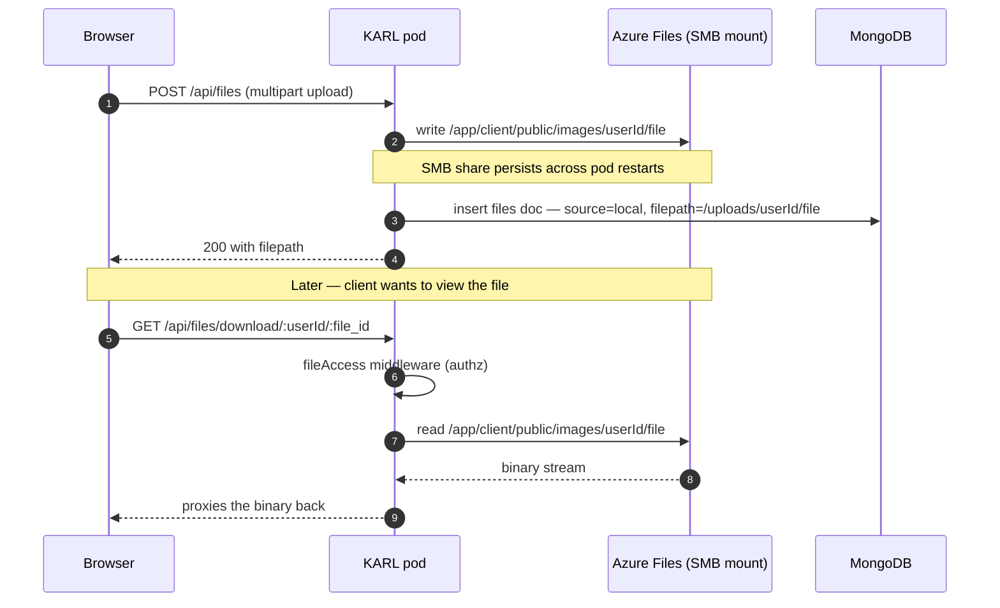
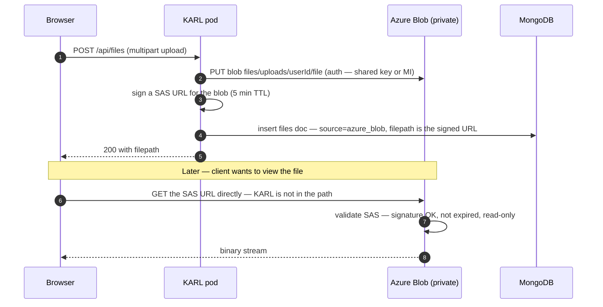
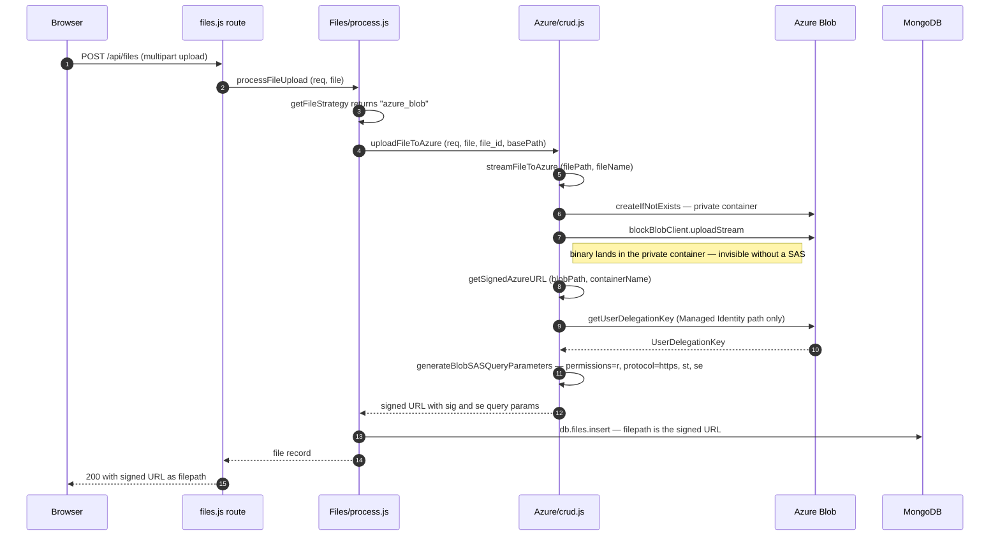
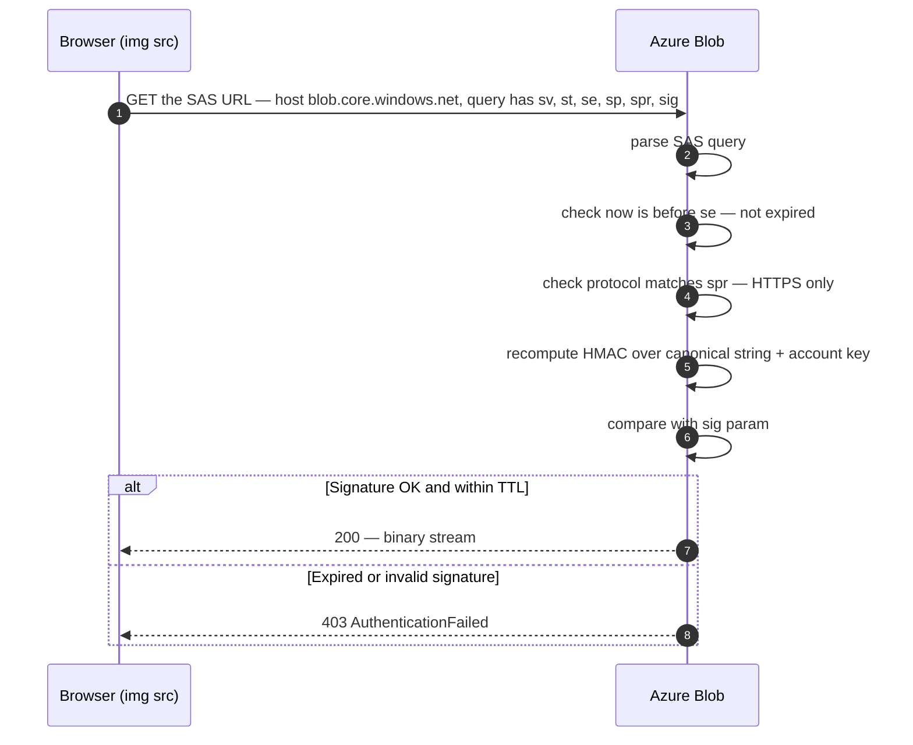
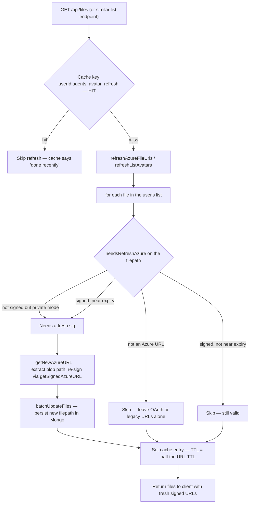
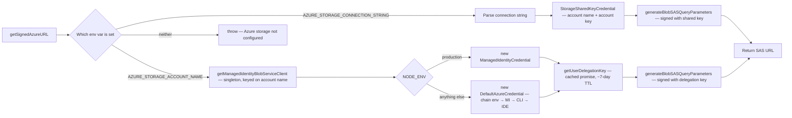
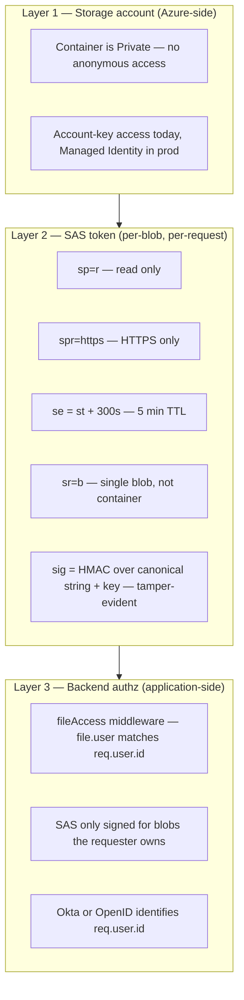

# Files — storage (`fileStrategy` & Azure Blob)

How and where the **bytes** are stored and served once an upload lands. Covers the pluggable `fileStrategy` abstraction, the backend adapters, size/MIME enforcement, and the full Azure Blob + SAS-signed-URL machinery that runs in production today.

> Part of the files docs: [`overview.md`](./overview.md) (taxonomy, binding, lifecycle) · **storage.md** (this doc) · [`rag-search.md`](./rag-search.md) (RAG / file search).
> Rollout status + still-pending workstreams live in [`../../implementation-plans/azure-blob-and-private-files.md`](../../implementation-plans/azure-blob-and-private-files.md). This doc is the *architecture*; that doc is the *plan*.

---

## 1. `fileStrategy` — the storage abstraction

The blob backend is pluggable via the top-level `fileStrategy` key in [librechat.yaml](../../../../librechat.yaml), validated by [config.ts](../../../../packages/data-provider/src/config.ts). A per-context split is also possible via `fileStrategies: { default, avatar, image, document }`.

All backends implement the same adapter interface, registered in [strategies.js](../../../../api/server/services/Files/strategies.js) and selected at runtime by [getFileStrategy.js](../../../../api/server/utils/getFileStrategy.js):

| Method | Purpose |
|---|---|
| `handleFileUpload` / `saveBuffer` | Write bytes for a document/image |
| `getFileURL` / `saveURL` | Produce / persist the URL the client fetches |
| `getDownloadStream` | Stream bytes back (download endpoint) |
| `processAvatar` / `handleImageUpload` | Image-specific write + URL |
| `deleteFile` | Remove bytes |

Upload dispatch (`processFileUpload` / `processAgentFileUpload` in [process.js](../../../../api/server/services/Files/process.js)) calls `getFileStrategy(appConfig, { isImage, isAvatar })` to pick the adapter, then routes text-extraction vs blob vs vector accordingly. The same selector also exposes internal pseudo-strategies (`openai`, `vectordb`, `execute_code`, `document_parser`, `mistral_ocr`, `text` → alias for `local`) that route to non-blob destinations and are not user-selectable as the global default.

### Backends

| Value | What it uses | Where bytes go | Best fit |
|---|---|---|---|
| `azure_blob` **(active — [librechat.yaml#L15](../../../../librechat.yaml#L15))** | Azure SDK | Private blob container, SAS-served (§3+) | Azure-native (Knauf stack) |
| `local` (schema default) | Node `fs` | `./uploads/<userId>/...` on the api container disk | Dev only |
| `s3` | AWS SDK | S3 bucket via `AWS_*` env | AWS / S3-compatible |
| `firebase` | Firebase SDK | Firebase Storage | Firebase deployments |
| `openai` / `vectordb` | (internal) | Provider Files API / rag_api | Not user-selectable as default |

### Size & MIME enforcement

Client-side `validateFiles()` ([client/src/utils/files.ts](../../../../client/src/utils/files.ts)) runs before upload against the merged `fileConfig.endpoints.<name>` config: disabled → empty → file-count → MIME inference/fix → MIME allowlist → per-file size → total size → duplicate. The server re-enforces the size cap in [process.js#L1028](../../../../api/server/services/Files/process.js#L1028).

- Server-wide ceiling: `serverFileSizeLimit` (default 512 MB) in [file-config.ts](../../../../packages/data-provider/src/file-config.ts); Knauf pins it to **50 MB** in [librechat.yaml](../../../../librechat.yaml) so multer aborts oversized streams before they land on disk.
- Knauf sets per-endpoint caps of **50 MB** per file for `azureOpenAI` + `agents` (`totalSizeLimit` 50 MB chat / 100 MB agent) in [librechat.yaml](../../../../librechat.yaml), and enforces **tighter per-category caps on top** — documents 25 MB / data 50 MB / images 20 MB (`knaufCategorySizeLimit`, client `validateFiles` + server `filterFile`) — to control Azure Blob spend and avoid oversized PDFs blowing the model context. See [processing.md](./processing.md) §5 for the per-category breakdown.
- For `tool_resource: context`, the allowlist merges the `text` / `ocr` / `stt` supported-type sets; MIME routing into OCR vs text-parse vs STT is configured via `fileConfig.ocr|text|stt.supportedMimeTypes`.

**No `cloudfront.*` block.** Despite signed-CloudFront delivery often being mentioned as a `fileStrategy` option, the Zod schema in [config.ts](../../../../packages/data-provider/src/config.ts) does not expose `cloudfront` / `urlExpiry` / `cookieExpiry`. Signed-CDN delivery would be a code change, not config.

The rest of this doc is the **`azure_blob`** implementation — the only backend running in production.

---

## 2. The 30-second version (Azure)

- Files (avatars, image attachments, file_search PDFs, etc.) live in a **private** Azure Blob Storage container.
- The backend never proxies the binary. It hands the client a **SAS URL** — a normal `https://…/blob` URL with a signed query string proving the client is allowed to read this one blob for the next 5 minutes.
- The client fetches the binary **directly from Azure**, not from KARL's pods.
- The signed URL is **stored in MongoDB** alongside the file's other metadata.
- When the URL is about to expire, the backend **refreshes** it (re-signs the same blob path with a fresh expiry) and writes it back.

Why this shape:

- **No persistent disk on the pod** — KARL runs on AKS, pods are ephemeral and multi-replica. Local files vanish on restart and don't cross replicas.
- **No public container** — Knauf compliance requires private storage. Plain blob URLs don't work; you need a signed credential per request.
- **No backend bandwidth burning** — proxying the binary means 1× ingress + 1× egress per view. Direct fetch from Azure offloads it.

---

## 3. Before vs. after — the same upload, two architectures

### Before: `fileStrategy: "local"` + SMB-mounted persistent share



What hurts:
- Every read costs the backend 1× ingress (from SMB) + 1× egress (to client). Bandwidth scales with viewers, not uploads.
- SMB share = single shared storage account, single network endpoint. Per-user isolation doesn't exist at the storage layer.
- Without the SMB share, pods can't see each other's uploads. With it, you've reintroduced shared-state coupling.

### After: `fileStrategy: "azure_blob"` + SAS URLs



What changes:
- Read traffic skips KARL entirely. Bandwidth is between client and Azure.
- The container is **private** — no anonymous reads. The SAS in the URL is the access token.
- The URL is a normal HTTPS link the browser handles natively (`` works, downloads work, no special client code).

---

## 4. SAS URL anatomy — what each part does

```
https://karlblob.blob.core.windows.net/files/uploads/<userId>/<file_id>__name.pdf
       └──────────────────┬───────────┘└──┬─┘└──────────┬────────────────────┘
            account host       container       blob path (the resource)

  ?sv=2023-11-03            ← SAS spec version (cryptographic schema)
  &spr=https                ← Protocol restriction — HTTPS only, no HTTP replay
  &st=2026-05-22T10%3A00%3A00Z  ← Signed start time (when the URL becomes valid)
  &se=2026-05-22T10%3A05%3A00Z  ← Signed expiry  (when it stops working) — the TTL
  &sr=b                     ← Resource scope: b = single blob (not container)
  &sp=r                     ← Permissions: r = read only (no write, no delete)
  &sig=YMq7nGKap…           ← HMAC signature over all of the above + the blob path
```

Three security properties built into the URL:

| Property | Mechanism | What it gives you |
|---|---|---|
| **Authenticity** | `sig` — HMAC-SHA256 of the canonical string, keyed by the storage account key (or a User Delegation Key derived from Managed Identity). | Can't forge a SAS without the key. Tamper any other param → signature breaks → Azure refuses. |
| **Time-bounded** | `st`/`se` checked server-side. | A leaked URL only works until `se`. Default TTL = **5 minutes** in our setup. |
| **Least privilege** | `sp=r` + `sr=b`. | Compromise of one URL only lets the holder **read** that **one blob**. No list, no write, no delete, no other blobs. |

`spr=https` is the "must come over HTTPS" tag — without it, a TLS-stripping attacker could replay the URL over HTTP. We force it on every signed URL.

---

## 5. Upload flow — what actually happens in code



Key steps the diagram glosses over:

- **`createIfNotExists({ access: undefined })`** — `undefined` means "create as private, no anonymous access". In dev with `AZURE_STORAGE_PUBLIC_ACCESS=true` we'd pass `"blob"` instead. The default is `false` so a missing env var doesn't create a public container.
- **`getUserDelegationKey`** is called on the Managed Identity path only. The key is cached as a **promise** (not the resolved value) — N concurrent first-callers all await the same in-flight fetch instead of each firing their own AAD round-trip. Cached for ~7 days minus a 5-minute renewal buffer.
- **`generateBlobSASQueryParameters`** is pure local crypto. No network call. The key is the User Delegation Key (MI) or `StorageSharedKeyCredential` (Account Key).

---

## 6. Image fetch — yes, it's a signed URL

**The browser fetches the blob directly from Azure using the SAS URL.** KARL is not in the path on the read. The SAS URL is just a normal `https://…` link.



Practical implications:

- **``** in the UI works zero-effort. No special fetch code.
- **Once leaked, can't be revoked** until `se`. That's why TTL is **short** (5 min) — leaked URLs decay fast.
- **Doesn't go through `req.user`** — Azure has no idea who the user is. Per-user authorization is enforced at signing time (`fileAccess` middleware on KARL's backend), not at fetch time.

---

## 7. Why URLs need to be **cached** (in MongoDB)

Why store the SAS URL in MongoDB instead of regenerating one every time someone asks for the file?

1. **Cost on hot paths.** Listing 50 files in `/api/files` would cost 50 signing operations on every page-load. Signing is cheap but not free — especially in Managed Identity mode where the User Delegation Key may need refreshing.
2. **Stable URL across page loads.** A `` benefits from browser-level URL caching. If the URL changed every request, the browser would treat each render as a new image and re-fetch.

So we store the signed URL with the file's metadata. But SAS URLs **expire** — after 5 minutes the stored URL is dead. We need to refresh it without re-signing on every request. That's the **refresh chain**.

---

## 8. The refresh chain — `needsRefresh*` + `getNew*URL` + `refresh*FileUrls`



Three knobs hold this together:

- **`needsRefresh*` returns `false` for URLs we don't own.** Without this, a Google OAuth avatar URL would trigger a refresh attempt, `getNewAzureURL` would return `undefined`, and we'd persist `undefined` over the working avatar. Mirrors S3's `X-Amz-Signature` host-check.
- **`needsRefresh*` returns `true` for plain Azure URLs in private mode.** This is the "legacy transition" case — pre-fix URLs without `sig` need signing on first list.
- **The per-user cache short-circuits all of this.** If we refreshed this user's files in the last 2.5 minutes, don't iterate them again.

### 7.1 Message and tool-call snapshots — refresh on read (KK20-182)

The refresh chain above runs against the `files` collection. But three other collections **also snapshot the file record** — including the SAS-signed `filepath` — into `[Mixed]` arrays that are never updated after write:

- `messages.attachments[]` — tool outputs (image generation, code execution, etc.).
- `messages.files[]` — user-uploaded files referenced in the message.
- `toolcalls.attachments[]` — code-interpreter / `execute_code` artifacts (`packages/data-schemas/src/schema/toolCall.ts:10,40`), rehydrated by the client through `useToolCallsMap` on conversation open.

Without an extra hop, any image referenced by one of these snapshots 403s the moment its 5-minute SAS expires, even though the canonical `files` document is kept alive by the user-files refresh chain.

The shim:

- Lives at [`api/server/services/Files/Azure/refreshMessageAttachments.js`](../../../api/server/services/Files/Azure/refreshMessageAttachments.js).
- Walks each input's `attachments[]` and `files[]` fields (duck-typed — works the same on a message row or a toolcall row), calls `needsRefreshAzure` + `getNewAzureURL` per `filepath`, rewrites in place.
- Pre-checks `attachment.source === 'azure_blob'` OR `isAzureBlobUrl(new URL(filepath))` so local paths (`/uploads/...`), S3 URLs, and third-party avatars in the same `[Mixed]` array short-circuit without log noise.
- **In-memory only.** No Mongo writes — the resign cost is local crypto, and persisting back would amplify writes for every list view. The blob is durable; only the URL signature expires.
- Per-call memoization on `filepath` so a response carrying many copies of the same blob only resigns once.
- Wired into the three read paths that serve these snapshots:
  - [`api/server/routes/messages.js`](../../../api/server/routes/messages.js) — root list, `GET /:conversationId`, `GET /:conversationId/:messageId`.
  - [`api/server/routes/share.js`](../../../api/server/routes/share.js) — `getSharedMessages`.
  - [`api/server/controllers/tools.js`](../../../api/server/controllers/tools.js) — `getToolCalls`.

Why a separate shim instead of folding it into the existing chain:

- The existing chain operates on `MongoFile[]` rows (`source: 'azure_blob'`) and writes back to the `files` collection. The three snapshot sites above are denormalized copies inside other collections and don't carry the same shape consistently.
- Write-time copy paths — branched messages (`POST /api/messages/branch`), shared conversations (`anonymizeMessages` in `packages/data-schemas/src/methods/share.ts`), `POST /api/convos/fork`, `POST /api/convos/duplicate` — all snapshot the SAS URL at copy time. Refreshing on read keeps every read path correct without having to touch every write site (their immediate response payload still serves a stale URL for one paint cycle, but self-heals on the next read).
- Long-term, replacing the `[Mixed]` snapshots with `file_id`-only references + joins is the right shape — but that lives entirely in upstream code and is out of scope for the fork.

---

## 9. TTL math — why URL TTL ≠ cache TTL

Three timers, all related, easy to confuse:

```
─────── time ─────────────────────────────────────────────────────►

         ┌─────────────────────────────────────────────┐
URL TTL: │ st                                       se │  ← 5 min (default)
         └──────────────────────┬──────────────────────┘
                                │  bufferSeconds = 3600s
                                │  "if URL expires within an hour, refresh it"
                                ▼
         ┌───────────────────┐                              ← (effectively "always refresh"
Refresh  │ refresh window    │                                because 1 hour > 5-min URL TTL,
buffer:  └───────────────────┘                                so cache entry expires first)

         ┌────────────┐
Cache    │ cache TTL  │  ← 2.5 min  (= URL TTL / 2)
entry:   └─┬──────────┘
           │
           ▼
       After cache TTL expires, next `/api/files` call re-runs the refresh chain.
```

The invariant: **cache TTL ≤ URL TTL / 2**.

Why halve it: if the cache TTL equalled the URL TTL, then in the worst case a URL signed at T=0 (expires T=5min) could be re-cached at T=4:59 (cache hit returns "skip refresh"). At T=5:01 the URL has expired but the cache entry is still alive until T=9:59. Result: ~5 minutes of serving expired URLs. Halving guarantees that when the cache says "refreshed recently", the covered URLs have at least half their TTL left. The floor is 1 minute (prevents pathological rapid re-refreshes when `AZURE_URL_EXPIRY_SECONDS` is set very low).

This is what `getFileURLRefreshCacheTime(strategy)` does — cache TTL = `Math.max(urlTTL_ms / 2, ONE_MINUTE)`.

> **The bug this fixed**: the agent-list cache was hardcoded to **30 minutes** with the S3 cache namespace, regardless of strategy. With Azure's 5-min URL TTL, cached entries served expired SAS for ~25 minutes. Strategy-aware namespace + `getFileURLRefreshCacheTime` resolves it.

---

## 10. Signing modes — Account Key (dev) vs Managed Identity (prod)



Why two modes:

- **Account Key** (`AZURE_STORAGE_CONNECTION_STRING`): the storage account's master key is in the env. Anyone with it can do anything to any blob. Fine for dev, **dangerous in prod**. If it leaks, revocation is "rotate the key" — invalidating every SAS ever signed with the old key, including legitimate ones in flight.
- **Managed Identity → User Delegation SAS**: no account key in the cluster. The AKS pod has an AAD identity. KARL asks Azure for a delegation key (valid ≤7 days) and signs SAS with it. Compromise of one delegation key only affects ~7 days of in-flight URLs; rotating the AAD identity is fast.

Production should always be Managed Identity. The deployment-configs PR wires AKS Workload Identity → Storage Blob Data Contributor. After that proves out, flip the storage account to **"Allow storage account key access: Disabled"** — then even the account key won't work.

The **singleton** in `getManagedIdentityBlobServiceClient(accountName)` is what makes this fast: the credential's AAD token cache lives on the credential instance. Recreating it per-request cold-starts the AAD cache every time.

---

## 11. The three-layer security model (recap)



**The blob path's userId (`files/uploads/<userId>/...`) is a naming convention, not Azure-enforced.** Per-user isolation lives at Layer 3 — if the backend correctly signs only blobs the requesting user owns, and SAS TTL is short enough to bound leak damage, this is the same pattern Slack/GitHub use for hosted assets. If KARL's `fileAccess` middleware is bypassed (it shouldn't be), Azure can't catch it.

---

## 12. Where the code lives

| Concern | File |
|---|---|
| `fileStrategy` selector + refresh-cache TTL helper | [`api/server/utils/getFileStrategy.js`](../../../../api/server/utils/getFileStrategy.js) |
| Strategy registry (Azure vs S3 vs local) | [`api/server/services/Files/strategies.js`](../../../../api/server/services/Files/strategies.js) |
| Upload routing (text-extraction vs blob) | [`api/server/services/Files/process.js`](../../../../api/server/services/Files/process.js) |
| Azure signing, refresh, extractor, delete | [`api/server/services/Files/Azure/crud.js`](../../../../api/server/services/Files/Azure/crud.js) |
| Avatar processing (signed URL out) | [`api/server/services/Files/Azure/images.js`](../../../../api/server/services/Files/Azure/images.js) |
| **Message-attachment refresh shim (KK20-182)** | [`api/server/services/Files/Azure/refreshMessageAttachments.js`](../../../../api/server/services/Files/Azure/refreshMessageAttachments.js) |
| Container client + startup | [`packages/api/src/cdn/azure.ts`](../../../../packages/api/src/cdn/azure.ts) |
| `/api/files` list + refresh dispatch | [`api/server/routes/files/files.js`](../../../../api/server/routes/files/files.js) |
| User-avatar refresh dispatch | [`api/server/controllers/UserController.js`](../../../../api/server/controllers/UserController.js) |
| Agent-avatar refresh dispatch + cache | [`api/server/controllers/agents/v1.js`](../../../../api/server/controllers/agents/v1.js) |
| Cache namespaces | [`api/cache/getLogStores.js`](../../../../api/cache/getLogStores.js) |
| Client-side validation | [`client/src/utils/files.ts`](../../../../client/src/utils/files.ts) |
| Tests | `api/test/server/services/Files/Azure/crud.test.js` |

For the rollout sequence and what's still pending, see [`../../implementation-plans/azure-blob-and-private-files.md`](../../implementation-plans/azure-blob-and-private-files.md).
