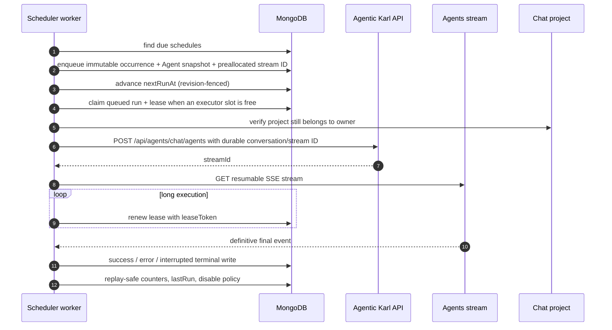

# Scheduled Chats

Scheduled Chats let a user run an accessible Agent on a recurring cadence. Each
run creates a normal, non-temporary conversation in a project selected by the
user. The generated conversation is the result: there is no separate email or
notification-delivery lifecycle.

The implementation is a bounded Knauf-owned compatibility layer. Its public API,
cadence model, run outcomes, counters, and disabled-reason shape deliberately
follow the upstream Scheduled Chats direction where practical, while execution
runs in a dedicated worker rather than inside horizontally scaled API pods.

The exact upstream preview was not backported because its dependency closure
spanned authentication, generation jobs, streams, schemas, startup, permissions,
and navigation across more than 100 upstream files, many of which had already
drifted from this fork. Copying those modules under Knauf paths would not have
removed those shared-runtime dependencies. The bounded compatibility layer keeps
the execution invariants and a future migration path without turning the preview
into a permanent high-risk override.

---

## 1. Product flow

### 1.1 Create

The Schedules sidebar panel opens a dialog that requires:

- a name and prompt;
- an Agent the user owns or may edit and is allowed to use;
- a project owned by the user;
- an `hourly`, `daily`, `weekdays`, or `weekly` cadence;
- the browser's IANA timezone.

The project field remains single-select. A user may open the existing project
creation dialog from the schedule form; the created project is selected
immediately without losing the other schedule fields.

Create requests include a client-generated `clientRequestId`. Retrying the same
request returns the existing schedule; reusing the key for different schedule
content returns a conflict. The API also enforces the per-user schedule limit
(`KNAUF_SCHEDULER_MAX_PER_USER`, default `10`) under concurrent creates.

An enabled schedule receives a computed `nextRunAt`. Cadence evaluation uses
Croner with IANA timezone handling and deterministic per-schedule jitter so
workers do not fire all schedules at the exact minute boundary.

### 1.2 Edit, enable, and disable

The dialog can change the prompt, Agent, project, cadence, and name. It sends the
revision that was visible when the dialog opened. The API increments
`configRevision` on every update and rejects stale edits with HTTP 409.

Changing cadence/timezone or re-enabling recomputes `nextRunAt`. Explicitly
enabling clears `disabledReason`. Explicitly disabling clears `nextRunAt` and
the disabled reason. A schedule auto-disabled by the worker retains
`nextRunAt`; `enabled: false` is the execution gate.

Project access is checked when the project is selected and again before a run
is queued or executed. Agent owner/editor access is checked on create, on every
edit that leaves the schedule enabled, on Run Now, before automatic dispatch,
and immediately before the internal Agents request. Disabling remains possible
after Agent access is lost. A legacy schedule without `chatProjectId` can still
be disabled. The user must edit it and select an accessible project before it
can be enabled or run again.

### 1.3 Run Now

Run Now is allowed even when recurrence is disabled. The API:

1. rechecks Agent and project access;
2. preallocates a conversation ID;
3. writes a manual run with immutable schedule and Agent-configuration snapshots;
4. returns immediately while the worker executes it.

Only one active run may exist for a schedule. A second Run Now request, or a
delete while a run is queued/actively leased, returns HTTP 409.

### 1.4 Delete a project

Project deletion is permanently destructive. The confirmation names the
project data that is removed: chats and messages, schedule definitions,
inactive scheduler history, project knowledge and files, sources, tool-call
data, and shared links.

Deletion is rejected with HTTP 409 while any project schedule has a queued run
or a started run with an unexpired lease. Expired leases and terminal runs do
not block deletion. After the project aggregate is removed, owner-scoped
scheduler cleanup deletes its schedule definitions and inactive run rows,
including project-scoped orphan history. No cache or navigation cleanup runs
when the deletion is rejected.

### 1.5 Automatic run



The request uses the normal Agents route, so Agent permissions, tools,
conversation persistence, file readiness, and provider behavior stay aligned
with interactive chat. The worker adds:

- a short-lived JWT for the schedule owner;
- an HMAC signature over timestamp, owner, trigger, method, and path;
- `x-knauf-scheduler-trigger` (`automatic` or `manual`);
- the preallocated conversation ID and snapshotted project ID.
- the Agent configuration snapshot persisted on the immutable run.

The API removes the snapshot from the ordinary request body only after the
scheduler HMAC is verified. The Agents build path then uses that snapshot
instead of reloading the mutable Agent document. Agent edits made after queueing
therefore affect only future runs. The worker still revalidates current
owner/editor access immediately before execution; authorization is current
while execution configuration remains pinned.

The adapter obtains a fresh owner JWT for start, stream/resume, and cancellation
requests, so a long-running execution cannot outlive the credentials needed to
stop it. Cancellation cleanup has its own short timeout and cannot hold worker
shutdown open indefinitely. The API accepts the signed identity only within a
bounded clock-skew window. The shared signing secret is never exposed to the
browser.

---

## 2. API and client surfaces

### 2.1 API

The authenticated contract is mounted at `/api/schedules`:

| Method   | Path                     | Purpose                                                 |
| -------- | ------------------------ | ------------------------------------------------------- |
| `GET`    | `/api/schedules`         | List the owner's schedules and capacity                 |
| `POST`   | `/api/schedules`         | Create an idempotent project-scoped schedule            |
| `GET`    | `/api/schedules/:id`     | Read one owned schedule                                 |
| `PATCH`  | `/api/schedules/:id`     | Edit, enable, or disable with optional revision fencing |
| `POST`   | `/api/schedules/:id/run` | Queue Run Now                                           |
| `DELETE` | `/api/schedules/:id`     | Delete when no active run exists                        |

All item lookups are owner-scoped and return 404 across ownership boundaries.
Payloads are strict: unsupported fields, including attachments, are rejected
rather than silently ignored.

### 2.2 Client

The implementation lives in Knauf-owned client paths:

- `SchedulePanel` loads schedules, shows capacity, empty/error states, and the
  create action;
- `ScheduleDialog` owns create/edit form state, project and Agent selection,
  idempotent create keys, timezone, and revision-aware updates;
- `ScheduleCard` owns enable/disable, Run Now, edit/delete actions, cadence,
  next-run and last-run display, and disabled-reason messaging;
- the Schedules data-provider layer owns React Query keys, service calls, and
  cache invalidation.

Successful last-run chips navigate to the generated conversation. A known
`too_many_failures` reason is explained in localized text. Unknown future
reasons remain a safe generic disabled state.

### 2.3 Feature gates

The feature is dark unless all deployed parts agree:

- `KNAUF_SCHEDULER_API_ENABLED=true` mounts the usable API and overrides
  `interface.knauf.scheduler` to expose the sidebar;
- `KNAUF_SCHEDULER_WORKER_ENABLED=true` starts polling in the dedicated worker;
- the application and worker receive the same
  `KNAUF_SCHEDULER_INTERNAL_SECRET`.

`librechat.yaml` keeps `interface.knauf.scheduler: false` as the safe source
default. Environment enablement is explicit.

---

## 3. Persistence and concurrency

### 3.1 Collections

| Collection                    | Responsibility                                                                                      |
| ----------------------------- | --------------------------------------------------------------------------------------------------- |
| `knauf_agent_schedules`       | User configuration, recurrence, revision, counters, next/last run, disabled reason                  |
| `knauf_scheduled_agent_runs`  | Immutable execution snapshot, occurrence identity, lease, terminal result/error, bookkeeping marker |
| `knauf_scheduler_user_states` | Account-deletion barrier and distributed in-flight start-admission count                               |

Every run snapshots the owner, Agent ID and bounded execution configuration,
project, prompt, cadence, timezone, schedule name, `configRevision`, and
scheduled time. The Agent snapshot includes the stored provider/model,
instructions, parameters, tools/actions references, orchestration fields, and
its version ordinal without copying the Agent's full version history. Later
Agent or schedule edits therefore affect future runs, not an already
queued/claimed run.

### 3.2 Claims, leases, and fencing

Recurring occurrences use the unique key
`<scheduleId>:<scheduledFor ISO timestamp>`. Manual runs use a unique manual
key. MongoDB indexes enforce:

- one document per recurring occurrence;
- one active run per schedule;
- efficient due-schedule, expired-lease, queued-run, and unbookkept-run scans.

A recurring run receives its conversation ID before it becomes executable.
LibreChat uses that ID as the Agent `streamId`, so a reclaimed lease resumes the
existing stream with `resume=true` instead of POSTing a second generation. If a
legacy/reclaimed run has no durable ID, or the corresponding job has expired,
the run becomes `interrupted`; recovery never guesses by starting another
provider side effect.

A claim mints a `leaseToken` and `leaseExpiresAt`. Renewals and terminal writes
must match the token. If renewal fails or the deadline expires, the worker
aborts its HTTP/SSE request and loses permission to write the run. Another
worker may reclaim an expired run with a new token.

Automatic execution advances `nextRunAt` before calling the provider, fenced by
the claimed schedule state. This avoids repeatedly claiming the same due time
after a crash. Missed occurrences skip forward; the worker does not replay
every missed wall-clock interval.

### 3.3 Replay-safe bookkeeping

Terminal run persistence and schedule-card projection are deliberately separate
so either side can be replayed after a crash. `bookkeepingAppliedAt` is written
last, only after all applicable work succeeds.

Bookkeeping uses:

- `countedOccurrenceKeys` to avoid double-counting a replay;
- `countersAsOf` to prevent an older late result from changing counters after a
  newer occurrence;
- `configRevision` to prevent runs from an old configuration changing the
  current schedule;
- last-run occurrence ordering so an older result cannot replace a newer one.

The worker starts each tick by replaying terminal runs without
`bookkeepingAppliedAt`, then dispatches due schedules into the durable run
queue. Dispatch does not wait for Agent execution. Free executor slots reclaim
expired runs or claim the oldest queued automatic/manual runs. Completing one
execution wakes the loop immediately so a slow run cannot prevent free slots
from accepting more work.

---

## 4. Outcomes and failure policy

Run outcomes are:

| Outcome       | Counter effect                       | Meaning                                                                          |
| ------------- | ------------------------------------ | -------------------------------------------------------------------------------- |
| `success`     | `runCount + 1`, reset `failureCount` | A definitive successful final Agents event                                       |
| `error`       | `failureCount + 1`                   | A definitive failed execution                                                    |
| `interrupted` | No counter change                    | The Agents response was marked unfinished or execution was intentionally skipped |
| `queued`      | None                                 | Durably dispatched and waiting for executor capacity                             |
| `started`     | None                                 | Actively leased by an executor                                                   |

The worker recognizes failure only from proven final shapes:

- a structured top-level final-event `error`;
- `responseMessage.error === true`;
- the current Agents error-controller final event containing conversation data
  but no `responseMessage`.

Empty response text is still a success. Localized text, missing titles, and
arbitrary response content are never failure heuristics.

### 4.1 Consecutive-failure auto-disable

`KNAUF_SCHEDULER_AUTO_DISABLE_AFTER_FAILURES` controls the threshold. The
upstream-compatible default is `5`; an explicitly supplied value must be a
strict positive integer or the worker fails startup.

After an error is counted, the repository disables the schedule with
`disabledReason: too_many_failures` only when all of these still match:

- the schedule is enabled;
- `failureCount` reached the threshold;
- `countersAsOf` is exactly this run's scheduled time;
- `configRevision` matches the run snapshot.

Policy evaluation also runs when a replay sees that the occurrence counter was
already applied. This closes the crash window between counter persistence and
the disable update. An older error cannot auto-disable after a newer success,
and a stale run cannot disable a schedule the user edited or re-enabled.

The policy stops future claims; it does not cancel another independently active
run. Project-not-found and Agent/provider errors use the same consecutive
failure policy rather than introducing immediate permanent-disable reasons.

### 4.2 Known limitations

- The Agents controller persists a conversation before provider generation is
  known to succeed. A definitive failed scheduled request can therefore leave a
  failed conversation in the selected project.
- A transport break after the API accepted execution but before the worker sees
  a definitive final event is ambiguous. The current system records an
  interrupted run. Lease recovery resumes the durable Agent stream when it is
  still available, but does not infer success from conversation existence or
  start a replacement generation after the job expires.
- Email and Teams delivery are not part of KK20-255. The generated project
  conversation is the MVP report. Teams direct-user delivery is a separate
  discovery item whose recipient model, integration method, report content,
  timing, retry/deduplication, privacy, and failure UX require Product input.
- No governance, approval, or review stage is required for Scheduled Chats.
  Scheduled Agents use the Agent's configured tool/action references under the
  existing Agent authorization model.
- The immutable run captures the Agent configuration and referenced tool/action
  IDs, not deep copies of external tool implementations or remote action
  definitions.
- Schedule attachments are intentionally unsupported.
- Historical run rows are operational evidence, not a user-facing run-history
  product. Terminal rows receive an `expiresAt` timestamp and are deleted by a
  MongoDB TTL index after 30 days. Queued and active rows never expire. Deleting
  a schedule immediately removes its inactive history while preserving any
  concurrently active row until it settles safely.

---

## 5. User deletion

Each authenticated scheduler start atomically increments a per-user MongoDB
admission count only while no deletion barrier exists. Account deletion first
writes the one-hour barrier, waits for admitted starts to register their
generation jobs, then snapshots and aborts those jobs before purging
schedule/run rows. The controller releases admission immediately after
`GenerationJobManager.createJob`; response finish/close is an error-path
fallback. This distributed handshake closes the cross-pod race where a start
could pass the old barrier check and register after deletion had already
enumerated jobs. A final purge remains after the normal user-data deletion
sequence.

---

## 6. Runtime and deployment

### 6.1 Process topology

The scheduler uses the exact same immutable application image as the API but a
separate command:

```text
API Deployment                    Scheduler Deployment
npm run backend                   npm run backend:scheduler
replicas: horizontally scaled     replicas: fixed, horizontally scalable
serves browser/API traffic        dispatches and executes through bounded slots
```

Keeping polling out of API replicas avoids coupling scheduler concurrency to
web scaling. Each scheduler process has a configured executor limit; aggregate
capacity is `replicas × KNAUF_SCHEDULER_MAX_CONCURRENCY`. MongoDB occurrence,
active-run, and lease constraints make multiple active workers safe. Replica
count and concurrency remain fixed during a release so scheduler traffic cannot
silently grow with web HPA activity.

The release workflow updates the application and scheduler GitOps values to the
same image tag. A deployment is incomplete if the two workloads run different
versions of the persistence or internal execution contract.

### 6.2 Configuration

| Setting                                       |              Default | Purpose                               |
| --------------------------------------------- | -------------------: | ------------------------------------- |
| `KNAUF_SCHEDULER_API_ENABLED`                 |                false | API and sidebar discovery gate        |
| `KNAUF_SCHEDULER_WORKER_ENABLED`              |                false | Worker process gate                   |
| `KNAUF_SCHEDULER_API_URL`                     |   required in worker | Namespace-local API base URL          |
| `KNAUF_SCHEDULER_INTERNAL_SECRET`             |             required | Shared HMAC signing secret            |
| `KNAUF_SCHEDULER_MAX_PER_USER`                |                   10 | Schedule capacity                     |
| `KNAUF_SCHEDULER_POLL_MS`                     |                 5000 | Worker poll interval                  |
| `KNAUF_SCHEDULER_LEASE_MS`                    | 600000 in dev GitOps | Execution lease                       |
| `KNAUF_SCHEDULER_BATCH_SIZE`                  |     10 in dev GitOps | Bookkeeping scan bound                |
| `KNAUF_SCHEDULER_DISPATCH_BATCH_SIZE`         |                  100 | Due schedules durably queued per tick |
| `KNAUF_SCHEDULER_MAX_CONCURRENCY`             |                   25 | Maximum active executions per worker  |
| `KNAUF_SCHEDULER_EXECUTION_TIMEOUT_MS`        |              1800000 | Maximum wall time for one execution   |
| `KNAUF_SCHEDULER_AUTO_DISABLE_AFTER_FAILURES` |                    5 | Consecutive error threshold           |
| `KNAUF_SCHEDULER_PORT`                        |                 3082 | Health/readiness/metrics listener     |

Do not add a GitOps value merely to repeat the code default for the failure
threshold. Set it only when operations deliberately chooses a different policy.
Terminal run retention is also an application policy rather than a GitOps
knob. The repository assigns a 30-day per-document expiration only when a run
reaches `success`, `error`, or `interrupted`, and MongoDB removes it
asynchronously.

### 6.3 Secrets and networking

Application and scheduler Deployments receive the same Key Vault-backed
signing secret through separate ExternalSecrets. The scheduler also receives
MongoDB/JWT runtime secrets and `agentic-karl-metrics-secret` for authenticated
Prometheus metrics.

The scheduler:

- calls `http://agentic-karl` through the namespace-local ClusterIP Service;
- reaches MongoDB through the existing private-endpoint network policy;
- exports OTLP traces to Datadog on TCP 4318;
- accepts Datadog OpenMetrics scrapes on TCP 3082 from the monitoring namespace;
- has no public ingress.

No dedicated Terraform resource is required. Terraform becomes relevant only
if a future environment requires infrastructure-managed creation or rotation
of the signing secret.

### 6.4 Health, readiness, and metrics

The worker listens on port `3082`:

- `/health`: process liveness;
- `/ready`: MongoDB connected, worker not stopping, and recent worker progress;
- `/metrics`: an authorization-protected scheduler registry with default
  Node.js/process metrics and scheduler dispatch, execution, duration,
  capacity, queue-depth, and oldest-queue-age metrics.

Progress is recorded after every poll, including an idle poll, and after each
successful lease renewal during a long execution. Readiness becomes stale after
`max(5 * poll interval, lease duration)`. This prevents a process with a wedged
poll loop or disconnected MongoDB from remaining ready while allowing healthy
long-running Agent calls.

Kubernetes uses `/health` for startup/liveness and `/ready` for readiness.
Datadog scrapes process and scheduler metrics through the authenticated
endpoint. Alerts must cover oldest queue age, queue growth, execution-capacity
saturation, interrupted/error outcomes, and pod unavailability.

### 6.5 Production load contract

The initial production design target is **300 scheduled occurrences becoming
due within five minutes** while normal interactive traffic continues. This is a
dispatch rate of one occurrence per second; it is not permission to start an
unbounded number of Agent runs.

Required behavior under that load:

- all 300 occurrences are durably queued within five minutes;
- no occurrence is duplicated and no schedule overlaps itself;
- executor concurrency never exceeds the configured aggregate capacity;
- completing any run immediately makes its slot available, independent of
  slower runs;
- overload increases queue age instead of exhausting API, model, database, or
  tool capacity;
- queue depth and oldest age remain observable throughout the run;
- shutdown, lease loss, and the execution timeout terminate work as
  `interrupted` without increasing consecutive-failure counters.

Active concurrency must be selected from measured execution duration and
downstream capacity. At one arrival per second, Little's Law implies about 60
active runs for a one-minute average, 300 for five minutes, and 600 for ten
minutes. Do not configure those values from arithmetic alone: certify the
chosen limit with representative Agent/model/tool traffic and interactive load.
The initial dev GitOps profile uses two workers with 25 slots each (50 total)
as a safe evidence-gathering baseline, not as the certified production value.

The durable deployed test belongs in `agentic-karl-quality`. It must generate
300 due occurrences over five minutes, validate queued/started/terminal state,
and correlate scheduler metrics with API, MongoDB, Redis, RAG/tool, Kubernetes,
and model-quota telemetry. Promotion is blocked until the selected production
replica/concurrency combination passes this test without violating interactive
traffic SLOs.

---

## 7. Operations

### 7.1 Rollout checks

Before enabling the feature in an environment:

1. verify the signing secret exists and is enabled in the environment Key Vault
   without displaying its value;
2. render the API and scheduler values and confirm both map the same secret;
3. confirm the scheduler Service targets container port `3082`;
4. confirm probes target `/health` and `/ready`;
5. confirm the scheduler image exactly matches the API image;
6. confirm worker-to-API, MongoDB, Datadog OTLP, and metrics-scrape policies;
7. confirm no scheduler ingress exists.
8. confirm aggregate scheduler capacity equals the reviewed fixed budget;
9. run the `agentic-karl-quality` scheduler load scenario and retain the
   metrics/results with the release evidence.

Then enable API/UI and worker together. A healthy pod alone is not feature
health: create a schedule in a test project, run it manually, open the resulting
conversation, allow one automatic occurrence, and verify schedule counters and
the next-run projection.

### 7.2 Disable and rollback

The fastest feature disable is:

- set `KNAUF_SCHEDULER_WORKER_ENABLED` to false or scale the scheduler
  Deployment to zero to stop new execution;
- set `KNAUF_SCHEDULER_API_ENABLED` to false to hide the UI and make the API
  return 404.

Existing schedule/run rows remain for re-enable or migration. Roll back API and
worker to the same prior image tag; never roll back only one side across a
persistence-contract change.

---

## 8. Future upstream migration

`chatProjectId` is a Knauf extension and must not be silently dropped when the
released upstream scheduler is adopted. Migration tooling should be written
only after the released upstream schema and execution semantics are known.

The cutover must be quiesced and idempotent:

1. disable the Knauf scheduler API mutations and stop the Knauf worker;
2. stop/keep disabled the upstream worker while data is copied;
3. map schedules while preserving stable IDs where accepted, owner, Agent,
   prompt, cadence, timezone, enabled state, counters, compatible revisions,
   `chatProjectId`, disabled state/reason, and last-run summary;
4. recompute `nextRunAt` with the target scheduler rather than copying a
   potentially incompatible timestamp;
5. keep legacy projectless schedules disabled until a user repairs them;
6. verify total counts and representative enabled, disabled, failed, weekly,
   and project-scoped schedules;
7. switch application reads and start only the upstream worker;
8. retain the Knauf collections temporarily for rollback.

Do not dual-write. Do not run both workers against the same logical schedules.
Historical `knauf_scheduled_agent_runs` rows are not migrated unless a later
product requirement introduces visible run history or compliance retention.

The compatibility layer is intentionally retireable. Once LibreChat releases a
stable scheduler with known persistence and execution semantics, compare the
released contract rather than the old preview, migrate project-scoped fields
explicitly, and remove the Knauf worker and collections after the rollback
window.

Rollback before the retention window expires stops the upstream worker,
restores Knauf reads, and restarts the Knauf worker from the retained source
collections.
