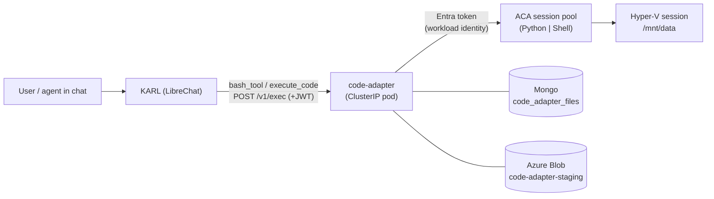

# Code execution — how it works

How KARL runs model-authored Python and Bash, end to end. Ticket: **KK20-108**.
The backend decision (ACA vs self-hosted) is in [`backend-decision.md`](backend-decision.md);
why the adapter is a separate service is in [`placement-and-justification.md`](placement-and-justification.md);
the adapter's operational reference (env, contract table, run/test) is its own
[README](../../code-adapter/README.md).

---

## The one-paragraph version

When an agent runs code, LibreChat calls a fixed HTTP contract (the "Code API")
at `LIBRECHAT_CODE_BASEURL`. We point that at **`knauf/code-adapter`**, a small
in-cluster service that translates each call into **Azure Container Apps dynamic
sessions** — Microsoft-managed, Hyper-V-isolated sandboxes — runs the code
there, and translates the result back. LibreChat is unmodified; the sandbox is
Microsoft's to operate; the adapter owns the glue and the bookkeeping ACA
doesn't do for us.

---

## Who calls what

The code-execution client is **not ours** — it's compiled inside the published
`@librechat/agents` package. It speaks exactly one protocol (the Code API) to
one URL (`LIBRECHAT_CODE_BASEURL`), computed once at module load. The modern
agent path expands the `execute_code` capability into **`bash_tool` + `read_file`**
([`packages/api/src/agents/initialize.ts`](../../../packages/api/src/agents/initialize.ts)),
so the dominant traffic is `lang=bash` and `python3` one-liners, executed verbatim.

The adapter serves that contract under `/v1`:

| Code API call                                                       | Purpose                                                     |
| ------------------------------------------------------------------- | ----------------------------------------------------------- |
| `POST /exec {lang, code, files?, session_id?}`                      | run code, get `{session_id, stdout, stderr, code, files[]}` |
| `POST /upload` · `POST /upload/batch`                               | stage input files                                           |
| `GET /download/{sid}/{fileId}`                                      | fetch an output file                                        |
| `GET /sessions/{sid}/objects/{fileId}`                              | freshness probe                                             |
| `DELETE /sessions/{sid}/objects/{fileId}` (+ `/files/...` fallback) | delete                                                      |

Inbound auth is the short-lived JWT LibreChat mints per request
([`packages/api/src/auth/codeapi.ts`](../../../packages/api/src/auth/codeapi.ts));
outbound auth to Azure is an Entra token via workload identity — **no static
credential anywhere.**

---

## What the adapter actually does (the six jobs)

1. **Protocol translation** — Code API ⇄ the ACA data-plane call, both directions.
2. **Language → pool routing** — `py` → the Python pool, `bash` → the Shell pool, else `501`.
3. **Auth bridge** — verify LibreChat's JWT inbound; acquire an Entra token outbound. Neither side sees the other's auth.
4. **File staging** — uploads land in Blob + a Mongo TTL row _before_ any session exists, get pushed into the session at exec time, and generated files get captured back to Blob so downloads outlive the sandbox.
5. **Filling ACA's gaps** — real exit codes and output past the ~4000-char cap, via the wrapper (below).
6. **Resilience** — expired-session re-mint, friendly timeouts, capacity handling — never a 5xx into the tool loop.

---

## The exec wrapper (why code isn't sent raw)

The spike found the two pools disagree on two things LibreChat needs, so the
adapter never sends user code directly. It wraps it in a base64-embedded
subprocess that tees full stdout/stderr to `/mnt/data/.karl_out.log` /
`.karl_err.log` and prints a per-request random sentinel
`KARL_<hex> RC=<n> OUT=<bytes> ERR=<bytes>` plus inline heads. This buys:

- **Real exit codes.** The Python pool runs an **IPython kernel** that swallows
  `sys.exit()` — verified: `sys.exit(3)` reported "Success". Running the user
  program as a subprocess captures its true return code (→ `3`). The Shell pool
  already returns a native exit code; the wrapper agrees with it.
- **Output past the cap.** The pools truncate inline stdout (~4000 chars). When
  the sentinel's byte counts exceed the inlined head, the adapter fetches the
  full log from `/mnt/data` (capped at `STDOUT_MAX_BYTES`, 64 KB).

If the sentinel is ever missing (API drift), the adapter degrades to raw stdout
plus 0/1 exit-code synthesis and increments `wrapper_parse_failures_total`.

---

## Pools, languages, and installed libraries (verified — and a gap that matters)

`lang` doesn't just pick a syntax; it picks a **different pool**, which is a
**different sandbox with a different set of installed libraries**. Verified live
(Aug 2026):

| `lang` | Which tool sends it                                                                     | Pool                          | `python3` | pandas / numpy            | `pip install`       |
| ------ | --------------------------------------------------------------------------------------- | ----------------------------- | --------- | ------------------------- | ------------------- |
| `bash` | **`bash_tool` — all agent code execution**, plus `readSandboxFile` / `writeSandboxFile` | **Shell**                     | 3.10.12 ✓ | **✗ absent**              | ✗ (egress disabled) |
| `py`   | legacy `execute_code` / the manual **Run** button only                                  | **Python** (code interpreter) | ✓         | **pandas 2.2.2, numpy ✓** | ✗ (egress disabled) |

> ### ⚠️ Known limitation — the data-science libraries are in the pool agents don't use
>
> The modern agent path registers **only `bash_tool`** (+ `read_file`), and
> `bash_tool` always sends `lang: "bash"` → the **Shell** pool. But the Shell
> pool has **no pandas/numpy/matplotlib** — those live only in the **Python**
> pool, which agent traffic never reaches. So an agent that analyses data by
> running `python3 <<'EOF' … import pandas …'EOF'` through `bash_tool` fails with
> `ModuleNotFoundError: No module named 'pandas'`. Egress is disabled, so a
> runtime `pip install` can't rescue it either. **This is the pandas failure you
> hit.**
>
> The fix is an infra decision (it changes the Terraform pools), not an adapter
> bug: the pool that serves `lang=bash` needs the data-science stack. The clean
> option is a **CustomContainer pool** — a small image with `bash` + `python3` +
> pandas/numpy/matplotlib baked in — used for the bash path (and, since the two
> languages don't share a sandbox anyway — see below — optionally for _both_
> languages, giving one sandbox per conversation with everything present).
> Tracked in the [rollout plan](../implementation-plans/code-interpreter-artifacts-rollout.md)
> and [backend-decision.md](backend-decision.md); until it lands, only pure-shell
> work (and Python that needs no third-party libs) succeeds through an agent.

---

## Sessions and sandboxes — "is it the same sandbox for the same user?" (verified)

The session identity is the hinge — but the real key is **(pool, identifier)**.
Each ACA sandbox is keyed by an **`identifier`** string _within a pool_. The
adapter mints `karl-<32 hex>` ids and uses them as that identifier; LibreChat
returns the `session_id` from the first exec and sends it back on the next, so
**one conversation reuses one identifier**.

Consequences, all verified live against the pools (Aug 2026):

- **Same pool + same `session_id` → the same sandbox is reused** (until it
  self-destructs after the cooldown, minimum 300 s idle). Files written to
  `/mnt/data` in one exec are there in the next.
- **Different `session_id` → a different, fully isolated sandbox.** A second
  identifier could not see the first's `/mnt/data` file. So two users (or two
  conversations) never share a sandbox — isolation is by identifier, and
  identifiers are per-conversation, server-minted, and unguessable.
- **`py` and `bash` do NOT share a sandbox — even in the same conversation.**
  This is the one that surprises people. Because `lang` selects a different
  _pool_, a `py` exec and a `bash` exec with the _same_ `session_id` land in two
  **separate sandboxes**. Verified: a file written by `lang=py` was invisible to
  a `lang=bash` call with the same id (`CANNOT SEE from_py.txt`), while a second
  `lang=py` call saw it fine. So "the shell can then manipulate the files Python
  wrote" is **false today** — the shell is a different box. (A single
  CustomContainer pool serving both languages would fix this too — see the
  limitation above.)
- **Files persist across calls; in-memory variables do not.** Because the
  wrapper runs each exec as a fresh subprocess, a Python variable set in one
  call is gone in the next (verified: `var persists: False`), but a file written
  to `/mnt/data` remains (`file persists: True`). `/tmp` is per-call scratch and
  does not persist. The model is expected to persist state to `/mnt/data`, not
  to memory — which is also what the read_file tool and the timeout message tell
  it to do.

> **Security note:** "same user" is _not_ what shares a sandbox — _same
> conversation_ is. A shared/marketplace agent used by two people runs each
> person's turns under their own conversation's identifier, so their sandboxes
> are separate. Cross-user leakage would require guessing another conversation's
> random 32-hex identifier, which the download/objects/delete paths additionally
> gate with a Mongo ownership check (user-kind → same `sub`; agent/skill-kind →
> same tenant).

### What happens when a sandbox has expired

If a session has cooled down and vanished, the next call gets
`SessionWithIdentifierNotFound`. The adapter catches it, transparently re-mints
the session, re-pushes any staged input files, and re-runs once — so from the
user's side the conversation just continues. Output files from the _previous_
sandbox still download fine because they were captured to Blob, not left in the
dead session.

---

## A file's journey (CSV → analysis → chart), verified end to end

1. You attach `data.csv` in chat. LibreChat stores it, then (at exec time) calls
   `POST /upload` → the adapter stages it to Blob (`code-adapter-staging/<sid>/<fileId>`)
   plus a Mongo row (`state: staged`, TTL 24 h). No session exists yet.
2. The agent runs `pd.read_csv('data.csv')`. LibreChat calls `POST /exec` with
   the file _referenced_. The adapter pulls the bytes from Blob, pushes them into
   the session's `/mnt/data`, then runs the wrapped code.
3. The code writes `chart.png`. After a `code:0` exec the adapter lists the
   session files, sees the new PNG, captures it to Blob + Mongo under the exec
   session, and returns it in `files[]`.
4. LibreChat downloads it via `GET /download/...` and renders it inline. It
   still works after the sandbox is gone, because it lives in Blob.

The whole round trip is covered by `npm run smoke` in the adapter and by the
contract suite in `test/contract/`.

> **Caveat:** this journey is proven with `lang=py` (the Python pool, which has
> pandas). An **agent** doing the same analysis calls `bash_tool` → the Shell
> pool, which has no pandas — so today the agent path fails at step 2 until the
> data-science-libs limitation above is resolved. The staging, capture, and
> download machinery is pool-agnostic and works either way; only the missing
> library blocks the analysis itself.

---

## Bookkeeping (Mongo + Blob)

- **Mongo `code_adapter_files`** — one row per staged/captured file:
  `{sessionId, fileId, filename, state, identity, userId, tenantId, blobPath, expiresAt, …}`,
  indexed unique on `(sessionId,fileId)` and `(sessionId,filename)`, with a 24 h
  TTL. Rows are the source of truth for what's valid.
- **Azure Blob `code-adapter-staging`** — the durable bytes, keyed `<sid>/<fileId>`.
  Cleaned by a container lifecycle rule (>2 days); an orphan blob is harmless
  because Mongo, not Blob, decides validity.

The 24 h Mongo TTL deliberately overshoots LibreChat's 23 h freshness window, so
LibreChat re-uploads _before_ rows expire; a 404 from the freshness probe routes
into LibreChat's own re-upload path.

---

## Failure handling (never a 5xx into the tool loop)

| Situation             | What the model sees                                    |
| --------------------- | ------------------------------------------------------ |
| Non-zero exit         | `code:<n>` + real stderr                               |
| >220 s (platform cap) | `code:1` + "split the work, persist to /mnt/data"      |
| Pool at capacity      | `code:1` + "sandbox is at capacity, try again shortly" |
| Expired input file    | `code:1` + "re-attach the file and retry"              |
| Backend/token fault   | honest `502` (the only case that isn't a friendly 200) |

---

## Local vs production

- **Local:** the adapter is a plain Node process (`node dist/index.js`) with
  `CODE_ADAPTER_LOCAL_MODE=true` (JWT skipped) authenticating to Azure via your
  `az login`. No Docker, no cluster. See the adapter [README](../../code-adapter/README.md).
- **Production (AGK):** a ClusterIP pod (image from `build-code-adapter.yaml`),
  first app pod on AGK to use **workload identity** for its Entra token; pools +
  identity + role assignment come from `agk-infrastructure` Terraform, deploy
  from `agk-deployment-configs`. LibreChat reaches it at
  `http://agentic-karl-code-adapter.<ns>.svc.cluster.local:3112/v1`.
