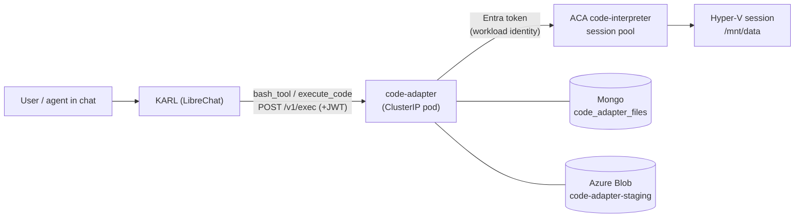

# Code execution — how it works

How KARL runs model-authored Python and Bash, end to end. Ticket: **KK20-108**.
The backend decision (ACA vs self-hosted) is in [`backend-decision.md`](backend-decision.md);
why the adapter is a separate service is in [`placement-and-justification.md`](placement-and-justification.md);
the adapter's operational reference (env, contract table, run/test) is its own
[README](../../code-adapter/README.md).

---

## The one-paragraph version

When an agent runs code, LibreChat calls a fixed HTTP contract (the "Code API")
at `LIBRECHAT_CODE_BASEURL`. We point that at **`knauf/code-adapter`**, a small
in-cluster service that translates each call into **Azure Container Apps dynamic
sessions** — Microsoft-managed, Hyper-V-isolated sandboxes — runs the code
there, and translates the result back. LibreChat is unmodified; the sandbox is
Microsoft's to operate; the adapter owns the glue and the bookkeeping ACA
doesn't do for us.

---

## Who calls what

The code-execution client is **not ours** — it's compiled inside the published
`@librechat/agents` package. It speaks exactly one protocol (the Code API) to
one URL (`LIBRECHAT_CODE_BASEURL`), computed once at module load. The modern
agent path expands the `execute_code` capability into **`bash_tool` + `read_file`**
([`packages/api/src/agents/initialize.ts`](../../../packages/api/src/agents/initialize.ts)),
so the dominant traffic is `lang=bash` and `python3` one-liners, executed verbatim.

The adapter serves that contract under `/v1`:

| Code API call                                                       | Purpose                                                     |
| ------------------------------------------------------------------- | ----------------------------------------------------------- |
| `POST /exec {lang, code, files?, session_id?}`                      | run code, get `{session_id, stdout, stderr, code, files[]}` |
| `POST /upload` · `POST /upload/batch`                               | stage input files                                           |
| `GET /download/{sid}/{fileId}`                                      | fetch an output file                                        |
| `GET /sessions/{sid}/objects/{fileId}`                              | freshness probe                                             |
| `DELETE /sessions/{sid}/objects/{fileId}` (+ `/files/...` fallback) | delete                                                      |

Inbound auth is the short-lived JWT LibreChat mints per request
([`packages/api/src/auth/codeapi.ts`](../../../packages/api/src/auth/codeapi.ts));
outbound auth to Azure is an Entra token via workload identity — **no static
credential anywhere.**

---

## What the adapter actually does (the six jobs)

1. **Protocol translation** — Code API ⇄ the ACA data-plane call, both directions.
2. **Language handling** — `py` and `bash` (else `501`) both run on the one code-interpreter pool; the wrapper picks the interpreter.
3. **Auth bridge** — verify LibreChat's JWT inbound; acquire an Entra token outbound. Neither side sees the other's auth.
4. **File staging** — uploads land in Blob + a Mongo TTL row _before_ any session exists, get (re-)pushed into the fresh sandbox **sequentially** on every exec that references them, and generated files get captured back to Blob so downloads outlive the sandbox.
5. **Filling ACA's gaps** — real exit codes and output past the ~4000-char cap, via the wrapper (below).
6. **Resilience** — expired-session re-mint, friendly timeouts, capacity handling — never a 5xx into the tool loop.

---

## The exec wrapper (why code isn't sent raw)

The adapter never sends user code directly. Everything runs on the
code-interpreter pool, so the wrapper is always a **Python program** that runs
the user's code — python (`[sys.executable, script]`) or bash (`['bash', script]`)
— as a subprocess, tees full stdout/stderr to `/mnt/data/.karl_out.log` /
`.karl_err.log`, and prints a per-request random sentinel
`KARL_<hex> RC=<n> OUT=<bytes> ERR=<bytes>` plus inline heads. This buys:

- **Real exit codes.** The pool runs an **IPython kernel** that swallows
  `sys.exit()` — verified: `sys.exit(3)` reported "Success". Running the user
  program as a subprocess captures its true return code (→ `3`) for both
  languages (bash `exit 7` → `7`, verified).
- **Bash on a Python pool.** The pool has `/usr/bin/bash`, so `lang=bash` runs
  via `subprocess.run(['bash', script])` — which is also how bash gets pandas
  (the pool has it) and a real exit code.
- **Output past the cap.** The pool truncates inline stdout (~4000 chars). When
  the sentinel's byte counts exceed the inlined head, the adapter fetches the
  full log from `/mnt/data` (capped at `STDOUT_MAX_BYTES`, 64 KB).

If the sentinel is ever missing (API drift), the adapter degrades to raw stdout
plus 0/1 exit-code synthesis and increments `wrapper_parse_failures_total`.

---

## Pools, languages, and installed libraries (one pool for everything)

**Both `lang=py` and `lang=bash` run on the same pool: the built-in
code-interpreter (PythonLTS) pool.** Verified live (Aug 2026), it carries
everything KARL needs — so the adapter always submits a Python wrapper and, for
bash, runs the script via `subprocess.run(['bash', …])`:

| The code-interpreter pool has |                                       |
| ----------------------------- | ------------------------------------- |
| `python3`                     | ✓ (3.12)                              |
| pandas / numpy / matplotlib   | ✓ **pandas 2.2.2**, numpy, matplotlib |
| `bash`                        | ✓ `/usr/bin/bash`                     |

> ### Why one pool (this replaced an earlier two-pool design)
>
> The obvious setup — a `PythonLTS` pool for `lang=py` and a `Shell` pool for
> `lang=bash` — has a trap we hit in testing: the modern agent path registers
> **only `bash_tool`** (+ `read_file`), and `bash_tool` always sends
> `lang: "bash"`. The built-in **Shell** pool has `python3` but **no
> pandas/numpy** (and egress is off, so no `pip install`), so an agent analysing
> data via a `python3` heredoc failed with a `pandas` ModuleNotFoundError. The
> two pools are also two separate sandboxes, so a file written by `lang=py`
> wasn't visible to `lang=bash`.
>
> The fix — implemented — is to route **both** languages to the **code-interpreter
> pool**, which already has `bash` + the data-science stack. One change closes
> every gap: pandas is present for bash, there's no second sandbox _type_ to keep
> in sync (files land in the same `/mnt/data` layout whichever language runs),
> real exit codes come from the subprocess, and it needs **no custom image and no
> egress** (the secure default;
> the image is Microsoft-maintained). The rejected alternatives — a
> `CustomContainer` image (own + patch it; only if KARL ever needs libraries the
> code-interpreter image lacks) and egress-enabled + `pip install` (verified ~7 s
> for pandas, but opens sandbox internet egress) — are recorded in
> [backend-decision.md](backend-decision.md).

---

## Sessions and sandboxes — "is the sandbox still there when I come back?" (verified)

**No — every `/exec` runs in a brand-new sandbox.** This is the most
counter-intuitive part, so it's worth being exact about what actually persists.

Each ACA sandbox is keyed by an **`identifier`** string, and the adapter mints
`karl-<32 hex>` ids to use as that identifier. The adapter _would_ reuse a
sandbox if a caller sent back a prior `session_id` — but the current client
doesn't. The compiled code tool in **`@librechat/agents` (v3.2.46)** reads a
`session_id` from its context but **never puts it in the `POST /exec` body**
(verified in `CodeExecutor.cjs`, and in the adapter's own logs: every exec in a
conversation arrives with no `session_id` and gets a fresh `karl-…` id). So in
practice:

- **Each exec = a fresh, empty, fully isolated Hyper-V sandbox.** It is never
  "still there" from a previous run; ACA sessions also self-destruct after the
  cooldown (≥300 s idle) regardless.
- **In-memory state never carries over.** A Python variable, `/tmp`, an
  installed package — all gone next exec. (The subprocess wrapper means state
  doesn't even survive _within_ a conversation, and the fresh sandbox means it
  wouldn't anyway.)

### So why do the files look like they're "still there"?

Because file continuity is **not** the sandbox's job — it's re-materialised from
the adapter's staging store on every call:

- LibreChat re-sends the relevant **file references on every `/exec`** (its
  `_injected_files` mechanism — it carries files forward instead of relying on a
  live session). The adapter pulls each referenced file's bytes from Blob and
  **re-pushes them into the fresh sandbox's `/mnt/data`** before running the
  code. So `data.csv` "is there" every run — mechanically it is re-uploaded each
  time.
- Files the code **generates** are captured to Blob + Mongo and handed back as
  refs, so they get re-injected/re-pushed the same way on later runs (and remain
  downloadable even though the sandbox that made them is long gone).
- The staging copy has a **sliding 24 h TTL** — every push/download bumps
  `expiresAt` — so an active conversation keeps its files available
  indefinitely. Only after ~24 h of no use does a file expire; the next exec
  that references it then returns `code:1` + "re-attach the file and retry"
  rather than crashing.

> **Push order matters:** the re-push is **sequential, one file at a time**. ACA
> dynamic-sessions file upload is _not_ concurrency-safe — pushing several files
> in parallel to a session clobbers all but one (verified live, Aug 2026:
> 4 concurrent pushes → 1 random survivor; sequential → all 4). This was a real
> bug (a model would `ls` and see a file, then `pd.read_excel` it in another exec
> and get `FileNotFoundError`); the fix is `pushInputs` in
> [`stagePush.ts`](../../code-adapter/src/exec/stagePush.ts).

> **Security / isolation:** every exec is its own sandbox, so users and
> conversations never share one — isolation is inherent, not dependent on
> identifier reuse. Access to a staged/generated file is additionally gated by a
> Mongo ownership check on download/objects/delete (user-kind → same `sub`;
> agent/skill-kind → same tenant), so a guessed identifier still can't reach
> another user's bytes.

### The re-mint safety net

The adapter still handles `SessionWithIdentifierNotFound` (a cooled-down
identifier): it re-mints and re-runs once. With today's client this path is
rarely taken — since each call already starts fresh — but it keeps the
"supplied `session_id`" case correct if a future client version starts reusing
sessions. Either way, output files download fine because they live in Blob, not
in the dead session.

---

## A file's journey (CSV → analysis → chart), verified end to end

1. You attach `data.csv` in chat. LibreChat stores it, then (at exec time) calls
   `POST /upload` → the adapter stages it to Blob (`code-adapter-staging/<sid>/<fileId>`)
   plus a Mongo row (`state: staged`, TTL 24 h). No session exists yet.
2. The agent runs `pd.read_csv('data.csv')`. LibreChat calls `POST /exec` with
   the file _referenced_ (it re-sends the ref on every exec). The adapter mints a
   fresh sandbox, pulls the bytes from Blob, pushes them into that sandbox's
   `/mnt/data` (sequentially), then runs the wrapped code.
3. The code writes `chart.png`. After a `code:0` exec the adapter lists the
   session files, sees the new PNG, captures it to Blob + Mongo under the exec
   session, and returns it in `files[]`.
4. LibreChat downloads it via `GET /download/...` and renders it inline. It
   still works after the sandbox is gone, because it lives in Blob.

The whole round trip is covered by `npm run smoke` in the adapter and by the
contract suite in `test/contract/`.

> Proven live end to end both via `lang=py` and via the **agent path** — a
> `lang=bash` `python3` heredoc importing pandas now returns `code=0` on the
> code-interpreter pool (this is the flow that failed under the old two-pool
> design). `npm run smoke` covers it.

---

## Bookkeeping (Mongo + Blob)

- **Mongo `code_adapter_files`** — one row per staged/captured file:
  `{sessionId, fileId, filename, state, identity, userId, tenantId, blobPath, expiresAt, …}`,
  indexed unique on `(sessionId,fileId)` and `(sessionId,filename)`, with a 24 h
  TTL. Rows are the source of truth for what's valid.
- **Azure Blob `code-adapter-staging`** — the durable bytes, keyed `<sid>/<fileId>`.
  Cleaned by a container lifecycle rule (>2 days); an orphan blob is harmless
  because Mongo, not Blob, decides validity.

The 24 h Mongo TTL deliberately overshoots LibreChat's 23 h freshness window, so
LibreChat re-uploads _before_ rows expire; a 404 from the freshness probe routes
into LibreChat's own re-upload path.

---

## Failure handling (never a 5xx into the tool loop)

| Situation             | What the model sees                                    |
| --------------------- | ------------------------------------------------------ |
| Non-zero exit         | `code:<n>` + real stderr                               |
| >220 s (platform cap) | `code:1` + "split the work, persist to /mnt/data"      |
| Pool at capacity      | `code:1` + "sandbox is at capacity, try again shortly" |
| Expired input file    | `code:1` + "re-attach the file and retry"              |
| Backend/token fault   | honest `502` (the only case that isn't a friendly 200) |

---

## Local vs production

- **Local:** the adapter is a plain Node process (`node dist/index.js`) with
  `CODE_ADAPTER_LOCAL_MODE=true` (JWT skipped) authenticating to Azure via your
  `az login`. No Docker, no cluster. See the adapter [README](../../code-adapter/README.md).
- **Production (AGK):** a ClusterIP pod (image from `build-code-adapter.yaml`),
  first app pod on AGK to use **workload identity** for its Entra token; pools +
  identity + role assignment come from `agk-infrastructure` Terraform, deploy
  from `agk-deployment-configs`. LibreChat reaches it at
  `http://agentic-karl-code-adapter.<ns>.svc.cluster.local:3112/v1`.
