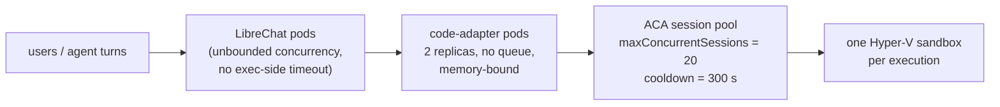

# Scaling and capacity — code execution

How much code execution KARL can actually run, what runs out first, and which knob to turn
when it does. Companion to [how-it-works.md](how-it-works.md) (which explains the request
flow and the sandbox/file model) and [deployment.md](deployment.md) (which explains how the
pieces get deployed).

Read this before raising replica counts, before promising a user-facing SLA, and before
assuming "it's serverless, it scales".

---

## 1. The four limits, in the order they bind

A single `/exec` passes through four independent capacity domains. They are **not**
interchangeable — adding adapter pods does nothing for a saturated session pool.



| Domain | Limit today | Bounded by | Where it lives |
| --- | --- | --- | --- |
| LibreChat → adapter | none | nothing — `CodeExecutor` uses `node-fetch` with no timeout | `@librechat/agents` |
| Adapter process | none (no queue, no semaphore) | pod memory, then Node's socket pool | `knauf/code-adapter` |
| Adapter fleet | 2 replicas × 2 Gi limit | `replicaCount` / `resources` | `agk-deployment-configs` values |
| **ACA session pool** | **20 concurrent sessions** | `maxConcurrentSessions` | `agk-infrastructure` Terraform |
| One sandbox | 1 exec, ~220 s, no network | ACA platform | Microsoft |

**The pool is the binding constraint**, and it is the only one that is not elastic. Everything
above it will happily accept more work than the pool can take; the adapter turns the resulting
429 into a friendly "The sandbox is at capacity. Try again shortly." (`code: 1`, HTTP 200), so
saturation degrades into a retry prompt rather than an error — but it is still a stall the user
sees.

---

## 2. What one execution costs the pool

This is the part that surprises people, and it follows directly from the
**fresh-sandbox-per-exec** model described in [how-it-works.md](how-it-works.md) (§ "Sessions and
sandboxes").

Every `/exec` mints a brand-new identifier (`karl-<32 hex>`), so every `/exec` **allocates a new
session**. A session is released when it has been idle for `cooldownPeriodInSeconds` — 300 s,
which is the platform minimum and cannot be lowered.

So one execution occupies a pool slot for:

```
slot time  =  execution time  +  cooldown (300 s)
```

An execution that finishes in 4 seconds still holds its slot for roughly 5 minutes.

### Sustained throughput

```
sustained executions/min  ≈  maxConcurrentSessions × 60 / (exec_time + 300)
                          ≈  20 × 60 / 304
                          ≈  4 executions per minute, pool-wide
```

Four per minute is **across every user of the environment**, not per user. A single analysis
turn commonly costs 3–6 executions (`ls`, inspect, compute, plot, write), so in dev roughly
**one data-analysis conversation per minute** saturates the pool.

Burst behaviour is better than sustained: 20 executions can start simultaneously. It is the
recovery that is slow — the pool is empty again only ~5 minutes after the burst.

### How many users is that?

The number people actually want. It follows from one step that is easy to miss: **executions
within a turn are sequential, but their slots are not.** Each `/exec` mints a *new* identifier,
so step 2 allocates a second session while step 1's is still cooling. A user five steps into an
analysis is holding **five slots at once** — one running, four idle-but-not-yet-released.

```
slots held by one user mid-analysis  ≈  executions in the turn        (3–6)
concurrent analyses the pool supports ≈  maxConcurrentSessions / that (20 / ~5)
```

| Pool | Concurrent users mid-analysis | Analysis turns / hour | Executions / hour |
| --- | --- | --- | --- |
| **20** (dev, stage — today) | **~4** | ~47 | ~236 |
| 50 (prod, planned) | ~10 | ~118 | ~590 |
| 100 | ~20 | ~236 | ~1 180 |

"Concurrent" means *inside the same ~5-minute window*, which is the right unit here: a user who
finishes an analysis keeps their slots for five more minutes regardless.

To go from concurrent to population, divide by how often a person actually runs one:

| Profile | Analyses / hour each | Users supported on the dev pool (20) |
| --- | --- | --- |
| Power analyst (one every 10 min) | 6 | ~8 |
| Regular (one every 30 min) | 2 | ~23 |
| Occasional (one every 2 hours) | 0.5 | ~94 |

Read those as *simultaneously-online users of that type during the peak hour*, not licence
count. Most KARL turns run no code at all — chat, web search and artifacts never touch the pool
— so the population that maps onto these numbers is only the slice doing data work at that
moment.

**What this means in practice.** For dev UAT with a handful of testers, 20 is comfortable. For a
department-wide rollout it is not: ~8 concurrent power users is a plausible Monday morning, and
the 21st execution gets "The sandbox is at capacity."

**Two assumptions carry all of this, and both are cheap to replace with measurements:**

- *executions per analysis turn = 3–6* — estimated from the workflow the skills prescribe
  (`ls` → inspect → compute → plot → write), not measured. The adapter's `exec completed` log
  line has everything needed to count it for real.
- *a cooling session still occupies a slot* — follows from the documented ACA semantics, and is
  what the validation below actually tests. If ACA releases slots earlier than the cooldown,
  every number in these tables improves, in some cases by a lot.

**The lever that changes the shape, not just the size:** session reuse (§2, option 2) makes a
whole *conversation* cost one slot instead of one per execution. On the dev pool that moves
"~4 concurrent analysts" to roughly "~20 concurrent conversations" — a bigger win than any
plausible increase to `maxConcurrentSessions`, and cheaper, since idle sessions bill by the
hour. It needs the identity fix in §5 first.

> **Validate this before UAT.** The slot-accounting above follows from the documented ACA
> semantics (`maxConcurrentSessions` counts *allocated* sessions; `cooldownPeriodInSeconds` is
> the idle timeout before termination), but we have not measured it on the AGK pools. The test
> is cheap:
>
> ```bash
> # 25 trivial execs as fast as the adapter will take them
> for i in $(seq 1 25); do
>   curl -s -XPOST "$ADAPTER/v1/exec" -H 'Content-Type: application/json' \
>     -H "Authorization: Bearer $JWT" \
>     -d '{"lang":"py","code":"print(1)"}' | jq -r '.stderr' &
> done; wait
> ```
>
> If ~20 succeed and the rest come back "at capacity", the model holds. Then wait 5 minutes and
> confirm the pool has recovered. Record the result here.

### The three ways to buy more throughput

1. **Raise `maxConcurrentSessions`** (Terraform, `code-adapter-{dev,stage}.tf`). Linear, immediate,
   and the pool bills per session-hour — idle capacity is close to free. This is the cheap lever.
2. **Reuse sessions per conversation** — turn on `toolExecution.sandbox.statefulSessions`, which
   makes `@librechat/agents` send `runtime_session_hint` and the adapter derive a stable
   identifier from it. One conversation then costs **one** slot instead of one per execution,
   which is a 3–6× throughput improvement on realistic traffic. It is a real product decision,
   not a tuning change (see the trade-offs in how-it-works.md), and it currently has a
   [security prerequisite](#5-security-note-that-is-also-a-scaling-decision).
3. **Release the slot early.** If the dynamic-sessions data plane exposes a session-terminate
   call at our pinned api-version, calling it after capture would return the slot in seconds
   instead of 300, which is worth up to ~75× on sustained throughput. **Unverified** — nobody has
   checked. Worth 30 minutes with the API reference before anyone raises the session cap.

---

## 3. Memory is the adapter's real limit, not CPU

The adapter is I/O-bound — it spends nearly all of an execution awaiting ACA — so CPU is
irrelevant. **Bytes in flight are not.** Two paths buffer whole files in memory:

| Path | Peak buffer | Source |
| --- | --- | --- |
| Input push | the whole file, one at a time (pushes are deliberately sequential) | `blob.getBuffer()` → `aca.pushFile()` |
| Output capture | the whole file, one at a time | `aca.fetchFileContent()` → `Buffer.concat` → `blob.put()` |

Defaults: `UPLOAD_MAX_BYTES` 128 MB, `CAPTURE_MAX_TOTAL_BYTES` 256 MB per execution,
`CAPTURE_MAX_FILES` 20.

So a *single* execution can legitimately peak at a couple of hundred megabytes resident, and
the adapter runs **N of those concurrently with no queue**. Sizing rule:

```
pod memory limit  ≥  (largest single file you allow)  ×  (concurrent execs you expect)  +  ~256 Mi baseline
```

With a 1 Gi limit — the value the worker service uses and the obvious thing to copy — **three
concurrent executions each capturing a 256 MB output OOM-kill the pod.** So the dev service
deliberately does not copy it:

- **1 Gi request / 2 Gi limit**, 2 replicas — as deployed.
- **`CAPTURE_MAX_TOTAL_BYTES: 67108864`** (64 MB) in the values rather than the adapter's 256 MB
  default, which is generous for charts and spreadsheets and fits the limit with room for
  concurrency. These two move together: raising one without the other is how the pod OOMs.
- The durable fix is to stream capture straight from ACA into Blob instead of buffering
  (`BlobStore.put` already accepts a `Readable`); that removes the coupling entirely and is
  worth doing before prod.

An OOM kill is not graceful: in-flight executions die with a socket error, and the user sees
"Execution error". Watch `container_memory_working_set_bytes` against the limit before raising
`maxConcurrentSessions`.

---

## 4. Latency budgets — the four timeouts that must stay ordered

| Hop | Budget | Set in |
| --- | --- | --- |
| Sandbox execution (platform) | ~220 s | ACA |
| Adapter → ACA (`ACA_EXEC_TIMEOUT_MS`) | 230 s | adapter env |
| Adapter → ACA file ops (`ACA_FILE_OP_TIMEOUT_MS`) | 30 s | adapter env |
| LibreChat → adapter, `/exec` from the model | unbounded | `@librechat/agents` |
| LibreChat → adapter, `readSandboxFile` / `writeSandboxFile` | **15 s** | `process.js` |
| LibreChat → adapter, `/upload`, `/upload/batch` | 120 s | `crud.js` |
| LibreChat → adapter, `/download` | 15 s | `crud.js`, `process.js` |
| LibreChat → adapter, object freshness probe | 5 s | `process.js` |

Two consequences worth knowing:

- **`read_file` has a 15-second budget but runs a full `/exec`.** Because every exec is a fresh
  sandbox, the adapter must re-push the referenced inputs first — sequentially. A `read_file`
  against a conversation carrying 100 MB of attachments will blow the 15 s client budget while
  the adapter is still pushing; LibreChat gives up and the model is told the read failed, even
  though the sandbox is fine. Keep an eye on `push_count` and `total_ms` in the adapter's
  `exec completed` log line.
- **A slow execution ties up a LibreChat request too**, for up to 230 s, because nothing on that
  side times out. Node handles that fine (it's an idle socket), but it does count against
  `CONCURRENT_MESSAGE_MAX` and against any ingress read timeout in front of LibreChat.

---

## 5. Security note that is also a scaling decision

The most attractive throughput lever (§2.2 — session reuse via `statefulSessions`) currently has
a prerequisite. The derived identifier is `HMAC(sessionHintSecret, thread_id)`, and
`sessionHintSecret` **defaults to the JWT public key**, which deployment publishes as a
ConfigMap value. `/exec` also honours a caller-supplied `session_id` without checking that the
session belongs to the caller. Today that is inert — identifiers are 128-bit random mints — but
with reuse switched on, the identifier becomes a deterministic function of two non-secret
values, and reaching another user's live sandbox becomes a question of knowing a conversation id.

**Bind the session to the principal before enabling reuse**: fold `auth.userId` into
`deriveSessionId`, and reject a supplied `session_id` that was not minted for the caller. Small
change; it just has to land first.

---

## 6. What to watch

The adapter exposes Prometheus metrics on `/metrics` (unauthenticated, ClusterIP-only).

| Signal | Metric | What it tells you |
| --- | --- | --- |
| Saturation | `code_adapter_exec_total{outcome="capacity"}` | Pool is full — raise `maxConcurrentSessions` or enable reuse |
| **Executions per turn** | `code_adapter_exec_total` ÷ distinct conversations | The assumption the §2 user math rests on. Measure it in UAT and replace the 3–6 estimate |
| Timeouts | `code_adapter_exec_total{outcome="timeout"}` | Work exceeding ~220 s — a prompt/skill problem more often than a capacity one |
| Lost sandboxes | `code_adapter_exec_total{outcome="session_lost"}` | Retry-once exhausted; correlate with pool restarts |
| Latency | `code_adapter_exec_duration_seconds` | Success path only — failures are counted but not observed |
| Contract drift | `code_adapter_wrapper_parse_failures_total` | The sentinel wrapper stopped parsing; exit codes are being synthesized |
| Volume | `code_adapter_upload_bytes_total` | Staging growth; pairs with the 24 h sliding TTL |

Gaps to close when monitors are wired: `code_adapter_truncation_recoveries_total` and
`code_adapter_aca_request_duration_seconds` are registered but never written, so they read as a
permanent zero — don't build an alert on them until they're incremented.

Non-Prometheus signals worth a dashboard: pool-level session counts in Azure Monitor (the
authoritative saturation signal), adapter pod memory against limit (§3), and Mongo
`code_adapter_files` collection size against the 24 h TTL.

---

## 7. Knob reference

| Symptom | Turn this | Where |
| --- | --- | --- |
| "The sandbox is at capacity" | `maxConcurrentSessions` (20 → 50) | `agk-infrastructure`, `code-adapter-<env>.tf` |
| Capacity pressure at the same user load | enable `statefulSessions` (after §5) | `librechat.yaml` |
| Adapter OOM-kills | `resources.limits.memory` ↑ **and** `CAPTURE_MAX_TOTAL_BYTES` ↓ | `agk-deployment-configs` values |
| Adapter CPU-bound (unexpected) | `replicaCount` | `agk-deployment-configs` values |
| Long analyses truncated at ~220 s | nothing to turn — it is a platform cap; the skills already tell the model to split work and persist to `/mnt/data` | — |
| Files expiring mid-conversation | `FILE_TTL_HOURS` (24, sliding — bumped on every push/download) | adapter env |
| Too many generated files dropped | `CAPTURE_MAX_FILES` (20) | adapter env |

Two knobs that look like scaling knobs and are not: `cooldownPeriodInSeconds` is already at the
platform minimum, and adapter `replicaCount` buys nothing while the pool is the constraint —
it's for availability and rollout safety, not throughput.

---

## 8. Prod sizing, when it comes

Not a copy of dev. Before the prod pool is created:

1. Measure real executions-per-conversation in dev UAT (the `exec completed` log line has
   everything needed).
2. Decide on session reuse — it changes the required pool size by 3–6×.
3. Size `maxConcurrentSessions` for peak-hour concurrency **plus the 300 s cooldown tail**, not
   for average load. The planned 50 assumes fresh-per-exec and roughly 10 executions/minute
   sustained; verify against the dev numbers rather than inheriting the assumption.
4. Fix the capture buffering (§3) or set memory limits that account for it.

Sizing shortcut, once step 1 has a real number for executions-per-turn (`E`):

```
maxConcurrentSessions  ≈  peak concurrent analysts  ×  E          (fresh-per-exec)
maxConcurrentSessions  ≈  peak concurrent conversations           (with session reuse)
```

At the planned 50 and `E ≈ 5`, prod supports roughly **10 people doing data analysis in the same
five-minute window** — which is the number to sanity-check against the actual audience before
the pool is created, not after. If that is too few, decide between a larger pool (linear, cheap
— idle sessions bill by the hour) and session reuse (§2, which divides the requirement by `E`),
and remember the second one needs the §5 identity fix first.
