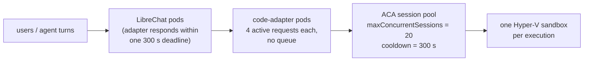

# Scaling and capacity — code execution

How much code execution KARL can actually run, what runs out first, and which knob to turn
when it does. Companion to [how-it-works.md](how-it-works.md) (which explains the request
flow and the sandbox/file model) and [deployment.md](deployment.md) (which explains how the
pieces get deployed).

Read this before raising replica counts, before promising a user-facing SLA, and before
assuming "it's serverless, it scales".

---

## 1. The four limits, in the order they bind

A single `/exec` passes through four independent capacity domains. They are **not**
interchangeable — adding adapter pods does nothing for a saturated session pool.



| Domain               | Limit today                                                    | Bounded by                                                  | Where it lives                 |
| -------------------- | -------------------------------------------------------------- | ----------------------------------------------------------- | ------------------------------ |
| LibreChat → adapter  | adapter total deadline 300 s; sandbox read/write helper 350 s  | `EXEC_TOTAL_TIMEOUT_MS`, `CODE_EXEC_HELPER_TIMEOUT_MS`      | adapter + `process.js`         |
| Adapter process      | 4 active requests and 512 MiB aggregate staged input; no queue | `EXEC_MAX_ACTIVE_REQUESTS`, `EXEC_MAX_INFLIGHT_INPUT_BYTES` | `knauf/code-adapter`           |
| Adapter fleet        | 2 replicas × 4 admitted requests × 2 Gi limit                  | `replicaCount` / admission / `resources`                    | adapter + GitOps values        |
| **ACA session pool** | **20 concurrent sessions**                                     | `maxConcurrentSessions`                                     | `agk-infrastructure` Terraform |
| One sandbox          | 1 exec, ~220 s, no network                                     | ACA platform                                                | Microsoft                      |

The first binding constraint depends on traffic shape. Per-process admission intentionally rejects
before Node memory or sockets are exhausted; the ACA pool remains the environment-wide ceiling.
Adapter admission returns HTTP 429 with no queue. ACA saturation remains a friendly HTTP 200
`code:1` response so the model can retry later.

---

## 2. What one execution costs the pool

This is the part that surprises people, and it follows directly from the
**fresh-sandbox-per-exec** model described in [how-it-works.md](how-it-works.md) (§ "Sessions and
sandboxes").

Every stateless `/exec` mints a brand-new identifier (`karl-<32 hex>`), so it allocates a new
session. After output recovery and generated-file capture, the adapter calls the ACA session
DELETE endpoint. A successful delete returns the slot promptly; only a failed or unauthorized
delete leaves the session allocated through the 300-second cooldown.

So one execution occupies a pool slot for:

```
normal slot time   = input push + execution + capture + explicit delete
failed-delete time = the same work + cooldown tail (up to 300 s)
```

The former four-executions-per-minute model assumed every session waited through cooldown and is
no longer the normal-path model. Throughput must now be measured with deletion success/failure
split out. The stage proof must show DELETE permission, `code_adapter_session_deletion_total`,
and Azure pool recovery after both successful and deliberately failed cleanup.

### How many users is that?

The number people actually want. It follows from one step that is easy to miss: **executions
within a turn are sequential, but their slots are not.** Each `/exec` mints a _new_ identifier,
so step 2 allocates a second session while step 1's is still cooling. A user five steps into an
analysis is holding **five slots at once** — one running, four idle-but-not-yet-released.

```
slots held by one user mid-analysis ≈ concurrently running executions
cooling slots after completion      ≈ executions whose explicit deletion failed
```

Do not convert the configured pool size into a supported-user count without measured peak arrival
rates, executions per analysis, execution/capture duration, and deletion success.

**The remaining assumptions must be replaced with measurements:**

- _executions per analysis turn = 3–6_ — estimated from the workflow the skills prescribe
  (`ls` → inspect → compute → plot → write), not measured. The adapter's `exec completed` log
  line has everything needed to count it for real.
- _successful DELETE promptly returns pool capacity_ — the API contract is implemented, but the
  exact stage identity permission and observed recovery time still require a live proof.

**The lever that changes the shape, not just the size:** session reuse (§2, option 2) can make a
whole _conversation_ cost one slot instead of one per execution. It remains disabled because it
changes privacy/lifecycle behavior and hint-derived sessions are not yet treated as reused during
output capture; see §5.

> **Validate this before UAT.** The slot-accounting above follows from the documented ACA
> semantics (`maxConcurrentSessions` counts _allocated_ sessions; `cooldownPeriodInSeconds` is
> the idle timeout before termination), but we have not measured it on the AGK pools. The test
> is cheap:
>
> ```bash
> # 25 trivial execs as fast as the adapter will admit them
> for i in $(seq 1 25); do
>   curl -s -XPOST "$ADAPTER/v1/exec" -H 'Content-Type: application/json' \
>     -H "Authorization: Bearer $JWT" \
>     -d '{"lang":"py","code":"print(1)"}' | jq -r '.stderr' &
> done; wait
> ```
>
> Record adapter 429s, ACA capacity responses, deletion outcomes, and pool recovery time. The
> configured limits do not prove service behavior in advance.

### The three ways to buy more throughput

1. **Raise `maxConcurrentSessions`** (Terraform, `code-adapter-{dev,stage}.tf`). Linear, immediate,
   and the pool bills per session-hour — idle capacity is close to free. This is the cheap lever.
2. **Reuse sessions per conversation** — after its separate privacy and capture gates, turn on
   `toolExecution.sandbox.statefulSessions`, which
   makes `@librechat/agents` send `runtime_session_hint` and the adapter derive a stable
   identifier from it. One conversation then costs **one** slot instead of one per execution,
   which may materially improve throughput. It is a product/privacy decision, not a tuning
   change (see the trade-offs in how-it-works.md).
3. **Keep explicit deletion healthy.** It is implemented for adapter-minted stateless sessions
   after capture. Verify the stage identity can call it and alert on deletion failures; raising
   pool size while cleanup is unauthorized only hides the lifecycle defect.

---

## 3. Memory is the adapter's real limit, not CPU

The adapter is I/O-bound — it spends nearly all of an execution awaiting ACA — so CPU is
rarely the first limit. **Bytes in flight are not.** Input push and output capture are streamed, and admission bounds the
aggregate metadata-backed input bytes accepted by each process:

| Path           | Peak buffer                                                                    | Source                                           |
| -------------- | ------------------------------------------------------------------------------ | ------------------------------------------------ |
| Input push     | streaming SDK buffers; one file at a time (pushes are deliberately sequential) | `blob.getStream()` → `aca.pushFile()`            |
| Output capture | bounded streaming buffers (roughly 8 MiB per upload plus SDK overhead)         | ACA stream → byte-limit transform → `blob.put()` |

Defaults: `UPLOAD_MAX_BYTES` 128 MB, `CAPTURE_MAX_TOTAL_BYTES` 256 MB per execution,
`CAPTURE_MAX_FILES` 20.

The adapter admits at most four active executions and 512 MiB of aggregate staged input metadata
per process by default. There is no waiting queue. Conservative sizing rule:

```
pod memory limit ≥ concurrent SDK stream buffers + runtime/SDK headroom
```

- **1 Gi request / 2 Gi limit**, 2 replicas — as deployed.
- **`CAPTURE_MAX_TOTAL_BYTES: 67108864`** (64 MB) bounds generated bytes and Blob spend but no
  longer implies a same-sized process buffer.
- Stage load evidence still has to cover concurrent maximum-size streams before production
  activation; metadata admission bounds logical bytes, while SDK buffering determines heap use.

An OOM kill is not graceful: in-flight executions die with a socket error, and the user sees
"Execution error". Watch `container_memory_working_set_bytes` against the limit before raising
`maxConcurrentSessions`.

---

## 4. Latency budgets — the four timeouts that must stay ordered

| Hop                                                         | Budget                           | Set in                                        |
| ----------------------------------------------------------- | -------------------------------- | --------------------------------------------- |
| Sandbox execution (platform)                                | ~220 s                           | ACA                                           |
| Adapter → ACA (`ACA_EXEC_TIMEOUT_MS`)                       | 230 s                            | adapter env                                   |
| Adapter → ACA file ops (`ACA_FILE_OP_TIMEOUT_MS`)           | 30 s                             | adapter env                                   |
| Whole adapter request (`EXEC_TOTAL_TIMEOUT_MS`)             | 300 s                            | adapter env                                   |
| Stateless session deletion                                  | 10 s, independent cleanup budget | adapter env                                   |
| LibreChat → adapter, `readSandboxFile` / `writeSandboxFile` | 350 s                            | `CODE_EXEC_HELPER_TIMEOUT_MS` in `process.js` |
| LibreChat → adapter, `/upload`, `/upload/batch`             | 120 s                            | `crud.js`                                     |
| LibreChat → adapter, `/download`                            | 15 s                             | `crud.js`, `process.js`                       |
| LibreChat → adapter, object freshness probe                 | 5 s                              | `process.js`                                  |

Two consequences worth knowing:

- **The adapter owns the terminal deadline.** A timeout aborts ACA, Blob, Table, stream, retry,
  and capture work and returns a model-actionable failure where the contract permits.
- **The helper timeout is intentionally outside the adapter deadline.** Its 350-second budget
  allows the 300-second request plus bounded cleanup and transport slack without becoming
  unbounded.

---

## 5. Stateful reuse remains a separate launch decision

Session IDs are now bound to the authenticated caller: minted IDs carry an owner tag, hint
derivation includes the user ID, and foreign supplied IDs are ignored. A dedicated
`SESSION_HINT_SECRET` is still required before enabling stateful sessions so known conversation
IDs do not yield predictable session IDs.

That closes the direct ownership defect, but it does not make stateful reuse launch-ready.
Hint-derived sessions are not currently marked as reused when the pre-execution baseline is
selected, so a later execution without new inputs can re-report files left by an earlier turn.
Continuity also changes retention and shared-conversation privacy semantics. Keep
`toolExecution.sandbox.statefulSessions` disabled until those behaviors have dedicated tests and
an explicit product/security decision.

---

## 6. What to watch

The adapter exposes Prometheus metrics on `/metrics` (unauthenticated, ClusterIP-only).

| Signal                  | Metric                                                                         | What it tells you                                                                        |
| ----------------------- | ------------------------------------------------------------------------------ | ---------------------------------------------------------------------------------------- |
| Saturation              | `code_adapter_exec_total{outcome="capacity"}`                                  | Pool is full — raise `maxConcurrentSessions` or enable reuse                             |
| Adapter admission       | `code_adapter_admission_rejected_total{reason}`                                | Per-process active-request or aggregate-input guard rejected before execution            |
| Active load             | `code_adapter_admission_active_requests`, `code_adapter_admission_input_bytes` | Current process admission occupancy                                                      |
| Session cleanup         | `code_adapter_session_deletion_total{outcome}`                                 | Whether stateless sessions are returning pool capacity explicitly                        |
| Dependency health       | `code_adapter_dependency_ready{dependency}`                                    | Cached Table/Blob/identity/ACA readiness                                                 |
| Canary freshness        | `code_adapter_canary_last_success_timestamp_seconds`                           | Last complete fixed-code/output/file lifecycle proof                                     |
| **Executions per turn** | `code_adapter_exec_total` ÷ distinct conversations                             | The assumption the §2 user math rests on. Measure it in UAT and replace the 3–6 estimate |
| Timeouts                | `code_adapter_exec_total{outcome="timeout"}`                                   | Work exceeding ~220 s — a prompt/skill problem more often than a capacity one            |
| Lost sandboxes          | `code_adapter_exec_total{outcome="session_lost"}`                              | Retry-once exhausted; correlate with pool restarts                                       |
| Latency                 | `code_adapter_exec_duration_seconds`                                           | Success path only — failures are counted but not observed                                |
| Contract drift          | `code_adapter_wrapper_parse_failures_total`                                    | The sentinel wrapper stopped parsing; exit codes are being synthesized                   |
| Volume                  | `code_adapter_upload_bytes_total`                                              | Staging growth; pairs with the 24 h sliding TTL                                          |

`code_adapter_aca_request_duration_seconds{op}` (per-op: execute/pushFile/listFiles/
fetchFileStream/fetchFileContent) and `code_adapter_truncation_recoveries_total` were previously
registered but never written (permanent zero). As of KK20-257's metrics fix both are incremented
— the former on every ACA call (`fetchFileStream`'s timer spans the full stream lifetime, headers
through close/error, not just the header round-trip), the latter on every recovered-from-`/mnt/data`
log fetch — and are safe to build alerts on.

Non-Prometheus signals worth a dashboard: pool-level session counts in Azure Monitor (the
authoritative saturation signal), adapter pod memory against limit (§3), and
`codeAdapterFiles` Table entity/reconciliation volume against the 24-hour lifetime.

---

## 7. Knob reference

| Symptom                                 | Turn this                                                                                                          | Where                                         |
| --------------------------------------- | ------------------------------------------------------------------------------------------------------------------ | --------------------------------------------- |
| "The sandbox is at capacity"            | Review `maxConcurrentSessions` using measured demand; do not assume a target                                       | `agk-infrastructure`, `code-adapter-<env>.tf` |
| Capacity pressure at the same user load | enable `statefulSessions` (after §5)                                                                               | `librechat.yaml`                              |
| Adapter 429s                            | Review `EXEC_MAX_ACTIVE_REQUESTS` and `EXEC_MAX_INFLIGHT_INPUT_BYTES` against measured memory/latency              | adapter env + GitOps                          |
| Adapter OOM-kills                       | Keep admission conservative; review `resources.limits.memory` and stream evidence                                  | adapter env + GitOps                          |
| Adapter CPU-bound (unexpected)          | `replicaCount`                                                                                                     | `agk-deployment-configs` values               |
| Long analyses truncated at ~220 s       | nothing to turn — it is a platform cap; the skills already tell the model to split work and persist to `/mnt/data` | —                                             |
| Files expiring mid-conversation         | `FILE_TTL_HOURS` (24, sliding — bumped on every push/download)                                                     | adapter env                                   |
| Too many generated files dropped        | `CAPTURE_MAX_FILES` (20)                                                                                           | adapter env                                   |

Two knobs that look like scaling knobs and are not: `cooldownPeriodInSeconds` is already at the
platform minimum, and adapter `replicaCount` buys nothing while the pool is the constraint —
it's for availability and rollout safety, not throughput.

---

## 8. Production sizing

Production already has a separately owned pool configured at 20 sessions. Before activation:

1. Measure real executions-per-conversation in dev UAT (the `exec completed` log line has
   everything needed).
2. Decide on session reuse — it changes the required pool size by 3–6×.
3. Size `maxConcurrentSessions` for peak-hour concurrency plus the measured failed-delete
   cooldown tail, not for average load. Keep 20 unless measured evidence justifies a reviewed
   change; there is no established 50-session requirement.
4. Measure concurrent large-input pushes against the adapter memory limit (§3).

Sizing shortcut, once step 1 has a real number for executions-per-turn (`E`):

```
maxConcurrentSessions  ≈  peak concurrent analysts  ×  E          (fresh-per-exec)
maxConcurrentSessions  ≈  peak concurrent conversations           (with session reuse)
```

Use the formula only after `E` and peak demand are measured. If 20 is insufficient, decide
between a larger pool and stateful reuse; the latter remains gated by §5 and must not be enabled
as an operational shortcut.
