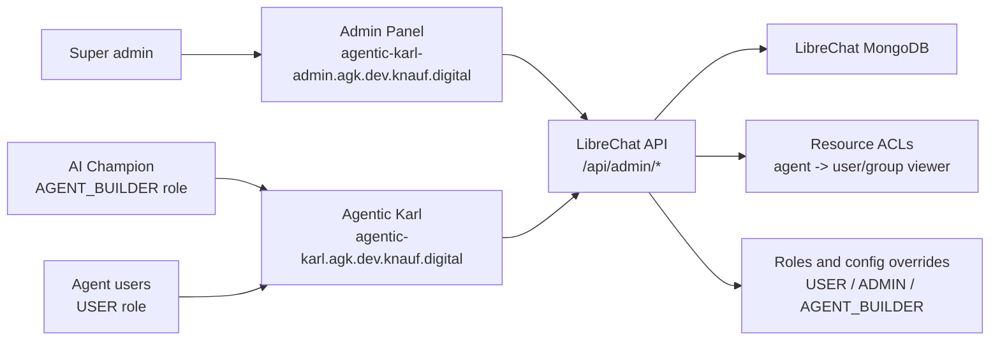

# Plan: LibreChat Admin Panel on AGK dev

Generated: 2026-06-05

## Current decision

Use the upstream LibreChat Admin Panel as a separate AGK dev service first. Do not fork the admin panel for the initial pilot.

Reasoning:

- The Admin Panel already manages users, groups, roles, config overrides, and admin grants through LibreChat's `/api/admin/*` endpoints.
- LibreChat access control already separates feature permissions from resource ACLs. That matches the AI Champions flow: `AGENT_BUILDER` controls who can create agents, while per-agent ACLs control who can use each published agent.
- A custom Knauf implementation is only needed later for the governance view we do not get out of the box: agent inventory, assigned users/groups, CSV import status, and audit/export reporting.

## Target shape



The admin panel does not need direct MongoDB access. It calls LibreChat admin APIs, and LibreChat reads/writes the shared database.

## Repos and branches

| Repo | Branch | Purpose |
|---|---|---|
| `/Users/ZaharA/knauf/agentic-karl` | `codex/admin-panel-dev-deployment-plan` | Planning docs and future app-side config notes |
| `/Users/ZaharA/knauf/agk-deployment-configs` | `codex/admin-panel-dev-service` | GitOps service definition for the admin panel |
| `/Users/ZaharA/knauf/librechat-admin-panel` | upstream `main` only | Reference source; do not fork for the first deployment |

## Dev implementation status

Updated: 2026-06-05

Completed:

- Nonprod Azure subscription selected locally: `CT-SHARED-RESOURCES`.
- Dev Key Vault secret created: `AGK-ADMIN-PANEL-SESSION-SECRET` in `kv-agntkarl-nonprod-001`.
- Pinned upstream image imported into `acragkhubnonprod001` as `agentic-karl-dev/librechat-admin-panel:eaba3220a57f51184b8c790220f07a59227b6d1a`.
- GitOps branch `codex/admin-panel-dev-service` now contains the dev admin panel service definition.
- LibreChat dev values now include `ADMIN_PANEL_URL=https://agentic-karl-admin.agk.dev.knauf.digital`.

Still required before ArgoCD can make the service usable:

- Add the Okta login redirect URI listed below.
- Push and merge the GitOps branch, or otherwise sync the branch through the approved GitOps path.
- Verify the new ArgoCD app and SSO flow after sync.

## Infra prerequisites

1. Pin Azure CLI to nonprod before any live operation:

   ```bash
   az account set --subscription ad3f0a71-cc5b-4d00-8289-23623cf2064c
   az account show --query "{name:name,id:id,tenantId:tenantId,user:user.name}" -o json
   ```

   Current local CLI state was checked on 2026-06-05 and was still pointed at `CT-SHARED-RESOURCES-PROD`, so this is mandatory before touching Key Vault, ACR, AKS, or ArgoCD.

2. Add this Okta login redirect URI to the existing Agentic-Karl OIDC app:

   ```text
   https://agentic-karl.agk.dev.knauf.digital/api/admin/oauth/openid/callback
   ```

   This is the LibreChat backend callback. It is not the admin panel URL.

3. Create a Key Vault secret for the admin panel session secret in `kv-agntkarl-nonprod-001`.

   Suggested secret name:

   ```text
   AGK-ADMIN-PANEL-SESSION-SECRET
   ```

4. Pin the upstream admin-panel image. Candidate already verified locally:

   ```text
   ghcr.io/clickhouse/librechat-admin-panel:eaba3220a57f51184b8c790220f07a59227b6d1a
   ```

   Preferred hardening step for AGK dev is to import it into the nonprod hub ACR instead of pulling directly from GHCR:

   ```bash
   az acr import \
     --name acragkhubnonprod001 \
     --source ghcr.io/clickhouse/librechat-admin-panel:eaba3220a57f51184b8c790220f07a59227b6d1a \
     --image agentic-karl-dev/librechat-admin-panel:eaba3220a57f51184b8c790220f07a59227b6d1a
   ```

## GitOps changes

Make these in `/Users/ZaharA/knauf/agk-deployment-configs` on `codex/admin-panel-dev-service`.

1. Add a local-only service path:

   ```text
   agentic-karl/dev/services/agentic-karl-admin-panel/
   ```

2. Add `Chart.yaml` using the existing `ct-shared-chart` dependency pattern.

3. Add `values.yaml` for a single-service deployment:

   ```yaml
   agentic-karl-admin-panel:
     namespace: agentic-karl-dev
     replicaCount: 1
     name: agentic-karl-admin-panel
     image:
       repository: acragkhubnonprod001.azurecr.io/agentic-karl-dev/librechat-admin-panel
       tag: eaba3220a57f51184b8c790220f07a59227b6d1a
       pullPolicy: IfNotPresent
     service:
       type: ClusterIP
       port: 80
       targetPort: 3000
     pod:
       ports:
         containerPort: 3000
     envFrom:
       - configMapRef:
           name: agentic-karl-admin-panel
       - secretRef:
           name: agentic-karl-admin-panel-secrets
     externalSecret:
       enabled: true
       secretStore:
         kind: SecretStore
         name: kv-agntkarl-nonprod-001
       secrets:
         SESSION_SECRET: AGK-ADMIN-PANEL-SESSION-SECRET
     configmap:
       PORT: 3000
       VITE_API_BASE_URL: https://agentic-karl.agk.dev.knauf.digital
       API_SERVER_URL: http://agentic-karl
       ADMIN_SSO_ONLY: true
       ADMIN_SESSION_IDLE_TIMEOUT_MS: 1800000
       SESSION_COOKIE_SECURE: true
     ingress:
       enabled: true
       class: traefik
       ingressClassName: traefik
       path: /
       host: agentic-karl-admin.agk.dev.knauf.digital
   ```

4. Update `/Users/ZaharA/knauf/agk-deployment-configs/infra/nonprod/argocd/projects/services.yaml`:

   - Exclude `agentic-karl/dev/services/agentic-karl-admin-panel` from the normal multi-source `services` ApplicationSet.
   - Add it to the `services-local` ApplicationSet.

5. Confirm network policy. The current `agentic-karl-dev` policy allows same-namespace traffic, so the admin panel should reach `http://agentic-karl` without a new network-policy exception.

## LibreChat backend changes

Make these in the AGK dev service values so LibreChat can redirect admin OAuth back to the separate admin panel:

```yaml
configmap:
  ADMIN_PANEL_URL: https://agentic-karl-admin.agk.dev.knauf.digital
```

This belongs in `/Users/ZaharA/knauf/agk-deployment-configs/agentic-karl/dev/services/agentic-karl/values.yaml`.

Also review `librechat.yaml` defaults. Latest main still has broad default agent settings for the `USER` role:

```yaml
agents:
  use: true
  create: true
  share: true
  public: true
```

For the pilot, the intended effective defaults are:

| Role | Agents use | Agents create | Agents share | Agents public |
|---|---:|---:|---:|---:|
| `USER` | yes | no | no | no |
| `AGENT_BUILDER` | yes | yes | no | no |
| `ADMIN` | yes | yes | yes | yes |

The admin panel should be the operational source of truth after bootstrap. We still need to decide whether to also tighten `librechat.yaml` so a future restart or clean database cannot reseed overly broad `USER` permissions.

## Governance pilot flow

1. Super admin creates or verifies the `AGENT_BUILDER` role in the admin panel.
2. Super admin grants selected AI Champions the `AGENT_BUILDER` role.
3. AI Champions create agents in Agentic Karl and attach files/prompts as needed.
4. AI Champions submit a CSV to the super admin team:

   ```csv
   agent_name,agent_owner_email,grantee_type,grantee_email_or_group,access_role
   Contract Helper,champion@example.com,user,target@example.com,viewer
   HR Policy Assistant,champion@example.com,group,HR Pilot Users,viewer
   ```

5. Super admins apply the ACL entries programmatically, preferably through admin APIs where available; direct DB writes are allowed only as a controlled back-office script when API coverage is insufficient.
6. Normal users retain the `USER` role and can only use agents explicitly shared to them or to a group they belong to.

Use roles for capability profiles. Use groups for agent audiences. Use direct user grants only for narrow exceptions or tiny pilots.

## Validation checklist

Pre-deploy:

- `az account show` confirms nonprod subscription.
- Okta app contains the admin callback URI.
- Key Vault contains `AGK-ADMIN-PANEL-SESSION-SECRET`.
- Admin panel image is pinned and either reachable from GHCR or imported into ACR.
- GitOps `helm template` succeeds for the new service.

Post-deploy:

- ArgoCD app `agentic-karl-dev-agentic-karl-admin-panel` is healthy.
- `https://agentic-karl-admin.agk.dev.knauf.digital` loads.
- SSO redirects to Okta and returns through `/api/admin/oauth/openid/callback`.
- A current admin can access the panel.
- A non-admin without `access:admin` cannot access the panel.
- `AGENT_BUILDER` can create an agent but cannot share or make it public.
- `USER` cannot open the builder for new agents and only sees assigned agents.
- CSV-driven ACL assignment grants viewer access to the intended user or group.

## Open decisions

- Should dev pull the pinned GHCR image directly, or should every environment consume only the ACR-imported image?
- Should `librechat.yaml` be tightened now, or should we first validate DB-backed admin-panel role changes on dev?
- Should agent ACL assignment be implemented as a small script in `knauf/scripts/`, or kept as an operational one-off until the final governance model is approved?
- Which host should be reserved for prod if dev succeeds: `agentic-karl-admin.agk.prod.knauf.digital` or a path under the main KARL host?

## Rollback

1. Disable or delete the `agentic-karl-admin-panel` ArgoCD app by reverting the GitOps service path.
2. Remove `ADMIN_PANEL_URL` from the LibreChat dev values.
3. Remove the Okta admin callback URI if the panel is no longer being tested.
4. Keep `AGENT_BUILDER` and ACL data in Mongo unless there is a separate governance reason to delete them; they do not depend on the admin panel service being live.
