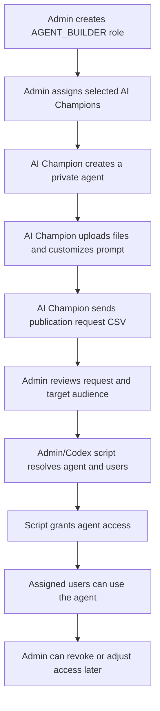

# Agent publishing governance flow

Working draft started on 2026-06-02. This document captures the current proposal for a controlled AI Champions pilot. It is intentionally not the final legal/process document yet; it is the place to collect decisions until we converge on the final operating model.

> **Status update (2026-06-10):** The `AGENT_BUILDER` role proposed below has been implemented. See [`knauf/docs/reference/roles-and-access.md`](../reference/roles-and-access.md) for the technical reference. The final role model is `USER` / `AGENT_BUILDER` / `ADMIN`.

## Goal

Allow a narrow set of AI Champions to create agents while keeping publication and audience access under admin control.

Regular users should not get the agent builder, MCP connector builder, broad sharing controls, or other self-service publishing capabilities. They should only be able to use agents that have been explicitly assigned to them or to a group/role they belong to.

## Proposed roles

### ADMIN

Existing full admin role. This is the super-admin role for the pilot.

Expected access:

- Manage users, groups, roles, capabilities, config, and agent grants.
- Review agent publication requests.
- Assign agents to users or groups programmatically.
- Revoke access when needed.

### AGENT_BUILDER

New role for AI Champions.

Expected access:

- Use agents.
- Create agents.
- Upload/configure files where needed for their own agent.
- Customize prompt/instructions/personality for their own agent.
- No public sharing.
- No self-service sharing to other users/groups.
- No admin panel access unless explicitly added later.
- No MCP builder/connectors for the pilot unless explicitly approved.

### USER

Default regular user role.

Expected access:

- Use assigned agents.
- Cannot create agents.
- Cannot share agents.
- Cannot publish agents.
- Cannot manage users, groups, roles, config, or grants.

## Roles, groups, and precedence

Roles and groups are separate controls:

```text
role = what a user can do
group = which resources a set of users can access
```

For this pilot, roles should stay few and stable:

```text
ADMIN
AGENT_BUILDER
USER
```

Groups should represent agent audiences:

```text
agent-hr-policy-users
agent-finance-faq-users
agent-procurement-helper-users
```

A group cannot be added to a role in the current implementation. Users have one role string, and groups have member lists. At runtime, LibreChat resolves a user's access from the user itself, the user's role, the user's groups, and public access.

The preferred publishing model is therefore:

```text
AGENT_BUILDER role -> allows selected AI Champions to create private agents
agent-specific group -> grants approved users access to a specific agent
```

## YAML and admin panel source of truth

`librechat.yaml` should be treated as bootstrap/base configuration. The admin panel writes role and permission changes to MongoDB and should be treated as the operational source of truth after deployment.

Important startup behavior:

```text
Custom roles, such as AGENT_BUILDER:
  Managed in MongoDB through the admin panel.
  Not managed by librechat.yaml startup sync.

Built-in roles, USER and ADMIN:
  Can be initialized or updated on backend startup from explicit interface permissions in librechat.yaml.
```

That means admin panel changes to `USER` or `ADMIN` can be affected by explicit YAML permissions after a restart. Custom roles such as `AGENT_BUILDER` are safer for pilot-specific behavior because YAML does not re-seed them.

For the controlled pilot, `librechat.yaml` should avoid broad explicit publishing permissions such as:

```yaml
agents:
  use: true
  create: true
  share: true
  public: true
```

Instead, YAML should only make the feature available at the base level, while role-specific create/share/public permissions are managed through the admin panel:

```yaml
agents:
  use: true
  # create/share/public intentionally omitted; managed by admin roles
```

Target role state:

```text
USER:
  agents.use = true
  agents.create = false
  agents.share = false
  agents.public = false

AGENT_BUILDER:
  agents.use = true
  agents.create = true
  agents.share = false
  agents.public = false

ADMIN:
  full admin control
```

## Current flow proposal



The key control is that AGENT_BUILDER users can create agents, but cannot publish or share them directly. Admins remain the publication gate.

## CSV-based publication request

For the first pilot, the AI Champion can send a CSV to admins. The minimum request can be:

```csv
agent_name,owner_email,target_user_email
HR Policy Assistant,champion@example.com,user@example.com
```

Preferred format once we expose or document agent IDs:

```csv
agent_id,agent_name,owner_email,target_user_email
agent_abc123,HR Policy Assistant,champion@example.com,user@example.com
```

`agent_id` is preferred because agent names can collide or change. If we only use `agent_name`, the script must also require `owner_email` to avoid assigning the wrong agent.

## Assignment model

For the narrow pilot, direct user-to-agent grants are acceptable:

```text
agent -> user
```

For repeatable production governance, group-based access is cleaner:

```text
agent -> access group -> users
```

Example:

```text
agent: HR Policy Assistant
group: agent-hr-policy-users
members: approved users
```

Group-based grants are easier to audit, revoke, and maintain. Direct user grants are simpler for early testing.

## What this gives us

- AI Champions can build agents without having uncontrolled publishing rights.
- Regular users only see/use assigned agents.
- Admins keep full control over agent access.
- The same model can support a legal approval step before publication.
- We likely do not need a custom permission system for the pilot.

## What still needs validation

- Exact API or DB write path for granting a specific agent to a user/group.
- Whether the admin panel UI can manage agent-level access directly, or whether we rely on a script.
- How AI Champions will retrieve/copy the stable agent ID.
- Whether access should be assigned directly to users for the pilot or via agent-specific groups.
- Where CSV requests are stored for audit.
- Who approves publication and what metadata legal requires.
- Rollback/revocation script for removing access.

## Non-goals for the pilot

- No agent builder access for regular users.
- No self-service publication by AI Champions.
- No public agent sharing.
- No unmanaged MCP connector rollout.
- No custom governance layer unless the existing role/capability/ACL model cannot support the scriptable assignment flow.

## Working conclusion

The current admin panel and LibreChat role/capability model appear sufficient for the controlled pilot:

1. Create `AGENT_BUILDER`.
2. Allow creation but not sharing/publication.
3. Keep publication under `ADMIN`.
4. Use CSV-driven admin scripts to assign agents to users or groups.
5. Iterate once the exact agent grant implementation is verified.
