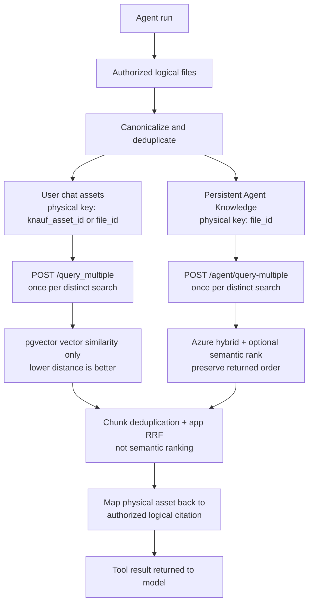

# Plan: Agent Retrieval and LangGraph Reliability

**Generated:** 2026-07-16<br>
**Status:** Retrieval delivery in progress; SDK reliability work deferred<br>
**Estimated complexity:** Medium for the SDK-independent retrieval delivery; high for the deferred multi-repository runtime correction<br>
**Primary evidence:** Langfuse runs `ce9436b2a6956965e9f8838c2cc1edd6` and `fbc4778b4d07737f34dfe6090bf9c4ef`

## Delivery split — 2026-07-17

- RAG API PR #14 is merged and deployed, so the batch retrieval contracts are available.
- Agentic Karl PR #145 intentionally remains on `@librechat/agents` 3.2.65 and can ship the application-owned routing, batching, deduplication, rank fusion, citation, exact-query cache, and backend-query budget fixes.
- Agents SDK PR #314 is a deferred follow-up, not a dependency of PR #145. It owns compaction coverage, preservation of the structured current turn, neutral summary transport, and graceful same-turn tool suppression/finalization.
- Until that SDK work ships, the application query budget caps backend RAG requests but cannot guarantee that the model stops requesting `file_search`; `recursionLimit` remains the graph-level emergency fuse.

## Executive decision

Fix graph/context and retrieval correctness before adding another ranking model.

The target behavior is:

1. Conversation document uploads always use user-scoped PostgreSQL/pgvector, including uploads made while chatting with a persistent agent.
2. Persistent Agent Knowledge uploaded through the agent builder uses agent-scoped Azure AI Search.
3. A run may search both stores, but performs at most one batch request per backend for each distinct logical search.
4. Logical file aliases that share one physical `knauf_asset_id` are queried once. Citations still use an authorized logical `file_id` visible to the user.
5. Results keep their backend-native order and are fused by reciprocal rank. Raw Azure scores and pgvector distances are never compared.
6. The latest user turn, including every image/content block, survives context compaction or the request fails before model invocation with a specific context-size error.
7. Repeated searches reuse cached content and distinct searches are bounded at the RAG boundary. At exhaustion the application returns typed `search_budget_exhausted` evidence; graceful tool suppression is deferred to the agents SDK.
8. Langfuse shows one main trace for the user turn with nested retrieval/model work. Detached title and memory work may remain separate traces, correlated by source message and conversation session.

No custom reranker model in the initial fix. Azure semantic ranking applies only to the Azure AI Search Agent Knowledge path. PostgreSQL/pgvector uses vector similarity only. The application must preserve each backend's native order, then combine the two ordered lists with deterministic rank fusion; that cross-backend fusion is not semantic ranking.

## Ranking boundaries: three different mechanisms

| Stage                                              | Where it runs            | What it does                                                                                                                  | Score/order contract                                                                                  |
| -------------------------------------------------- | ------------------------ | ----------------------------------------------------------------------------------------------------------------------------- | ----------------------------------------------------------------------------------------------------- |
| pgvector similarity                                | PostgreSQL/pgvector      | Finds user conversation-document chunks by embedding distance                                                                 | Lower distance is better; there is no Azure semantic ranker or other semantic reranker in this path   |
| Azure hybrid retrieval plus optional semantic rank | Azure AI Search only     | Combines Azure keyword/vector candidates, then optionally applies Azure's second-stage semantic ranker to Agent Knowledge     | Preserve Azure's returned order; application fusion ignores raw backend scores                        |
| Cross-backend reciprocal-rank fusion               | Agentic Karl application | Combines the final pgvector and Azure lists using their ordinal positions after per-backend retrieval and chunk deduplication | Deterministic rank arithmetic, not a model, semantic ranker, or raw-score comparison                  |

The application-level RRF must not be described as giving pgvector “Azure semantic ranking.” It only lets results from independently ranked stores compete without comparing incompatible raw numbers.

The [pgvector project documentation](https://github.com/pgvector/pgvector) defines vector distance/similarity operators; Azure's [semantic ranker](https://learn.microsoft.com/en-us/azure/search/semantic-search-overview) is a separate Azure AI Search feature.

## Why a reranker is not the first fix

A reranker cannot repair:

- duplicate backend requests;
- wrong pgvector/Azure routing;
- lost multimodal current turns;
- legacy automatic RAG plus explicit `file_search` double retrieval;
- physical asset IDs leaking into logical citation identity;
- shifted citations after failed requests;
- repeated LangGraph tool loops;
- Azure scores being sorted in the wrong direction.

Azure AI Search already applies hybrid retrieval and optional semantic ranking to Azure Agent Knowledge only. Microsoft documents Azure hybrid RRF and its semantic ranker as a second-stage reranker over Azure's initial candidate set:

- [Azure AI Search RRF ranking](https://learn.microsoft.com/en-us/azure/search/hybrid-search-ranking)
- [Azure AI Search semantic ranker](https://learn.microsoft.com/en-us/azure/search/semantic-search-overview)

The pgvector path has no learned reranker in this plan. Reconsider a pgvector-specific or single cross-backend reranker only when a labelled evaluation shows this precise condition:

> The correct chunk is present in the retrieved candidate set but repeatedly falls below the answer cutoff after deduplication and RRF.

If the correct chunk is absent, fix retrieval, filters, embeddings, or chunking. A reranker cannot recover a candidate that was never retrieved.

## Scope

Included in the SDK-independent delivery:

- dual-backend file ownership and routing;
- retrieval request deduplication and batching;
- result deduplication, rank fusion, and citation mapping;
- removal of legacy double retrieval when `file_search` is active;
- exact-query caching and a configurable distinct-search budget;
- RAG batch endpoint scope parity;
- Langfuse trace structure and retrieval diagnostics;
- retrieval-focused dev replay, production rollout, and rollback.

Deferred to the agents SDK release and later Agentic Karl integration:

- LangGraph summarization coverage and retained-tail behavior;
- preservation of the full structured current turn during compaction;
- neutral summary/history transport and deterministic content-filter replay;
- selective tool suppression and graceful graph finalization;
- typed UI handling that depends on new SDK failure contracts.

Not included:

- PII masking or anonymization;
- a new vector database;
- changing Azure Blob as the original-byte store;
- embedding images into either search backend;
- replacing Azure semantic ranker;
- disabling or bypassing Azure OpenAI content filters;
- a custom cross-encoder/reranker without evaluation evidence.

## Architecture invariant

See the enduring architecture reference in [`../architecture/files/rag-search.md`](../architecture/files/rag-search.md).

| Upload origin                                      | Persisted purpose    | Scope             | Search backend      | Retrieval availability             |
| -------------------------------------------------- | -------------------- | ----------------- | ------------------- | ---------------------------------- |
| Conversation upload in normal KARL                 | `message_attachment` | user              | PostgreSQL/pgvector | that user’s conversation context   |
| Conversation upload while using an agent           | `message_attachment` | user              | PostgreSQL/pgvector | that user’s conversation context   |
| Persistent Agent Knowledge uploaded in the builder | `agents`             | agent             | Azure AI Search     | every authorized run of that agent |
| Image uploaded in any chat                         | message attachment   | user/conversation | no vector backend   | direct multimodal model content    |

The active chat endpoint never selects the vector backend. Persisted upload purpose plus authorized Agent Knowledge membership does.

## Current failures and root causes

### Causal failure chains from the original traces

| Trace     | Primary root cause                                                                                                                           | Amplifiers                                                                                                                            | Terminal failure                                                                                |
| --------- | -------------------------------------------------------------------------------------------------------------------------------------------- | ------------------------------------------------------------------------------------------------------------------------------------- | ----------------------------------------------------------------------------------------------- |
| `ce9436…` | Compaction/pruning removed the real current turn, including all five image blocks, from every main-model call                                | Legacy automatic RAG bloated the system context; stale checkpoint remained; `file_search` fanned each repeated search across 27 files | No graceful loop exit; the emergency 25-step fuse threw `GraphRecursionError`                   |
| `fbc477…` | The app injected an assistant-generated checkpoint as a synthetic `HumanMessage` containing instruction-shaped summarizer/checkpoint wording | Very large combined context made the policy decision context-sensitive                                                                | Azure Microsoft.DefaultV2 Prompt Shield rejected the constructed prompt before model generation |

The Azure/pgvector ranking bug is real and must be fixed, but it is not the primary cause of either trace. The root-cause implementation order is:

1. preserve the complete current turn and correct summary coverage/provenance;
2. stop injecting derived history as a user instruction;
3. eliminate legacy plus tool-based double retrieval;
4. batch, deduplicate, correctly rank, and bound explicit retrieval;
5. finalize gracefully before the recursion fuse;
6. make every decision visible in Langfuse.

This diagnosis matches the provider boundary: [Microsoft Prompt Shields](https://learn.microsoft.com/en-us/azure/ai-services/content-safety/concepts/jailbreak-detection) evaluates the constructed model prompt, not the vector-store routing decision.

### Implementation defects to close

| Failure                                | Current cause                                                                                                  | Required fix                                                                                          |
| -------------------------------------- | -------------------------------------------------------------------------------------------------------------- | ----------------------------------------------------------------------------------------------------- |
| Current images disappear               | Compaction/pruning can remove the latest structured HumanMessage                                               | Pin the entire current turn as an indivisible required message                                        |
| Prompt Shield `jailbreak` response     | Derived checkpoint/history is transported as a command-shaped user message                                     | Use neutral historical state with durable coverage; never a synthetic user message                    |
| Legacy double retrieval                | Non-Agents client path can run `createContextHandlers()` while `file_search` is also available                 | Disable only legacy vector augmentation when `file_search` owns retrieval                             |
| Search loop reaches recursion limit    | No exact-query cache or distinct-query budget                                                                   | Cache and budget backend calls now; defer same-turn `file_search` suppression to the SDK; keep recursion limit as an emergency fuse |
| Duplicate pgvector calls               | `fileSearch.js` maps one HTTP request per logical file; multiple rows can resolve to the same `knauf_asset_id` | Deduplicate canonical physical targets before any request                                             |
| N requests for N files                 | Retrieval uses `/query` and `/agent/query` per file despite batch routes existing                              | One `/query_multiple` request and one `/agent/query-multiple` request at most                         |
| Duplicate chunks                       | Results are flattened, sorted, and sliced without a chunk identity check                                       | Deduplicate by physical asset plus digest/chunk identity before final cutoff                          |
| Wrong Azure ranking                    | Azure higher-is-better scores are treated as pgvector lower-is-better distances                                | Keep pgvector similarity and Azure semantic/hybrid ranking separate; fuse positions, never raw scores |
| Wrong citation after one request fails | `filter(result !== null)` changes result indexes before mapping back to `files[fileIndex]`                     | Carry target metadata with every promise/result; never recover identity by array position             |
| Wrong citation for dedup reuse row     | Physical `knauf_asset_id` and visible logical `file_id` are different identities                               | Maintain physical-to-logical authorized alias map                                                     |
| Unsafe pg batch contract               | `/query_multiple` filters by `file_ids` but does not match `/query` user/entity enforcement                    | Add user/entity filtering and mixed allowed/denied tests                                              |
| Incomplete Azure scope check           | `/agent/query-multiple` accepts `entity_id`, but Azure filtering currently keys only on file IDs               | Require and apply agent entity filtering in the RAG store                                             |
| Multiple disconnected traces           | Main run, title generation, and memory are separate roots without complete session/retrieval structure         | Keep independent work separate but correlate it; nest all main-run retrieval under the main trace     |

## Separate upload transport incident

The three-PDF upload failure is not part of either agent-runtime failure above. Traefik returned a transient 502 while the browser was still streaming the middle file; the request never reached RAG or embedding. [Agentic Karl PR #142](https://github.com/Knauf-Group/agentic-karl/pull/142) is merged and separately adds one transient upload retry plus a visible failed attachment state.

This plan must not claim to fix that incident. Its upload regression requirement is only “do not regress PR #142.” A client-generated upload correlation ID before body streaming remains a useful telemetry follow-up, but it is not a dependency for the compaction/retrieval correction.

## Target retrieval flow



## Repository and PR strategy

A single GitHub PR cannot cover three repositories. Minimum safe sequence:

| PR  | Repository                                     | Purpose                                                                                                         | Dependency                         |
| --- | ---------------------------------------------- | --------------------------------------------------------------------------------------------------------------- | ---------------------------------- |
| 1   | `Knauf-Group/agentic-karl-rag-api`             | Secure and normalize both batch query contracts                                                                 | none                               |
| 2   | `Knauf-Group/agentic-karl`                     | Ship grouped retrieval, RRF, citations, cache, backend-query budget, config, tests, and these docs on SDK 3.2.65 | deployed RAG PR #14                |
| 3   | `danny-avila/agents` or approved internal fork | Later fix summary coverage, multimodal current-turn retention, and graceful finalization                        | deferred; not required by PR #145  |
| 4   | `Knauf-Group/agentic-karl`                     | Later pin the released SDK and enable/test its runtime behavior                                                  | released SDK version               |

Do not patch `node_modules`, use `patch-package`, or copy the agents SDK into Agentic Karl. Keep PR #145 on the existing SDK; publish and pin the corrected SDK in a later PR.

Sprint numbering preserves the full root-cause plan, not the immediate merge boundary. The SDK compaction fix remains the primary runtime correction for the two original trace failures, but it is explicitly deferred. The SDK-independent retrieval fixes do not wait for it.

## Sprint 0: Freeze the failures as regression fixtures

**Goal:** Make the two production failures and duplicate retrieval deterministic before behavior changes.<br>
**Demo/validation:** Tests fail against current code for the expected reasons and Langfuse trace exports identify each retrieval invocation.

### Task 0.1: Capture retrieval regression cases

- **Location:**
  - [`../../../api/app/clients/tools/util/fileSearch.spec.js`](../../../api/app/clients/tools/util/fileSearch.spec.js)
  - [`../../../api/server/controllers/agents/client.test.js`](../../../api/server/controllers/agents/client.test.js)
- **Description:** Add fixtures covering duplicate logical rows, shared physical assets, mixed pgvector/Azure files, one failed backend request, and repeated exact queries.
- **Dependencies:** none.
- **Acceptance criteria:**
  - Two logical rows sharing one `knauf_asset_id` demonstrate two current pgvector calls.
  - A failed first request demonstrates current citation-index shifting.
  - A non-Agents endpoint with embedded files and `file_search` demonstrates both retrieval paths.
- **Validation:** Focused Jest suites only; no live backend required.

### Task 0.2: Capture graph and multimodal regression cases

- **Location:**
  - [`../../../packages/api/src/agents/__tests__/summarization.e2e.test.ts`](../../../packages/api/src/agents/__tests__/summarization.e2e.test.ts)
  - [`../../../packages/api/src/agents/__tests__/run-summarization.test.ts`](../../../packages/api/src/agents/__tests__/run-summarization.test.ts)
  - agents SDK `src/specs/summarization.test.ts`, `src/specs/multi-agent-summarization.test.ts`, and `src/graphs/__tests__/`
- **Description:** Recreate the important structure of the failing runs: long history, repeated compaction, latest turn containing text plus five images, tool calls, and a near-limit loop.
- **Dependencies:** none.
- **Acceptance criteria:**
  - The current-turn image-loss case fails before the SDK change.
  - An image-only current turn is not mistaken for an empty message.
  - Repeated compaction exposes summary coverage/replay loss.
  - A loop reaches the current recursion failure path.
- **Validation:** SDK unit/integration tests; no Azure policy bypass.

### Task 0.3: Record a trace baseline

- **Location:** Langfuse dev project; trace IDs listed at the top of this plan.
- **Description:** Record main-run trace count, file-search call count, backend/file/query tuple, context snapshots, summary events, content-filter response, and latency.
- **Dependencies:** Tasks 0.1–0.2.
- **Acceptance criteria:** Every later replay can be compared with the same fields.
- **Validation:** Saved Langfuse view or exported trace JSON referenced from the implementing PR, not committed if it contains large payloads.

## Sprint 1: Make RAG batch endpoints safe and predictable

**Goal:** Ship additive batch contracts that Agentic Karl can use without weakening scope behavior.<br>
**Repository:** `agentic-karl-rag-api`.<br>
**Demo/validation:** One authorized batch query returns ranked results; mixed unauthorized IDs cannot return another scope’s chunks; no matches return `[]`.

### Task 1.1: Bring pgvector `/query_multiple` to `/query` parity

- **Location:**
  - `app/models.py`
  - `app/routes/document_routes.py`
  - `tests/test_main.py`
  - `tests/integration/test_pgvector_filter.py`
- **Description:** Add optional `entity_id` to `QueryMultipleBody`; derive the authorized user/entity exactly as `/query` does; filter by both authorized `user_id` and requested `file_ids` at query time.
- **Dependencies:** Sprint 0 fixture.
- **Acceptance criteria:**
  - Mixed allowed/denied file IDs return only authorized chunks.
  - An entity query cannot read user-scoped chat vectors belonging to someone else.
  - No matches return HTTP 200 with `[]`, not HTTP 404.
  - Native pgvector order remains lower-distance-first.
  - The response is described and traced as pgvector similarity, never Azure semantic ranking.
- **Validation:** Route unit tests plus real-pg filter SQL/index integration tests.

### Task 1.2: Enforce agent entity scope in Azure batch search

- **Location:**
  - `app/routes/agent_routes.py`
  - `app/services/vector_store/azure_search.py`
  - new focused route/store tests next to existing RAG tests
- **Description:** Require the agent `entity_id` for Agent Knowledge queries and include it in the Azure filter alongside requested `file_ids`. Escape/filter values through the Azure SDK-supported path instead of concatenating unchecked values. Preserve Azure's returned order; the application does not add or normalize score fields.
- **Dependencies:** Sprint 0 fixture.
- **Acceptance criteria:**
  - A file ID from another agent does not match.
  - Batch and single-file routes enforce the same entity rule.
  - Azure result order is returned unchanged.
  - Semantic search remains enabled through `AZURE_SEARCH_SEMANTIC_ENABLED`.
- **Validation:** Mocked Azure client filter assertions and route tests.

### Task 1.3: Release and deploy the RAG prerequisite

- **Location:** RAG repository release workflow and `agk-deployment-configs` dev RAG image tag.
- **Description:** Publish a versioned RAG image, deploy it to dev, and verify both batch endpoints from the application pod/network path.
- **Dependencies:** Tasks 1.1–1.2.
- **Acceptance criteria:**
  - Dev reports the new pinned RAG image.
  - Both batch routes return the new empty-result and scope behavior.
- **Validation:** Authenticated smoke queries using one pgvector fixture and one Agent Knowledge fixture.

## Sprint 2: Fix compaction and termination in the agents SDK

**Goal:** Make summarization a durable history replacement without losing the current turn or looping into a hard recursion error.<br>
**Repository:** `danny-avila/agents` or an approved internal fork.<br>
**Demo/validation:** The five-image replay reaches the main model with all five image blocks after compaction; repeated compaction retains history coverage; near-limit runs produce a final response.

LangGraph’s current guidance treats summaries as explicit state and injects historical summary context separately from retained messages. See [LangGraph short-term memory and summarization](https://docs.langchain.com/oss/javascript/langgraph/add-memory).

### Task 2.1: Add durable summary coverage metadata

- **Location:**
  - agents SDK `src/summarization/node.ts`
  - `src/types/summarize.ts`
  - `src/messages/format.ts`
  - `src/specs/summarization*.test.ts`
- **Description:** Persist which source message/turn the summary covers, not only summary text/version. On the next run, replay only messages after that boundary and extend the prior summary exactly once. Coverage identifies source messages; it is never inferred from the summary message's physical position.
- **Dependencies:** Task 0.2.
- **Acceptance criteria:**
  - Repeated compaction neither drops uncovered messages nor summarizes covered history again.
  - Cross-run formatting uses the persisted coverage boundary.
  - If a legacy or current checkpoint has no resolvable coverage ID, ignore that summary and preserve the raw history; never delete messages based on an unresolved boundary.
- **Validation:** Fresh summary, update summary, cross-run resume, and legacy-checkpoint tests.

### Task 2.2: Make the latest user turn indivisible and required

- **Location:**
  - agents SDK `src/summarization/node.ts`
  - `src/messages/budget.ts`, `src/messages/prune.ts`, or the smallest existing current-turn selection seam
  - related message/content tests
- **Description:** Detect the latest real user turn before pruning and preserve its full structured content: text, images, provider-native document blocks, and inline extracted text. Never retain only the text portion of a multimodal turn. Treat “current turn present” as a precondition for every main-model call.
- **Dependencies:** Task 0.2.
- **Acceptance criteria:**
  - Text plus five images remains one complete HumanMessage after compaction with the same block IDs/URLs, order, MIME types, and text.
  - Image-only current turns remain valid.
  - Historical images may be summarized/pruned.
  - If the latest turn alone exceeds the model budget, return `current_turn_exceeds_context` before invoking the model.
  - Every main-model call contains the verified current turn; otherwise no provider call occurs.
- **Validation:** Multimodal, image-only, provider-file, and oversized-current-turn tests.

### Task 2.3: Transport summaries as historical state

- **Location:** agents SDK `src/summarization/node.ts`, `src/run.ts`, and `docs/summarization-behavior.md`.
- **Description:** Stop presenting a checkpoint as a new user instruction during the main run. Represent compacted state as neutral assistant/history state, followed by the real current user turn. Add one stable system instruction explaining that conversation-state blocks are derived historical context. Keep the summarizer's control prompt isolated to the summarization generation call. If a provider rejects assistant-first history, use the existing merged dynamic-system path as the compatibility fallback; never use a synthetic user message.
- **Dependencies:** Tasks 2.1–2.2.
- **Acceptance criteria:**
  - The main model sees summary content as prior state, followed by the real current HumanMessage.
  - Durable summary text is declarative and contains no summarizer control instructions such as “pick up,” “do not repeat,” “ignore,” or “only use this checkpoint.”
  - No synthetic “ignore/replace/continue” user message is inserted into the main conversation.
  - The failing Prompt Shield trace is replayed; any remaining filter response is classified with its actual intervention point.
- **Validation:** Message-role snapshot tests and Azure dev replay.

### Task 2.4: Add checkpoint-safe tool suppression

- **Location:** agents SDK `src/run.ts`, graph routing files under `src/graphs/`, and graph tests.
- **Description:** In the future SDK contract, when a tool result artifact contains validated `toolControl.disableTools`, omit only those named tools from subsequent model bindings for the same user turn. Do not infer remaining budget from absolute graph-step values because resumed checkpoints may already contain steps. A later Agentic Karl integration may map typed `file_search` budget exhaustion to this primitive so the next model call answers from retained evidence. PR #145 does not emit or depend on this artifact. Keep `recursionLimit` as the emergency fuse.
- **Reference:** LangGraph documents [`GRAPH_RECURSION_LIMIT`](https://docs.langchain.com/oss/javascript/langgraph/errors/GRAPH_RECURSION_LIMIT) as an error when the graph reaches its step limit, not as a mechanism that forces a final answer.
- **Dependencies:** Tasks 2.1–2.3.
- **Acceptance criteria:**
  - A `search_budget_exhausted` result suppresses only `file_search` for the rest of the current turn.
  - Other tools remain available and malformed control artifacts are ignored.
  - The next model call sees the typed result and answers from existing evidence.
  - Generic non-file tool recursion finalization is deferred until the SDK has a checkpoint-safe primitive.
  - Cancellation/timeout behavior remains unchanged.
- **Validation:** Tool-control parsing, selective binding, resumed-checkpoint, cancellation, and hard-error tests.

### Task 2.5: Publish an exact SDK version

- **Location:** agents SDK release pipeline.
- **Description:** Publish the tested version. Do not consume an unreleased commit from Agentic Karl.
- **Dependencies:** Tasks 2.1–2.4.
- **Acceptance criteria:** Version is available from the approved package registry with release notes naming coverage/current-turn/finalization fixes.
- **Validation:** Clean install and SDK test suite.

## Sprint 3: Replace per-file retrieval with one dual-backend pipeline

**Goal:** Agentic Karl performs one canonical, authorized, deduplicated retrieval operation per distinct search.<br>
**Repository:** `agentic-karl`.<br>
**Demo/validation:** A run with 27 chat documents and Agent Knowledge produces at most one pgvector batch span and one Azure batch span.

### Task 3.1: Build canonical search targets once

- **Location:**
  - [`../../../api/app/clients/tools/util/fileSearch.js`](../../../api/app/clients/tools/util/fileSearch.js)
  - [`../../../api/app/clients/tools/util/fileSearch.spec.js`](../../../api/app/clients/tools/util/fileSearch.spec.js)
- **Description:** After existing access filtering, create a target map keyed by `backend + physicalAssetId` where `physicalAssetId = knauf_asset_id ?? file_id`. Retain the lexically first authorized logical alias `{file_id, filename}` for citations so input ordering cannot change citation identity or the cache fingerprint.
- **Dependencies:** RAG Sprint 1 deployed.
- **Acceptance criteria:**
  - Duplicate logical IDs are removed.
  - Different logical rows sharing one physical asset generate one pg target.
  - Agent Knowledge routes to Azure only when `fromAgent === true` and `context === 'agents'`.
  - Runtime suffixes on added-agent IDs are stripped for resource ACL and RAG scope, while cache/budget partitioning remains explicit per runtime agent instance.
  - Chat uploads route to pgvector even when the current run has an agent ID.
  - A target with contradictory/unknown provenance fails closed to pgvector or is rejected; it is never promoted to Azure.
- **Validation:** Pure target-building tests.

### Task 3.2: Query each backend once

- **Location:** `createFileSearchTool()` in `fileSearch.js` and its spec.
- **Description:** Partition canonical targets and call `/query_multiple` once for pgvector and `/agent/query-multiple` once for Azure. Include `entity_id` in the pgvector batch when available so its user-or-entity authorization contract also supports Azure-disabled Agent Knowledge fallback. Carry `{backend, targets}` beside each promise so failures cannot shift result ownership. Update the tool description to state that `file_search` searches extracted document text; it cannot inspect historical image pixels. Current image blocks continue through the direct multimodal path.
- **Dependencies:** Task 3.1 and RAG Sprint 1.
- **Acceptance criteria:**
  - Zero or one request per backend per distinct search.
  - One backend may fail without corrupting the other backend’s citations.
  - If the surviving backend has no matches, the no-content result still states that retrieval was partial.
  - Empty arrays are successful no-result responses.
  - No per-file fallback request is issued after a successful batch response.
  - A mixed image/document turn may still use both direct image input and document `file_search`; an image-only request is not redirected to document search merely because historical PDFs exist.
- **Validation:** Mocked Axios request-count, payload, partial-failure, and result-identity tests.

### Task 3.3: Deduplicate chunks and fuse backend ranks

- **Location:** `fileSearch.js`; extract only a small pure helper under an existing Knauf path if inline logic becomes unreadable.
- **Description:** Preserve each backend's returned order. The pgvector list is ordered by vector distance only; the Azure list may already include Azure-internal hybrid RRF and Azure semantic reranking. Deduplicate within the same physical asset using `metadata.digest` when available, otherwise physical asset + page + normalized content. Merge the two final ordinal lists with application RRF `1 / (60 + rank)`. Do not add a shared raw-score contract.
- **Dependencies:** Task 3.2.
- **Acceptance criteria:**
  - Azure results are not sorted as ascending distances.
  - pgvector results retain lower-distance order.
  - Raw Azure scores and pgvector distance are never normalized into a shared numeric score.
  - Application RRF is labelled `cross_backend_rrf`, never `semantic_ranking`.
  - Identical chunks from one shared asset appear once.
  - The same text from two genuinely different source assets may remain twice for provenance.
  - Final citations use authorized logical IDs and filenames.
  - Citation threshold and limits are applied before anchors; only that exact selected chunk array is shown to the model and persisted in the same order/cardinality.
  - Each distinct search gets a request-wide turn number used by both `turnNfileM` anchors and its attachment, even when several agents contribute tools to one response; cached repeats reuse the original content without creating another attachment.
  - Client rendering keeps `fileN` and web `refN` in separate index arrays, while the source-card list may deduplicate both views by file.
- **Validation:** Deterministic pure-function tests for order, ties, duplicate digests, fallback content keys, and citation aliases.

### Task 3.4: Remove legacy vector double retrieval

- **Location:**
  - [`../../../api/server/controllers/agents/client.js`](../../../api/server/controllers/agents/client.js)
  - [`../../../api/app/clients/prompts/createContextHandlers.js`](../../../api/app/clients/prompts/createContextHandlers.js)
  - related agent client tests
- **Description:** When the effective run has `file_search`, skip only `createContextHandlers` vector augmentation. Preserve `addFileContextToMessage`, image formatting, provider-native file handling, Upload-as-Text injection, and code-execution file priming.
- **Dependencies:** Task 3.2.
- **Acceptance criteria:**
  - Searchable documents enter the model only through `file_search`.
  - Inline text attachments and images are unchanged.
  - Bedrock or another endpoint without `file_search` retains the legacy path until explicitly migrated.
- **Validation:** Endpoint/tool matrix tests.

### Task 3.5: Add exact-query caching and a distinct-query budget

- **Location:**
  - `fileSearch.js`
  - [`../../../packages/data-provider/src/config.ts`](../../../packages/data-provider/src/config.ts)
  - [`../../../librechat.yaml`](../../../librechat.yaml)
  - config and tool tests
- **Description:** Cache the in-flight/completed promise and distinct-query budget by normalized query plus sorted canonical target set in a request-keyed `WeakMap`, nested by agent/entity, while keeping one request-wide next-turn counter at the WeakMap root. This lets ON_TOOL_EXECUTE reloads and multi-agent responses share collision-free citation turns without one agent consuming another agent's cache/budget; a new request starts cleanly. Add one application config value, `endpoints.agents.fileSearch.maxDistinctQueries`, default `3`; do not add an environment variable. A repeated exact query returns cached content without a duplicate citation attachment. Budget exhaustion returns typed `search_budget_exhausted` content and performs no additional backend request.
- **Dependencies:** Tasks 3.1–3.3.
- **Acceptance criteria:**
  - Identical queries reuse cached content and emit no second backend request or duplicate source attachment.
  - Concurrent identical calls share one promise.
  - Paraphrased queries count as distinct; no semantic-query deduper is introduced.
  - At the configured limit, the tool returns typed `search_budget_exhausted` evidence with an answer-from-existing-evidence instruction and performs no backend request.
  - The budget bounds retrieval traffic only. Guaranteed graph finalization remains deferred to the agents SDK; the application does not infer completion from graph-step arithmetic.
- **Validation:** Exact, whitespace/case-normalized, concurrent, distinct, and budget tests.

Strict removal of the existing Agent Knowledge pgvector fallback is deferred. It requires a separate inventory/migration decision and is not part of this retrieval PR.

## Sprint 4: Deferred — integrate the corrected SDK and failure behavior

**Delivery status:** Not part of PR #145 and not required to merge its retrieval fixes.<br>
**Goal:** A later Agentic Karl PR consumes the corrected SDK without local patching and produces stable final responses.<br>
**Demo/validation:** Both failing trace scenarios replay successfully in dev.

### Task 4.1: Pin the released agents SDK

- **Location:**
  - [`../../../api/package.json`](../../../api/package.json)
  - [`../../../packages/api/package.json`](../../../packages/api/package.json)
  - lockfile
- **Description:** Replace the current `^3.2.65` range with the exact released fixed version in both package manifests.
- **Dependencies:** SDK Task 2.5.
- **Acceptance criteria:** Clean install resolves exactly one intended SDK version.
- **Validation:** Lockfile inspection, API/package tests, and SDK integration tests.

### Task 4.2: Configure safe rollout defaults

- **Location:** [`../../../librechat.yaml`](../../../librechat.yaml), agent summarization config tests.
- **Description:** Keep `retainRecent.turns: 0` while running SDK 3.2.65. Enable a bounded retained tail only after the new SDK coverage tests and dev replay pass. Correct the recursion-limit comment so it reflects actual graph steps rather than assuming every tool interaction costs exactly two.
- **Dependencies:** Task 4.1.
- **Acceptance criteria:** Config behavior is explicit and version-compatible.
- **Validation:** Startup config parsing and repeated-compaction replay.

### Task 4.3: Map typed graph failures to useful responses

- **Location:**
  - [`../../../api/server/controllers/agents/openai.js`](../../../api/server/controllers/agents/openai.js)
  - callbacks/error handling beside existing graph handlers
- **Description:** Convert `current_turn_exceeds_context`, `search_budget_exhausted`, content-filter responses, and unavoidable recursion exhaustion into distinct logged/streamed outcomes. Do not add a special Prompt Shield retry in this application PR; fix summary transport in the SDK and return the provider's typed failure.
- **Dependencies:** Tasks 3.5 and 4.1.
- **Acceptance criteria:** Users receive a short actionable message; logs and Langfuse retain the typed cause and provider status.
- **Validation:** Controller/callback tests for every typed outcome.

## Sprint 5: Make Langfuse prove the fix

**Goal:** A developer can diagnose routing, deduplication, ranking, compaction, and termination from one main trace.<br>
**Demo/validation:** The trace tree and metadata answer “what searched where, why, how often, and what ended the run?” without reading application logs.

Langfuse models a trace as one request with nested observations and recommends sessions for multi-turn chats. See [Langfuse tracing concepts](https://langfuse.com/docs/observability/data-model) and [LangChain/LangGraph integration](https://langfuse.com/integrations/frameworks/langchain).

Use the existing LangGraph/Langfuse observation tree; this work adds no custom trace hierarchy or tracing dependency. Title generation and memory work may remain separate root traces because they are independent jobs. They must share:

- `librechat.source.message.id`;
- conversation ID as Langfuse session ID;
- tenant/environment/release tags;
- `operation=title|memory`.

### Task 5.1: Verify existing retrieval observations

- **Location:** Existing Agentic Karl Langfuse callback integration and `fileSearch.js` logs/tests.
- **Description:** Verify the existing observation tree contains one tool call per logical search and no detached duplicate retrieval roots. Do not add custom spans or a new tracing dependency in this PR.
- **Dependencies:** Sprint 3.
- **Acceptance criteria:** Existing traces and request logs are sufficient to correlate the run, tool call, backend request count, partial failure, and final outcome. Do not invent score fields or imply that pgvector received Azure semantic ranking.
- **Validation:** Deterministic request-count tests plus one dev trace inspection.

### Task 5.2: Add context and termination attributes

- **Location:** `run.ts`, callbacks, and SDK event metadata.
- **Description:** Reuse existing callback metadata for summary transport, current-turn preservation, typed provider failure, and search-budget outcome where already available. Defer new metadata taxonomy until a trace shows a concrete diagnostic gap.
- **Dependencies:** Sprint 2 and Sprint 4.
- **Acceptance criteria:** The `fbc...` replay identifies whether Prompt Shield fired on user input, summary/history composition, tool output, or generated response when Azure provides that detail.
- **Validation:** Langfuse dev trace and callback unit tests.

## Sprint 6: Dev replay, rollout, and production verification

**Goal:** Prove correctness under real infrastructure before production.<br>
**Demo/validation:** Both original failing scenarios pass, retrieval request counts meet the contract, and no regression appears for ordinary chat uploads or Agent Knowledge.

### Task 6.1: Deploy in dependency order

1. Confirm deployed RAG API PR #14 batch routes in dev.
2. Merge and deploy Agentic Karl PR #145 on the existing SDK 3.2.65.
3. Confirm GitOps has `AZURE_SEARCH_ENABLED=true` for the application and valid Azure Search endpoint/key settings for the RAG service.
4. Smoke-test pgvector-only, Azure-only, and mixed retrieval and verify actual pod image versions.
5. Later, after the corrected SDK is released, pin it in a separate Agentic Karl PR and replay the compaction/termination scenarios.

### Task 6.2: Replay acceptance matrix

| Scenario                                            | Required result                                                                                                                                     |
| --------------------------------------------------- | --------------------------------------------------------------------------------------------------------------------------------------------------- |
| 27 user chat documents                              | One pgvector batch request per distinct search                                                                                                      |
| Persistent Agent Knowledge only                     | One Azure batch request; zero pgvector requests                                                                                                     |
| Mixed chat documents and Agent Knowledge            | At most one pgvector and one Azure request                                                                                                          |
| Two logical chat rows sharing one asset             | One physical query; citation uses an accessible logical row                                                                                         |
| Deleted original owner row with surviving reuse row | Search still works; citation never emits deleted owner ID                                                                                           |
| One backend fails                                   | Other backend results remain correctly attributed                                                                                                   |
| No matches                                          | Empty tool result, no 404/error loop                                                                                                                |
| Repeated identical tool query                       | Cache hit; no second backend request                                                                                                                |
| Two distinct file-search calls                      | Attachments use separate turns; each `turnNfileM` anchor resolves to the exact persisted chunk                                                     |
| Web `ref0` and file `file0` on the same turn        | Both resolve independently; source cards may still deduplicate files                                                                                |
| Repeated paraphrased queries                        | Stops backend retrieval at the configured budget; graph may still reach the recursion fuse on SDK 3.2.65                                            |
| Five-image latest turn after compaction (deferred)  | After SDK integration: main-model call contains text plus all five images, or explicit pre-call context error                                        |
| Image-only latest turn (deferred)                   | After SDK integration: remains a valid current user turn                                                                                            |
| Historical images plus new text (deferred)          | After SDK integration: historical images may prune; newest text remains                                                                             |
| Chat upload while using an agent                    | pgvector, user-scoped                                                                                                                               |
| Builder Agent Knowledge upload                      | Azure AI Search, agent-scoped                                                                                                                       |
| Azure Prompt Shield with derived summary (deferred) | After SDK integration: deterministic role/content tests pass, followed by equivalent Microsoft.DefaultV2 dev replays                               |
| Summary transport (deferred)                        | After SDK integration: no summary uses role `user`; durable summary contains no summarizer control instructions                                     |
| Cross-run `retainRecent: 2` (deferred)              | After SDK integration: retained raw turns survive the next request and remain outside summary coverage                                              |
| Generic non-file recursion                          | `recursionLimit` remains the emergency fuse; checkpoint-safe generic finalization is deferred                                                        |
| Langfuse trace                                      | One main run trace with nested retrieval; title/memory correlated by source and session                                                             |

### Task 6.3: Production promotion

- Promote the exact tested application and RAG image versions.
- Run one pgvector-only query, one Azure-only query, and one mixed query.
- Confirm p95 retrieval latency, backend request counts, content-filter rate, recursion failures, and search-budget exhaustion for the first production traffic window.
- Keep the original failing trace IDs in the PR/runbook for before/after comparison.

## Configuration and environment contract

Existing required application configuration:

| Setting                                            | Required value/purpose                                      |
| -------------------------------------------------- | ----------------------------------------------------------- |
| `RAG_API_URL`                                      | Internal RAG API base URL                                   |
| `AZURE_SEARCH_ENABLED`                             | `true` in AGK environments; enables Agent Knowledge routing |
| `LANGFUSE_HOST`                                    | Existing self-hosted Langfuse URL                           |
| `LANGFUSE_PUBLIC_KEY`, `LANGFUSE_SECRET_KEY`       | Existing project credentials                                |
| `LANGFUSE_TRACING_ENVIRONMENT`, `LANGFUSE_RELEASE` | Environment/release attribution                             |

Existing required RAG configuration:

| Setting                         | Required value/purpose                             |
| ------------------------------- | -------------------------------------------------- |
| `AZURE_SEARCH_ENDPOINT`         | Environment-specific Azure AI Search endpoint      |
| `AZURE_SEARCH_API_KEY`          | Existing secret mapping                            |
| `AZURE_SEARCH_INDEX_NAME`       | Existing Agent Knowledge index name                |
| `AZURE_SEARCH_SEMANTIC_ENABLED` | Keep `true` unless an evaluation proves regression |

One proposed application config value:

```yaml
endpoints:
  agents:
    fileSearch:
      maxDistinctQueries: 3
```

Why config instead of an environment variable or hidden constant: this is agent-runtime behavior that must be reviewable beside `recursionLimit`, versioned with the application, and adjustable without inventing another deployment secret.

No new reranker model, key, deployment, package, or environment variable.

## Testing strategy

### Agentic Karl

- Focused Jest tests for canonical target construction, batch request counts, physical deduplication, partial failures, RRF, chunk deduplication, citation aliasing, search turns, cache, and search budget.
- Client hook tests for ordered same-file chunks, explicit/legacy turn mapping, same-turn web/file resolution, and copied citations.
- Agent client tests proving only legacy vector augmentation is disabled.
- SDK integration, summarization, and selective tool-suppression tests are deferred to the later SDK pinning PR.
- Existing upload, image, inline-text, code-file, citation, and vector delete suites remain green.

### RAG API

- Route tests for authorized, unauthorized, mixed, empty, and partial file sets.
- Real PostgreSQL filter/index integration test for `file_id IN (...) AND user_id = ...`.
- pgvector tests proving distance order and no semantic-ranker field/label.
- Azure mock tests for `entity_id + file_ids` filters and preserved order.

### Agents SDK

- Repeated compaction with coverage metadata.
- Cross-run resume with retained tail.
- Text plus five images with exact IDs/order/MIME/text, image-only, and oversized current turn.
- Selective same-turn tool suppression and hard recursion fallback.
- Provider message-role snapshots.
- Five equivalent dev replays under unchanged Microsoft.DefaultV2 after deterministic message-role coverage passes.

### Live dev

- Replay the two identified Langfuse runs using equivalent inputs.
- Compare trace shape, request count, latency, content block count, and final outcome.

## Risks and mitigations

| Risk                                                               | Mitigation                                                                                                    |
| ------------------------------------------------------------------ | ------------------------------------------------------------------------------------------------------------- |
| Application deploys before RAG batch contract                      | Pin deployment order; keep app PR blocked until dev RAG smoke passes                                          |
| RAG batch filtering weakens user isolation                         | Filter by authorized scope inside the vector query and test mixed IDs                                         |
| Physical dedup breaks citations                                    | Separate physical search identity from logical display identity through an explicit alias map                 |
| Azure semantic ordering is lost                                    | Treat returned Azure array order as authoritative; never sort it using pgvector distance logic                |
| pgvector is incorrectly described as semantically ranked           | Use `pgvector_similarity` and `cross_backend_rrf` labels; semantic ranker metadata is Azure-only              |
| RRF over-deduplicates identical legal text from separate documents | Include physical asset ID in the chunk dedup key                                                              |
| Current turn alone exceeds context                                 | Fail before provider invocation with `current_turn_exceeds_context`; never silently drop blocks               |
| Prompt Shield still rejects retrieved document text                | Classify the tool-response intervention separately; do not assume every filter error is image/summary-related |
| Old Agent Knowledge exists in pgvector fallback                    | Leave compatibility behavior unchanged; handle inventory/migration in a separate workstream                  |
| SDK correction is not yet released                                | Keep PR #145 SDK-independent; document remaining compaction/finalization risk and pin later                    |
| Search budget ends too early                                       | Keep it configurable, trace exhaustion, tune from dev/production evidence                                     |
| New reranker adds cost and hides retrieval bugs                    | Do not add it until the candidate-present/rank-wrong condition is demonstrated                                |

## Rollback plan

1. RAG batch changes are additive; old single-file routes remain available during rollback.
2. Revert Agentic Karl to the prior image if retrieval behavior regresses; PR #145 does not change the SDK version.
3. Do not roll back by setting `AZURE_SEARCH_ENABLED=false`; that changes Agent Knowledge storage semantics. Roll back the application image instead.
4. Preserve new RAG images and indexes; no destructive data migration is required for the query contract.
5. Keep Langfuse trace correlation enabled during rollback so before/after behavior remains comparable.

## Definition of done for PR #145

- All acceptance-matrix scenarios pass in dev.
- Production mixed search emits at most two backend retriever spans per distinct query.
- No physical pgvector asset is queried twice inside one logical search.
- No legacy vector context is injected when `file_search` is active.
- Azure and pgvector scores are never numerically compared.
- pgvector retrieval is never labelled as Azure semantic ranking; cross-backend RRF is explicitly non-semantic.
- Citations always resolve to an authorized logical file record.
- Repeated exact searches reuse cached content; distinct searches stop producing backend requests at the configured budget.
- `recursionLimit` remains the emergency fuse because graceful same-turn tool suppression is deferred.
- The original trace root causes and deferred SDK work remain documented and are not claimed fixed by PR #145.
- PR #142 upload retry/failed-chip behavior remains green and is reported as a separate transport fix.
- No custom reranker was added without evaluation evidence.
- Architecture docs and [`../../../SEAMS.md`](../../../SEAMS.md) match the shipped behavior.

The full plan is done only after the later SDK integration also preserves the complete current turn, transports summaries without a synthetic `user` role, finalizes repeated tool use gracefully, and passes equivalent replays of both original failures.
