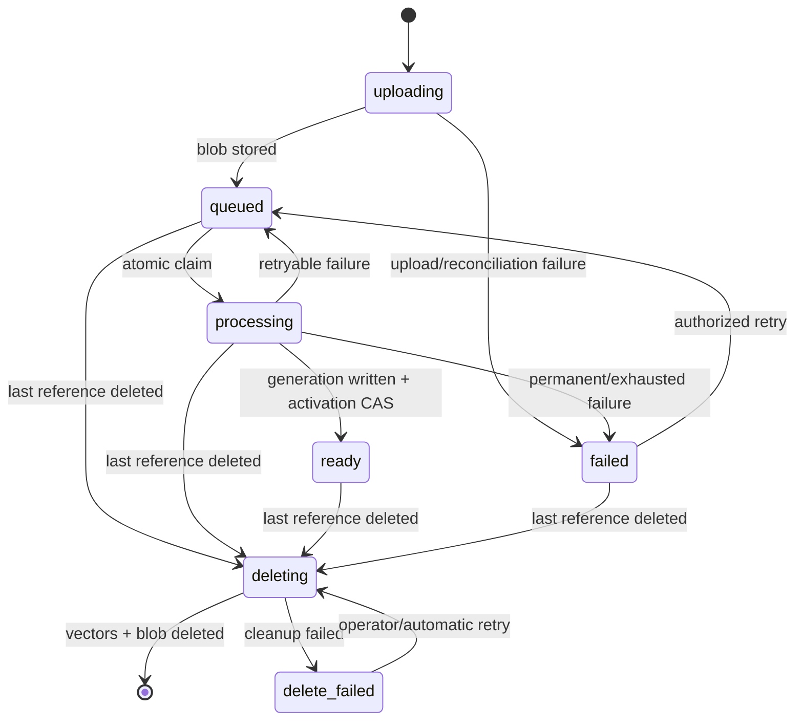

# Production async File Search indexing (KK20-195)

> **Status: accepted implementation direction.**
>
> Decision date: 2026-07-13.
>
> This plan supersedes the historical [v1 Mongo/API-pod proposal](../proposals/async-file-indexing.md),
> [v2 `IndexJob`/Azure Function counter-proposal](../proposals/async-file-indexing-v2.md), and
> [v3 Service Bus ADR](../proposals/async-file-indexing-v3.md). Do not implement those documents.
>
> Code baseline reviewed: `agentic-karl` `main@2a399fb3f7d74898ebccf157654e8034d1cf4ee2`,
> PR #113 through `c09b92ba2200f4f7d960128670caa82d7cdb7707`, the deployed RAG implementation
> available to the review, current AGK deployment configuration, and read-only Datadog EU evidence.
>
> This is a cross-repository delivery plan. When rollout finishes, promote the enduring ownership,
> state-machine, and RAG-generation sections to `knauf/docs/architecture/` and archive this file.

---

## 1. Decision

Build this production architecture:

```text
Logical File
    -> physical FileAsset in Mongo
    -> atomic Mongo claim
    -> dedicated fixed-size AKS worker
    -> generation-safe RAG writes
    -> atomic active-generation switch
```

This is not a disposable MVP and there is no planned Service Bus migration.

- `File` remains the logical attachment used by chat, agents, permissions, display, and deletion.
- `FileAsset` is the physical aggregate that owns blob, vectors, deduplication, indexing, retry,
  retention, and physical deletion.
- Mongo is both the product-state store and the durable work backlog.
- A dedicated AKS Deployment runs the worker. API pods never execute indexing loops.
- RAG writes are at-least-once but generation-safe. No retry deletes the active generation first.
- Azure Service Bus, Azure Functions, BullMQ, Kafka, KEDA, and a per-attempt `IndexJob` collection
  are not part of this design.

Service Bus requires a new ADR only if requirements materially change: a platform mandate,
independent producers that cannot write the asset record, or measured Mongo claim load affecting
the primary database. It is not a deferred phase of KK20-195.

---

## 2. Why this is the selected design

### 2.1 Observed production problem

The current flow stores the blob and synchronously waits for RAG before creating the `File` row.
The RAG call has no explicit timeout or retry. Concurrent identical uploads resolve the dedup race
only after both have embedded.

The client is already concurrent:

- Chat upload calls React Query `mutate()` and returns before the network request completes.
- Agent knowledge upload explicitly uses `Promise.allSettled` over every queued file.

Read-only Datadog EU evidence for the reviewed 30-day period:

| Signal | Observed |
|---|---:|
| pgvector `/embed` starts | 127 |
| Maximum simultaneous pgvector embeds | 5 |
| Failed pgvector jobs | 3 |
| Failed-job chunk counts | 1,704 / 5,086 / 13,304 |
| Failed-job durations | 124 s / 486 s / 1,284 s |
| Raw Azure embedding HTTP 429 responses | 314 |
| Observed `Retry-After` | 1-57 s |
| `/agent/embed` responses | 228 x 200 / 14 x 500 |

All pgvector `/embed` requests returned HTTP 200, including body-level failures. Only two of the
three failed jobs logged completed rollback. The failure is therefore recovery, idempotency, and
quota control, not broker throughput.

### 2.2 Why `File` cannot own physical indexing state

Current content deduplication already separates logical and physical identity:

- Multiple logical `File` rows can point to one `knauf_asset_id`.
- The row that first embedded the asset may be deleted while reuse rows remain.
- Physical garbage collection counts references by `knauf_asset_id`, not by owner row.

Putting leases, generations, retry state, or physical deletion state on one arbitrary `File` row
would make a logical reference own a shared physical object. Copying status to every `File` row
would create fan-out updates and disagreement. A physical `FileAsset` is the missing aggregate.

### 2.3 Why `FileAsset` is not Ali's `IndexJob`

`FileAsset` is one durable record for one physical blob/vector object. It persists across attempts,
logical references, retries, and future re-indexing. It is the authority for physical lifecycle.

`IndexJob` was a second per-job status model that still required `File` readiness and synchronization.
That split is rejected. Optional immutable attempt history may be added only when an audit
requirement exists; logs and metrics cover the current requirement.

### 2.4 Why Mongo claim is the final transport

Service Bus would still require:

- Mongo product/readiness state;
- an API-to-broker outbox or reconciler;
- duplicate-safe RAG writes and execution fencing;
- lock renewal for long OCR jobs;
- DLQ-to-Mongo projection;
- retry/delete reconciliation;
- a dedicated AKS worker because RAG is private in AKS.

It adds another durable system and failure boundary without removing the correctness work. Private
Service Bus networking also requires Premium plus DNS, identity, GitOps, and Terraform changes.

Mongo claim uses one atomic `findOneAndUpdate` against the authoritative record. There is no
publication gap. The workload is low-message-rate, long-running, and limited by Azure OpenAI,
Document Intelligence, and vector-store quotas. A fixed worker fleet provides the required
backpressure.

### 2.5 Known limitation accepted

Mongo claim means the team owns a small job runner: claim query, lease heartbeat, retry schedule,
terminal failure, and runbooks. That is accepted because these primitives operate on the same
authoritative document and avoid outbox, broker lock, and DLQ projection code. Keep the runner
small and specific to this state machine.

### 2.6 Current code map

| Concern | Current implementation |
|---|---|
| Synchronous blob -> RAG -> agent ref -> `File` flow | [`processAgentFileUpload`](../../../api/server/services/Files/process.js#L875) |
| RAG route selection and unbounded POST | [`uploadVectors`](../../../api/server/services/Files/VectorDB/crud.js#L185) |
| Physical dedup identity on logical `File` | [`knauf_asset_id` schema](../../../packages/data-schemas/src/schema/file.ts#L150) |
| Reuse of an asset after original owner deletion | [`findAssetForHash`](../../../api/server/services/Files/knauf/contentDedup.js#L31) |
| Logical-row delete and physical reference-count GC | [`gcDedupRows`](../../../api/server/services/Files/knauf/cascadeDeleteConvoFiles.js#L271) |
| Chat upload's non-awaiting `mutate()` | [`useFileHandling`](../../../client/src/hooks/Files/useFileHandling.ts#L270) |
| Agent upload concurrency | [`useDrainPendingKnaufFiles`](../../../client/src/knauf/data-provider/Agents/useDrainPendingKnaufFiles.ts#L67) |
| Retrieval currently lacks readiness filtering | [`primeFiles`](../../../api/app/clients/tools/util/fileSearch.js#L36) |
| Transaction capability cache defect | [`getTransactionSupport`](../../../packages/data-schemas/src/utils/transactions.ts#L54) |

RAG implementation points reviewed outside this repository:

- `app/routes/document_routes.py::_process_documents_async_pipeline`;
- `app/services/vector_store/azure_search.py::add_documents`;
- `app/services/vector_store/azure_search.py::delete_by_file_id`.

WP1 must bind these findings to the exact deployed RAG source/image before implementation.

---

## 3. Non-negotiable invariants

1. A successful upload response is never returned before durable state exists.
2. Every accepted physical asset is discoverable as `uploading`, `queued`, `processing`, `ready`,
   `failed`, `deleting`, or `delete_failed`.
3. The existing client-generated `file_id` is the logical-upload idempotency key. An exact retry
   returns the same logical file and asset state.
4. Physical deduplication never crosses its authorization/isolation scope or indexing profile.
5. At most one `FileAsset` exists for one dedup key.
6. Work execution is at-least-once. Vector visibility is effectively once through generation
   activation.
7. A stale worker can write only its own inactive generation and cannot activate it.
8. The active generation is never deleted before a replacement is fully written and activated.
9. Search uses only the active generation of a non-deleted asset.
10. Deleting one logical `File` never deletes a still-referenced physical asset.
11. Physical state is retained until blob and every vector generation are confirmed deleted.
12. API and worker concurrency cannot exceed the configured downstream budget during rollout.
13. Mongo transactions are not required for correctness.
14. User-visible errors are stable machine codes; raw provider errors remain in bounded logs.

---

## 4. Ownership and data model

### 4.1 Logical `File`

`File` continues to own:

- `file_id` and existing user/tenant ownership;
- filename, MIME type, size, conversation/agent association, and display metadata;
- logical retention/reference metadata;
- existing `knauf_asset_id` pointer;
- optional client-generated `knauf_upload_batch_id` for derived batch UX.

`File` does not authorize vector queries from a cached indexing status. API responses may project
the asset status beside a file, but `FileAsset` remains authoritative.

Use the existing client-generated `file_id` as upload idempotency. Enforce uniqueness in the
existing ownership scope and make retries with the same `file_id` return the existing record.
Do not add a second idempotency field unless an external client cannot supply `file_id`.

### 4.2 Physical `FileAsset`

Use a Knauf-owned model such as `KnaufFileAsset` in collection `knauf_file_assets`.

| Field | Purpose |
|---|---|
| `asset_id` | Stable UUID; unique physical identity used by blob and vectors |
| `tenant_id` | Tenant isolation and operational lookup |
| `scope_type` / `scope_id` | Retrieval/dedup scope, for example user-owned chat or agent-owned knowledge |
| `content_hash` | SHA-256 of uploaded bytes |
| `dedup_key` | Optional hash of isolation scope + content hash + indexing profile; unique when present |
| `index_profile` | Versioned backend/parser/chunking/embedding configuration |
| `vector_backend` | `pgvector` or `azure_search` |
| `embed_route` | `/embed` or `/agent/embed` |
| `blob` | Source, path/key, region, bytes, MIME type; no expiring SAS URL |
| `status` | `uploading`, `queued`, `processing`, `ready`, `failed`, `deleting`, `delete_failed` |
| `attempt_count` | Automatic execution attempts for the current desired work |
| `next_attempt_at` | Retry scheduling without sleeping in a worker |
| `lease_owner` / `lease_expires_at` | Current worker ownership and stale-work recovery |
| `execution_token` | Random token unique to one claim; fences heartbeat and terminal updates |
| `target_generation` | Generation assigned to the current claim |
| `active_generation` | Only generation visible to queries; null before first successful index |
| `last_error_code` | Stable bounded machine code |
| `last_error_detail` | Sanitized, truncated diagnostic; no document text or credentials |
| `queued_at` / `started_at` / `ready_at` | Queue and processing SLOs |
| `delete_requested_at` | Tombstone that blocks future claims/activation |
| `created_at` / `updated_at` | Audit and reconciliation |

For current behavior:

- Chat dedup: set `dedup_key` from user isolation scope + content hash + index profile.
- Agent-library uploads: preserve current no-dedup behavior by leaving `dedup_key` absent.
- Reconsider agent-scoped dedup only in a separate authorization review.

### 4.3 Required indexes

```javascript
{ asset_id: 1 } // unique
{ dedup_key: 1 } // unique partial index where dedup_key exists
{ status: 1, next_attempt_at: 1, queued_at: 1 } // normal claims
{ status: 1, lease_expires_at: 1 } // stale processing claims
{ delete_requested_at: 1, status: 1 } // deletion reconciliation
{ updated_at: 1, status: 1 } // stale uploading/failed operational queries
```

Ensure `File.knauf_asset_id` has a lookup index for reference count and batch hydration.

### 4.4 Legacy compatibility

Migration is additive:

1. For deduped chat rows, create one asset per distinct `knauf_asset_id`.
2. For non-deduped and agent rows, use `asset_id = file_id`.
3. Backfill missing `File.knauf_asset_id` with `file_id`.
4. Map `embedded=true` to `status=ready` and `active_generation=0`.
5. Treat generation 0 as legacy vectors whose generation field is absent.
6. Map known incomplete rows to `failed` with a migration error code; do not auto-embed silently.
7. Query compatibility supports generation 0 until every retained legacy asset has been re-indexed
   or deleted.

The migration must be restartable and idempotent. Report counts for files scanned, assets created,
legacy-ready assets, incomplete assets, and inconsistencies.

---

## 5. State machine



Searchability:

- Initial upload is searchable only when `status=ready` and `active_generation` is non-null.
- A future re-index may retain the old active generation while a new target generation is
  processing. The active generation remains searchable until activation succeeds.
- `delete_requested_at` always makes the asset non-searchable, regardless of status.

### 5.1 Atomic claim

The worker claims one eligible asset at a time:

```javascript
findOneAndUpdate(
  {
    delete_requested_at: null,
    $or: [
      { status: 'queued', next_attempt_at: { $lte: now } },
      { status: 'processing', lease_expires_at: { $lte: now } },
    ],
  },
  {
    $set: {
      status: 'processing',
      lease_owner: workerId,
      lease_expires_at: nowPlusLease,
      execution_token: newUuid,
      started_at: now,
    },
    $inc: { attempt_count: 1, target_generation: 1 },
  },
  { sort: { queued_at: 1 }, returnDocument: 'after' },
)
```

Implementation may use a Mongo update pipeline to set the generation/token atomically. Do not
split claim and generation assignment into separate writes.

### 5.2 Heartbeat and stale claims

- Initial lease: 5 minutes.
- Heartbeat: every 30 seconds while local execution is active.
- Heartbeat filter: `asset_id + execution_token + status=processing + no tombstone`.
- A heartbeat CAS miss means ownership is lost. The worker must not update asset state.
- Expired processing work is reclaimable with a new execution token and generation.
- On SIGTERM, stop claiming immediately and wait for active work within the pod grace period.
- Do not release a lease while an external RAG request may still execute. If cancellation cannot be
  proven, let the lease expire and rely on generation fencing.

Lease values are configuration, not constants. Confirm them against measured heartbeat jitter and
job duration before production enablement.

### 5.3 Retry classification

| Class | Examples | Action |
|---|---|---|
| Retryable | network reset, timeout, HTTP 408/429/5xx, transient pg/Azure Search error | CAS back to `queued` with `next_attempt_at` |
| Permanent input | unsupported/encrypted/corrupt file, parser validation failure | CAS to `failed` |
| Configuration/authorization | missing secret, invalid worker token, HTTP 401/403 from internal RAG | limited retry plus immediate alert; then `failed` |
| Ownership lost | heartbeat/completion CAS miss | no state update; clean only this generation |
| Delete requested | tombstone before/during execution | no activation; clean this generation; continue deletion |

Every retry, failure, and success transition matches the current `execution_token`. Requeue and
terminal transitions clear `lease_owner`, `lease_expires_at`, and `execution_token` atomically.
This prevents a late heartbeat or completion from reviving an old claim.

Backoff uses full jitter and honors provider `Retry-After`:

`next_attempt_at = now + max(provider_retry_after, bounded_exponential_backoff)`.

Make attempt cap, base delay, and max delay configurable. The rollout ticket must set final values
from fault tests; do not ship the previous fixed 5-second/3-attempt policy.

---

## 6. Upload and API contract

### 6.1 Upload transaction boundary

The request still owns multipart receipt, validation, hashing, and blob storage. It must not own
OCR, embedding, or vector writes.

Order:

1. Authenticate and authorize the logical destination.
2. Validate size, MIME allow-list, encryption, and permissions.
3. Require/stabilize client `file_id` and optional batch ID.
4. Compute SHA-256 from the temporary file.
5. Look up the logical file by owner + `file_id`. If it exists with the same destination/content,
   return its current projected state. If the key is reused for different content or destination,
   return HTTP 409 `upload_idempotency_conflict`.
6. Atomically find-or-create `FileAsset(status=uploading)` by `dedup_key` when dedup applies.
7. Idempotently create the logical `File` pointing to `asset_id`.
8. If this request owns a new asset, upload the blob to a deterministic asset path.
9. CAS `uploading -> queued` with blob metadata and `next_attempt_at=now`.
10. Return without waiting for RAG.

If an existing asset is:

- `ready`: return the new/retried logical file as ready without re-embedding.
- `uploading/queued/processing`: return its current state; do not start duplicate physical work.
- `failed` with a stored blob: return failed and expose authorized indexing retry.
- `failed` without a stored blob: require re-upload with the same `file_id`; do not queue work that
  cannot materialize its input.
- `deleting/delete_failed`: reject reuse with a stable conflict code until deletion resolves.

No multi-document transaction is assumed. Reconciliation handles a reserved asset with no logical
reference, a logical reference whose blob upload never completed, and a stored blob whose final
queue transition was interrupted.

### 6.2 Upload response

New or pending work returns HTTP 202:

```json
{
  "file": {
    "file_id": "logical-file-uuid",
    "knauf_asset_id": "physical-asset-uuid",
    "filename": "manual.pdf"
  },
  "indexing": {
    "status": "queued",
    "ready": false,
    "retryable": false,
    "error_code": null,
    "queued_at": "2026-07-13T12:00:00Z"
  },
  "batch_id": "optional-client-batch-uuid"
}
```

An exact idempotent replay may return 200 for an already-ready asset or 202 for pending work. The
body shape remains the same.

### 6.3 Status

Provide:

- `GET /api/files/:file_id/index-status` for one logical file.
- `GET /api/files/index-status?batch_id=<id>` for optional aggregate UX.
- Existing file-list/agent-file APIs project the current asset status to avoid one request per row.

Batch response includes aggregate counts plus per-file terminal failures. Batch state is derived;
there is no batch job collection.

### 6.4 Retry

`POST /api/files/:file_id/index/retry`:

- requires the same authorization needed to modify the logical file/agent;
- resolves the physical asset;
- CASes only `failed -> queued`;
- clears bounded error fields, sets `next_attempt_at=now`, and resets the automatic-attempt counter;
- is idempotent if another reference already retried the same asset;
- requires confirmed blob metadata; otherwise returns `file_reupload_required`;
- never retries `ready`, `deleting`, or `delete_failed` through this endpoint.

### 6.5 Readiness enforcement

Both layers enforce readiness:

- Client disables chat send and agent knowledge use for pending/failed assets.
- Server rejects a request that explicitly selects a non-ready initial asset with HTTP 409 and
  `file_indexing_not_ready`.
- File Search hydration filters out non-ready/tombstoned assets as defense in depth.
- A failed agent knowledge file remains visible with retry/delete actions after reload.

Polling starts at 5 seconds while any file is non-terminal and stops when all are terminal. No SSE,
WebSocket, or completion queue is required.

---

## 7. RAG generation contract

This is a release blocker. Async retries must not wrap the current append/delete behavior.

### 7.1 Current defects to remove

- pgvector batches continue after a failed batch.
- Results are drained only after all work; an early exception can leave `all_ids` empty after later
  batches inserted, so rollback is skipped.
- pgvector batch IDs are not unique deterministic chunk IDs.
- Azure Search logs per-document upload failures but returns success.
- Azure Search deletion reads at most 1,000 documents.
- Delete-before-reembed can remove a good index and lets overlapping workers delete each other's
  writes.
- `/embed` can return HTTP 200 with `status=false`.

### 7.2 Write request

Both `/embed` and `/agent/embed` accept:

| Field | Requirement |
|---|---|
| `asset_id` | Physical identity |
| `generation` | Positive integer assigned by the claim |
| `file` or blob materialization | Existing multipart content |
| persisted scope | User/agent retrieval scope; never inferred from a missing request |
| `index_profile` | Parser/chunk/embed version for diagnostics |

`execution_token` may be included for correlation but Mongo remains its authority.

### 7.3 Vector identity and visibility

- Deterministic key: `asset_id:generation:chunk_index`.
- Upsert, never blind append.
- Every vector stores `asset_id`, `generation`, authorization scope, and bounded source metadata.
- New vectors are inactive staging data.
- Query requests pass each `asset_id` with its `active_generation`.
- RAG filters on both values. Generation 0 includes legacy vectors with no generation field.

### 7.4 Success and activation

RAG returns success only after every expected chunk/document succeeds:

```json
{
  "status": "ready",
  "asset_id": "physical-asset-uuid",
  "generation": 4,
  "chunks_expected": 5086,
  "chunks_written": 5086
}
```

Then the worker performs one Mongo CAS matching:

- `asset_id`;
- `status=processing`;
- its `execution_token`;
- its `target_generation`;
- no `delete_requested_at`.

The CAS sets `active_generation=target_generation` and `status=ready`. Only after activation may an
older generation be garbage-collected. Cleanup failure is observable but does not roll back the
new active generation.

If activation CAS misses, the worker deletes only the generation it wrote. It never deletes the
active generation or all vectors for the asset.

### 7.5 Failure response

- Unsupported/corrupt input: 4xx with stable code.
- Provider throttle: 429 and preserve `Retry-After`.
- Transient downstream/internal error: 5xx.
- Partial Azure Search document failure: request failure, not logged success.
- pgvector stops scheduling new batches after failure and removes only the failed attempt's
  generation.

Total request timeout must be finite and above measured valid long-tail duration. Start pre-prod
testing with a 30-minute cap because a reviewed valid failure ran for 21.4 minutes; set the final
value from P99 evidence. Heartbeats continue independently while the request is active.

### 7.6 Delete API

RAG must support:

- deleting one inactive generation by `asset_id + generation`;
- deleting every generation for a physical asset;
- complete pagination for Azure Search;
- idempotent 404/empty success;
- a response reporting matched/deleted/failure counts.

---

## 8. Delete, retention, and reconciliation

### 8.1 Logical delete

1. Authorize deletion of the logical `File`.
2. Remove that logical reference and associated agent/chat resource reference.
3. Recount `File` rows by `knauf_asset_id`.
4. If references remain, stop. Physical state remains unchanged.
5. If no references remain, CAS the asset to `deleting` and set `delete_requested_at`.

Concurrent last-reference deletes may both attempt the CAS; one wins and the other observes the
tombstone. Physical delete is idempotent.

### 8.2 In-flight delete

- Worker checks the tombstone before RAG, after RAG, and in activation CAS.
- A late worker cannot activate because completion matches the absent tombstone.
- It deletes only its generation.
- The deletion owner removes all generations, then the blob.
- Remove the `FileAsset` row only after confirmed physical cleanup, or retain a bounded deletion
  audit record per retention policy.

### 8.3 Failed delete

Any vector/blob failure sets `delete_failed` with a stable code. The record remains retryable and
visible to operations. Never remove the last pointer before physical cleanup is recoverable.

### 8.4 Reconciliation loop

Run bounded periodic reconciliation in the dedicated worker process:

- stale `uploading` asset;
- expired `processing` lease;
- `File` pointing to a missing asset;
- asset with no logical references;
- `delete_failed` due for retry;
- `ready` asset missing `active_generation`;
- legacy migration inconsistency.

Each pass uses indexed, limited queries and records counts. Reconciliation repairs only cases with
an unambiguous safe action; otherwise it alerts and leaves state intact.

---

## 9. Worker deployment and capacity

### 9.1 Runtime shape

- Same application image and version as the API.
- Separate Kubernetes Deployment and process role.
- No public HTTP listener beyond health/metrics if required by platform probes.
- Same private network path, managed identity/secrets, Datadog injection, and RAG DNS as API.
- Worker uses persisted scope and a short-lived RAG token; it never reconstructs an Express `req`.

### 9.2 Initial hard cap

Start production canary with:

- 2 worker replicas;
- 1 in-flight file per replica;
- no HPA or KEDA;
- rolling update `maxSurge: 0` plus a pause-and-drain rollout step so planned deploys do not add
  claims while retiring pods still execute;
- oldest-due-first claim ordering;
- client blob-transfer cap of 2-3 per user.

These are rollout defaults, not permanent capacity claims. Raise only after load evidence shows
headroom in Azure OpenAI TPM/RPM, Document Intelligence, RAG CPU/memory, and vector-store latency.
The deployment must expose replica/concurrency settings without code changes. A killed worker's
already-accepted RAG request may outlive the pod, so the capacity test must include stale-request
overlap; generation fencing provides correctness but is not a quota limiter.

### 9.3 Admission and fairness

Before enablement, define product limits for queued files and queued bytes per user/tenant using the
existing authorization/rate-limit layer. Reject excess with HTTP 429 and a stable code. Do not let
one browser create an unbounded durable backlog.

Oldest-due-first is the initial worker fairness policy. Do not add priority lanes until an agreed
SLO or measured starvation requires them.

---

## 10. Security

- Preserve current user/tenant/agent authorization before logical `File` creation.
- Persist only the minimum worker scope required to call the correct RAG route.
- Chat dedup remains per user. No cross-user or cross-tenant content sharing.
- Agent assets retain agent authorization semantics for every reader.
- Worker system access is limited to the asset collection, required file/agent lookup, private blob,
  and internal RAG.
- Mint short-lived RAG tokens from persisted owner scope; never store bearer tokens in Mongo.
- Keep blobs private. Persist stable blob keys, not expiring SAS URLs.
- Never tag metrics with file ID, user ID, filename, content hash, or document text.
- Structured logs may include `asset_id`, generation, execution token, route, backend, and bounded
  error code. Follow existing policy for tenant correlation.
- Sanitize provider errors before user/API projection.

---

## 11. Observability and operations

### 11.1 Metrics

Use bounded tags: environment, route, vector backend, outcome, and error code.

| Metric | Type |
|---|---|
| `knauf.file_index.accepted` | counter |
| `knauf.file_index.completed` | counter |
| `knauf.file_index.failed` | counter |
| `knauf.file_index.retried` | counter |
| `knauf.file_index.stale_claimed` | counter |
| `knauf.file_index.cleanup_failed` | counter |
| `knauf.file_index.queue_depth` | gauge |
| `knauf.file_index.oldest_queued_age_seconds` | gauge |
| `knauf.file_index.processing_age_seconds` | gauge |
| `knauf.file_index.time_to_ready_seconds` | histogram |
| `knauf.file_index.processing_duration_seconds` | histogram |
| `knauf.file_index.provider_429` | counter |
| `knauf.file_index.provider_5xx` | counter |
| `knauf.file_index.worker_heartbeat` | gauge/service check |

### 11.2 Logs

One structured lifecycle event per transition:

`accepted`, `blob_stored`, `claimed`, `heartbeat_lost`, `rag_succeeded`, `activated`, `retry_scheduled`,
`failed`, `delete_requested`, `generation_cleaned`, `asset_deleted`.

Avoid per-chunk info logs for large files. Aggregate batch counts and log detailed provider payloads
only at bounded error level.

### 11.3 Required Datadog monitors

- Worker heartbeat absent.
- Oldest queued age over agreed threshold.
- Processing age over expected bound while heartbeat is absent/stale.
- Failed rate/count over baseline.
- Retry rate and 429 rate over baseline.
- `delete_failed` or inactive-generation cleanup backlog.
- RAG partial-write/failure count.
- Queue depth growing while completion rate is zero.

WP0 must define product SLOs and alert thresholds from measured file classes. Licensed-user count is
not a sizing input. Do not encode the proposal's unverified 150-500 uploads/day as capacity fact.

### 11.4 Runbooks

Document:

- inspect one asset by `asset_id`;
- retry a terminal failure;
- pause/resume new claims;
- drain workers during deploy;
- recover a stale lease;
- reconcile a logical/physical mismatch;
- retry `delete_failed`;
- clean an inactive generation;
- respond to sustained 429;
- roll back async acceptance without stranding queued assets.

---

## 12. Feature flags and rollout

Suggested independent flags:

| Flag | Effect |
|---|---|
| `KNAUF_FILE_ASSET_READS_ENABLED` | Hydrate readiness from `FileAsset` while sync indexing remains active |
| `KNAUF_ASYNC_FILE_INDEXING_ACCEPT` | Upload returns after blob + queued state |
| `KNAUF_INDEXING_WORKER_ENABLED` | Worker claims queued assets |
| tenant allow-list | Limits async acceptance during canary |

Do not use one flag for acceptance and execution. Rollback must be able to stop new async uploads
while existing work drains.

### Rollout sequence

1. Ship immediate RAG failure semantics, `Retry-After` handling, finite timeout, client transfer cap,
   structured logs, and Datadog monitors.
2. Ship generation-aware RAG writes/query/delete behind backward-compatible generation-0 reads.
3. Ship `FileAsset` schema, indexes, migration tooling, and derived status reads.
4. Run the current synchronous upload through `FileAsset` and generation activation. Verify data
   model and deletion before introducing background execution.
5. Deploy the dedicated worker with claiming disabled.
6. Enable worker claims in dev at concurrency 1; run the full fault matrix.
7. Enable async acceptance for internal test users, then selected tenants.
8. Start production at the hard cap in section 9 and expand only after SLO/quota review.
9. Remove synchronous embedding only after all upload surfaces and rollback paths are verified.

### Rollback

- Disable `KNAUF_ASYNC_FILE_INDEXING_ACCEPT` to stop new async work.
- Keep `KNAUF_INDEXING_WORKER_ENABLED` on until queued assets drain, unless RAG writes are unsafe.
- If RAG writes are unsafe, pause claims; active generations remain queryable.
- Never send already-queued work back through synchronous embedding.
- Data changes are additive. Do not drop `FileAsset` or generation fields during rollback.
- Generation-0 compatibility remains until a separate cleanup decision.

---

## 13. Work packages

Each work package should become one or more implementation tickets with a named owner. Do not start
WP4 async acceptance before WP1-WP3 acceptance criteria pass.

### WP0: containment, evidence, and SLOs

Repositories: RAG API, `agentic-karl`, Datadog.

Deliver:

- non-2xx RAG failures and preserved `Retry-After`;
- finite calibrated RAG timeout;
- browser upload concurrency cap;
- baseline dashboards/monitors;
- measured arrival rate, file-size/chunk distributions, P50/P95/P99 duration, and downstream quota
  headroom;
- agreed time-to-ready SLO and retry/attempt configuration.

Acceptance:

- a forced RAG 429 is retried according to `Retry-After`;
- a body-level failure cannot appear as HTTP success;
- five concurrent representative large files do not exceed configured file-level concurrency;
- dashboards distinguish chat pgvector from agent Azure Search.

### WP1: generation-safe RAG

Repository: RAG API.

Deliver:

- generation fields and deterministic chunk IDs in both vector backends;
- all-or-fail batch accounting;
- query by asset + active generation;
- one-generation and all-generation delete with Azure pagination;
- generation-0 compatibility;
- unit/integration tests for partial failures and overlapping attempts.

Acceptance:

- duplicate delivery produces one visible generation;
- a failed replacement leaves the previous active generation searchable;
- stale attempt cleanup cannot delete another generation;
- any Azure document failure fails the request;
- deletion removes more than 1,000 Azure Search documents.

### WP2: `FileAsset` model and migration

Repository: `agentic-karl`.

Deliver:

- Knauf-owned model/collection and indexes;
- atomic dedup reservation;
- logical `File -> asset` hydration;
- idempotent migration and reconciliation command;
- generation-0 compatibility reads;
- deletion/reference-count primitives.

Acceptance:

- concurrent identical chat uploads create one physical asset and two logical files;
- deleting either logical file keeps the asset while the other survives;
- migration may be interrupted and rerun without duplicates;
- no correctness path depends on Mongo multi-document transactions.

### WP3: API lifecycle

Repository: `agentic-karl`.

Deliver:

- reordered upload acceptance;
- 202 response projection;
- status/batch-status/retry endpoints;
- server-side readiness gating;
- delete and retention integration;
- stable error taxonomy.

Acceptance:

- lost HTTP response plus replayed `file_id` returns the original logical file;
- crash after reservation, blob upload, or logical row creation is recoverable;
- non-ready selected files return 409;
- retry and delete are authorized and idempotent.

### WP4: dedicated Mongo-claim worker

Repositories: `agentic-karl`, `agk-deployment-configs`.

Deliver:

- worker role in the existing image;
- atomic claim, heartbeat, retry scheduling, stale reclaim, and reconciliation;
- graceful shutdown behavior;
- health/metrics;
- fixed Deployment, PDB/probes/resources, `maxSurge: 0`, pause-and-drain rollout, no HPA/KEDA.

Acceptance:

- two workers cannot activate the same or stale execution;
- killing a worker during RAG eventually recovers through lease expiry;
- SIGTERM stops new claims;
- a late external response after lease loss cannot change active generation;
- a planned rollout does not issue replacement claims before retiring workers stop claiming;
- API pod count has no effect on indexing concurrency.

### WP5: client UX

Repository: `agentic-karl`.

Deliver:

- upload transfer cap;
- persistent per-file queued/processing/ready/failed states;
- polling with stop conditions;
- optional derived batch summary;
- retry/delete actions;
- chat send and agent knowledge gating;
- accessible pending/error labels.

Acceptance:

- reload preserves pending/failed state;
- one failed file does not hide successful files;
- chat cannot submit a selected pending file;
- agent builder shows usable files only as ready;
- polling stops after terminal state.

### WP6: operations and rollout

Repositories: `agk-deployment-configs`, Datadog configuration/runbooks.

Deliver:

- dev/prod values and feature flags;
- Datadog dashboard/monitors;
- capacity and quota runbook;
- canary allow-list;
- rollback/drain procedure;
- owner for failed/delete-failed operational queues.

Acceptance:

- on-call can locate and retry one failed asset without DB mutation by hand;
- monitors fire in dev fault tests;
- rollout cannot exceed configured global file concurrency;
- rollback drains or intentionally pauses every queued asset.

---

## 14. Required test matrix

| Scenario | Required result |
|---|---|
| Lost upload response | Same `file_id` returns same logical file/asset |
| Concurrent identical chat uploads | One asset/index execution; multiple logical references |
| Concurrent different large uploads | Durable backlog; hard concurrency cap; eventual terminal state |
| Blob upload fails | Asset remains recoverable/cleanable; no queued worker races missing blob |
| Worker dies before RAG | Lease expires and work is reclaimed |
| Worker dies during RAG | New generation may start; only winning token activates |
| Worker dies after RAG before Mongo CAS | Retry writes another generation; one activation wins |
| Heartbeat stalls | Lease expires; stale worker cannot activate |
| Azure OpenAI 429 | `Retry-After` honored; no busy retry |
| RAG 5xx/network timeout | Backoff and bounded attempts |
| pgvector partial batch failure | No partial generation becomes visible |
| Azure per-document failure | Whole attempt fails |
| Duplicate claim/delivery | Deterministic invisible duplicate or upsert; one active generation |
| Delete while queued | No claim/activation; blob/vector cleanup completes |
| Delete while processing | Tombstone wins; late generation cleaned |
| Delete one dedup reference | Shared asset remains |
| Delete last reference | All generations and blob removed before authority disappears |
| Cleanup failure | `delete_failed` remains observable/retryable |
| Rolling deploy | No new claim after SIGTERM; no concurrency surge |
| Mongo outage | Work pauses durably and resumes without duplicate visibility |
| RAG outage beyond retries | Terminal failed with authorized manual retry |
| Legacy generation 0 | Existing ready file remains searchable |

Automate deterministic unit/integration cases. Run provider throttling, multi-thousand-chunk files,
pod termination, and 2x expected burst in dev/pre-prod before production canary.

---

## 15. Error taxonomy

Minimum stable codes:

| Code | Retry |
|---|---|
| `upload_failed` | API/reconciler policy |
| `blob_missing` | no, until reconciled |
| `unsupported_type` | no |
| `encrypted_file` | no |
| `parse_failed` | usually no |
| `embed_throttled` | automatic |
| `embed_timeout` | automatic |
| `rag_5xx` | automatic |
| `vector_partial_write` | automatic after generation cleanup |
| `worker_auth_failed` | limited + alert |
| `attempts_exhausted` | manual |
| `delete_vector_failed` | automatic/operator |
| `delete_blob_failed` | automatic/operator |
| `migration_inconsistent` | operator |

The UI maps codes to localized messages. It never displays raw provider text.

---

## 16. Explicitly rejected or deferred

| Option | Reason |
|---|---|
| Azure Function Consumption | Poor fit for long private-AKS work, split runtime/observability, unsafe default scaling |
| Service Bus as current transport | Adds outbox, broker locks, DLQ projection, Premium private networking, and another state system |
| API-pod worker loops | API replica count would multiply indexing concurrency and couple deploys/capacity |
| Primary `IndexJob` collection | Duplicates current state and does not own physical asset lifecycle |
| Delete-before-reembed | Can remove a good index and lets overlapping attempts delete each other's writes |
| Existing shared Redis/BullMQ | Redis uses cache/eviction semantics, not durable queue persistence |
| Kafka | Event-log complexity for a low-rate long-running work queue |
| KEDA/HPA at launch | Queue elasticity can overrun fixed downstream quotas |
| Unrestricted client parallelism | Recreates the observed burst failure |
| Completion queue/SSE/WebSocket | Polling current Mongo state satisfies current UX |

---

## 17. Decisions required before feature-ticket implementation

These are blockers, not optional follow-ups:

1. Approve `File`/`FileAsset` ownership and collection naming.
2. Approve isolation scope and exact `dedup_key` inputs.
3. Approve the generation-aware RAG request/query/delete contract.
4. Identify the exact deployed RAG source/image baseline for implementation and audit.
5. Set time-to-ready SLO, job timeout, attempts/backoff, and initial concurrency from measured data.
6. Set queued-file/byte admission limits.
7. Confirm worker identity, persisted scope, and short-lived RAG token path.
8. Assign operational ownership for `failed`, `delete_failed`, and inactive-generation cleanup.
9. Confirm legacy generation-0 migration/retention duration.

Implementation tickets may be created from WP0-WP6 now, but WP1-WP4 must retain these decisions as
blocking acceptance criteria rather than silently choosing incompatible defaults.

---

## 18. Definition of done

KK20-195 production rollout is complete when:

- every upload surface returns after blob + durable state rather than embedding;
- all physical work is represented by `FileAsset`;
- the dedicated worker recovers after crash/deploy without duplicate visible vectors;
- pgvector and Azure Search use generation-safe writes and complete deletion;
- chat and agent paths enforce ready state server-side;
- retry/delete work after reload;
- concurrent large-file and downstream-throttle tests pass at 2x expected burst;
- Datadog dashboards, monitors, and runbooks are owned;
- migration/reconciliation reports no unresolved orphan or missing-asset class;
- rollback has been exercised in dev;
- the superseded proposal documents remain historical only.
