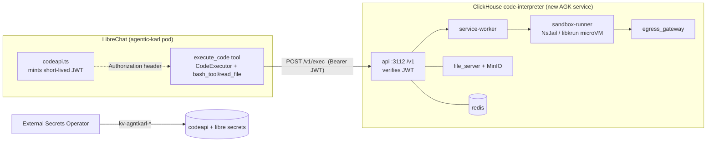

# Code Interpreter + Artifacts on AGK — rollout

> **Hands-on local setup guide** (how to run the sandbox + enable both features on a dev machine): [`../architecture/code-interpreter-and-artifacts.md`](../architecture/code-interpreter-and-artifacts.md). This doc is the *production rollout plan*.
>
> **Backend choice** (why the self-hosted ClickHouse sandbox vs an Azure managed service like Container Apps dynamic sessions): [`../proposals/code-interpreter-backend-options.md`](../proposals/code-interpreter-backend-options.md). This plan assumes the ClickHouse self-host; that proposal is where the alternative is weighed.

> **TL;DR** — Two upstream LibreChat features are fully present in the fork but deliberately **dark** on KARL: **Code Interpreter** (sandboxed code execution) and **Artifacts** (React/HTML/Mermaid preview in a side panel). Both are gated off by one line in [`librechat.yaml`](../../../librechat.yaml) — `endpoints.agents.capabilities` lists only `file_search` and `tools`. Neither needs a code change to turn on. **Code Interpreter also needs a backend**: upstream no longer calls a paid API — it targets the self-hosted, Apache-2.0 **[ClickHouse/code-interpreter](https://github.com/ClickHouse/code-interpreter)** sandbox, which we would run as a new AGK GitOps service (mirroring the Langfuse / rag-api pattern). **Artifacts needs no backend** — rendering is browser-side via Sandpack — but has a CDN-egress decision. **Status: local evaluation done; prod not started.** This doc is the evaluation record + the prod rollout plan. Ticket: **KK20-108**.

## Tickets

- **KK20-108** — enable Code Interpreter + Artifacts (evaluation + rollout).
- Follow-ups to file when prod work starts (see [Open questions](#open-questions)): the AKS nested-virtualization (`/dev/kvm`) node-pool spike, and the end-user exposure decision for the simplified Knauf agent builder.

---

## Architecture / mental model

### Two independent gates (do not conflate)

Enabling code execution is governed by **two** switches that live in different places and control different UX:

| Gate | Where | Controls |
|---|---|---|
| `interface.runCode` | [`librechat.yaml:369`](../../../librechat.yaml) — already `true` | The **manual "Run" button** on a code block + the composer "Run Code" badge toggle. Backed by the `RUN_CODE` role permission. |
| `execute_code` in `endpoints.agents.capabilities` | [`librechat.yaml:469-471`](../../../librechat.yaml) — currently **excluded** | Whether an **agent auto-runs code** as a tool during a run (`codeEnvAvailable`). |

Artifacts is a **single** capability gate — `artifacts` in the same `capabilities` list (no dedicated RBAC permission). Adding `artifacts` there surfaces the per-chat Artifacts toggle; the model is then prompted to emit the `:::artifact` directive that the Sandpack side panel renders.

Upstream ships `defaultAgentCapabilities` **including** both `execute_code` and `artifacts`; KARL overrides the list down to `[file_search, tools]` on purpose (comment block at [`librechat.yaml:452-461`](../../../librechat.yaml)). So the whole rollout on the LibreChat side is: **add two strings to that list** in the committed yaml (which is baked into the image at build — [`Dockerfile:37-38`](../../../Dockerfile) — so it ships via the normal release pipeline).

### Sandbox trust model (Code Interpreter only)



- **Auth**: LibreChat mints a per-request EdDSA/RS256 JWT ([`packages/api/src/auth/codeapi.ts`](../../../packages/api/src/auth/codeapi.ts), upstream PR #13028 — **not a Knauf seam**, so zero fork-maintenance). The sandbox verifies it with the matching public key. In `LOCAL_MODE=true` the sandbox bypasses auth and LibreChat sends no header — that is exactly why local eval needs no key material.
- **Isolation**: the sandbox runs NsJail (shared host kernel — trusted envs only) or libkrun **microVMs** (`KVM_ENABLED=true`, separate guest kernel — needs `/dev/kvm`). MicroVM is the posture for running untrusted user code.
- **Files**: code-interpreter file upload/download is a **separate path** from RAG file-search. It uploads the temp file straight to the sandbox and persists outputs via the existing `azure_blob` strategy; it does **not** touch the vector DB, Meilisearch, or the KK20-195 async-indexing worker (that machinery is fenced to `tool_resource === 'file_search'`). No conflict with the file lifecycle work.

### Artifacts rendering (no backend)

Artifacts render in a Sandpack iframe **in the user's browser**. With `SANDPACK_BUNDLER_URL` unset, the browser fetches the public CodeSandbox bundler; Tailwind is pulled from `cdn.tailwindcss.com/3.4.17` (hardcoded in [`client/src/utils/artifacts.ts`](../../../client/src/utils/artifacts.ts), so present even with a self-hosted bundler). This is an **egress decision**, not a server dependency — see [Open questions](#open-questions).

---

## What's landed

This PR (KK20-108) is **docs + local-eval scaffolding only** — no behavioural change ships:

| Change | File | Why |
|---|---|---|
| Ignore the local config variant | [`.gitignore`](../../../.gitignore) | Lets a `librechat.local.yaml` exist for local evaluation without ever becoming canonical. |
| Document the env surface | [`.env.example`](../../../.env.example) | `[knauf]` KK20-108 block documenting `LIBRECHAT_CODE_BASEURL`, the `CODEAPI_*` JWT knobs, and `SANDPACK_BUNDLER_URL` — all commented/off. |
| This plan | `knauf/docs/implementation-plans/code-interpreter-artifacts-rollout.md` | Evaluation record + prod rollout sequence. |

**Local evaluation (done, not committed — it is machine-local by design):**

1. `ClickHouse/code-interpreter` cloned as a sibling repo, brought up with its own `docker compose` (`LOCAL_MODE=true`, `KVM_ENABLED=true`; gateway on `:3112`).
2. **Runtimes seeded** with the repo's `./build-packages.sh` (the "package-init" step — installs Python 3.14.4 + numpy/pandas/matplotlib, Node 24.15.0, Bun, Bash onto the shared `data/pkgs` volume), then `docker compose restart sandbox-runner service-worker`. **This is required and easy to miss**: a fresh sandbox has an empty package volume and every `exec` returns `{"error":"bad_request","message":"python-3.14.4 runtime is unknown"}` (HTTP 400) until the runtimes are seeded *and* the runner is restarted to register them (`GET :2000/api/v2/runtimes` then lists them).
3. `librechat.local.yaml` = a copy of `librechat.yaml` with `execute_code` + `artifacts` added to `endpoints.agents.capabilities`.
4. Local `.env`: `CONFIG_PATH=<abs path>/librechat.local.yaml` + `LIBRECHAT_CODE_BASEURL=http://localhost:3112/v1`.
5. **Sandbox verified directly** (`POST :3112/v1/exec`, auth-bypassed): `print(40+2)` → `42`; `pandas` `describe()` works; `matplotlib` `savefig` returns a `files[]` output artifact (the shape `processCodeOutput` downloads and renders in chat). LibreChat-side clicks (Run button, agent auto-run, artifacts panel) are verified in the browser as ADMIN — see [Verification recipes](#verification-recipes).

The local-vs-committed split relies on the loader: [`api/server/services/Config/loadCustomConfig.js:71`](../../../api/server/services/Config/loadCustomConfig.js) honours `CONFIG_PATH` (local path or even an `https://` URL). `.env` is gitignored, so the override never leaks. This is **not** the forbidden base+overlay YAML split — the committed `librechat.yaml` stays the single canonical file; the local one is a full standalone copy used only on a dev machine.

---

## Still pending (prod worklist, dependency-ordered)

1. **[Spike] AKS nested-virtualization node pool.** Standard AKS nodes do not expose `/dev/kvm`. Decide: dedicated nested-virt VM-size node pool (e.g. `Dsv3`/`Esv3`+ families) with a device-exposure mechanism + taints/tolerations for microVM isolation, **or** accept `KVM_ENABLED=false` (NsJail, shared node kernel) for an internal-only, authenticated deployment. This is the single biggest unknown — resolve before committing to a deploy shape.
2. **Deploy the sandbox service** in `Knauf-Group/agk-deployment-configs` via the upstream `helm/codeapi` chart (single-source service; `services-local` ApplicationSet + exclude from multi-source `services`, per the Langfuse precedent). Internal-only ingress or ClusterIP — LibreChat is the only client.
3. **Provision JWT trust.** Generate an EdDSA keypair; private key → `kv-agntkarl-nonprod-001` → ExternalSecret → LibreChat env; public key → codeapi values. Set matching `issuer`/`audience`/`kid`/`alg` on both sides. `LOCAL_MODE=false`; strong `CODEAPI_INTERNAL_SERVICE_TOKEN` from Key Vault (never the `localdev-…` default).
4. **Wire LibreChat env** in the AGK values: `LIBRECHAT_CODE_BASEURL=http://<codeapi-svc>.<ns>.svc.cluster.local:3112/v1`, `CODEAPI_AUTH_PROVIDER=librechat-jwt`, and the `CODEAPI_JWT_*` set.
5. **Flip the capability** in the committed `librechat.yaml` (`execute_code`, `artifacts`, and — if the deployment skills in `skill/` should be live in prod — `skills`) — ships via the release pipeline **after** the sandbox exists in dev. Note `skills` needs no backend (see the setup guide's Skills section), so it can be flipped independently of the sandbox.
6. **Artifacts egress decision** — self-host the Sandpack bundler (`SANDPACK_BUNDLER_URL`) or accept CodeSandbox + Tailwind CDN egress from user browsers.
7. **USER-role decision** — see [Open questions](#open-questions).

---

## Rollout sequence (dev → prod)

1. Land this PR (docs + gitignore + env doc). No behaviour change.
2. Resolve the KVM node-pool spike (step 1 above) — its outcome sets `KVM_ENABLED` and the deploy shape.
3. Deploy the sandbox to **dev** with `LOCAL_MODE=true` first. Ensure the chart's **Package Init** job has populated the runtime PVC (Python/Node/Bun/Bash) — without it every `exec` fails with `"…runtime is unknown"`. Then confirm `POST /v1/exec` from inside the cluster.
4. Turn on JWT: keypair in Key Vault → ExternalSecret → both sides configured → `LOCAL_MODE=false`; confirm an authed `exec` succeeds and an unauthed one is rejected.
5. Add the LibreChat dev env vars; deploy; confirm the manual Run button reaches the in-cluster sandbox.
6. Flip the capability in committed `librechat.yaml`; release to dev; **UAT** (agent auto-run, files, artifacts).
7. Promote: `az acr import` the sandbox image dev→prod, apply prod values in `agentic-karl/prod`, prod Key Vault secrets, prod capability release; smoke-test.

---

## Critical file map

| File | Role in this workstream |
|---|---|
| [`librechat.yaml`](../../../librechat.yaml) | The capability gate (`endpoints.agents.capabilities`, ~L469) + `interface.runCode` (L369). The one committed change that turns features on in prod. |
| [`packages/api/src/auth/codeapi.ts`](../../../packages/api/src/auth/codeapi.ts) | Mints the sandbox JWT (upstream; no seam). Defines which `CODEAPI_JWT_*` env vars matter. |
| [`api/app/clients/tools/util/handleTools.js`](../../../api/app/clients/tools/util/handleTools.js) | Builds the `execute_code` tool with `authHeaders: () => getCodeApiAuthHeaders(req)`. |
| [`api/server/services/Files/Code/`](../../../api/server/services/Files/Code/) | Sandbox file upload/download + output persistence (separate from RAG). |
| [`api/server/services/Config/loadCustomConfig.js`](../../../api/server/services/Config/loadCustomConfig.js) | `CONFIG_PATH` resolution — the local-config mechanism. |
| [`client/src/utils/artifacts.ts`](../../../client/src/utils/artifacts.ts) | Sandpack options; `SANDPACK_BUNDLER_URL` override point; hardcoded Tailwind CDN. |
| [`client/src/knauf/components/Agents/capabilities.ts`](../../../client/src/knauf/components/Agents/capabilities.ts) | The simplified Knauf agent-builder registry — where an end-user "Analyze data" capability entry would go (separate ticket). |
| [`Dockerfile`](../../../Dockerfile) | `COPY librechat.yaml` at build (L37-38) — why the capability flip needs a release. |
| [`.env.example`](../../../.env.example) | `[knauf]` KK20-108 env doc block. |

Cross-repo: `Knauf-Group/agk-deployment-configs` (`agentic-karl/{dev,prod}/services/...`), `kv-agntkarl-{nonprod,prod}-001`. Reference precedent: [`langfuse-rollout.md`](langfuse-rollout.md), [`rag-azure-di-rollout.md`](rag-azure-di-rollout.md).

---

## Verification recipes

**Sandbox up (local or in-cluster):**
```bash
# One-time seed of language runtimes (fresh clone has none). In the sandbox repo:
./build-packages.sh && docker compose restart sandbox-runner service-worker
curl -s http://localhost:2000/api/v2/runtimes                       # lists python/node/bun/bash once seeded

curl -s -X POST http://localhost:3112/v1/exec \
  -H 'Content-Type: application/json' \
  -d '{"lang":"py","code":"print(40+2)"}'
# -> {"stdout":"42\n","code":0,...}   (before seeding: HTTP 400 "python-…runtime is unknown")
# api log confirms auth posture: "LOCAL MODE - Authentication bypassed"
```

**Capabilities exposed by the running LibreChat backend:**
```bash
curl -s localhost:3080/api/endpoints | jq '.agents.capabilities'   # includes execute_code, artifacts
curl -s localhost:3080/api/config    | jq '.bundlerURL,.staticBundlerURL'  # null locally = public CodeSandbox bundler
```

**Local config wiring:**
```bash
git check-ignore -v librechat.local.yaml                      # confirms the ignore rule bites
git diff --no-index -- librechat.yaml librechat.local.yaml    # expected drift = the two capability lines
```

**Manual clicks (as ADMIN, in the browser):**
1. KARL chat → ask for a Python snippet → hover the code block → **Run**; output streams underneath.
2. Composer **"+"** → toggle **Run Code** → "compute Fibonacci(20) by running Python" → tool call auto-executes.
3. Agent builder (admins get the detailed builder by default) → enable **Code Interpreter** on a test agent → chat auto-runs.
4. Attach a **CSV** to a code-interpreter agent → "load with pandas, print describe()" → then "plot a chart" → PNG renders + downloads. (`.py`/`.zip` are rejected by the KK20-190 MIME allow-list.)
5. Composer **"+"** → toggle **Artifacts** → "React counter with Tailwind" and "Mermaid flowchart of a login flow" → both render in the side panel (browser needs CodeSandbox + Tailwind CDN egress).

---

## Open questions

- **AKS `/dev/kvm`** — does the target node pool support nested virtualization, and is a dedicated pool justified, or do we accept NsJail-only isolation for an internal, authenticated service? (Blocks the deploy shape; own spike ticket.)
- **Artifacts CDN egress** — self-host the Sandpack bundler and/or vendor Tailwind, or accept browser egress to `*.codesandbox.io` + `cdn.tailwindcss.com`? The Tailwind CDN is hardcoded; fully closing egress would need a Tier 4c seam. Preflight: load both URLs from a corporate-network browser.
- **USER-role UX** — with `KNAUF_RESTRICT_(PROD_)USER_PERMISSIONS` on, `RUN_CODE.USE` is forced **false** for the USER role ([`packages/api/src/knauf/permissions/userRestrictions.ts:75-78`](../../../packages/api/src/knauf/permissions/userRestrictions.ts)), which hides the manual Run button/toggle and blocks the direct-call route. **But agent auto-run is not gated by `RUN_CODE`** — a shared/marketplace agent with the `execute_code` capability will run code for USERs regardless. Intended prod stance is likely "code execution via curated agents only"; confirm, and decide separately whether the simplified Knauf builder should ever expose the capability to end users (the commented `analyzeData` template in `capabilities.ts`).
