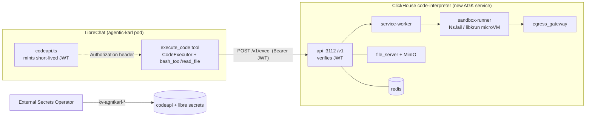

# Artifacts, Skills + Code Interpreter on AGK — rollout

> **Hands-on local setup guide** (how to run the sandbox + enable both features on a dev machine): [`../architecture/code-interpreter-and-artifacts.md`](../architecture/code-interpreter-and-artifacts.md). This doc is the _production rollout plan_.
>
> **Backend choice — DECIDED (Aug 2026): Azure Container Apps dynamic sessions + the Tier-3 adapter** ([`knauf/code-adapter/`](../../code-adapter/)), NOT the self-hosted ClickHouse sandbox. The full code-execution story now lives in [`../code-execution/`](../code-execution/): [how-it-works](../code-execution/how-it-works.md), the [backend decision](../code-execution/backend-decision.md), and the [sidecar placement justification](../code-execution/placement-and-justification.md). Sections of this plan written before the decision that reference the ClickHouse sandbox (`codeapi`, KVM node pool, `helm/codeapi`) are superseded by the worklist below; the JWT trust model and the capability-flip mechanics are unchanged (the adapter verifies the same `codeapi.ts` JWT the sandbox would have).

> **TL;DR** — Three upstream LibreChat capabilities live on one gate in [`librechat.yaml`](../../../librechat.yaml), `endpoints.agents.capabilities`. **Artifacts** (React/HTML/Mermaid/SVG preview panel) and **Skills** (markdown context injection, carrying the Knauf brand tokens) are **now enabled** — KK20-243 — because neither needs a backend. **Code Interpreter** (sandboxed execution) is still **dark**: upstream no longer calls a paid API, it targets the self-hosted, Apache-2.0 **[ClickHouse/code-interpreter](https://github.com/ClickHouse/code-interpreter)** sandbox, which we would run as a new AGK GitOps service (mirroring the Langfuse / rag-api pattern). Artifacts has no service to deploy but does carry a CDN-egress decision. **Status: artifacts + skills shipped; code interpreter prod not started.** Tickets: **KK20-108**, **KK20-243**.

## Tickets

- **KK20-108** — enable Code Interpreter + Artifacts (evaluation + rollout). Still open for `execute_code`.
- **KK20-243** — Artifacts + Skills activation and the Knauf brand-theme skill. **Landed** — see [Landed in KK20-243](#landed-in-kk20-243).
- Follow-ups to file (see [Open questions](#open-questions)): the AKS nested-virtualization (`/dev/kvm`) node-pool spike; the artifact CDN-egress pre-flight; and whether the composer Skills chip should be made a working off-switch on spec-driven chats.

---

## Architecture / mental model

### Three capabilities, three different gate stacks (do not conflate)

All three appear in the same `endpoints.agents.capabilities` list, but what _else_ has to be true differs per capability. Conflating them is the main source of confusion here.

| Capability         | Gates that must all pass                                                                                                                                                                                                                     | Notes                                                                                                                                                                                                                                                                                                                                                                                                    |
| ------------------ | -------------------------------------------------------------------------------------------------------------------------------------------------------------------------------------------------------------------------------------------- | -------------------------------------------------------------------------------------------------------------------------------------------------------------------------------------------------------------------------------------------------------------------------------------------------------------------------------------------------------------------------------------------------------- |
| **`artifacts`**    | 1. the capability list<br>2. a non-empty `artifacts` mode on the conversation or agent                                                                                                                                                       | **No RBAC permission exists at all.** The `karl` modelSpec sets `artifacts: 'default'`, which is what makes it on-by-default for new chats; without that key `applyModelSpecEphemeralAgent` writes `''` and forces it off. Server-side there is _no_ capability check either — `initialize.ts` appends the prompt for any non-empty string — so this flag is a UI/UX gate, not enforcement.              |
| **`skills`**       | 1. the capability list<br>2. the `SKILLS` RBAC permission (`interface.skills` for USER/ADMIN, `seed-agent-builder-role.js` for AGENT_BUILDER)<br>3. per-agent opt-in: `skills_enabled` on a persisted agent, or the modelSpec `skills` field | Enforced server-side at `initialize.js` and `skillDeps.js`. The `karl` spec sets `skills: true`. Skills need no backend — `read_file` on a skill reference is served from the in-process deployment registry.                                                                                                                                                                                            |
| **`execute_code`** | 1. the capability list — **currently excluded**<br>2. a reachable sandbox at `LIBRECHAT_CODE_BASEURL`<br>3. for the _manual_ Run button only: the `RUN_CODE` permission                                                                      | `interface.runCode` is currently `false` and gates only the manual Run button on a code block, **not** agent auto-run. Note the asymmetry: `KNAUF_RESTRICT_USER_PERMISSIONS` also forces `RUN_CODE.USE` false for the built-in USER role, but agent auto-run is not gated by `RUN_CODE` — so a future shared agent with `execute_code` could run code for USERs unless a separate runtime gate is added. |

One correction worth recording, because the earlier version of this doc and the yaml comment both got it wrong: **this list is not "the agent builder" list.** It gates _every_ chat, including default-spec KARL chats on the `azureOpenAI` endpoint — all sends route through [`api/server/routes/agents/chat.js`](../../../api/server/routes/agents/chat.js), and `skipAgentCheck` exists precisely to let non-agents endpoints through that router.

Upstream's `defaultAgentCapabilities` includes all three; KARL overrides the list explicitly, so that default never applies. The committed yaml is baked into the image at build ([`Dockerfile`](../../../Dockerfile)) and stage/prod are `az acr import` re-tags of the dev image, so **the same config ships to all three environments byte-identically** — there is no per-environment yaml mechanism. Per-env divergence is env vars only.

### Sandbox trust model (Code Interpreter only)



- **Auth**: LibreChat mints a per-request EdDSA/RS256 JWT ([`packages/api/src/auth/codeapi.ts`](../../../packages/api/src/auth/codeapi.ts), upstream PR #13028 — **not a Knauf seam**, so zero fork-maintenance). The sandbox verifies it with the matching public key. In `LOCAL_MODE=true` the sandbox bypasses auth and LibreChat sends no header — that is exactly why local eval needs no key material.
- **Isolation**: the sandbox runs NsJail (shared host kernel — trusted envs only) or libkrun **microVMs** (`KVM_ENABLED=true`, separate guest kernel — needs `/dev/kvm`). MicroVM is the posture for running untrusted user code.
- **Files**: code-interpreter file upload/download is a **separate path** from RAG file-search. It uploads the temp file straight to the sandbox and persists outputs via the existing `azure_blob` strategy; it does **not** touch the vector DB, Meilisearch, or the KK20-195 async-indexing worker (that machinery is fenced to `tool_resource === 'file_search'`). No conflict with the file lifecycle work.

### Artifacts rendering (no backend)

Artifacts render in a Sandpack iframe **in the user's browser**. With `SANDPACK_BUNDLER_URL` unset, the browser fetches the public CodeSandbox bundler; Tailwind is pulled from `cdn.tailwindcss.com/3.4.17` (hardcoded in [`client/src/utils/artifacts.ts`](../../../client/src/utils/artifacts.ts), so present even with a self-hosted bundler). This is an **egress decision**, not a server dependency — see [Open questions](#open-questions).

---

## What's landed

This PR (KK20-108) is **docs + local-eval scaffolding only** — no behavioural change ships:

| Change                          | File                                                                    | Why                                                                                                                                       |
| ------------------------------- | ----------------------------------------------------------------------- | ----------------------------------------------------------------------------------------------------------------------------------------- |
| Ignore the local config variant | [`.gitignore`](../../../.gitignore)                                     | Lets a `librechat.local.yaml` exist for local evaluation without ever becoming canonical.                                                 |
| Document the env surface        | [`.env.example`](../../../.env.example)                                 | `[knauf]` KK20-108 block documenting `LIBRECHAT_CODE_BASEURL`, the `CODEAPI_*` JWT knobs, and `SANDPACK_BUNDLER_URL` — all commented/off. |
| This plan                       | `knauf/docs/implementation-plans/code-interpreter-artifacts-rollout.md` | Evaluation record + prod rollout sequence.                                                                                                |

**Local evaluation (done, not committed — it is machine-local by design):**

1. `ClickHouse/code-interpreter` cloned as a sibling repo, brought up with its own `docker compose` (`LOCAL_MODE=true`, `KVM_ENABLED=true`; gateway on `:3112`).
2. **Runtimes seeded** with the repo's `./build-packages.sh` (the "package-init" step — installs Python 3.14.4 + numpy/pandas/matplotlib, Node 24.15.0, Bun, Bash onto the shared `data/pkgs` volume), then `docker compose restart sandbox-runner service-worker`. **This is required and easy to miss**: a fresh sandbox has an empty package volume and every `exec` returns `{"error":"bad_request","message":"python-3.14.4 runtime is unknown"}` (HTTP 400) until the runtimes are seeded _and_ the runner is restarted to register them (`GET :2000/api/v2/runtimes` then lists them).
3. `librechat.local.yaml` = a copy of `librechat.yaml` with `execute_code` added to `endpoints.agents.capabilities`; `artifacts` and `skills` are already present.
4. Local `.env`: `CONFIG_PATH=<abs path>/librechat.local.yaml` + `LIBRECHAT_CODE_BASEURL=http://localhost:3112/v1`.
5. **Sandbox verified directly** (`POST :3112/v1/exec`, auth-bypassed): `print(40+2)` → `42`; `pandas` `describe()` works; `matplotlib` `savefig` returns a `files[]` output artifact (the shape `processCodeOutput` downloads and renders in chat). LibreChat-side clicks (Run button, agent auto-run, artifacts panel) are verified in the browser as ADMIN — see [Verification recipes](#verification-recipes).

The local-vs-committed split relies on the loader: [`api/server/services/Config/loadCustomConfig.js:71`](../../../api/server/services/Config/loadCustomConfig.js) honours `CONFIG_PATH` (local path or even an `https://` URL). `.env` is gitignored, so the override never leaks. This is **not** the forbidden base+overlay YAML split — the committed `librechat.yaml` stays the single canonical file; the local one is a full standalone copy used only on a dev machine.

---

## Landed in KK20-243

Artifacts and Skills are **on**. `execute_code` is untouched. The whole activation is config plus one client registry:

| Change                                                                                     | File                                                                                                                                            | Why                                                                                                                                                                                                                                                                                                                       |
| ------------------------------------------------------------------------------------------ | ----------------------------------------------------------------------------------------------------------------------------------------------- | ------------------------------------------------------------------------------------------------------------------------------------------------------------------------------------------------------------------------------------------------------------------------------------------------------------------------- |
| `artifacts` + `skills` in the capability list; the stale "agent builder" comment rewritten | [`librechat.yaml`](../../../librechat.yaml)                                                                                                     | The single gate. Verified with `configSchema.safeParse`.                                                                                                                                                                                                                                                                  |
| `interface.skills: { use: true, create: false, share: false, public: false }`              | [`librechat.yaml`](../../../librechat.yaml)                                                                                                     | Without an explicit block, `hasExplicitConfig` never rewrites the role docs, so USER/ADMIN `SKILLS` freeze at first-create and environments drift. `create: false` keeps authoring with platform engineering — the schema default is `true`.                                                                              |
| `artifacts: 'default'` + `skills: true` on the `karl` spec                                 | [`librechat.yaml`](../../../librechat.yaml)                                                                                                     | `applyModelSpecEphemeralAgent` is authoritative for new spec-driven chats and writes `artifacts: ''` when the key is absent — without it the feature ships dark. `interface.defaultPinnedTools` is **not** a substitute: the pin default is beaten by the eagerly-persisted localStorage value in every existing browser. |
| `SKILLS: { USE: true, … }` for AGENT_BUILDER                                               | [`knauf/scripts/seed-agent-builder-role.js`](../../scripts/seed-agent-builder-role.js)                                                          | The role hard-set all-false, so AI Champions would have stayed locked out. **Requires a manual run per environment — see the post-deploy step below.**                                                                                                                                                                    |
| Two rows appended to the capability registry                                               | [`client/src/knauf/components/Agents/capabilities.ts`](../../../client/src/knauf/components/Agents/capabilities.ts)                             | `KnaufAgentConfig` held only `browseInternet`, so artifacts/skills toggles were ADMIN-only and AI Champions could not enable them on agents they publish. Needs no schema work — the fields already exist and already round-trip.                                                                                         |
| `skill/karl-brand/` (new) + `karl-artifacts` rewritten; `knauf-theme.md` deleted           | [`skill/`](../../../skill)                                                                                                                      | One token source instead of four uncontrolled copies in three incompatible object shapes. Backed by the official kit in [`knauf/brand/`](../../brand).                                                                                                                                                                    |
| `skill/_disabled/karl-data-analysis/`                                                      | [`skill/_disabled`](../../../skill/_disabled)                                                                                                   | Its catalog entry advertises `bash_tool` and `/mnt/data`, which do not exist while `execute_code` is off — shipping it invites the model to promise work it cannot do. One `git mv` to re-enable.                                                                                                                         |
| Guard spec over the real `skill/` tree                                                     | [`packages/api/src/skills/__tests__/deploymentSkills.knauf.spec.ts`](../../../packages/api/src/skills/__tests__/deploymentSkills.knauf.spec.ts) | Nothing covered the shipped skills. A frontmatter typo there fails **server boot**; a typo'd reference path was undetectable until runtime.                                                                                                                                                                               |
| The brand kit                                                                              | [`knauf/brand/`](../../brand)                                                                                                                   | 17 files, ~26 MB. Excluded from the Docker build context by `.dockerignore`.                                                                                                                                                                                                                                              |

### Post-deploy step — do not skip

`knauf/scripts/seed-agent-builder-role.js` is **not** a job, **not** a migration, and **not** run by the app: `updateInterfacePermissions` only iterates USER and ADMIN, and AGENT_BUILDER exists only because a human ran mongosh. **Deploying the image does not grant AI Champions skills access.** After each environment's release lands:

```bash
mongosh "<agk-dev-mongo-uri>"   knauf/scripts/seed-agent-builder-role.js
mongosh "<agk-stage-mongo-uri>" knauf/scripts/seed-agent-builder-role.js
mongosh "<agk-prod-mongo-uri>"  knauf/scripts/seed-agent-builder-role.js
```

The script prints every matching role doc's final permissions — capture that as evidence. It is idempotent and converges every tenant-scoped copy. **Hazard:** it `$set`s the whole `permissions` object, so running an _older_ checkout afterwards silently reverts `SKILLS` to false.

### Known behaviour that will generate questions

- **The composer Skills chip cannot turn skills off on a spec-driven chat.** `skills: true` on the modelSpec makes `skills_enabled` unconditional, which short-circuits `isAgentSkillsEnabledForRun` before it consults the chip. Accepted because the alternative is skills off by default everywhere. A working off-switch is a follow-up.
- **A new Skills section appears in the left sidebar** for every user (`useSideNavLinks` adds it whenever the capability and permission are on). With `create: false` it is read-only — currently a catalogue of six deployment skills. Harmless but visible; worth product sign-off on the copy.
- **Artifacts adds ~2.9k input tokens per turn** on every KARL conversation (the artifacts prompt is ~11.4 KB). Capture a Langfuse baseline before and after promotion.
- **Artifacts previews depend on CDN egress from the user's browser.** See the pre-flight in [Verification recipes](#verification-recipes).

---

## Still pending (prod worklist, dependency-ordered)

**Artifacts and Skills are done** — items 5–7 of the original list are resolved (see [Landed in KK20-243](#landed-in-kk20-243)), except the artifact egress pre-flight, which is item 8 below. What remains is Code Interpreter, now on the **ACA dynamic sessions** path (the KVM node-pool spike and the `helm/codeapi` deploy are obsolete — Microsoft operates the sandbox):

1. **[Spikes, sandbox subscription] S1/S5 + S2 — DONE (Aug 2026).** Both pools created in West Europe; `Shell` viable with `python3` 3.10.12 + `base64`/`head`/`wc`/`bash`; the two data-plane contracts pinned as fixtures (Python `POST /code/execute@2024-02-02-preview`, Shell `POST /executions@2025-02-02-preview`); full CSV→pandas→PNG round-trip proven via `lang=py`. **New finding that changes the pool plan (item 3): the built-in `Shell` pool has NO pandas/numpy, and all agent traffic (`bash_tool`, `lang=bash`) routes to it — so agent-driven data analysis fails there.** See the "Open decision — the execution pool must carry the data-science stack" section in [`../code-execution/backend-decision.md`](../code-execution/backend-decision.md).
   - **1a. [decision] Data-science pool image.** Resolve before the Terraform lands: a `CustomContainer` pool image with `bash` + `python3` + pandas/numpy/matplotlib for the `lang=bash` path (recommended — optionally serving both languages from one image so a conversation shares one sandbox), vs. shell-only-interim. This needs its own small image + `build-*` workflow (adapter precedent) if the CustomContainer route is chosen.
2. **[agentic-karl PR — largely done] The adapter.** `knauf/code-adapter/` (LibreChat Code API front, ACA session pools back; real exit codes + output-cap recovery via the sentinel wrapper; blob staging + Mongo TTL bookkeeping) + `.github/workflows/build-code-adapter.yaml` (az acr build → `agentic-karl-dev/agentic-karl-code-adapter`). See its [README](../../code-adapter/README.md). Remaining inside this item: replace the provisional ACA fixtures with the S1/S5 spike captures.
3. **[agk-infrastructure PR] Azure resources (Terraform, AzAPI provider — no azurerm resource exists).** `Microsoft.App/sessionPools`, West Europe, `EgressDisabled`, `maxConcurrentSessions` 20, `cooldown` 300 s, mgmt api-version `2025-07-01`. **Pool image per decision 1a** — the built-in `Shell` pool lacks pandas/numpy, so plan on a `CustomContainer` pool with the data-science stack for the `lang=bash` path (built-in `PythonLTS` alone does not serve agent traffic); UAMI `id-agk-code-adapter-nonprod` + federated credential (AKS OIDC issuer, subject `system:serviceaccount:agentic-karl-dev:sa-code-adapter`); role **"Azure ContainerApps Session Executor"** on both pools. One new KV entry: `AGK-CODEAPI-JWT-PRIVATE-KEY` (Ed25519, for LibreChat's side — the adapter itself needs **no pool credential**, that's the workload-identity win; it is the **first app workload-identity pod on AGK**, only ESO uses it today).
4. **[agk-deployment-configs PR] Deploy the adapter** as a single-source service `agentic-karl-code-adapter` (`services-local` + exclude from multi-source `services`, same PR — langfuse precedent): ct-shared-chart wrapper, ClusterIP 3112, replicaCount 2, `serviceAccount.create: true` + `azure.workload.identity/client-id` annotation + `azure.workload.identity/use: "true"` pod label, ExternalSecret for `MONGO_URI` + `AZURE_STORAGE_CONNECTION_STRING` (existing KV entries), ConfigMap for pool endpoints/api-version/JWT public key, defaultDenyAll egress allowances (login.microsoftonline.com, both pool endpoints, blob, Mongo). **Ordering: the CI image must exist in ACR before this merges** (rag-azure-di precedent — merge = deploy).
5. **Provision JWT trust + wire LibreChat env** (values-only): keypair via `openssl genpkey -algorithm ed25519`; private → KV → ExternalSecret → LibreChat env (`CODEAPI_AUTH_PROVIDER=librechat-jwt`, `CODEAPI_JWT_PRIVATE_KEY`, `_ALGORITHM=EdDSA`, `_KID=lc-codeapi-dev-<date>`, `_ISSUER=agentic-karl`, `_AUDIENCE=codeapi`, `_SINGLE_TENANT_ID=knauf`); public half → adapter ConfigMap (same issuer/audience/kid); `LIBRECHAT_CODE_BASEURL=http://agentic-karl-code-adapter.agentic-karl-dev.svc.cluster.local:3112/v1`. Verify in-cluster before the flip: authed `/v1/exec` 200 (py + bash), unauthed 401, CSV → pandas → PNG round-trip, >220 s → friendly `code:1` (never 5xx), >5 min-gap re-exec → transparent session re-mint.
6. **Flip `execute_code`** in the committed `librechat.yaml` — ships via the release pipeline **after** dev verification. Same PR: `git mv skill/_disabled/karl-data-analysis skill/karl-data-analysis` (its `bash_tool`/`/mnt/data` promises become true — first re-check its body against ACA realities: 220 s cap, no session egress, py/bash only) and run the deployment-skills guard spec. `interface.runCode` stays `false` (KK20-252): execution is agent auto-run only.
7. **USER-role decision for code execution** — see [Open questions](#open-questions). Unchanged by KK20-243, since artifacts has no RBAC permission and skills is not in the restricted set.

**Independent of the sandbox — do this now, not with code interpreter:**

8. **Artifacts CDN egress pre-flight.** Artifacts are live, so this is no longer a decision to defer: confirm from a managed browser on the corporate network that `cdn.tailwindcss.com/3.4.17`, `*-sandpack.codesandbox.io` and `preview.sandpack-static-server.codesandbox.io` are reachable. If the bundler is blocked, `SANDPACK_BUNDLER_URL` / `SANDPACK_STATIC_BUNDLER_URL` are per-environment env vars and need no rebuild. If **Tailwind** is blocked, React previews render unstyled and there is no env override — that needs a code change (self-hosting the Tailwind build), so find out before promoting to prod.

---

## Rollout sequence (dev → prod) — ACA path

1. Spikes S1/S5/S2 in the personal sandbox subscription (worklist item 1). Gate: `Shell` pool viable + response fixtures captured.
2. Land the adapter PR in `agentic-karl` (worklist item 2) and run `build-code-adapter.yaml` so the image exists in ACR.
3. Land the Terraform PR in `agk-infrastructure` (worklist item 3): pools + UAMI + federated credential + role assignments + the `AGK-CODEAPI-JWT-PRIVATE-KEY` KV entry.
4. Land the GitOps PR in `agk-deployment-configs` (worklist item 4) — merge = deploy to `agentic-karl-dev`. Confirm the pod acquires an Entra token via workload identity (log line "Entra token acquired") and `/readyz` is green.
5. Wire JWT trust + LibreChat env (worklist item 5); verify in-cluster (authed py/bash exec, 401 unauthed, CSV→PNG round-trip, timeout shape, cooldown re-mint).
6. Flip the capability in committed `librechat.yaml` + re-enable `karl-data-analysis` (worklist item 6); release to dev; **UAT** (agent auto-run, files, artifacts).
7. Promote: prod Terraform (`sp-agk-code-{py,sh}-prod`, `id-agk-code-adapter-prod` with subject `agentic-karl-prod:sa-code-adapter`, maxConcurrent 50), `az acr import` the adapter image nonprod→prod, copy the GitOps dir to `agentic-karl/prod` (swap ACR/KV/namespace), prod KV keypair, slot the adapter into `promote_pipeline.yaml` beside the existing sibling services, prod capability release; smoke-test.

---

## Critical file map

| File                                                                                                                | Role in this workstream                                                                                                                             |
| ------------------------------------------------------------------------------------------------------------------- | --------------------------------------------------------------------------------------------------------------------------------------------------- |
| [`librechat.yaml`](../../../librechat.yaml)                                                                         | The capability gate (`endpoints.agents.capabilities`, ~L469) + `interface.runCode` (L369). The one committed change that turns features on in prod. |
| [`packages/api/src/auth/codeapi.ts`](../../../packages/api/src/auth/codeapi.ts)                                     | Mints the sandbox JWT (upstream; no seam). Defines which `CODEAPI_JWT_*` env vars matter.                                                           |
| [`api/app/clients/tools/util/handleTools.js`](../../../api/app/clients/tools/util/handleTools.js)                   | Builds the `execute_code` tool with `authHeaders: () => getCodeApiAuthHeaders(req)`.                                                                |
| [`api/server/services/Files/Code/`](../../../api/server/services/Files/Code/)                                       | Sandbox file upload/download + output persistence (separate from RAG).                                                                              |
| [`api/server/services/Config/loadCustomConfig.js`](../../../api/server/services/Config/loadCustomConfig.js)         | `CONFIG_PATH` resolution — the local-config mechanism.                                                                                              |
| [`client/src/utils/artifacts.ts`](../../../client/src/utils/artifacts.ts)                                           | Sandpack options; `SANDPACK_BUNDLER_URL` override point; hardcoded Tailwind CDN.                                                                    |
| [`client/src/knauf/components/Agents/capabilities.ts`](../../../client/src/knauf/components/Agents/capabilities.ts) | The simplified Knauf agent-builder registry — where an end-user "Analyze data" capability entry would go (separate ticket).                         |
| [`Dockerfile`](../../../Dockerfile)                                                                                 | `COPY librechat.yaml` at build (L37-38) — why the capability flip needs a release.                                                                  |
| [`.env.example`](../../../.env.example)                                                                             | `[knauf]` KK20-108 env doc block.                                                                                                                   |

Cross-repo: `Knauf-Group/agk-deployment-configs` (`agentic-karl/{dev,prod}/services/...`), `kv-agntkarl-{nonprod,prod}-001`. Reference precedent: [`langfuse-rollout.md`](langfuse-rollout.md), [`rag-azure-di-rollout.md`](rag-azure-di-rollout.md).

---

## Verification recipes

**Sandbox up (local or in-cluster):**

```bash
# One-time seed of language runtimes (fresh clone has none). In the sandbox repo:
./build-packages.sh && docker compose restart sandbox-runner service-worker
curl -s http://localhost:2000/api/v2/runtimes                       # lists python/node/bun/bash once seeded

curl -s -X POST http://localhost:3112/v1/exec \
  -H 'Content-Type: application/json' \
  -d '{"lang":"py","code":"print(40+2)"}'
# -> {"stdout":"42\n","code":0,...}   (before seeding: HTTP 400 "python-…runtime is unknown")
# api log confirms auth posture: "LOCAL MODE - Authentication bypassed"
```

**Capabilities exposed by the running LibreChat backend:**

```bash
curl -s localhost:3080/api/endpoints | jq '.agents.capabilities'   # includes execute_code, artifacts
curl -s localhost:3080/api/config    | jq '.bundlerURL,.staticBundlerURL'  # null locally = public CodeSandbox bundler
```

**Local config wiring:**

```bash
git check-ignore -v librechat.local.yaml                      # confirms the ignore rule bites
git diff --no-index -- librechat.yaml librechat.local.yaml    # expected drift = the two capability lines
```

**Manual clicks (as ADMIN, in the browser):**

1. KARL chat → ask for a Python snippet → hover the code block → **Run**; output streams underneath.
2. Composer **"+"** → toggle **Run Code** → "compute Fibonacci(20) by running Python" → tool call auto-executes.
3. Agent builder (admins get the detailed builder by default) → enable **Code Interpreter** on a test agent → chat auto-runs.
4. Attach a **CSV** to a code-interpreter agent → "load with pandas, print describe()" → then "plot a chart" → PNG renders + downloads. (`.py`/`.zip` are rejected by the KK20-190 MIME allow-list.)
5. Composer **"+"** → toggle **Artifacts** → "React counter with Tailwind" and "Mermaid flowchart of a login flow" → both render in the side panel (browser needs CodeSandbox + Tailwind CDN egress).

---

## Open questions

- **AKS `/dev/kvm`** — does the target node pool support nested virtualization, and is a dedicated pool justified, or do we accept NsJail-only isolation for an internal, authenticated service? (Blocks the deploy shape; own spike ticket.)
- **Artifacts CDN egress** — self-host the Sandpack bundler and/or vendor Tailwind, or accept browser egress to `*.codesandbox.io` + `cdn.tailwindcss.com`? The Tailwind CDN is hardcoded; fully closing egress would need a Tier 4c seam. Preflight: load both URLs from a corporate-network browser.
- **USER-role UX** — with `KNAUF_RESTRICT_(PROD_)USER_PERMISSIONS` on, `RUN_CODE.USE` is forced **false** for the USER role ([`packages/api/src/knauf/permissions/userRestrictions.ts:75-78`](../../../packages/api/src/knauf/permissions/userRestrictions.ts)), which hides the manual Run button/toggle and blocks the direct-call route. **But agent auto-run is not gated by `RUN_CODE`** — a shared/marketplace agent with the `execute_code` capability will run code for USERs regardless. Intended prod stance is likely "code execution via curated agents only"; confirm, and decide separately whether the simplified Knauf builder should ever expose the capability to end users (the commented `analyzeData` template in `capabilities.ts`).
