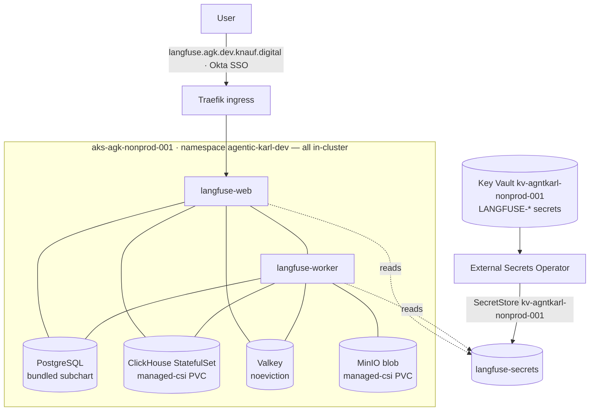

# Langfuse on AGK — rollout

> **TL;DR** — Deploy [Langfuse](https://langfuse.com) (open-source LLM observability) on the **AGK** platform as a normal GitOps service, *not* via the upstream self-contained `langfuse-terraform-azure` module (a duplicate AKS/VNet/App-Gateway/DNS island). Langfuse runs the official Helm chart on the AGK nonprod cluster `aks-agk-nonprod-001`, under the `agentic-karl` project, namespace `agentic-karl-dev`, at `langfuse.agk.dev.knauf.digital`. It mirrors the existing `agentic-karl-meilisearch` / `agentic-karl-rag-api` single-source service pattern. **All backing stores are bundled in-cluster for dev** (PostgreSQL, ClickHouse, Valkey, MinIO) so there is **no `agk-infrastructure` Terraform** and no CNPG dependency. **Status: drafted — [agk-deployment-configs#31](https://github.com/Knauf-Group/agk-deployment-configs/pull/31) (draft).**

## Repo split (per the `agk-infra-context` skill)

The current AGK GitOps repo is **`Knauf-Group/agk-deployment-configs`** (clusters `aks-agk-nonprod-001` / `aks-agk-prod-001`, ArgoCD `argocd.agk.nonprod.knauf.digital`). The older `ct-shared-deployment-configs` is the legacy "Old CT dev" path (`argocd-shared-dev.knauf.digital`) and is **not** where new AGK services go. Langfuse therefore lives in `agk-deployment-configs`. No `agk-infrastructure` change is needed because every backing store is in-cluster for dev.

## Architecture (dev)



Chart: [`langfuse/langfuse`](https://github.com/langfuse/langfuse-k8s) **`1.5.34`** → app **`3.179.1`** (pin exactly). Wrapper `Chart.yaml` depends on it from `oci://acrctshared001.azurecr.io/helm` (same registry meilisearch's chart uses; allowed by the `services` AppProject `sourceRepos`).

### Component decisions

| Langfuse dep | Dev decision | Notes / prod hardening |
|---|---|---|
| **PostgreSQL** | Bundled subchart (`postgresql.deploy: true`), `existingSecret` for the password | AGK has **no CNPG operator** (it uses managed hub PG for the app). Bundled is simplest + self-contained for dev. Prod: a managed DB on `pgsql-agk-hub-nonprod-westeurope-001` via an `agk-infrastructure` PR, or HA bundled. |
| **ClickHouse** | Bundled StatefulSet, `replicaCount: 1`, `clusterEnabled: false`, `resourcesPreset: medium`, `managed-csi` PVC | No Azure PaaS equivalent. **Never** Azure Files SMB. Prod: `replicaCount: 3`, larger preset/PVC, on-demand nodes, backups. Highest blast radius — see Risks. |
| **Redis/Valkey** | Bundled (`redis.deploy: true`). The chart sets `--maxmemory-policy noeviction` on Valkey by default | Prod: optionally managed Azure Cache (noeviction). |
| **Blob (events/media)** | Bundled MinIO (`s3.deploy: true`, `storageProvider: s3`), `managed-csi` PVC | Prod: `s3.deploy: false` + `s3.storageProvider: azure` (chart-native) backed by an AGK blob account. |

Bitnami subchart images default to `bitnamilegacy/*` with `global.security.allowInsecureImages: true` (chart default) — they pull from Docker Hub at runtime (AGK nodes can, e.g. meilisearch pulls `getmeili/meilisearch` directly). Those images are frozen; revisit before prod.

### Registration (ApplicationSet, not app-of-apps)

AGK discovers services via ApplicationSets in `infra/nonprod/argocd/projects/services.yaml`. Langfuse is **single-source** (no `Knauf-Group/langfuse` repo to supply `infrastructure/dev/values.yaml`), so it must be:
- **added** to the `services-local` ApplicationSet `directories`, and
- **excluded** from the multi-source `services` ApplicationSet (exactly like `agentic-karl-admin-panel` / `-rag-api` / `-meilisearch`).

The `services-local` template auto-syncs (`selfHeal: true, prune: true`), so **merging the PR deploys langfuse immediately** — hence the prerequisites below must land first (the PR is a draft until then).

### Secrets

The SecretStore `kv-agntkarl-nonprod-001` already exists namespace-wide (defined in `agentic-karl/dev/common-namespace-resources`). Langfuse's `ExternalSecret` is rendered by the chart's **`extraManifests`**, mapping Key Vault → the `langfuse-secrets` k8s Secret. Subchart passwords use `existingSecret` so ArgoCD's `helm template` (no `lookup`) doesn't rotate them on every sync.

| Key Vault secret (`kv-agntkarl-nonprod-001`) | → `langfuse-secrets` key |
|---|---|
| `LANGFUSE-SALT` | `SALT` |
| `LANGFUSE-NEXTAUTH-SECRET` | `NEXTAUTH_SECRET` |
| `LANGFUSE-ENCRYPTION-KEY` | `ENCRYPTION_KEY` (256-bit, `openssl rand -hex 32`) |
| `LANGFUSE-POSTGRES-PASSWORD` | `POSTGRES_PASSWORD` |
| `LANGFUSE-CLICKHOUSE-PASSWORD` | `CLICKHOUSE_PASSWORD` |
| `LANGFUSE-REDIS-PASSWORD` | `REDIS_PASSWORD` |
| `LANGFUSE-MINIO-ROOT-PASSWORD` | `MINIO_ROOT_PASSWORD` |
| `LANGFUSE-OKTA-CLIENT-ID` | `OKTA_CLIENT_ID` |
| `LANGFUSE-OKTA-CLIENT-SECRET` | `OKTA_CLIENT_SECRET` |

```bash
az account set --subscription ad3f0a71-cc5b-4d00-8289-23623cf2064c   # CT-SHARED-RESOURCES (AGK nonprod)
az keyvault secret set --vault-name kv-agntkarl-nonprod-001 --name LANGFUSE-SALT               --value "$(openssl rand -base64 32)"
az keyvault secret set --vault-name kv-agntkarl-nonprod-001 --name LANGFUSE-NEXTAUTH-SECRET     --value "$(openssl rand -base64 32)"
az keyvault secret set --vault-name kv-agntkarl-nonprod-001 --name LANGFUSE-ENCRYPTION-KEY      --value "$(openssl rand -hex 32)"
az keyvault secret set --vault-name kv-agntkarl-nonprod-001 --name LANGFUSE-POSTGRES-PASSWORD   --value "$(openssl rand -base64 24)"
az keyvault secret set --vault-name kv-agntkarl-nonprod-001 --name LANGFUSE-CLICKHOUSE-PASSWORD --value "$(openssl rand -base64 24)"
az keyvault secret set --vault-name kv-agntkarl-nonprod-001 --name LANGFUSE-REDIS-PASSWORD      --value "$(openssl rand -base64 24)"
az keyvault secret set --vault-name kv-agntkarl-nonprod-001 --name LANGFUSE-MINIO-ROOT-PASSWORD --value "$(openssl rand -base64 24)"
# Register a new Okta OIDC app (redirect https://langfuse.agk.dev.knauf.digital/api/auth/callback/okta), then:
az keyvault secret set --vault-name kv-agntkarl-nonprod-001 --name LANGFUSE-OKTA-CLIENT-ID      --value "<from Okta>"
az keyvault secret set --vault-name kv-agntkarl-nonprod-001 --name LANGFUSE-OKTA-CLIENT-SECRET  --value "<from Okta>"
```

SSO issuer is the public AGK Okta issuer `https://dev.identity.knauf.digital/oauth2/default` (a plain value in the chart, not a secret).

### Chart & image mirror

```bash
# Chart (with vendored Bitnami subcharts) -> ACR OCI; ArgoCD sourceRepos allows acrctshared001.
helm repo add langfuse https://langfuse.github.io/langfuse-k8s
helm pull langfuse/langfuse --version 1.5.34
helm push langfuse-1.5.34.tgz oci://acrctshared001.azurecr.io/helm
# Images: langfuse/langfuse(-worker) + bitnamilegacy/* pull from Docker Hub at runtime (like meilisearch) — no mirror needed for dev.
```

## Ordering constraint

```
1. LANGFUSE-* secrets present in kv-agntkarl-nonprod-001 (+ Okta app)   ── else ESO can't sync → pods crashloop
2. Chart mirrored to acrctshared001.azurecr.io/helm                     ── else ArgoCD sync fails (chart not found)
3. PR merged → services-local ApplicationSet creates agentic-karl-dev-langfuse and AUTO-SYNCS:
     ExternalSecret writes langfuse-secrets → bundled PG/ClickHouse/Valkey/MinIO start
       → web runs Postgres+ClickHouse migrations → web+worker Ready
4. Verify dev → prod follow-up (agentic-karl/prod/services/langfuse + prod ApplicationSet + Azure Blob)
```

## Verification recipes

```bash
# secrets
az keyvault secret list --vault-name kv-agntkarl-nonprod-001 --query "[?contains(name,'LANGFUSE')].name" -o tsv
# ArgoCD (VPN; --grpc-web per the skill)
argocd app get agentic-karl-dev-langfuse --grpc-web
argocd app get-resource agentic-karl-dev-langfuse --kind ExternalSecret --group external-secrets.io --resource-name langfuse-secrets --grpc-web -o yaml
# cluster (az aks get-credentials -g rg-agk-nonprod-westeurope -n aks-agk-nonprod-001)
kubectl -n agentic-karl-dev get externalsecret langfuse-secrets        # SecretSynced=True
kubectl -n agentic-karl-dev get pods -l app.kubernetes.io/instance=langfuse
kubectl -n agentic-karl-dev get statefulset,pvc | grep -E 'clickhouse|postgres|valkey|minio'
# end-to-end
curl -fsS https://langfuse.agk.dev.knauf.digital/api/public/health     # {"status":"OK"}
curl -fsS https://langfuse.agk.dev.knauf.digital/api/auth/providers     # lists 'okta'
```

## Critical file map

| Repo / file | Role |
|---|---|
| `agk-deployment-configs` `agentic-karl/dev/services/langfuse/Chart.yaml` | Depends on `langfuse` `1.5.34` from `oci://acrctshared001.azurecr.io/helm` |
| `agk-deployment-configs` `agentic-karl/dev/services/langfuse/values.yaml` | Helm values: web+worker, bundled PG/ClickHouse/Valkey/MinIO, Okta SSO, Traefik ingress, `usernpool` scheduling, `langfuse-secrets` ExternalSecret via `extraManifests` |
| `agk-deployment-configs` `infra/nonprod/argocd/projects/services.yaml` | Register `langfuse` in `services-local`; exclude from `services` |
| this repo `knauf/docs/implementation-plans/langfuse-rollout.md` | This document |

Precedents: `agk-deployment-configs` `agentic-karl/dev/services/agentic-karl-meilisearch/**` (single-source upstream image), `.../agentic-karl/**` (Okta/OpenID + Traefik), `.../common-namespace-resources/values.yaml` (SecretStore), `.../network-policy/values.yaml` (namespace default-deny that already permits this app).

## Validation done

- `helm template langfuse/langfuse --version 1.5.34 -f <values>` renders cleanly: 43 manifests — ExternalSecret + web/worker Deployments + 4 StatefulSets + Traefik Ingress on `langfuse.agk.dev.knauf.digital`, all secret refs into `langfuse-secrets`, bundled stores wired to `existingSecret`.
- All three changed files parse as YAML.

## Risks & open questions

- **Biggest risk — stateful ClickHouse on a shared dev cluster, on spot nodes.** Dev schedules all stateful subcharts on `usernpool` (spot) to match the rest of AGK; spot reclaim can lose trace data. Acceptable for dev observability; for prod move ClickHouse/Postgres to on-demand nodes, size PVCs up front, add backups, and use `managed-csi` block (never SMB).
- **Postgres home**: bundled in-cluster (this rollout) vs a managed DB on the AGK hub PostgreSQL via `agk-infrastructure`. Bundled is simplest for dev; managed is the likely prod choice.
- **ExternalSecret apiVersion** `external-secrets.io/v1` — confirm against the cluster's ESO (appVersion `v0.38.0` supports v1).
- **Network policy** — the namespace default-deny already allows same-namespace + Traefik ingress + 443/80 egress, so no change is needed for all-in-cluster langfuse. Re-check if any store is moved out-of-cluster.

## Out of scope (follow-ups)

- **Instrumenting Karl / LibreChat to emit traces to Langfuse** — LibreChat has no native Langfuse integration; separate workstream.
- **Prod** (`agentic-karl/prod/services/langfuse` + the prod ApplicationSet + Azure Blob) and any `agk-infrastructure` managed-store hardening.
