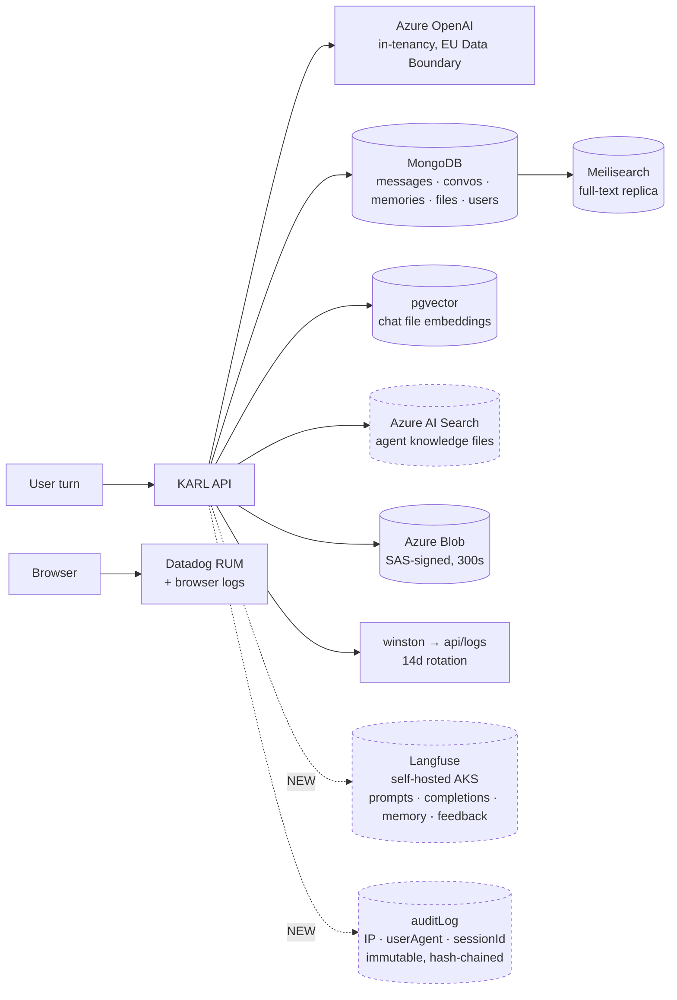

# PII & privacy workstream — ticket set, compliance mapping, rollout

> **TL;DR** — [KK20-207](../proposals/pii-masking-and-anonymization.md) produced the strategy; this
> plan turns it into executable work. It carries (1) the **delta** between what that assessment
> claims and what the code does today, (2) a **paste-ready ticket set** for every phase, (3) a
> **GDPR / EU AI Act mapping** per ticket, and (4) a **bundling and sequencing** recommendation.
>
> The assessment's thesis is unchanged and still correct: **protect the durable copies and the
> logs; do not mask prompts before the model.** What changed is everything underneath it. The
> assessment on `main` is v1.0; a review-clean v1.2 has been unmerged since 2026-07-06 and is now
> 1251 commits behind; ~8 weeks of development have retired or invalidated a further 13 claims.
> Most consequentially, one of the assessment's own activation triggers — *"Langfuse keys set"*,
> which it named as requiring a PII review **before the first trace** — has fired in dev and prod.
>
> **Status: drafted 2026-08-28.** No ticket is filed yet; the drafts in §4 are ready to paste.

> **Scope note on compliance.** §3 is engineering-facing analysis to put *to* the DPO — which
> articles each change touches and what evidence it produces. It is not legal advice and does not
> substitute for the DPO's own assessment or a formal DPIA.

---

## 1. Mental model — what actually holds personal data

The stable part, and the thing to keep current. Nine sinks, of which **three are new since the
assessment was written** and are not in its §1.1 table.



Three properties drive every decision below:

1. **The model call is the least risky hop.** Azure OpenAI runs in Knauf's tenancy under the EU
   Data Boundary. Masking before it would wreck the product and push users to shadow IT.
2. **The durable copies are the exposure.** Data that persists without a purpose — memories with
   no expiry, a full-text search replica, Langfuse traces, logs — is where Art. 5(1)(c) and
   5(1)(e) actually bite. None of that is fixed by an LLM gateway.
3. **Erasure must reach every sink.** The account-deletion cascade covers 23 stores; it does
   **not** cover Langfuse, and `auditLog` is append-only by design.

---

## 2. Delta — what changed since the 2026-07-06 recheck

Verified against `main` @ `88baf689c` (2026-08-21). This is the input to the assessment's v1.3
refresh (ticket **DOC-1**).

| # | Change | Effect on the roadmap |
|---|---|---|
| 1 | `DEBUG_LOGGING` code default is now **false**; winston moved to [`packages/data-schemas/src/config/winston.ts`](../../../packages/data-schemas/src/config/winston.ts). Prod root level is `warn` (`winston.ts:78-81`), so `info`/`debug` reach **no transport** in prod | Ph0 0.1/0.2 largely retired. Identity leaks are prod-suppressed *by level*, not by redaction — still live in dev, one `NODE_ENV` slip from prod |
| 2 | Redactor **deduped and now runs at every level** — deep-traverses metadata, redacts identity keys, Azure SAS `sig=`, image data URIs (PR #201, `SEAMS.md:1219`) | **Ph1 1.1 done; 1.2 half-done.** The remaining gap is PII *patterns*, not levels or duplication |
| 3 | PR #115 merged — Azure AI Search delete propagation | Ph0 0.3 done |
| 4 | Shared links: `isPublic` removed from the schema → ACL/grant model (upstream #13051). Legacy docs missing the field migrate to **public** (`share.isPublic !== false`, [`shared-links/service.ts:71`](../../../packages/api/src/shared-links/service.ts)). `expiredAt` + TTL index now exist | Ph0 0.6 inverts — no longer "audit the default", now "a decision went the other way". Ph2 2.4's mechanism exists |
| 5 | TTL indexes on `expiredAt` for convo, message, share; `retentionMode: "all"` lever exists upstream | Ph2 2.2's *mechanism* exists — but it is **not** a config flip. See §6 |
| 6 | A file retention sweep exists — [`packages/api/src/files/sweep.ts`](../../../packages/api/src/files/sweep.ts) on a dedicated cluster worker | "No scheduler anywhere" is dead. There is an in-process pattern to copy |
| 7 | **Langfuse live in dev and prod** — traces prompts, completions, memory-agent runs and feedback | The assessment's §12.2 trigger fired without its gate. **P0** |
| 8 | New `auditLog` collection — IP + userAgent + sessionId, every field `immutable`, hash-chained, append-only *by design*, admin CSV export | New durable PII store, in structural tension with Art. 17 |
| 9 | Two ingest paths (`VectorDB/crud.js:207` sync, `Files/knauf/generationRagClient.js` async) into two vector sinks | Ph3 3.2 is **two** chokepoints, not one |
| 10 | Upstream v0.8.7 shipped `messageFilter.pii` | §2's "no OOTB" verdict survives **with a qualifier** — it is a blocker, not a masker |
| 11 | MCP `use/create/share/public: true` unchanged in yaml — **but** `KNAUF_RESTRICT_USER_PERMISSIONS: 'true'` is set in **all three** environments (`infrastructure/{dev,stage,prod}/values.yaml`) and [`userRestrictions.ts:82-93`](../../../packages/api/src/knauf/permissions/userRestrictions.ts) already forces MCP `CREATE/SHARE/SHARE_PUBLIC=false` and all four `REMOTE_AGENTS` false on the USER role | **De-escalated.** Not a live egress hole. The yaml change moves **ADMIN only** |
| 12 | Memory still has no expiry of any kind; still no data-export endpoint | Ph2 items stand unchanged |
| 13 | The BAN Keyv store **does** have a TTL (`ttl: cacheConfig.BAN_DURATION`, [`getLogStores.js:29-32`](../../../api/cache/getLogStores.js)) | "Violation/ban records have no TTL" is **half stale** — bans expire, the general violation log does not |

### 2.1 Two corrections that change what we build

**`messageFilter.pii` is a blocker, not a masker.** On match,
[`messageFilterPii.ts`](../../../packages/api/src/middleware/messageFilterPii.ts) returns HTTP 400
`message_filter_pii_block` and the message is refused. Starter patterns are credential-shaped
(`sk_prefix`, `bearer_header`, `api_key_header`); `customPatterns` accept arbitrary regex. So it is
genuinely useful for **credential hygiene** and actively harmful for entity PII — blocking a
message because it contains an email address is exactly the utility loss the assessment argues
against. Enable it; do **not** put identity patterns in it.

**Langfuse has more in-repo levers than expected.** `LangfuseConfig` exposes no `mask` hook, but
`toolOutputTracing: { enabled: false }` **is** honoured per-run and strips RAG chunk text,
code-interpreter output, file-search results and web-fetch bodies from traces — that is assessment
category #4 (extracted document body, P0) removed by one line inside an existing seam. Separately,
[`langfuse/feedback.ts:88`](../../../packages/api/src/langfuse/feedback.ts) sets
`comment: [feedback.tag, feedback.text]…`, so users' **free-text** thumbs-down comments (category
#11, "Current control: None") go verbatim into a second durable store.

> **Trap:** `LANGFUSE_SAMPLE_RATE` is **not** a trace-volume control. It is read only by the
> fork-local `feedback.ts:39`, where a value of `0` disables feedback scores. Do not let it be
> claimed as a privacy control.

---

## 3. Compliance mapping

### 3.1 GDPR

| Article | What engages it | Tickets | Status |
|---|---|---|---|
| **5(1)(c)** minimisation | Langfuse tool outputs + feedback text; identifiers in logs; Meilisearch full-text replica | P0-1, P0-4, P1-1, P1-2, P3-4 | Partial — redactor covers secrets, not identifiers |
| **5(1)(e)** storage limitation | No expiry on memories, Langfuse traces or the general violation log; conversations effectively indefinite | P0-2, P2-1…P2-4, P2-8 | **Weakest area** |
| **5(1)(f)** integrity & confidentiality | MCP egress surface, shared links, `open_url` | P0-3, P1-4, P2-4 | Reasonable; MCP mitigated by env restriction |
| **5(2)** accountability | Evidence controls exist and were reviewed | DOC-1, P0-5, P1-3, G-4 | The assessment + its verification logs *are* the evidence |
| **6** lawful basis | Assistant use is straightforward; **memory profiling is the contested one** | G-1, G-2 | Open |
| **9** special categories | Free-text chat can carry health, beliefs, union membership — unavoidable in a corporate assistant | G-1, P2-3 | Unassessed. Argues for short memory retention |
| **13/14** transparency | EULA cites Art. 13, 15–18, 20, 7(3) | existing | Done — re-review when memory + Langfuse are disclosed |
| **15 / 20** access & portability | **No export endpoint.** DSARs are manual | **P2-6** | **Real gap** |
| **17** erasure | Must reach Mongo + Meilisearch + pgvector + Azure AI Search + Blob **+ Langfuse**; `auditLog` is immutable | P0-2, P2-2, P2-5, P2-7 | Cascade verified for 23 stores; **Langfuse is a copy erasure does not reach** |
| **25** by design & default | The whole Phase 0 argument; restrictive permission defaults | P0-3, P1-3 | Good instinct, thinly documented |
| **28** processors | Azure DPA; Datadog; any future MCP endpoint | P1-2, G-4 | Azure fine; Datadog forwarding unreviewed |
| **30** records of processing | The §1 data map is the natural source | **G-4** | Exists as prose, not as a record |
| **32** security | Tenant isolation, SAS TTLs, hash-chained audit log | existing + P0-3 | Strong |
| **35** DPIA | Large-scale processing + profiling + workplace context | **G-1** | **Likely required, not done** |

**The three that matter most:** Art. 5(1)(e) (nothing expires), Art. 15 (no export path), Art. 35
(no DPIA). The rest is either healthy or cheap.

### 3.2 EU AI Act

**Knauf is a *deployer*, not a provider.** The GPAI models are Microsoft's/OpenAI's; Knauf puts a
system into service for internal staff. Confirm with Legal — authoring agents and system prompts
under Knauf's own name is the one thing that could re-characterise this.

| Provision | Applies? | Implication |
|---|---|---|
| **Art. 4 — AI literacy** | **Yes — in force since 2025-02-02** | Deployers must ensure staff have sufficient AI literacy. A *current, live* obligation and the cheapest to evidence: onboarding material, the EULA, an internal FAQ → **G-3** |
| **Art. 50 — transparency** | **Yes** | Users must know they are interacting with an AI. The EULA and the "Karl is a GPT…" framing cover it; confirm AI output is identifiable → **G-3** |
| **Annex III.4 — employment & worker management** | **Probably not today** | KARL is a general assistant, not a system deciding promotion, task allocation, or *monitoring and evaluating performance*. That is the honest read — and it is the finding that saves the most work |
| **Art. 26 — deployer duties** | Only if it becomes Annex III | Human oversight, input relevance, ≥6-month log retention, and **Art. 26(7): inform workers' representatives before workplace use** |
| **GPAI chapter** | Provider-side | Microsoft's obligation — but hold the model card and DPA on file |

**Drift triggers**, each already visible in the codebase and each one product decision away from
moving KARL toward Annex III.4:

1. Per-user cost/usage metering growing an admin or reporting surface that **compares employees**.
2. Memory being used for anything beyond assisting that same user.
3. Any feature that scores, ranks, or evaluates staff output.

None is live. That is precisely why G-2 and G-3 are cheap **now**.

### 3.3 German law — the gate most likely to bite

- **BetrVG §87(1)(6)** — the works council holds *co-determination* rights over technical systems
  **suited** to monitor employee behaviour or performance. The bar is "suited to", not "intended
  to". Per-user cost records and LLM-written memories plausibly meet it. This is a hard gate on
  deployment scope and is **independent of** the AI Act high-risk finding.
- **BDSG §26** — employee data processing; a works agreement is a common lawful basis.

**Consequence:** **G-2 is the highest-leverage governance item.** A works agreement can settle the
Art. 6 basis for memory, the §87(1)(6) duty, *and* the retention periods that gate all of Phase 2 —
in one conversation.

---

## 4. Ticket set

Paste-ready for the KK20 project. KK20-207 stays the discovery record; each PR anchors to its own
leaf ticket.

### DOC-1 · Refresh the PII assessment to v1.3

**Type:** Task · **Effort:** S · **Compliance:** Art. 5(2), 30

**Summary:** `main` carries v1.0 of the KK20-207 assessment. A review-clean v1.2 has been unmerged
since 2026-07-06 and is now 1251 commits behind; ~8 weeks of change have invalidated 13 further
claims, and one of its own activation triggers (Langfuse) has fired. Restore v1.2 and add a v1.3
delta plus a verification log.

**AC:** [ ] v1.2 restored onto `main` · [ ] §13 verification log with `file:line` evidence for all
13 delta rows · [ ] new §1.1 rows for Langfuse, `auditLog`, Azure AI Search · [ ] §2 qualified re
`messageFilter.pii` · [ ] §12.2 Langfuse trigger marked FIRED · [ ] §9 ticket list regenerated
against this plan · [ ] hosted artifact URL removed (companions are in-repo HTML) · [ ] demo HTML
refreshed or explicitly retired · [ ] `knauf/docs/README.md` entry updated · [ ] `langfuse-rollout.md`
given a prod section (it still reads "drafted — PR #31 (draft)", dev only).

**Mechanics:** the v1.2 branch touches exactly one file — `git checkout
origin/docs/KK20-207-pii-masking-recheck -- knauf/docs/proposals/pii-masking-and-anonymization.md`
onto a branch off `main`. No merge, no conflict, despite the 1251-commit gap.

---

### Phase 0 — containment and explicit decisions

#### P0-1 · Langfuse PII gate — reduce what is captured *(in-repo)*

**Type:** Bug · **Effort:** S · **Compliance:** Art. 5(1)(c), 5(1)(e), 17

**Summary:** Langfuse went live in dev and prod without the PII gate KK20-207 §12.2 named as a hard
precondition. Traces capture prompts, completions, memory-agent runs and feedback verbatim into a
store the Art. 17 erasure cascade does not reach. Langfuse is self-hosted in Knauf's own AKS, so
this is a **retention and minimisation** issue, not a data-leaves-the-estate incident.

**AC:**
- [ ] `toolOutputTracing: { enabled: false }` in `buildLangfuseConfig`
      (`packages/api/src/agents/run.ts:887-918`) — removes RAG chunk text, code-interpreter output,
      file-search results and web-fetch bodies from traces.
- [ ] Feedback free-text no longer sent as the score `comment` (`api/server/routes/messages.js:419-433`
      → drop `feedback.text`, keep `tag`).
- [ ] The memory-agent trace (`packages/api/src/agents/memory.ts:464-474`) covered, not just the
      main run — memory values are the most profiling-grade content in the system.
- [ ] Identity posture pinned by a regression assertion (`userId`/`sessionId` stay pseudonymous).
- [ ] `LANGFUSE_SAMPLE_RATE` documented as *not* a privacy control.

**Notes:** the existing `[knauf] KK20-199` `enabled: false` image-input guard is the precedent.
`SEAMS.md:359` already has a `buildLangfuseConfig` row — **append**, never edit.

#### P0-2 · Langfuse platform retention & access *(cross-repo — `agk-deployment-configs`)*

**Type:** Task · **Effort:** S · **Compliance:** Art. 5(1)(e), 17, 32

**Summary:** P0-1 reduces what is written; only platform retention deletes it. Establish the
deployment facts first, then set a period.

**AC:** [ ] documented: which environments send traces, whether prod uses a separate instance from
`langfuse.agk.dev.knauf.digital`, current retention, which Okta group can read prod traces ·
[ ] project data-retention period set (from P2-1) · [ ] ClickHouse / Postgres / MinIO lifecycle
aligned · [ ] `LANGFUSE_TRACING_ENVIRONMENT` differs dev vs prod so retention can differ ·
[ ] "who can read Langfuse prod" added to the assessment's §7.2 Security questions.

> **Do P0-2's investigation before P0-1's code.** Its answers decide whether P0-1 is urgent or
> routine.

#### P0-3 · Phase 0 config baseline

**Type:** Task · **Effort:** M · **Compliance:** Art. 25, 32, 5(1)(f)

**Summary:** Tier-0 changes in `librechat.yaml` that convert inherited defaults into asserted
decisions. No data deletion, no schema change.

**AC:**
- [ ] `messageFilter.pii` enabled with **starter patterns plus credential-shaped custom patterns
      only** (private-key banner, `AccountKey=`, AWS `AKIA/ASIA`, GitHub `ghp_`/`github_pat_`,
      Slack `xox[baprs]-`, URL basic-auth). A yaml comment must record that email / phone / IBAN /
      national-ID / name patterns are **deliberately excluded** — the middleware *blocks* the
      message; those belong in the log redactor (P1-1) where redaction is invisible.
- [ ] **Client copy seam ships in the same PR.** `getStreamStartFailureData`
      (`client/src/hooks/SSE/useResumableSSE.ts:53-72`) falls through to `errorData.error`, so a
      blocked message currently renders the literal string `message_filter_pii_block` in a red
      bubble. Non-negotiable pairing.
- [ ] `mcpServers` and `remoteAgents` set explicitly to `use: true, create: false, share: false,
      public: false` — **all four keys**, because `hasExplicitConfig`
      (`packages/api/src/app/permissions.ts:50-51`) only re-seeds when the key is present and
      `updateAccessPermissions` merges rather than replaces.
- [ ] `retentionMode: 'temporary'` pinned explicitly, with §6's preconditions as a comment. A
      **runtime no-op today** — it guards against an upstream default flip.
- [ ] `sharedLinks` block added explicitly (same `hasExplicitConfig` reasoning — the permission is
      otherwise frozen at whatever each role document was first created with and never converges,
      so dev/stage/prod can silently disagree).
- [ ] Mongo role documents verified as converged after deploy — KK20-243 previously needed a manual
      `mongosh` step.

**Scope note — do not rate this P0.** `KNAUF_RESTRICT_USER_PERMISSIONS: 'true'` is already set in
dev, stage and prod, and `userRestrictions.ts` already forces MCP `CREATE/SHARE/SHARE_PUBLIC=false`
on the USER role. There is no top-level `mcpServers:` block — **zero MCP servers are configured**.
This is defence-in-depth plus a decision record; the yaml change moves ADMIN only.

#### P0-4 · Identity minimisation in auth and ban logs

**Type:** Bug · **Effort:** S · **Compliance:** Art. 5(1)(c) · **Upstream-contribution candidate**

**Summary:** `openidStrategy.js` logs email, username and name at `info` on every login — in both
the message string and the metadata object. **Neither half is redacted today:** `sensitiveKeys`
(`parsers.ts:30-39`) has no email pattern, and `sensitiveMetadataKey` (`parsers.ts:41-42`) matches
`user_id` but **not** the bare `user` key this call uses. Only the prod `warn` root level
suppresses it — a configuration accident, not a control. Separately, `banViolation.js` logs a raw
client IP.

**AC:** [ ] no email/name/username at `info` — six sites: `openidStrategy.js:824-832`, `:504-506`,
`:553-555`, `:752`, `:755-757` · [ ] login still traceable by `openidId` (Entra object GUID,
pseudonymous) · [ ] IP removed from the `banViolation.js:68-72` log line — **not hashed**, an
unsalted hash over IPv4 is trivially reversible · [ ] `req.ip` retained as the Keyv key at `:77`
(`checkBan` looks up by it — removing it silently disables IP banning) · [ ] ban event raised
`info` → `warn`, because at prod's `warn` root level the ban audit trail is currently **invisible**
· [ ] the existing assertion at `openidStrategy.spec.js:1961` still passes · [ ] considered for
upstream PR.

#### P0-5 · Logging-posture one-pager

**Type:** Task · **Effort:** S · **Compliance:** Art. 5(2), 30, 32

**AC:** [ ] doc merged next to the assessment · [ ] covers winston levels/transports/14-day
rotation, Datadog browser logs, Langfuse, `auditLog` · [ ] prod log read-access recorded ·
[ ] prod `DEBUG_LOGGING` value confirmed.

---

### Phase 1 — log & telemetry hygiene

#### P1-1 · PII patterns in the log redactor

**Type:** Task · **Effort:** M · **Compliance:** Art. 5(1)(c), 32 · **Upstream candidate**

**Summary:** Scope is **half what the assessment assumed** — deduplication and all-level
application already shipped in PR #201. What remains is patterns: `sensitiveKeys` is still
secrets-only.

**AC:** [ ] email, IPv4 + IPv6, phone, IBAN patterns added · [ ] applied at every level including
`debugTraverse` · [ ] seeded-fixture tests in the existing
`packages/data-schemas/src/config/parsers.spec.ts` prove no raw identifier reaches a transport ·
[ ] no measurable regression on the hot log path.

#### P1-2 · Datadog browser-logs PII review

**Type:** Task · **Effort:** S · **Compliance:** Art. 5(1)(c), 28

**Summary:** The client forwards `console.error` and uncaught errors to Datadog. Session replay is
off and input is masked, but error payloads are not PII-scrubbed before reaching a third-party
processor.

**AC:** [ ] forwarded content reviewed · [ ] scrubbers added or forwarding disabled · [ ] posture
folded into P0-5.

#### P1-3 · PII-regression checklist in the upstream-sync ritual

**Type:** Task · **Effort:** S · **Compliance:** Art. 25, 5(2)

**Summary:** Fork drift has already produced two silent privacy regressions (the JS/TS redactor
divergence; the Azure AI Search delete gap). Encode the assessment's §12.1 checks into
[`../contributing/upstream-sync.md`](../contributing/upstream-sync.md) and the PR template.

**AC:** [ ] checklist merged · [ ] referenced from the PR template · [ ] first post-merge run
recorded.

#### P1-4 · `open_url` provenance monitoring

**Type:** Task · **Effort:** S · **Compliance:** Art. 5(1)(f)

**AC:** [ ] existing provenance warnings surfaced on a dashboard · [ ] alert on recurrence.

---

### Phase 2 — retention, erasure, data-subject rights

#### P2-1 · DPO retention matrix *(gates most of Phase 2)*

**Type:** Decision · **Owner:** DPO · **Compliance:** Art. 5(1)(e)

**AC:** [ ] periods agreed per category — conversations/messages, memories, **Langfuse traces**,
shared links, violation log, cost records, `auditLog` · [ ] assessment §1 categories mapped to
Knauf's official data classes.

#### P2-2 · Conversation & message retention — **carries a real defect**

**Type:** Story · **Effort:** L · **Compliance:** Art. 5(1)(e), 17 · **Blocked on P2-1**

**Summary:** `retentionMode: "all"` is not a config flip — see §6. Four blocking problems, one of
which (Meilisearch orphans) would make the privacy posture **strictly worse**.

**AC:** [ ] period from P2-1 · [ ] dry-runnable backfill migration for existing rows · [ ] message
re-stamping fixed, or partial-history loss accepted in writing · [ ] **Meilisearch orphan
reconciliation on TTL deletion** · [ ] `retainAgentFiles` decided · [ ] rollback runbook documented
(this is a one-way door) · [ ] staged dev → stage → prod.

#### P2-3 · Memory staleness sweep

**Type:** Task · **Effort:** M · **Compliance:** Art. 5(1)(e), 17, 9

**Summary:** Memory is the only durable user-content store with **no expiry at all**, and holds the
most profiling-grade content in the system.

**AC:** [ ] a **sweep, not a TTL index** — `expireAfterSeconds` is baked into the index definition,
so a configurable window and a TTL index are incompatible (changing it throws `IndexOptionsConflict`
at boot) · [ ] staleness clock is the existing `updated_at`, already written on every upsert by
`packages/data-schemas/src/methods/memory.ts:63-94` — **no new field** · [ ] modelled on
`packages/api/src/files/sweep.ts` including its re-entrancy guard · [ ] ships **inert**: retention
unset ⇒ disabled, dry-run default true · [ ] rollout is dev dry-run → read counts → DPO signs the
window → enable.

**Already satisfied:** the "user can see and clear memories" criterion —
`api/server/routes/memories.js` exposes `GET /`, `DELETE /:key` and a `PATCH /preferences` opt-out.
Close that half by citing it rather than building anything.

#### P2-4 · Shared-link expiry and default review

**Type:** Task · **Effort:** M · **Compliance:** Art. 5(1)(e), 5(1)(f)

**AC:** [ ] expiry configurable, expired links 404 · [ ] existing links audited · [ ] the
legacy-migrates-to-public path (`share.isPublic !== false`) reviewed and the decision recorded.

#### P2-5 · Staging erasure-verification recipe

**Type:** Task · **Effort:** M · **Compliance:** **Art. 17 evidence**

**AC:** [ ] delete an account and a conversation, verify Mongo, Meilisearch, pgvector, Azure AI
Search, Blob **and Langfuse** are clean · [ ] run green · [ ] becomes the standing DSAR erasure
evidence · [ ] re-run after P2-2.

#### P2-6 · Data-subject access & portability endpoint

**Type:** Story · **Effort:** L · **Compliance:** **Art. 15, 20**

**Summary:** There is no export endpoint; DSARs are manual and error-prone. P2-5 is the erasure
half, this is the access half.

**AC:** [ ] a user can export conversations, messages, memories, file metadata and feedback ·
[ ] machine-readable format · [ ] admin-assisted path for a formal DSAR · [ ] fulfilment time
measured.

#### P2-7 · `auditLog` retention vs erasure

**Type:** Task · **Effort:** S · **Compliance:** **Art. 17 vs 5(1)(f)/32**

**Summary:** `auditLog` stores IP, userAgent and sessionId with every field `immutable` and a hash
chain — append-only by design, correct for tamper-evidence and in direct tension with erasure. A
governance decision, not a bug.

**AC:** [ ] retention period set · [ ] documented position on how erasure requests interact with an
append-only chain (typically retention under Art. 17(3), justified and time-boxed) · [ ] added to
the §1 data map and the Art. 30 record.

#### P2-8 · General violation-log TTL

**Type:** Task · **Effort:** S · **Compliance:** Art. 5(1)(e)

**Summary:** Ban entries **already expire** via `ttl: cacheConfig.BAN_DURATION`; the general
violation log does not. Smaller than the assessment states.

**AC:** [ ] violation namespace bounded.

---

### Phase 3 — engine and persistence chokepoints *(gate G3)*

| # | Ticket | Note |
|---|---|---|
| P3-1 | **Engine PoC spike** — Presidio vs Azure AI Language container | Measure DE+EN precision/recall and latency on labelled Knauf data; verify Presidio governance. **Reuse [`knauf/parser-eval/`](../../parser-eval/)** (existing Python harness, labelled corpus, metrics) and **[`knauf/code-adapter/`](../../code-adapter/)** as the proven Tier-3 sidecar shape. *No masking code before this decision is recorded.* |
| P3-2 | **RAG-ingest scan/flag** for shared-agent knowledge files | **Two** chokepoints: `VectorDB/crud.js:207` (sync) and `Files/knauf/generationRagClient.js` (async worker) |
| P3-3 | **Memory-write pseudonymisation** at `setMemory` | The ideal non-streamed backend chokepoint |
| P3-4 | **Meilisearch field minimisation** | Per-field `meiliIndex` flags exist; decide which fields stay indexed |

### Phase 4 — opt-in inline input masking *(gate G4, unscheduled)*

Only if a *named* high-risk flow exists **and** product accepts the utility loss. Input-side only;
masking streamed output stays out of scope (a placeholder can split across chunk boundaries).

### Governance track *(DPO/Legal-led, parallel, no code dependency)*

| # | Ticket | Note |
|---|---|---|
| G-1 | **DPIA (Art. 35)** | Large-scale processing + profiling + workplace context. Likely required, not done. The assessment is the input, not a substitute |
| G-2 | **Works council briefing** (BetrVG §87(1)(6), BDSG §26) | **Highest-leverage governance item.** A works agreement can settle the Art. 6 basis for memory, the §87(1)(6) duty and P2-1's retention periods at once |
| G-3 | **EU AI Act deployer posture** | Record the deployer (not provider) determination; evidence Art. 4 AI literacy (live since 2025-02-02) and Art. 50 transparency; register the three Annex III.4 drift triggers as watch items |
| G-4 | **Art. 30 record of processing** | Promote the assessment's §1.1 into a formal record; P1-3's checklist is the mechanism that keeps it current |

---

## 5. Bundling and sequence

| Bundle | Tickets | Why together |
|---|---|---|
| **A · Langfuse containment** | P0-1 + P0-2 | One workstream across two repos. P0-2's investigation gates P0-1's urgency; P0-1 alone reduces new writes but deletes nothing |
| **B · Config baseline** | P0-3 alone | One PR, one reviewer, fully revertible. The client copy seam **must** ride along — splitting it ships a raw error code to users |
| **C · Log identity hygiene** | P0-4 + P1-1 | Same subsystem, same reviewer, same test surface; both upstream-contribution candidates — open one upstream PR from the pair. **Strongest bundle in the set** |
| **D · Observability review** | P0-5 + P1-2 + P1-4 | All three answer "what leaves the app and who reads it". P0-5 is the write-up the other two feed |
| **E · Retention** | P2-1 → P2-2, P2-3, P2-4, P2-8 | P2-1 is a hard gate on all four. Sequence, do not parallelise. Land P2-3 **last** among the code items — it is the only one that deletes data |
| **F · Data-subject rights** | P2-5 + P2-6 + P2-7 | Art. 15/17 as one story: P2-5 the erasure evidence, P2-6 the access half, P2-7 the documented exception. A single DSAR touches all three |
| **G · Governance** | G-1 + G-2 + G-3 + G-4 | DPO/Legal-led, parallel, no code dependency. **Start now** — G-2 unblocks E |
| **H · Engine** | P3-1 → P3-2, P3-3, P3-4 | Gated on the G3 engine decision. Independent of A–F |

**Deliberately not bundled:** P2-2 stays alone despite belonging to bundle E — it carries a
migration, a data-integrity defect and a one-way door, and deserves its own review.

```
now ──▶ A (investigate → fix) ──▶ C ──▶ B ──▶ D ─────────────▶ steady state
         │                                                        ▲
   G (governance, parallel from day one) ──▶ G-2 works agreement ──┤
                                              │                    │
                                              ▼                    │
                                        E (P2-1 gate) ──▶ F ───────┘

   H (engine PoC) ──▶ G3 decision ──▶ P3-2 / P3-3   [independent of A–F]
```

---

## 6. `retentionMode: "all"` — why it is deferred

Traced end to end, because a mis-set TTL **deletes user data**:

1. **No backfill ⇒ the policy is not achieved.** `expiredAt` is stamped only at write time
   (`methods/conversation.ts:255-263`, `methods/message.ts:125-135`). Existing rows are never
   re-stamped unless re-saved, so flipping the key does nothing to today's corpus.
2. **Silent partial-history corruption.** `saveConvo` runs every turn so the conversation's expiry
   refreshes; `saveMessage` runs once per message and old messages are never re-saved. An active
   conversation therefore stays alive while its **oldest messages are deleted out from under it**.
   Users see chats that lose their beginning — a data-integrity defect, not a retention policy.
3. **A new privacy leak — Meilisearch orphans.** Mongo's TTL monitor deletes **server-side**,
   bypassing Mongoose middleware; the Meili sync is entirely middleware-driven. The startup
   reconciliation does not save you: `api/db/indexSync.js:299-302` forces a re-sync only when the
   index is *behind* (`convosInMeili < totalProcessed`). When Meili is *ahead* — exactly the TTL
   case — nothing fires. **TTL-deleted conversations stay searchable.**
4. **One-way door.** Reverting requires manually `$unset`-ing `expiredAt` across `conversations`
   and `messages`, or everything stamped during the window is still deleted. No automated rollback.

Default window if unset: **30 days** (`TEMP_CHAT_RETENTION_HOURS`,
`packages/data-schemas/src/utils/tempChatRetention.ts:7`) — flipping the mode without agreeing a
period silently adopts that as Knauf's corporate retention policy.

**Phase 0 ships the pin (`retentionMode: 'temporary'`), a runtime no-op. Phase 2 ships the change.**

---

## 7. Critical file map

| File | Role |
|---|---|
| [`librechat.yaml`](../../../librechat.yaml) | Tier-0 surface for P0-3 — `messageFilter`, `mcpServers`, `remoteAgents`, `retentionMode`, `sharedLinks` |
| [`packages/api/src/middleware/messageFilterPii.ts`](../../../packages/api/src/middleware/messageFilterPii.ts) | Upstream credential blocker — read before configuring it |
| [`client/src/hooks/SSE/useResumableSSE.ts`](../../../client/src/hooks/SSE/useResumableSSE.ts) | `getStreamStartFailureData` — the copy seam P0-3 must ship |
| [`packages/api/src/agents/run.ts`](../../../packages/api/src/agents/run.ts) | `buildLangfuseConfig` — the P0-1 seam (`SEAMS.md:359`) |
| [`packages/api/src/agents/memory.ts`](../../../packages/api/src/agents/memory.ts) | Memory-agent Langfuse config; second P0-1 site |
| [`packages/api/src/langfuse/feedback.ts`](../../../packages/api/src/langfuse/feedback.ts) | Free-text feedback → Langfuse `comment` |
| [`api/server/routes/messages.js`](../../../api/server/routes/messages.js) | `sendFeedbackScore` call site — where P0-1 gates the text |
| [`api/strategies/openidStrategy.js`](../../../api/strategies/openidStrategy.js) | Six info-level identity log sites (P0-4) |
| [`api/cache/banViolation.js`](../../../api/cache/banViolation.js) | Raw-IP log line; `req.ip` Keyv key must stay |
| [`packages/data-schemas/src/config/parsers.ts`](../../../packages/data-schemas/src/config/parsers.ts) | The redactor — P1-1 adds patterns to `sensitiveKeys` |
| [`packages/data-schemas/src/methods/memory.ts`](../../../packages/data-schemas/src/methods/memory.ts) | `setMemory` — single write chokepoint (P2-3, P3-3) |
| [`packages/api/src/files/sweep.ts`](../../../packages/api/src/files/sweep.ts) | The sweep pattern P2-3 copies |
| [`api/db/indexSync.js`](../../../api/db/indexSync.js) | Meilisearch reconciliation — the §6 orphan gap |
| [`packages/data-schemas/src/models/plugins/mongoMeili.ts`](../../../packages/data-schemas/src/models/plugins/mongoMeili.ts) | `preprocessObjectForIndex` — the single Meili chokepoint (P3-4) |
| [`packages/api/src/knauf/permissions/userRestrictions.ts`](../../../packages/api/src/knauf/permissions/userRestrictions.ts) | Why the MCP finding is de-escalated |
| [`knauf/parser-eval/`](../../parser-eval/) · [`knauf/code-adapter/`](../../code-adapter/) | Reusable assets for the P3-1 engine PoC |

---

## 8. Verification recipes

**P0-1 — Langfuse.** `npm run langfuse:traces` lists recent traces. Send a turn that uses file
search and confirm chunk text is absent from the trace; submit a thumbs-down with free text and
confirm the score `comment` carries only the tag.

```bash
cd packages/api && npx jest run-summarization -t 'Langfuse run config'
```

**P0-3 — message filter.** Paste `sk-proj-FAKEKEY123456` into a chat → a readable red bubble, **not**
`message_filter_pii_block`, and no reconnect loop. Then paste an ordinary message containing an
email address → a normal answer. *The second case is the regression that matters — it proves normal
use is unbroken.* As a non-admin, confirm MCP share/publish affordances are gone, then confirm the
Mongo role documents actually converged rather than trusting the yaml.

**P0-4 — identity logs.** Log in on dev with `NODE_ENV=development`, then:

```bash
grep -Ei 'e?mail|@[a-z0-9.-]+\.[a-z]{2,}' api/logs/debug-*.log   # expect no user addresses
grep -c 'openidId' api/logs/debug-*.log                          # expect > 0
```

Confirm `banLogs.get(req.ip)` still resolves after a ban — the functional path must not regress.

**Every PR, before opening:**

```bash
node knauf/scripts/seams.js check && node knauf/scripts/seams.js diff-check
npm run test:packages:api && npm run test:packages:data-schemas
npm run test:api && npm run test:client
```

> **CI green does not mean tests ran** — `test:coverage` in the root `package.json` is still
> `echo 'no tests implemented yet'`. Run them locally. Known non-regression noise: `packages/api`
> `*integration*` suites need Redis; serial `--runInBand` OOMs (use `--maxWorkers=4`).

---

## 9. Open questions

**DPO / Legal**
- Retention periods per category (P2-1) — gates all of Phase 2.
- Lawful basis for memory *profiling*: is a specific notice or consent needed beyond the EULA?
- Is a DPIA required (G-1)? Our read is yes.
- Does anything here trigger BetrVG §87(1)(6) co-determination (G-2)? Our read is that cost
  metering and memories plausibly do.

**Security**
- Who can read production logs, and are those views redacted?
- Who can read **Langfuse prod** traces?
- Shared-link posture after the legacy-migrates-to-public path.

**Engineering / Platform**
- What is `DEBUG_LOGGING` set to in prod? (Config lives in the deployment repos.)
- Is the Azure OpenAI **modified-abuse-monitoring opt-out** in place? This remains the single
  highest-leverage open verification — the assessment's whole "least risky hop" argument rests on
  it, and it has been open since v1.0.
- Langfuse prod: separate instance, current retention, trace volume?

---

## 10. Related

- [`../proposals/pii-masking-and-anonymization.md`](../proposals/pii-masking-and-anonymization.md) — the KK20-207 strategy this plan executes
- [`./langfuse-rollout.md`](./langfuse-rollout.md) — Langfuse deployment (needs a prod section; see DOC-1)
- [`./adobe-analytics-onetrust.md`](./adobe-analytics-onetrust.md) — the fork's already-shipped privacy control, and the model pattern for new data-emitting features
- [`../future-work/file-management-roadmap.md`](../future-work/file-management-roadmap.md) — its S6 (DLP) and T3 (retention sweep) rows are refined here
- [`../architecture/files/async-indexing.md`](../architecture/files/async-indexing.md) — the FileAsset delete cascade that closed the File Search erasure gap
