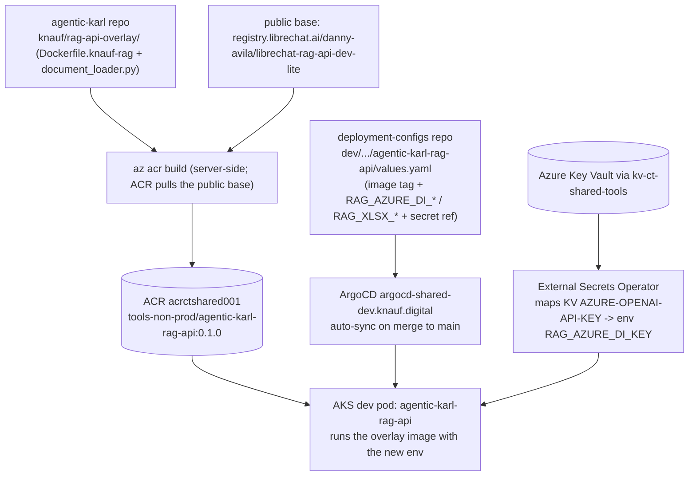
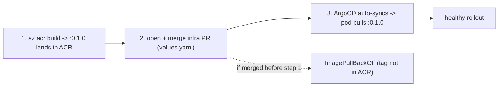

# Rollout — RAG Azure Document Intelligence overlay → dev

> How the `rag_api` Azure DI overlay gets from source to the **dev** cluster: build the
> overlay image, push it to ACR, wire it into the deployment-configs `values.yaml`, and let
> ArgoCD auto-sync it onto AKS. Spans **two repos** with a hard **ordering constraint** (image
> must exist in ACR before the config PR merges). Includes the exact infra-repo PR commands.

---

## TL;DR

The overlay code (DI parser + xlsx loader) is built and verified locally and the runtime
design is documented in [rag-search.md](../architecture/files/rag-search.md).
What's left is **deploying it to dev**, which is *not* covered by any existing pipeline — the
release pipeline only builds the main KARL app, never the `rag_api` overlay. So the overlay
image is built **manually with `az acr build`** (once, for now), and the dev `rag_api` Helm
service is **re-pointed at it** via a `values.yaml` edit in the deployment-configs repo.
ArgoCD auto-syncs that repo's `main`, so **merging the config PR is the deploy** — which is why
the image must be in ACR *first*, or the pod hits `ImagePullBackOff`.

**Where we are now:** the `values.yaml` edit is made but sits **uncommitted on the wrong infra
branch** (`feat/KK20-175-agentic-karl-app-title`). Step 2 below moves it to its own branch off
`main`. The image has **not** been built yet (Step 1).

---

## Architecture / mental model — the deploy topology



Two independent inputs converge on the dev pod: the **image** (built once into ACR) and the
**config** (the `values.yaml` change, applied by ArgoCD on merge). The **secret** is *not* a new
input — `RAG_AZURE_DI_KEY` reuses the existing `AZURE-OPENAI-API-KEY` Key Vault entry that
already backs `RAG_OPENAI_API_KEY` (same `cst-karl-dev` account key), so there is **no Key Vault
change** in this rollout.

### The ordering constraint (why sequence matters)



ArgoCD has no opinion about whether the image exists — it just applies the manifest. Build
**first**, merge **second**.

---

## Rollout sequence (do these in order)

### Step 1 — Build & push the overlay image to ACR

**Primary (no Azure login needed): the GitHub Action.** The workflow
[`.github/workflows/build-rag-api-overlay.yaml`](../../../.github/workflows/build-rag-api-overlay.yaml)
builds the overlay and pushes it to ACR, authenticating as the shared service principal
(`secrets.AZURE_CREDENTIALS`) + the ACR password from Key Vault — the same credentials the release
pipeline uses. **No personal `az login`.** Trigger it from the GitHub UI (Actions → *Build RAG API
overlay image* → *Run workflow*) and accept/enter the tag (default = `knauf/rag-api-overlay/VERSION`,
i.e. `0.1.0`). It also auto-runs on a push to `main` that touches `knauf/rag-api-overlay/**`. Bump
`VERSION` when you change the overlay, then point the deployment-configs `values.yaml` tag at it.

**Fallback (manual, needs Azure access):** from the agentic-karl repo root, `az acr build` runs the
build server-side in ACR:

```bash
cd ~/repos/knauf/agentic-karl-v2
az acr build --registry acrctshared001 \
  --image tools-non-prod/agentic-karl-rag-api:0.1.0 \
  --file knauf/rag-api-overlay/Dockerfile.knauf-rag \
  knauf/rag-api-overlay
```

Confirm it landed:

```bash
az acr repository show-tags \
  --name acrctshared001 \
  --repository tools-non-prod/agentic-karl-rag-api -o tsv
# expect: 0.1.0
```

> Pin a version (`0.1.0`), never `:latest`. Bump the tag on each overlay change and update
> `values.yaml` to match — that's what makes a rollout reviewable and rollback-able.

### Step 2 — Open the infra PR (deployment-configs repo)

The `values.yaml` edit is currently **uncommitted on the `feat/KK20-175-agentic-karl-app-title`
branch** (an unrelated app-title workstream). Move it to its own branch off `main`, commit,
push, and open the PR. The stash dance below is conflict-safe regardless of what the current
branch contains:

```bash
cd ~/repos/knauf/ct-shared-deployment-configs
F=dev/services/agentic-karl-rag-api/agentic-karl-rag-api/values.yaml

# 1. park the change, branch off a fresh main
git stash push -m "rag-di dev wiring" "$F"
git fetch origin
git switch -c feat/rag-azure-di-overlay origin/main
git stash pop

# 2. commit (Conventional Commits; no Claude co-author trailer)
git add "$F"
git commit -m "$(cat <<'EOF'
feat(agentic-karl-rag-api): wire dev rag_api to Azure DI overlay image

Point the dev agentic-karl-rag-api service at the Knauf overlay image
acrctshared001.azurecr.io/tools-non-prod/agentic-karl-rag-api:0.1.0
(FROM the upstream rag_api base + Azure Document Intelligence parser and
the native lean .xlsx loader).

Adds the RAG_AZURE_DI_* and RAG_XLSX_* config keys and reuses the existing
cst-karl-dev account key (AZURE-OPENAI-API-KEY in kv-ct-shared-tools) for
RAG_AZURE_DI_KEY -- no Key Vault change. Prereq: image must be in ACR before
this merges (ArgoCD auto-syncs dev), else ImagePullBackOff.
EOF
)"

# 3. push + open the PR against main
git push -u origin feat/rag-azure-di-overlay
gh pr create --repo Knauf-Group/ct-shared-deployment-configs --base main \
  --title "feat(agentic-karl-rag-api): wire dev rag_api to Azure DI overlay" \
  --body-file - <<'EOF'
## Summary

- Re-point the **dev** `agentic-karl-rag-api` service at the Knauf overlay image
  `acrctshared001.azurecr.io/tools-non-prod/agentic-karl-rag-api:0.1.0` (upstream rag_api +
  Azure Document Intelligence document parser + native lean `.xlsx` loader).
- Add `RAG_AZURE_DI_*` / `RAG_XLSX_*` config keys; reuse the existing `cst-karl-dev` account key
  for `RAG_AZURE_DI_KEY` (no Key Vault change).

## Why now

File-search (RAG) currently parses PDFs with text-only extraction, so scanned PDFs ingest empty
and unsearchable, and large spreadsheets blow up chunking. The overlay (built + verified locally)
fixes both; this PR rolls it to dev. Runtime design:
`agentic-karl-v2 → knauf/docs/architecture/files/rag-search.md`.

## What changed

| File | What |
|---|---|
| `dev/services/agentic-karl-rag-api/agentic-karl-rag-api/values.yaml` | image → overlay `:0.1.0`; add `RAG_AZURE_DI_*` + `RAG_XLSX_*` to `configmap`; add `RAG_AZURE_DI_KEY → AZURE-OPENAI-API-KEY` to `externalSecret.secrets` |

## ⚠️ Merge order

The overlay image must be in ACR **before** this merges — ArgoCD auto-syncs dev on merge to
`main`. Verify: `az acr repository show-tags --name acrctshared001 --repository tools-non-prod/agentic-karl-rag-api` shows `0.1.0`.

## Test plan

- [ ] ACR shows tag `0.1.0`.
- [ ] After merge: ArgoCD `agentic-karl-rag-api` Healthy/Synced on `:0.1.0`.
- [ ] Pod env shows `RAG_AZURE_DI_ENDPOINT` and the synced `RAG_AZURE_DI_KEY` secret.
- [ ] Upload a scanned PDF in dev KARL → answerable; rag_api logs show `[knauf] Parsing … via Azure AI Document Intelligence`.
- [ ] Upload the large `.xlsx` → ingests fast; logs show `[knauf] Large workbook … summary`.

## Depends on / related

- App repo overlay + harness: `agentic-karl-v2` branch `feat/rag-azure-doc-intelligence`.
- Rollout tracker: `agentic-karl-v2 → knauf/docs/implementation-plans/rag-azure-di-rollout.md`.
EOF
```

### Step 3 — ArgoCD deploys (automatic on merge)

Merging the PR to `main` triggers ArgoCD auto-sync at `argocd-shared-dev.knauf.digital`; the dev
`agentic-karl-rag-api` Deployment rolls to `:0.1.0` with the new env. No manual `kubectl apply`.

### Step 4 — Verify in dev

See **Verification recipes** below.

---

## Verification recipes

```bash
# image present in ACR (gate for Step 2 merge)
az acr repository show-tags --name acrctshared001 \
  --repository tools-non-prod/agentic-karl-rag-api -o tsv

# pod is on the overlay image + has the DI env (after ArgoCD sync)
kubectl -n tools-non-prod get pods -l app=agentic-karl-rag-api \
  -o jsonpath='{.items[*].spec.containers[*].image}{"\n"}'
kubectl -n tools-non-prod exec deploy/agentic-karl-rag-api -- \
  printenv | grep -E 'RAG_AZURE_DI_|RAG_XLSX_'   # key should be present (value populated by ESO)

# parser is actually routing through DI / the xlsx guard (smoke test, via app upload)
kubectl -n tools-non-prod logs deploy/agentic-karl-rag-api | grep '\[knauf\]'
#   expect: "[knauf] Parsing … via Azure AI Document Intelligence"  (scanned PDF)
#   expect: "[knauf] Large workbook … summary"                       (large .xlsx)
```

If DI calls fail (egress blocked, wrong endpoint/key), the overlay's `_AzureDIWithFallback`
logs a warning and re-parses with the upstream loader — uploads still succeed, just without OCR.
Confirm dev egress reaches `*.services.ai.azure.com`.

---

## Critical file map

| Repo | File | Role |
|---|---|---|
| agentic-karl-v2 | [knauf/rag-api-overlay/Dockerfile.knauf-rag](../../rag-api-overlay/Dockerfile.knauf-rag) | overlay image (FROM upstream base) |
| agentic-karl-v2 | [knauf/rag-api-overlay/document_loader.py](../../rag-api-overlay/document_loader.py) | DI parser + fallback + lean xlsx loader |
| agentic-karl-v2 | [knauf/docs/architecture/files/rag-search.md](../architecture/files/rag-search.md) | runtime design + diagrams |
| ct-shared-deployment-configs | `dev/services/agentic-karl-rag-api/agentic-karl-rag-api/values.yaml` | dev image tag + DI env + secret ref |

---

## Still pending

1. **Step 1** — `az acr build` the `0.1.0` image (not built yet).
2. **Step 2** — move the `values.yaml` change off `feat/KK20-175-agentic-karl-app-title` onto its own branch + open the infra PR.
3. **Step 4** — dev smoke (scanned PDF + large xlsx).
4. App-repo commit: the overlay/harness/doc on `feat/rag-azure-doc-intelligence` (separate PR).

## Open questions

- **Jira anchor.** The app branch (`feat/rag-azure-doc-intelligence`) carries no KK20 number. If
  a ticket exists for this workstream, rename the infra branch/commit/PR to `…/KK20-XXX-…` and
  list it in both PR bodies. Otherwise file one (config rollout = not a process-only carve-out).
- **Image rebuild automation.** ✅ Done — [`.github/workflows/build-rag-api-overlay.yaml`](../../../.github/workflows/build-rag-api-overlay.yaml)
  builds + pushes on overlay changes / manual dispatch using the shared SP + `ACRCTSHARED001-REGISTRY-PASSWORD`
  (no personal Azure login). Open: confirm the SP has AcrPush on `acrctshared001` (the release
  pipeline's `az acr import` uses the same registry password, so it should).
- **prod.** This rollout is dev-only. Promotion repeats Steps 1–4 against the prod values path.
