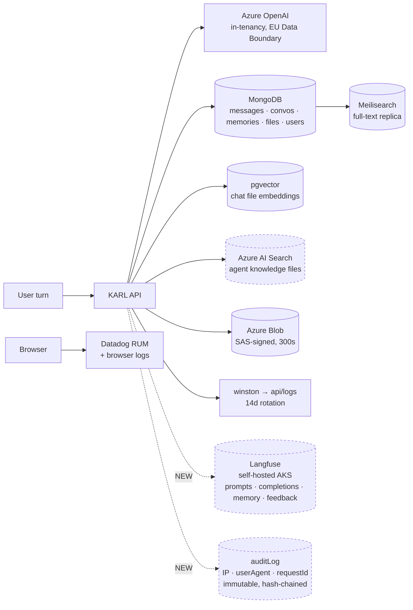

# PII & privacy workstream — ticket set, compliance mapping, rollout

> **TL;DR** — [KK20-207](./pii-masking-and-anonymization.md) produced the strategy; this
> plan turns it into executable work. It carries (1) the **delta** between what that assessment
> claims and what the code does today, (2) a **GDPR / EU AI Act / BetrVG mapping**, (3) a
> **phase-by-phase breakdown** of impact, priority and what gets built, (4) a **paste-ready ticket
> set**, and (5) the **five-wave execution plan** — what actually gets done, in what order (§6).
>
> The assessment's thesis is unchanged and still correct: **protect the durable copies and the
> logs; do not mask prompts before the model.** What changed is everything underneath it. The
> assessment on `main` is v1.0; a review-clean v1.2 has been unmerged since 2026-07-06 and is now
> 1251 commits behind; ~8 weeks of development have retired or invalidated a further 13 claims.
> Most consequentially, one of the assessment's own activation triggers — *"Langfuse keys set"*,
> which it named as requiring a PII review **before the first trace** — has fired in dev and prod.
>
> **Status: drafted 2026-08-28 · validated 2026-08-31 · implementation started 2026-09-01.**
> Wave 0's in-repo items are done; wave 1's two code tickets are filed and in open PRs —
> **KK20-327** (P0-1, PR #340) and **KK20-328** (P2-7, PR #341). See the implementation log at the
> end of §6.1 for what implementation taught, including three AC errors the code review caught.

> **Scope note on compliance.** §3 is engineering-facing analysis to put *to* the DPO — which
> articles each change touches and what evidence it produces. It is not legal advice and does not
> substitute for the DPO's own assessment or a formal DPIA.

---

## 1. Mental model — what actually holds personal data

The stable part, and the thing to keep current. Nine sinks, of which **three are new since the
assessment was written** and are not in its §1.1 table.



Three properties drive every decision below:

1. **The model call is the least risky hop.** Azure OpenAI runs in Knauf's tenancy under the EU
   Data Boundary. Masking before it would wreck the product and push users to shadow IT.
2. **The durable copies are the exposure.** Data that persists without a purpose — memories with
   no expiry, a full-text search replica, Langfuse traces, logs — is where Art. 5(1)(c) and
   5(1)(e) actually bite. None of that is fixed by an LLM gateway.
3. **Erasure must reach every sink.** The account-deletion cascade covers ~25 stores; it does
   **not** cover Langfuse, and `auditLog` is append-only by design.

---

## 2. Delta — what changed since the 2026-07-06 recheck

Verified against `main` @ `88baf689c` (2026-08-21). This is the input to the assessment's v1.3
refresh (ticket **DOC-1**).

> Phase-item numbers (`0.x`/`1.x`/`2.x`) and references to the assessment's §11/§12 resolve
> correctly: **v1.2 was restored to `main` on 2026-09-01** (DOC-1's restore step). What remains of
> DOC-1 is the v1.3 delta — folding this section's rows into the assessment itself.

| # | Change | Effect on the roadmap |
|---|---|---|
| 1 | `DEBUG_LOGGING` code default is now **false**; winston moved to [`packages/data-schemas/src/config/winston.ts`](../../../packages/data-schemas/src/config/winston.ts). Prod root level is `warn` (`winston.ts:78-81`), so `info`/`debug` reach **no transport** in prod | Ph0 0.1/0.2 largely retired. Identity leaks are prod-suppressed *by level*, not by redaction — still live in dev, one `NODE_ENV` slip from prod |
| 2 | Redactor **deduped and now runs at every level** — deep-traverses metadata, redacts identity keys, Azure SAS `sig=`, image data URIs (PR #201; tracked in SEAMS.md's row for `packages/data-schemas/src/config/parsers.ts` — cite SEAMS rows by path, raw line numbers shift on every append) | **Ph1 1.1 done; 1.2 half-done.** The remaining gap is PII *patterns*, not levels or duplication |
| 3 | PR #115 merged — Azure AI Search delete propagation | Ph0 0.3 done |
| 4 | Shared links: `isPublic` removed from the schema → ACL/grant model (upstream #13051). `expiredAt` + TTL index now exist. **Correction (2026-09-01):** earlier drafts of this plan claimed legacy docs *missing* `isPublic` silently migrate to public. That is **wrong** — both migration entry points are guarded by `'isPublic' in doc` ([`access.ts:88`](../../../packages/api/src/shared-links/access.ts), [`service.ts:191`](../../../packages/api/src/shared-links/service.ts)), so a doc without the field never enters `autoMigrateLegacyLink` at all; inside it `isPublic !== false` only ever sees a doc where the field exists (`true` → public grant, matching its prior state; `false` → owner only). Confirmed by `service.test.ts`, whose every fixture `$set`s the field explicitly | Ph0 0.6 inverts — no longer "audit the default", now "a decision went the other way". Ph2 2.4's mechanism exists |
| 5 | TTL indexes on `expiredAt` for convo, message, share; `retentionMode: "all"` lever exists upstream | Ph2 2.2's *mechanism* exists — but it is **not** a config flip. See §7 |
| 6 | A file retention sweep exists — [`packages/api/src/files/sweep.ts`](../../../packages/api/src/files/sweep.ts) on a dedicated cluster worker | "No scheduler anywhere" is dead. There is an in-process pattern to copy |
| 7 | **Langfuse live in dev and prod** — traces prompts, completions, memory-agent runs and feedback | The assessment's §12.2 trigger fired without its gate. **P0** |
| 8 | New `auditLog` collection — IP + userAgent + requestId (sessionId is schema-reserved, never populated), every field `immutable`, hash-chained, append-only *by design*, admin CSV export | New durable PII store, in structural tension with Art. 17 |
| 9 | Two ingest paths (`VectorDB/crud.js:207` sync, `Files/knauf/generationRagClient.js` async) into two vector sinks | Ph3 3.2 is **two** chokepoints, not one |
| 10 | Upstream v0.8.7 shipped `messageFilter.pii` | §2's "no OOTB" verdict survives **with a qualifier** — it is a blocker, not a masker |
| 11 | MCP `use/create/share/public: true` unchanged in yaml — **but** `KNAUF_RESTRICT_USER_PERMISSIONS: 'true'` is set in **all three** environments (`infrastructure/{dev,stage,prod}/values.yaml`) and [`userRestrictions.ts:82-94`](../../../packages/api/src/knauf/permissions/userRestrictions.ts) already forces MCP `CREATE/SHARE/SHARE_PUBLIC=false` and all four `REMOTE_AGENTS` false on the USER role | **De-escalated.** Not a live egress hole. The yaml change moves **ADMIN only** |
| 12 | Memory still has no expiry of any kind; still no data-export endpoint | Ph2 items stand unchanged |
| 13 | The BAN Keyv store **does** have a TTL (`ttl: cacheConfig.BAN_DURATION`, [`getLogStores.js:29-32`](../../../api/cache/getLogStores.js)) | "Violation/ban records have no TTL" is **half stale** — bans expire, the general violation log does not |

### 2.1 Two corrections that change what we build

**`messageFilter.pii` is a blocker, not a masker.** On match,
[`messageFilterPii.ts`](../../../packages/api/src/middleware/messageFilterPii.ts) returns HTTP 400
`message_filter_pii_block` and the message is refused. Starter patterns are credential-shaped
(`sk_prefix`, `bearer_header`, `api_key_header`); `customPatterns` accept arbitrary regex. So it is
genuinely useful for **credential hygiene** and actively harmful for entity PII — blocking a
message because it contains an email address is exactly the utility loss the assessment argues
against. Enable it; do **not** put identity patterns in it.

**Langfuse captures full payloads, and nobody chose that.** Traces carry prompts, completions,
tool outputs (RAG chunk text, code-interpreter output, file-search results, web-fetch bodies),
memory-agent values, and — via [`langfuse/feedback.ts:93`](../../../packages/api/src/langfuse/feedback.ts),
which sets `comment: [feedback.tag, feedback.text]…` — users' **free-text** thumbs-down comments
(assessment category #11, "Current control: None"). That is assessment category #4 (extracted
document body, P0) plus the most profiling-grade content in the system, in a second store the
Art. 17 cascade does not reach.

**The problem is not that this data is useful — it is. The problem is that full payload capture
happened by default rather than by decision, in production, with no retention period and no access
review.** See §4.3 for the posture the industry has converged on and where KARL actually stands
against it. In-repo levers are blunt (`enabled`, `toolOutputTracing`); the good lever — targeted
field-level redaction — is **not currently reachable**, for two independent reasons recorded in
§4.3.

> **Trap:** `LANGFUSE_SAMPLE_RATE` is **not** a trace-volume control. It is read only by the
> fork-local `feedback.ts:40`, where a value of `0` disables feedback scores. Do not let it be
> claimed as a privacy control.

---

## 3. Compliance mapping

### 3.1 GDPR

| Article | What engages it | Tickets | Status |
|---|---|---|---|
| **5(1)(c)** minimisation | Langfuse tool outputs + feedback text; identifiers in logs; Meilisearch full-text replica; **model reasoning in derived sinks** | P0-1, P0-4, P1-1, P1-2, P1-5, P3-4 | Partial — redactor covers secrets, not identifiers |
| **5(1)(e)** storage limitation | No expiry on memories, Langfuse traces, the audit log or the general violation log; conversations effectively indefinite | P0-2, P2-1…P2-4, P2-7, P2-8 | **Weakest area** |
| **5(1)(f)** integrity & confidentiality | MCP egress surface, shared links, `open_url` | P0-3, P1-4, P2-4 | Reasonable; MCP mitigated by env restriction |
| **5(2)** accountability | Evidence controls exist and were reviewed | DOC-1, P0-5, P0-6, P1-3, G-4 | The assessment + its verification logs *are* the evidence |
| **6** lawful basis | Assistant use is straightforward; **memory profiling is the contested one** | G-1, G-2 | Open |
| **9** special categories | Free-text chat can carry health, beliefs, union membership — unavoidable in a corporate assistant | G-1, P2-3 | Unassessed. Argues for short memory retention |
| **13/14** transparency | EULA cites Art. 13, 15–18, 20, 21, 7(3) — but read it: it **states KARL does "not carry out … profiling"** while memory is LLM-written user profiling; it refers to "the operation of the **Survey website**" (boilerplate from another product); its stated purposes are only "Authentication and content filtering"; and it claims storage "in the Netherlands", unverified against Langfuse/Azure AI Search | **G-5** | **Contradicted, not merely stale** — an affirmative statement to data subjects that live processing contradicts. Most urgent single line in the plan |
| **15 / 20** access & portability | **No export endpoint.** DSARs are manual | **P2-6** | **Real gap** |
| **17** erasure | Must reach Mongo + Meilisearch + pgvector + Azure AI Search + Blob **+ Langfuse**; `auditLog` is immutable | P0-2, P2-2, P2-5, P2-7 | Cascade verified for ~25 stores; **Langfuse is a copy erasure does not reach** |
| **25** by design & default | The whole Phase 0 argument; restrictive permission defaults | P0-3, P1-3 | Good instinct, thinly documented |
| **28** processors | Azure DPA; Datadog; the **karl-web search backend**; any future MCP endpoint | P0-6, P0-7, P1-2, G-4 | Azure fine; Datadog forwarding unreviewed; search backend unidentified |
| **30** records of processing | The assessment's §1.1 data map is the natural source | **G-4** | Exists as prose, not as a record |
| **32** security | Tenant isolation, SAS TTLs, hash-chained audit log | existing + P0-3 | Strong |
| **35** DPIA | Large-scale processing + profiling + workplace context | **G-1** | **Likely required, not done** |

**The three that matter most:** Art. 5(1)(e) (nothing expires), Art. 15 (no export path), Art. 35
(no DPIA). The rest is either healthy or cheap.

### 3.2 EU AI Act

**Knauf is a *deployer*, not a provider.** The GPAI models are Microsoft's/OpenAI's; Knauf puts a
system into service for internal staff. Confirm with Legal — authoring agents and system prompts
under Knauf's own name is the one thing that could re-characterise this.

| Provision | Applies? | Implication |
|---|---|---|
| **Art. 4 — AI literacy** | **Yes — in force since 2025-02-02** | Deployers must ensure staff have sufficient AI literacy. A *current, live* obligation and the cheapest to evidence: onboarding material, the EULA, an internal FAQ → **G-3** |
| **Art. 50 — transparency** | **Yes — the user-disclosure duty (Art. 50(1)/(4)) applies since 2026-08-02** | Users must know they are interacting with an AI; the synthetic-content *marking* duty (Art. 50(2)) is provider-side. The EULA and the "Karl is a GPT…" framing cover it; confirm AI output is identifiable → **G-3** |
| **Annex III.4 — employment & worker management** | **Probably not today** | KARL is a general assistant, not a system deciding promotion, task allocation, or *monitoring and evaluating performance*. That is the honest read — and it is the finding that saves the most work |
| **Art. 26 — deployer duties** | Only if it becomes Annex III | Human oversight, input relevance, ≥6-month log retention, and **Art. 26(7): inform workers' representatives before workplace use** |
| **GPAI chapter** | Provider-side | Microsoft's obligation — but hold the model card and DPA on file |

**Drift triggers**, each already visible in the codebase and each one product decision away from
moving KARL toward Annex III.4:

1. Per-user cost/usage metering growing an admin or reporting surface that **compares employees**.
2. Memory being used for anything beyond assisting that same user.
3. Any feature that scores, ranks, or evaluates staff output.

None is live. That is precisely why G-2 and G-3 are cheap **now**.

### 3.3 German law — the gate most likely to bite

- **BetrVG §87(1)(6)** — the works council holds *co-determination* rights over technical systems
  **suited** to monitor employee behaviour or performance. The bar is "suited to", not "intended
  to". Per-user cost records and LLM-written memories plausibly meet it. This is a hard gate on
  deployment scope and is **independent of** the AI Act high-risk finding.
- **BDSG §26** — employee data processing; a works agreement is a common lawful basis.

**Consequence:** **G-2 is the highest-leverage governance item.** A works agreement can settle the
Art. 6 basis for memory, the §87(1)(6) duty, *and* the retention periods that gate all of Phase 2 —
in one conversation.

### 3.4 Audit-log retention — what is actually mandated, and the number to pick

The recurring question "how long must we keep audit logs?" has a precise answer: **no instrument
that applies to this platform names a number; what is mandatory is a justified, documented,
*enforced* period** (Art. 5(1)(e) + 5(2)). Everything else is convention. The instruments, checked
2026-08-31:

| Instrument | What it actually says | Binding here? |
|---|---|---|
| **GDPR 5(1)(e)/32** | A justified period, enforced. Cuts both ways: security purposes justify a floor; indefinite person-linked retention is indefensible | **Yes — the controlling one** |
| **AI Act Art. 26(6)** | Deployers of **high-risk** systems keep system-generated logs **≥ 6 months**. No duty for non-high-risk deployers | Only if KARL ever slides into Annex III — the one concrete EU number in the vicinity |
| **NIS2 / BSIG (NIS2UmsuCG, in force since 2025-12-06)** | Logging/detection **capability**, no retention number. Knauf's building-materials core (NACE 23.5x) is **not** in Annex II's manufacturing sector (NACE C26–C30 + medical devices); the separate chemicals sector (Annex II pt. 4) could pull a chemicals-producing group entity in — a formal scope determination should be on file, but even in scope it adds no number | Conditional, likely out of scope |
| **ISO 27001 A.8.15 / SOC 2** | No number in the standards; the auditor convention is **~12 months** of security-relevant logs (often 90 days hot / 1 year cold) | Industry standard |
| **BSI Mindeststandard PD v2.1 (2024)** | ~90 days baseline example, longer with documented justification; incident-linked records exempt from deletion | German best-practice anchor |
| **§ 257 HGB / § 147 AO (6–10 years)** | Applies to Handelsbücher/Handelsbriefe/Buchungsbelege only. **This audit log is none of those** — importing tax-record periods here is the classic mistake, and creates a 5(1)(e)/§ 26 BDSG violation instead of compliance | **No** |
| **§ 26 BDSG + § 87(1) Nr. 6 BetrVG + DSK guidance** | The strongest force pushing *short*: an actor-name/IP/session log is a "technische Einrichtung zur Überwachung" — co-determination is mandatory, and German DPA practice expects short, purpose-limited log retention | **Yes (German entities)** |
| **§ 195 BGB (3 years)** | A per-record *extension* rule for entries tied to a concrete incident/claim (with Art. 17(3)(e)) — German DPAs reject it as a blanket default | Per-record only |
| **Microsoft Purview defaults** | 180 days standard, **1 year** under E5 — Knauf's own M365 admin-audit posture | Industry anchor |

**Recommendation: 12 months rolling, enforced, with per-record legal-hold extensions.** Twelve
months is simultaneously the ISO/SOC2 auditor convention, double the AI Act floor (future-proofing
a later Annex III finding), Microsoft's own E5 default for the estate's other admin trails, and
still within German DPA tolerance for an access-restricted, security-purpose-limited log —
*because this log records only admin/security events, not routine user activity*. Optionally tier
BSI-style (90 days fully identified, pseudonymized thereafter) — but note §5 P2-7: the schema's
immutability means tiering must be designed in, not patched on. What buys longer, per record and
never blanket: a live incident, litigation hold, or a concrete § 195 BGB claim horizon. What must
be refused: the 6–10-year tax reflex.

---

## 4. Phase-by-phase — impact, priority, and what gets done

The phases are ordered by **risk removed per unit of effort**, not by how impressive they sound.
Each block below answers the same four questions: what it changes, how much that matters, which
obligations it discharges, and what actually gets built.

### 4.1 At a glance

| Phase | What it changes | Impact | Priority | Effort | Discharges |
|---|---|---|---|---|---|
| **0 · Containment** | Stops live over-collection; turns three inherited defaults into asserted decisions | High, narrow | **Do first** | Days | 5(1)(c) · 25 · 5(2) |
| **1 · Log hygiene** | Makes logs structurally unable to carry identifiers, and makes it survive merges | Medium-high, rising | Next | ~1 sprint | 5(1)(c) · 32 · 28 · 25 |
| **2 · Retention & rights** | Nothing personal persists without a period; erasure provable; DSARs answerable | **Highest** | Gated on DPO | 1–2 sprints + decisions | 5(1)(e) · 15/20 · 17 · 5(2) |
| **3 · Engine** | Actual PII detection at the two persistence chokepoints that pay off | Medium | **PoC anytime**; wiring last | PoC ~2wk, then 1–2 sprints | 5(1)(c) at sink · 9 |
| **4 · Inline masking** | Opt-in input masking for one named high-risk flow | Possibly none | **Never, by default** | — | — |
| **G · Governance** | DPIA, works agreement, Art. 30 record, AI Act posture | Unblocks Phase 2 | **Start now, parallel** | DPO/Legal time | 35 · 6 · 30 · AI Act 4/50 · §87(1)(6) |

> The Priority column above is the per-phase risk ranking; the **actual execution order is §6's
> waves**, which deliberately interleave phases (parts of Phase 2 run in wave 1; bundle C runs in
> wave 2).

### 4.2 The counter-intuitive part

Two things are worth saying plainly, because instinct points the wrong way on both:

- **The phase everyone assumes is the project — Phase 3, "PII masking" — is the least urgent.**
  It is the only phase with a real spend decision, and every phase above it removes more risk per
  unit of effort. Reaching for it first is the most common way this kind of work stalls. Note the
  split, though: its **PoC** is unblocked today and can run in parallel; what stays last is wiring
  masking into production paths. An engine can never be a *prerequisite* for Phases 0–1 — see
  Phase 3 below for why none of those items can call one.
- **The track that costs engineering nothing has the longest lead time.** Governance (G) needs
  DPO and works-council calendar time measured in weeks, and it **gates Phase 2** — which is where
  the actual GDPR exposure sits. Starting G on day one is free and shortens the critical path more
  than any engineering decision here.

### 4.3 Observability posture — what the industry does, and where KARL sits

This drives the largest Phase 0 item, and the intuitive answer ("stop sending sensitive fields") is
the wrong one. Two independent sources converge on the same four-layer model:

- The **OpenTelemetry GenAI semantic conventions** capture *no* prompt content or tool arguments by
  default — only structural metadata (model, token counts, durations). Every content-bearing
  attribute is explicitly **opt-in** — forgetting a flag yields *no* capture, never accidental capture. The
  stated practice is: ship structural telemetry everywhere, enable payload attributes behind a
  config flag, with redaction and retention rules attached.
- **Langfuse's own engineering guidance** is blunter about the tradeoff: *"aggressive whole-text
  scrubbing hurts debuggability; prefer **targeted redaction plus short retention** over blanking
  everything."* Field-level redaction is preferred precisely because it preserves structure — a
  masked trace still shows *that* a card or a name was discussed.

| Layer | What it means | KARL today |
|---|---|---|
| **1 · Structure always** | Span tree, timings, model, token counts, tool names, status | ✅ fine |
| **2 · Payloads by decision** | Prompts, completions, tool outputs — on deliberately, scoped by environment | ⚠️ **on by accident**, prod included |
| **3 · Targeted redaction** | Field-level masking inside payloads; keeps traces debuggable | ❌ **not reachable** — see below |
| **4 · Retention + access** | Short retention as the blast-radius backstop; RBAC on who can read | ❌ **neither set** |

**Why layer 3 is blocked — two independent reasons:**

1. **In-app:** `LangfuseConfig` exposes no `mask` hook. `@langfuse/otel` *does* accept a `mask`
   function, but `@librechat/agents` constructs the span processor itself and forwards only
   `{publicKey, secretKey, baseUrl}`. Reaching it needs an **upstream contribution**, not a local
   change — and never a `node_modules` patch.
2. **Server-side:** Langfuse self-hosted supports ingestion masking via an HTTP callback
   (`LANGFUSE_INGESTION_MASKING_CALLBACK_URL` on the worker), which would be an excellent fit for a
   Presidio sidecar. But it is an **Enterprise Edition** feature and only covers the OTel ingestion
   endpoint. Our rollout plan records no licence, so **confirm EE status before planning around
   it** (this is an open question in §10, not an assumption).

**Consequence for Phase 0:** the achievable win is **layer 4, not layer 2**. Retention and access
control need no code, no licence and no upstream PR, and they bound the blast radius of everything
still captured. Blanket-disabling tool outputs would trade a large, immediate debuggability loss
for a small privacy gain — and would directly undercut
[`agent-retrieval-and-langgraph-reliability-plan.md`](../implementation-plans/agent-retrieval-and-langgraph-reliability-plan.md),
whose Sprint 5 is literally *"Make Langfuse prove the fix"* and whose validation method is Langfuse
retrieval diagnostics.

### 4.4 What is actually mandatory — and what is convention

Asked directly: which of these tickets does the law *compel*? The honest frame first: **GDPR
compels outcomes, not mechanisms.** It requires a defined retention period, erasure that
demonstrably works, answerable DSARs, a DPIA where Art. 35 bites — it almost never requires a
particular regex, sweep, or endpoint. "Mandatory" below therefore means: *a specific live
obligation is currently un-met, and this ticket is the cheapest documented way to meet it.*

| Class | Tickets | Basis |
|---|---|---|
| **Mandatory** | **P0-2** (a production store of prompts/completions with *no* retention period is a compelled Art. 5(1)(e) gap) · **P2-1** (defined periods per category — Art. 5(1)(e), 13(2)(a)) · **P2-3** (an LLM-written profiling store with no expiry, plausibly carrying Art. 9 content, is indefensible) · **P2-5** (Art. 17 + 5(2): erasure must demonstrably reach every copy) · **P2-7** (a period and an Art. 17(3) position for the audit log — §3.4) · **G-1** (Art. 35 DPIA — multiple WP248 criteria met) · **G-2** (BetrVG § 87(1) Nr. 6 co-determination) · **G-3** (AI Act Art. 4 live since 2025-02-02; Art. 50 since 2026-08-02) · **G-4** (Art. 30 record; the small-org exemption is unavailable) · **G-5** (Art. 13: the notice **affirmatively denies profiling** while memory performs it, names another product, and omits Langfuse and the auditLog — live processing *contrary to*, not just outside, the notice) · **P2-6a** (a documented, *tested* manual DSAR runbook — Art. 15 with the Art. 12(3) one-month clock; the endpoint itself stays convention) |
| **Industry standard** | **P0-1** (OTel GenAI payload-by-decision posture) · **P0-4**, **P0-5**, **P1-1** (ISO 27001 A.8.15-grade log hygiene; GDPR supplies the outcome, not the regex) · **P1-2** (Art. 28 due diligence on a third-party processor) · **P0-6** (verification underpinning the lawful-basis story — kept out of Mandatory deliberately: the obligation it feeds is discharged by G-1/G-4, and an unfavourable answer *creates* new mandatory work, which is exactly why it runs first) · **P1-5** (5(1)(c) at derived copies) · **P2-2** ("retain until user deletion" is a *defensible documented* policy — what is compelled is having one and enforcing it) · **P2-6** (the self-service endpoint half — the runbook half is P2-6a, mandatory) · **P2-8** (bounding a security log is A.8.15-grade hygiene; the mandatory outcome — *a* defined period — is discharged by P2-1's matrix) · **P0-7** (Art. 28 due diligence on the search hop) |
| **Recommended** | **DOC-1** (Art. 5(2) evidence quality) · **P0-3** (defence-in-depth; USER role already restricted) · **P1-3**, **P1-4** · **P2-4** (link expiry; its P2-4a half was **closed by code reading** — the premise was wrong, see §2 row 4) · **P3-1…P3-4** (pseudonymisation is *named* in Art. 25/32 as an example measure, never compelled) |
| **Optional** | **P4-1** (discretionary by design — double-gated, discharges no obligation on its own) |

Two consequences worth stating: the **mandatory column is dominated by Phase 2 and the governance
track** — not by anything with "masking" in its name; and nothing in Phase 3 is legally compelled,
which is exactly why it sits behind an evidence gate rather than a deadline.

---

### Phase 0 — containment and explicit decisions

**What it is.** Stop the two live over-collections, remove identity from auth logs, and convert
three inherited defaults into decisions somebody actually made.

**Impact.** Langfuse trace payloads become a bounded, reviewed decision — a retention period, a
recorded read-access group, and environment separation — instead of unbounded capture nobody chose.
Login stops writing email and name into logs. MCP/shared-link/retention posture becomes explicit
and converges across dev, stage and prod instead of drifting per environment.

**How important.** **High, but narrowly.** The Langfuse half is the only genuinely time-sensitive
item in the entire workstream — it is accumulating in production right now, and every day adds
volume that later has to be justified, retained or deleted. The config half is **medium**: real
defence-in-depth, but not a live hole, because `KNAUF_RESTRICT_USER_PERMISSIONS` already constrains
the USER role in all three environments. Do not let the config half inherit the Langfuse half's
urgency.

**Compliance discharged.** Art. 5(1)(c) minimisation, directly and measurably. Art. 25 by design
and by default — the explicit yaml blocks *are* the evidence that defaults were chosen rather than
inherited. Art. 5(2) accountability, via the logging-posture one-pager.

**What gets done.** P0-2 (Langfuse retention and access — **the main event, and mostly cross-repo**)
· P0-1 (the narrow in-repo reductions that do not cost debuggability, plus opening the path to
proper masking) · P0-3 (config baseline: `messageFilter.pii` with
credential patterns only, MCP/`remoteAgents` restricted, `retentionMode` pinned, `sharedLinks` made
explicit, plus the mandatory client copy seam) · P0-4 (OpenID and ban-log identity minimisation) ·
P0-5 (logging-posture one-pager) · P0-6 (abuse-monitoring opt-out verification — standalone, see
§6) · P0-7 (identify + review the karl-web search backend).

**Done when.** No message content or raw identifier reaches prod logs by configuration; Langfuse
has a retention period, a recorded read-access group and dev/prod separation; MCP, shared-link and
retention posture are recorded decisions verified as converged in Mongo.

**Cost of not doing it.** Langfuse keeps accruing verbatim prompts, completions and memory values
with no retention policy — the exact "durable copy without a purpose" the strategy is built to
prevent, and the one thing here that gets *more* expensive to fix with time.

---

### Phase 1 — log and telemetry hygiene

**What it is.** Make logs structurally incapable of carrying raw identifiers, and make that
property survive the next upstream merge.

**Impact.** Email, IP, phone and IBAN patterns are redacted at every level rather than relying on
the production log level happening to be `warn`. Datadog's browser-log forwarding gets reviewed
before it becomes a third-party disclosure nobody signed off. The upstream-sync ritual gains a
regression checklist.

**How important.** **Medium-high, and rising.** Today production is protected largely by accident:
the root log level is `warn`, so the `info`-level identity leaks never reach a transport. That is a
configuration side-effect, not a control. One `NODE_ENV` slip, one upstream change to the level
logic, or one new `logger.warn` carrying a user object, and it is live. The fork has **already
produced two silent privacy regressions** this way, which is exactly what P1-3 exists to stop.

**Compliance discharged.** Art. 5(1)(c) minimisation and Art. 32 security — the substantive half.
Art. 28 processors, via the Datadog review. Art. 25 by design — the checklist is the *mechanism*
that keeps the property true, which is what "by design" actually asks for.

**What gets done.** P1-1 (email/IP/phone/IBAN patterns in the redactor — note the scope is **half**
what the assessment assumed, since deduplication and all-level application already shipped) ·
P1-2 (Datadog browser-logs review) · P1-3 (PII-regression checklist in the upstream-sync ritual and
PR template) · P1-4 (`open_url` provenance monitoring) · P1-5 (reasoning content out of the search
index, TTS payloads and public shares — the five-sink table in §5).

**Done when.** A grep across a week of production logs finds zero raw emails, IPs or message
content, and every subsequent upstream merge runs the checklist.

**Cost of not doing it.** The protection stays accidental, and the next merge can silently remove
it. P1-1 and P0-4 together are also the cleanest upstream contribution in the set — value that is
lost if they drift apart.

---

### Phase 2 — retention, erasure and data-subject rights

**What it is.** Give every stored category a defined period and a verified delete path, and make
access requests answerable without manual archaeology.

**Impact.** The largest single risk reduction in the workstream. Memory stops being an unbounded
profiling store. Conversations acquire a real policy. Erasure is *provable* across Mongo,
Meilisearch, pgvector, Azure AI Search, Blob and Langfuse. A DSAR becomes a button rather than a
project.

**How important.** **Highest in aggregate — and gated.** This is where the actual exposure lives:
Art. 5(1)(e) is the weakest area in the whole assessment (memory has no expiry *at all*), and
Art. 15 is a straightforward gap (no export endpoint exists). But it cannot start on engineering's
say-so — it needs a retention number from the DPO, and ideally the works agreement from G-2, which
settles the memory lawful-basis question at the same time.

**It is also the only phase that can cause an incident.** P2-2 carries a genuine defect: enabling
`retentionMode: "all"` naively would delete data with no backfill, silently truncate the start of
active conversations, and leave TTL-deleted conversations **still searchable** in Meilisearch. See
§7. That is why P2-2 stays unbundled and gets its own review.

**Compliance discharged.** Art. 5(1)(e) storage limitation — the core of it. Art. 15 and 20 access
and portability, via P2-6. Art. 17 erasure *plus the evidence for it*, via P2-5, which is the
artefact a regulator or DPO would actually ask to see. Art. 5(2) accountability.

**What gets done.** P2-1 (DPO retention matrix — the gate) · P2-2 (conversation and message
retention, including the Meilisearch orphan fix and a dry-runnable backfill) · P2-3 (memory
staleness sweep, shipped inert with dry-run default) · P2-4 (shared-link expiry and the
expiry) · P2-5 (staging erasure-verification recipe) · P2-6
(data-subject access and portability endpoint) · P2-7 (`auditLog` retention vs erasure position) ·
P2-8 (general violation-log TTL).

**Done when.** Nothing personal persists without a defined period, and the erasure recipe passes
end-to-end including both vector stores and Langfuse.

**Cost of not doing it.** The two hardest questions in a DPO review — *"how long do you keep it?"*
and *"show me a completed erasure"* — currently have no good answer.

---

### Phase 3 — engine and persistence chokepoints

**What it is.** Choose a PII detection engine on measured evidence, then apply it at the two
non-streamed persistence chokepoints where masking has clear ROI.

**Impact.** Shared-agent knowledge files get scanned or masked before embedding — the one ingest
flow whose output is exposed to *other* users. Memory values get pseudonymised at write. Neither
touches live chat, so there is no user-visible utility loss.

**How important.** **Medium for the wiring — but the PoC has no dependencies and can start any
time.** Separate the two halves, because they sequence differently:

- **P3-1, the PoC, is unblocked today.** It needs only `agk-deployment-configs`, has no dependency
  on Phases 0–2, and carries the same long-lead-time argument as the governance track. Starting it
  in parallel is reasonable and shortens the critical path to a recorded engine decision.
- **P3-2/P3-3, wiring masking into production paths, stays last.** Everything in Phases 0–2 removes
  more risk per unit of effort, and this is the only phase carrying a licensing/infrastructure
  spend.

What must **not** happen is making an engine a *prerequisite* for earlier phases. It cannot be one:
no Phase 0 item can consume it (Langfuse exposes no `mask` hook and `@librechat/agents` does not
forward `@langfuse/otel`'s; `messageFilter.pii` compiles regex strings from yaml and cannot call a
service; P0-4 deletes fields already known to be identifiers), and the one case that looks like a
fit — replacing P1-1's regexes — is architecturally incompatible: `redactFormat`
(`packages/data-schemas/src/config/parsers.ts:356`) is a **synchronous** winston transform on every
log line, and an engine call is a ~35–70 ms in-cluster HTTP round trip. Regexes are the correct
tool there, not a stopgap. Deploying an engine early also pre-empts the very decision the ENGINE gate exists to make — a decision made on measured German/English performance.

This is the phase most likely to be started first for the wrong reason — "PII masking" is the
ticket title, so it reads as the whole project. It is not.

**Compliance discharged.** Art. 5(1)(c) minimisation *at the sink*, which is the strongest form.
Art. 9 special categories — pseudonymising memory is the most direct mitigation available for the
health/beliefs content that inevitably lands in a free-text assistant.

**What gets done.** P3-1 (engine PoC — Presidio vs Azure AI Language container, scored on German
and English Knauf data). **Two existing assets cut this cost sharply:**
[`knauf/parser-eval/`](../../parser-eval/) is already a Python evaluation harness with a labelled
corpus and metrics, and [`knauf/code-adapter/`](../../code-adapter/) is a proven Tier-3 sidecar
shape that unwires by dropping one env var. Then P3-2 (RAG-ingest scan — **two** chokepoints now,
sync and async) · P3-3 (memory-write pseudonymisation). P3-4 (Meilisearch field minimisation)
needs no engine and can run alongside Phase 2.

**Done when.** The engine decision is evidence-based and recorded, the two chokepoints are
protected, and normal chat is measurably unaffected.

**Cost of not doing it.** Shared knowledge bases keep embedding whatever was uploaded, verbatim,
into a store other users can retrieve from. Real, but bounded — and it does not grow the way the
Phase 0 and 2 gaps do.

---

### Phase 4 — opt-in inline input masking

**What it is.** Masking entities in the prompt before the model, for one designated high-risk flow,
with re-hydration.

**Impact.** Possibly none, and that is the intended outcome. It exists as the documented answer to
*"why don't you just mask everything?"* — because masking `Frau Müller` before the model breaks the
assistant's core job and pushes people to public ChatGPT, which is a strictly worse privacy
outcome. Upstream's maintainer reached the same conclusion, which is why the feature is opt-in
there too.

**How important.** **Lowest, deliberately.** It is double-gated: a *named* high-risk flow must exist
**and** product must accept the utility loss in writing. Without both, this phase never starts.
Output-side masking of the live stream stays permanently out of scope — a placeholder can split
across chunk boundaries after it has already been sent.

**Compliance discharged.** Nothing on its own. It is a risk-appetite decision for a specific
workflow, not an obligation.

**What gets done.** Only after gate MASK: a design (opt-in per model-spec or agent, input-side only,
pseudonymise-with-re-hydration), then implementation for the named flow.

---

### Governance track — runs in parallel, start now

**What it is.** The DPO/Legal work that no amount of engineering substitutes for.

**Impact.** Unblocks Phase 2 by producing the retention numbers. Settles whether the memory feature
has a lawful basis. Produces the two artefacts an audit actually asks for: a DPIA and an Art. 30
record.

**How important.** **High, and urgent for scheduling reasons rather than risk reasons.** It costs
engineering nothing and sits on the critical path for the highest-value phase. **G-2 is the single
highest-leverage item in this document**: a works agreement can settle the Art. 6 basis for memory,
the BetrVG §87(1)(6) co-determination duty, *and* the P2-1 retention periods in one conversation.

**Compliance discharged.** Art. 35 DPIA — likely required (large-scale processing, profiling,
workplace context) and not done. Art. 6 lawful basis for memory profiling. Art. 30 records of
processing. EU AI Act Art. 4 AI literacy, which has been **in force since 2025-02-02** and is a
live obligation today, plus Art. 50 transparency. BetrVG §87(1)(6) and BDSG §26.

**What gets done.** G-1 (DPIA) · G-2 (works council briefing) · G-3 (AI Act deployer posture,
including registering the three Annex III.4 drift triggers as watch items) · G-4 (Art. 30 record,
promoted from the assessment's §1.1 map and kept current by P1-3's checklist) · G-5 (privacy-notice
update — the EULA predates Langfuse, the auditLog and memory, all live processing today).

**Done when.** A DPIA exists, retention periods are agreed, the works council position is recorded,
and the AI Act determination (deployer, not provider; not Annex III today) is written down with its
drift triggers.

**Cost of not doing it.** Phase 2 stays blocked indefinitely, and the AI Act Art. 4 obligation —
already in force — remains unevidenced.

---

## 5. Ticket set

KK20-207 stays the discovery record; each PR anchors to its own leaf ticket. This section is the
**analytical** source — evidence, file:line citations, reasoning — and is what the filed tickets are
written from. Paste-ready transcriptions in the project's Jira format are kept out of the repo (they
are working material, not documentation); ask the workstream owner for the current set.

### DOC-1 · Refresh the PII assessment to v1.3

**Type:** Task · **Effort:** S · **Compliance:** Art. 5(2), 30

**Summary:** `main` carries v1.0 of the KK20-207 assessment. A review-clean v1.2 has been unmerged
since 2026-07-06 and is now 1251 commits behind; ~8 weeks of change have invalidated 13 further
claims, and one of its own activation triggers (Langfuse) has fired. Restore v1.2 and add a v1.3
delta plus a verification log.

**AC:** [x] **v1.2 restored onto `main`** (2026-09-01) · [ ] §13 verification log with `file:line` evidence for all
13 delta rows · [ ] new §1.1 rows for Langfuse, `auditLog`, Azure AI Search · [ ] §2 qualified re
`messageFilter.pii` · [ ] §12.2 Langfuse trigger marked FIRED · [ ] §9 ticket list regenerated
against this plan · [ ] hosted artifact URL removed (companions are in-repo HTML) · [ ] demo HTML
refreshed or explicitly retired · [ ] `knauf/docs/README.md` entry updated · [ ] `langfuse-rollout.md`
given a prod section (it still reads "drafted — PR #31 (draft)", dev only) · [ ] §1.2's "no
non-Azure content flows are active" qualified — Datadog receives browser **error payloads** (P1-2),
and **Azure-native web search is live** via `karl-web` (user-derived queries leave to the search
backend; neither is in the v1.0/v1.2 map) · [ ] new §1.1 rows for **cost/usage records**
(`transactions` — already named as an Annex III.4 drift trigger and in P2-1's matrix, absent from
the map) and a **model-reasoning** content dimension (P1-5).

**Mechanics:** ✅ **the restore is done** (2026-09-01) — v1.2 is on `main`, with the staleness
banner and the demo-block replacement re-applied on top. It was one `git show
origin/docs/KK20-207-pii-masking-recheck:knauf/docs/proposals/pii-masking-and-anonymization.md >
knauf/docs/privacy/pii-masking-and-anonymization.md` (a plain `git checkout <branch> -- <new path>`
fails with a pathspec error — the file moved to `privacy/` after that branch was cut).
**What remains is the v1.3 delta**: folding §2's rows into §1.1/§2/§8/§9 and adding a §13
verification log.

---

### Phase 0 tickets — containment and explicit decisions

#### P0-1 · Langfuse PII gate — reduce what is captured *(in-repo)*

**Jira:** [KK20-327](https://knauf.atlassian.net/browse/KK20-327) · **PR:** #340 (open) · **Type:** Bug · **Effort:** S · **Compliance:** Art. 5(1)(c), 5(1)(e), 17

**Summary:** Langfuse went live in dev and prod without the PII gate KK20-207 §12.2 named as a hard
precondition. Langfuse is self-hosted in Knauf's own AKS, so this is a **retention and minimisation**
issue, not a data-leaves-the-estate incident.

**Deliberately narrow.** Per §4.3, tool-output payloads are **kept** — they are the primary
debugging artefact and an in-flight retrieval workstream validates against them. This ticket only
removes payloads with low debug value or a redundant copy elsewhere, and opens the path to layer-3
masking. Bounding the rest is P0-2's job.

**AC:**
- [x] `toolOutputTracing` **not** blanket-disabled; the decision and §4.3's reasoning recorded in
      `buildLangfuseConfig` so it is not silently reversed.
- [x] Feedback free-text no longer sent as the Langfuse score `comment` — `rating` and `tag` kept,
      `text` dropped (already durable in Mongo at `message.feedback.text`; Langfuse was a redundant
      second copy of the highest-entropy free-text field in the product).
- [x] **Added in review — this AC was missing, and the original list would have shipped a
      bypass:** `tag` is **allow-listed** against `FEEDBACK_REASON_KEYS`. `tag` is `Mixed` in the
      schema and the route runs no Zod parse, so a crafted request could put the same prose in `tag`
      that the gate strips from `text`. Legacy `{ key }` objects normalise; anything unrecognised
      fails closed to `undefined`.
- [ ] **Still open after the PR** — memory-agent trace payloads
      (`packages/api/src/agents/memory.ts:464-474`) reviewed separately. Highest sensitivity, lowest
      marginal debug value. `memory.ts` was not touched by KK20-327.
- [x] Identity posture pinned by a regression assertion (`userId`/`sessionId` stay pseudonymous).
- [x] `LANGFUSE_SAMPLE_RATE` documented in `.env.example` as *not* a privacy control.
- [ ] **Still open after the PR** — path to layer 3: an upstream issue or PR against
      `@librechat/agents` to forward `@langfuse/otel`'s `mask` parameter through `LangfuseConfig`.
      Not yet opened. Never patch `node_modules`.

**Notes:** the existing `[knauf] KK20-199` `enabled: false` image-input guard was the precedent for
per-run gating. The two open ACs must not close with the PR by default — keep KK20-327 open or cut
a small follow-up. Seam test: `api/server/routes/__tests__/messagesFeedback.knauf.spec.js` (7 cases,
verified to fail when the gate is reverted).

#### P0-2 · Langfuse platform retention & access *(cross-repo — `agk-deployment-configs`)*

**Type:** Task · **Effort:** S · **Compliance:** Art. 5(1)(e), 17, 32

**Summary:** **This is the main Langfuse control, not the supporting one.** Because layer-3 masking
is unreachable today (§4.3), retention and access are what actually bound the exposure — and they
need no code, no licence and no upstream change. Short retention is also what makes *keeping*
debuggable payloads defensible.

**AC:**
- [ ] Documented: which environments send traces, whether prod uses a separate instance from
      `langfuse.agk.dev.knauf.digital`, current retention, and which Okta group can read prod traces.
- [ ] **Project data-retention period set** (from P2-1). This is the single highest-value action in
      the Langfuse workstream.
- [ ] ClickHouse / Postgres / MinIO lifecycle aligned with that period — retention that the object
      store ignores is not retention.
- [ ] `LANGFUSE_TRACING_ENVIRONMENT` differs dev vs prod, so prod can carry a shorter period than dev.
- [ ] **Read access reviewed and recorded** — trace payloads are message content; the group that can
      read them is effectively a group that can read user conversations.
- [ ] **EE licence status confirmed**, since server-side ingestion masking is Enterprise-only and
      determines whether a Presidio masking callback is even an option later (§4.3).
- [ ] Sampling considered if prod volume warrants it — reduces exposure and cost together.
- [ ] "Who can read Langfuse prod" added to the assessment's §7.2 Security questions.

> **Do P0-2 first.** Its answers decide the shape of P0-1 and whether anything here is urgent.

#### P0-3 · Phase 0 config baseline

**Type:** Task · **Effort:** M · **Compliance:** Art. 25, 32, 5(1)(f)

**Summary:** Tier-0 changes in `librechat.yaml` that convert inherited defaults into asserted
decisions. No data deletion, no schema change.

**AC:**
- [ ] `messageFilter.pii` enabled with **starter patterns plus credential-shaped custom patterns
      only** (private-key banner, `AccountKey=`, AWS `AKIA/ASIA`, GitHub `ghp_`/`github_pat_`,
      Slack `xox[baprs]-`, URL basic-auth). A yaml comment must record that email / phone / IBAN /
      national-ID / name patterns are **deliberately excluded** — the middleware *blocks* the
      message; those belong in the log redactor (P1-1) where redaction is invisible.
- [ ] **Client copy seam ships in the same PR.** `getStreamStartFailureData`
      (`client/src/hooks/SSE/useResumableSSE.ts:53-72`) falls through to `errorData.error`, so a
      blocked message currently renders the literal string `message_filter_pii_block` in a red
      bubble. Non-negotiable pairing.
- [ ] `mcpServers` and `remoteAgents` set explicitly to `use: true, create: false, share: false,
      public: false` — **all four keys**, because `hasExplicitConfig`
      (`packages/api/src/app/permissions.ts:50-51`) only re-seeds when the key is present and
      `updateAccessPermissions` merges rather than replaces.
- [ ] `retentionMode: 'temporary'` pinned explicitly, with §7's preconditions as a comment. A
      **runtime no-op today** — it guards against an upstream default flip.
- [ ] `sharedLinks` block added explicitly (same `hasExplicitConfig` reasoning — the permission is
      otherwise frozen at whatever each role document was first created with and never converges,
      so dev/stage/prod can silently disagree).
- [ ] Mongo role documents verified as converged after deploy — KK20-243 previously needed a manual
      `mongosh` step.

**Scope note — do not rate this P0.** `KNAUF_RESTRICT_USER_PERMISSIONS: 'true'` is already set in
dev, stage and prod, and `userRestrictions.ts` already forces MCP `CREATE/SHARE/SHARE_PUBLIC=false`
on the USER role. There is no top-level `mcpServers:` block — **zero MCP servers are configured**.
This is defence-in-depth plus a decision record; the yaml change moves ADMIN only.

#### P0-4 · Identity minimisation in auth and ban logs

**Type:** Bug · **Effort:** S · **Compliance:** Art. 5(1)(c) · **Upstream-contribution candidate**

**Summary:** `openidStrategy.js` logs email, username and name at `info` on every login — in both
the message string and the metadata object. **Neither half is redacted today:** `sensitiveKeys`
(`parsers.ts:30-39`) has no email pattern, and `sensitiveMetadataKey` (`parsers.ts:41-42`) matches
`user_id` but **not** the bare `user` key this call uses. Only the prod `warn` root level
suppresses it — a configuration accident, not a control. Separately, `banViolation.js` logs a raw
client IP.

**AC:** [ ] no email/name/username at `info` — five call sites (the `:824-832` login-success call
leaks in **both** its message string and its metadata object): `openidStrategy.js:824-832`, `:503-505`,
`:553-555`, `:752`, `:755-757` · [ ] login still traceable by `openidId` (Entra object GUID,
pseudonymous) · [ ] IP removed from the `banViolation.js:68-72` log line — **not hashed**, an
unsalted hash over IPv4 is trivially reversible · [ ] `req.ip` retained as the Keyv key at `:77`
(`checkBan` looks up by it — removing it silently disables IP banning) · [ ] ban event raised
`info` → `warn`, because at prod's `warn` root level the ban audit trail is currently **invisible**
· [ ] the existing assertion at `openidStrategy.spec.js:1961` still passes · [ ] considered for
upstream PR.

#### P0-5 · Logging-posture one-pager

**Type:** Task · **Effort:** S · **Compliance:** Art. 5(2), 30, 32

**AC:** [ ] doc merged next to the assessment · [ ] covers winston levels/transports/14-day
rotation, Datadog browser logs, Langfuse, `auditLog` · [ ] prod log read-access recorded ·
[ ] prod `DEBUG_LOGGING` value confirmed.

#### P0-6 · Verify the Azure OpenAI modified-abuse-monitoring opt-out

**Type:** Task · **Effort:** S · **Compliance:** Art. 5(2), 28 (due diligence)

**Summary:** The entire "the model call is the least risky hop" thesis rests on one unverified
platform fact: whether the tenant holds the modified-abuse-monitoring opt-out, without which Azure
OpenAI may retain prompts (with PII) for up to 30 days for human abuse review. This has been the
top open question since v1.0 (2026-07-03) and was the only load-bearing item in the plan with no
ticket. Pure verification — no code.

**AC:** [ ] opt-out status confirmed with the Azure subscription owner and evidenced (portal
screenshot / support case) — **if unanswered after ~5 business days, record as
escalated-and-pending and proceed; G-1 provisionally carries the 30-day Azure retention as a live
processing fact until answered** · [ ] result recorded in the assessment §7.1 risk register · [ ] if NOT
opted out: the assessment's §3 strategy has its first step re-argued and the DPIA (G-1) carries the 30-day
retention as a live processing fact.

#### P0-7 · Identify and review the karl-web search backend

**Type:** Task · **Effort:** S · **Compliance:** Art. 28

**Summary:** `karl-web`'s native web search is live — user-derived queries leave to a search
backend that appears in no data map and no processor review. Datadog's analogous forwarding got its
own ticket (P1-2); the search hop has none.

> **Code half answered 2026-09-01.** The mechanism is the **Azure OpenAI Responses API's hosted
> `web_search` tool**, enabled on the Azure group by `useResponsesApi: true` +
> `addParams: { web_search: true }` ([`librechat.yaml`](../../../librechat.yaml), KK20-194/KK20-175)
> — deliberately *not* a LibreChat capability, so no SERPER/Tavily/Firecrawl key is involved and no
> query leaves through the app's own HTTP client. The request goes to Knauf's Azure OpenAI
> resource; **Microsoft performs the grounding search server-side**.
>
> What remains is therefore **not a code question but a terms question**, and it is the sharp one:
> does Microsoft's hosted grounding search sit under the same Azure OpenAI DPA and EU Data Boundary
> commitments the assessment's §3 thesis relies on, or under separate search/grounding terms with
> different retention and sub-processor handling? The query text is user-derived and can carry the
> same PII as the prompt.

**AC:** [x] the mechanism behind `web_search` identified and documented (above) · [ ] **the
remaining question put to the DPO/Legal**: Microsoft's terms for hosted grounding search —
same-DPA or separate? · [ ] added to the assessment §1.1 map (DOC-1) and the §3.1 Art. 28 row ·
[ ] if outside the boundary: the query-content implications stated and the spec's exposure
re-argued (it is one `addParams` key — cheaply reversible).

---

### Phase 1 tickets — log & telemetry hygiene

#### P1-1 · PII patterns in the log redactor

**Type:** Task · **Effort:** M · **Compliance:** Art. 5(1)(c), 32 · **Upstream candidate**

**Summary:** Scope is **half what the assessment assumed** — deduplication and all-level
application already shipped in PR #201. What remains is patterns: `sensitiveKeys` is still
secrets-only.

**AC:** [ ] email, IPv4 + IPv6, phone, IBAN patterns added · [ ] applied at every level including
`debugTraverse` · [ ] seeded-fixture tests in the existing
`packages/data-schemas/src/config/parsers.spec.ts` prove no raw identifier reaches a transport ·
[ ] no measurable regression on the hot log path.

#### P1-2 · Datadog browser-logs PII review

**Type:** Task · **Effort:** S · **Compliance:** Art. 5(1)(c), 28

**Summary:** The client forwards `console.error` and uncaught errors to Datadog. Session replay is
off and input is masked, but error payloads are not PII-scrubbed before reaching a third-party
processor.

**AC:** [ ] forwarded content reviewed · [ ] scrubbers added or forwarding disabled ·
[ ] **Datadog-side retention and processing region recorded** — the Art. 28 review is incomplete if
it covers payload content but not how long the processor keeps it and where · [ ] posture folded
into P0-5.

#### P1-3 · PII-regression checklist in the upstream-sync ritual

**Type:** Task · **Effort:** S · **Compliance:** Art. 25, 5(2)

**Summary:** Fork drift has already produced two silent privacy regressions (the JS/TS redactor
divergence; the Azure AI Search delete gap). Encode the assessment's §12.1 checks into
[`../contributing/upstream-sync.md`](../contributing/upstream-sync.md) and the PR template.

**AC:** [ ] checklist merged · [ ] referenced from the PR template · [ ] first post-merge run
recorded.

#### P1-4 · `open_url` provenance monitoring

**Type:** Task · **Effort:** S · **Compliance:** Art. 5(1)(f)

**AC:** [ ] existing provenance warnings surfaced on a dashboard · [ ] alert on recurrence.

#### P1-5 · Model reasoning ("think" content) — minimise across derived sinks

**Type:** Task · **Effort:** M · **Compliance:** Art. 5(1)(c)

**Summary:** Reasoning is a first-class message content part (`ContentTypes.THINK`,
`packages/data-provider/src/types/runs.ts:5`) that **restates and elaborates the user's prompt** —
so it carries the same PII as message text, while appearing in no data map. Traced end-to-end, it
reaches **five sinks**, two of which nobody had on the map:

| Sink | Evidence | Status |
|---|---|---|
| Mongo `messages.content[]` | `BaseClient.js:729` → `saveMessage` | Expected — primary copy, covered by P2-2 |
| **Meilisearch full-text index** | `mongoMeili.ts:454-456` flattens via `parseTextParts`, whose `skipReasoning` **defaults false** (`packages/data-provider/src/parsers.ts:380-417`) | Hidden-behind-a-collapsible text is fully searchable |
| **Langfuse generation spans** | `handleLLMEnd` forwards the raw LLM output incl. reasoning; invisible in the shaped trace summary | Third retention regime; reviewers won't see it |
| **Shared links (incl. PUBLIC) + exports** | `share.ts:299` maps content through `rewriteSharedTextPart`, which passes non-`text` parts (incl. `think`) unchanged; the share view renders them | Public viewers see the model's reasoning about the owner's prompt |
| **TTS to the external speech provider** | `streamAudio.js:96` + client TTS hooks call `parseTextParts` without `skipReasoning` | Reasoning is sent to the speech provider — and read aloud |

**AC:** [ ] Meilisearch stops indexing reasoning (`skipReasoning=true` at the `mongoMeili`
call site — a one-argument fix — plus a re-index note) · [ ] TTS payloads exclude reasoning (server
route + client hooks) · [ ] product decision recorded on reasoning in **shared links** (at minimum:
excluded from PUBLIC shares) and in exports · [ ] Langfuse handling folded into P0-1/P0-2 (it is
generation-span payload — bounded by retention, masked when layer 3 arrives) · [ ] a "reasoning"
dimension added to the assessment's §1.1 map via DOC-1 · [ ] noted: prior-turn reasoning is never
re-sent to the model (`formatMessages.js:229-231`), so fixing these sinks fully accounts for the
surface; and KARL defaults reasoning blocks **expanded** ([knauf] KK20-128), which raises the
shoulder-surfing/screenshot exposure the sinks imply.

---

### Phase 2 tickets — retention, erasure, data-subject rights

#### P2-1 · DPO retention matrix *(gates most of Phase 2)*

**Type:** Decision · **Owner:** DPO · **Compliance:** Art. 5(1)(e)

**AC:** [ ] periods agreed per category — conversations/messages, memories, **Langfuse traces**,
shared links, violation log, cost records, `auditLog` (**anchor: §3.4 — 12 months**), **uploaded
files + extracted text + embeddings (pgvector / Azure AI Search) + Blob objects** (assessment
category #4, P0 — the sweep mechanism exists, the period does not) · [ ] a stated position on
**backups and snapshots** (Mongo dumps; Langfuse's ClickHouse/Postgres/MinIO): TTLs and the erasure
cascade do not reach them — standard answer is bounded backup retention plus a restore-time
re-deletion procedure, and it must be written down · [ ] assessment §1 categories mapped to
Knauf's official data classes.

#### P2-2 · Conversation & message retention — **carries a real defect**

**Type:** Story · **Effort:** L · **Compliance:** Art. 5(1)(e), 17 · **Blocked on P2-1**

**Summary:** `retentionMode: "all"` is not a config flip — see §7. Four blocking problems, one of
which (Meilisearch orphans) would make the privacy posture **strictly worse**.

**AC:** [ ] period from P2-1 · [ ] dry-runnable backfill migration for existing rows · [ ] message
re-stamping fixed, or partial-history loss accepted in writing · [ ] **Meilisearch orphan
reconciliation on TTL deletion** · [ ] `retainAgentFiles` decided · [ ] rollback runbook documented
(this is a one-way door) · [ ] staged dev → stage → prod.

#### P2-3 · Memory staleness sweep

**Type:** Task · **Effort:** M · **Compliance:** Art. 5(1)(e), 17, 9

**Summary:** Memory is the only durable user-content store with **no expiry at all**, and holds the
most profiling-grade content in the system.

**AC:** [ ] a **sweep, not a TTL index** — `expireAfterSeconds` is baked into the index definition,
so a configurable window and a TTL index are incompatible (changing it throws `IndexOptionsConflict`
at boot) · [ ] staleness clock is the existing `updated_at`, already written on every upsert by
`packages/data-schemas/src/methods/memory.ts:63-94` — **no new field** · [ ] modelled on
`packages/api/src/files/sweep.ts` including its re-entrancy guard · [ ] ships **inert**: retention
unset ⇒ disabled, dry-run default true · [ ] rollout is dev dry-run → read counts → DPO signs the
window → enable.

**Already satisfied:** the "user can see and clear memories" criterion —
`api/server/routes/memories.js` exposes `GET /`, `DELETE /:key` and a `PATCH /preferences` opt-out.
Close that half by citing it rather than building anything.

#### P2-4 · Shared-link expiry and default review

**Type:** Task · **Effort:** M · **Compliance:** Art. 5(1)(e), 5(1)(f)

**Summary:** `expiredAt` + a TTL index now exist upstream, so link expiry is a config/product
decision rather than a build. Expiry itself is convention, not obligation.

> **P2-4a was closed by code reading on 2026-09-01, before any audit ran.** It existed because this
> plan claimed legacy links missing `isPublic` silently migrated to public — a possible past
> Art. 5(1)(f)/32 event. **The claim was wrong** (see §2 delta row 4): migration is guarded by
> `'isPublic' in doc` at both entry points, so a doc without the field never migrates, and one with
> the field migrates to exactly the state it already had. No confidentiality event, no Art. 33
> trigger, no audit required. What survives is a much smaller check, folded into the AC below.

**AC:** [ ] a bounded check that no residual `{ isPublic: { $exists: true } }` documents remain
un-migrated per environment (they are correct-by-construction, but an un-migrated legacy doc is
served a 403 when auto-migration is disabled — an availability, not a confidentiality, issue) ·
[ ] expiry configurable, expired links 404 · [ ] the public-by-default posture decision recorded.

#### P2-5 · Staging erasure-verification recipe

**Type:** Task · **Effort:** M · **Compliance:** **Art. 17 evidence**

**AC:** [ ] delete an account and a conversation, verify Mongo, Meilisearch, pgvector, Azure AI
Search, Blob **and Langfuse** are clean · [ ] **a defined Langfuse deletion path for an Art. 17
request arriving *inside* the retention window** (traces are addressable — deterministic trace ids,
`tenant:` tags, `librechat.source.message.id` metadata; retention alone does not answer a live
erasure request) · [ ] run green · [ ] becomes the standing DSAR erasure evidence · [ ] re-run
after P2-2.

#### P2-6 · Data-subject access & portability endpoint

**Type:** Story · **Effort:** L · **Compliance:** **Art. 15, 20**

**Summary:** There is no export endpoint; DSARs are manual and error-prone. P2-5 is the erasure
half, this is the access half.

**AC:**
- [ ] **Now, and mandatory (P2-6a):** a documented, *tested* manual DSAR runbook covering **all
      nine sinks in §1** — Art. 15 is a live obligation with an Art. 12(3) clock (one month,
      extendable by two more for complex requests if the subject is told within the first), and
      "manual archaeology" is not a compliant fulfilment path until it is written down and rehearsed
      once. **Any pending or incoming DSAR promotes this item to immediate.**
- [ ] The access scope enumerates every §1 sink, not the obvious seven: Mongo, Meilisearch,
      pgvector, Azure AI Search, Blob, **Langfuse traces** (addressable: tenant tags,
      `librechat.source.message.id` metadata), the subject's **auditLog entries**, **winston logs**
      (error logs carry `userId`/`requestId`, 14-day rotation — searched or excluded, with the
      reason written down) and **Datadog** (pseudonymous session id only — document the exclusion
      rather than silently omit it). Access mirrors erasure: every sink P2-5 verifies, this discloses.
- [ ] **Art. 15(4) — third-party data:** a subject's auditLog entries name the *admin* who acted
      on them (`actor.name`). Access must not adversely affect others' rights; redact actor identity
      when the requester is the target, not the actor.
- [ ] Then the self-service endpoint: a user can export conversations, messages, memories, file
      metadata and feedback · machine-readable format · fulfilment time measured.

#### P2-7 · `auditLog` retention, minimisation & export governance

**Jira:** [KK20-328](https://knauf.atlassian.net/browse/KK20-328) · **PR:** #341 (open) · **Type:** Task · **Effort:** M · **Compliance:** **Art. 5(1)(e), 17 vs 5(1)(f)/32**

**Summary:** `auditLog` is today a **grants-only** trail (exactly three writers — `grant.assigned`
/ `grant.removed` via `recordAuditEntry`; `packages/api/src/admin/grants.ts:423-430, :495-502`,
`admin/roles.ts:199-213`), storing actor name, full IP, userAgent and requestId (`sessionId` is
schema-reserved but no writer populates it) — every field `immutable`, hash-chained, append-only.
**No retention existed.** `purgeAuditLogEntries` (`packages/data-schemas/src/methods/auditLog.ts:634-704`)
already existed, chain-safe (it converts the date into a contiguous `seq` prefix) and gated on
`confirm` — wired to nothing. **What did not exist was anywhere to keep the checkpoint it mints**:
without one, `verifyAuditChain` returns `ok:false` ("prefix purged or deleted") on every purged
chain — a false tamper alarm on a security feature. So the purge and a checkpoint ledger had to
land together. Period per **§3.4: 12 months rolling**, with per-record legal-hold extensions.

> **Compliance nuance:** German DSK guidance treats "a few days to several months" as normal for
> routine logs. 12 months for an *admin-only, purpose-limited* security log is defensible — but
> that defence rests on G-2's works agreement actually being concluded. G-2 is on this ticket's
> critical path, not adjacent to it.

**AC — done in KK20-328:**
- [x] 12-month rolling purge wired to `purgeAuditLogEntries`, modelled on the file-retention sweep.
- [x] **Review correction:** the plan said "wired at `experimental.js` on a dedicated cluster
      worker". Alone, that ships a feature that **never runs** — `Dockerfile CMD → npm run backend →
      api/server/index.js`. Both entrypoints are wired: `index.js` directly, `experimental.js` on its
      designated retention worker (one worker, one purge — concurrent purges on a chain can
      interleave deletes and checkpoint writes).
- [x] **Review correction:** the plan said dry-run comes "for free" from the `confirm` flag.
      **False** — `purgeAuditLogEntries` returns `{ deletedCount: 0 }` on its first line when
      `confirm` is false, no query, no count. Dry-run now counts separately (`countPurgeable`, an
      explicit upper-bound estimate), or "read the counts, then enable" is fiction.
- [x] **Review correction:** "persist the chain checkpoint" was understated. A ledger
      (`KnaufAuditRetentionCheckpoint` — schema/model/methods, forward-only advance) was built and
      the admin verify route feeds the persisted boundary back into `verifyAuditChain`. **And** a
      purge that *empties* a chain must **clear** its boundary: the chain restarts at seq 1 from
      genesis, and a stale far-ahead boundary would fail the forward-only guard on the next purge
      and wedge verification permanently. The integration spec reproduces the wedge and the heal.
- [x] Ships inert — retention unset ⇒ the sweep does not run; **no fallback** to 365; dry-run
      default true; only the literal `"false"` enables deletion.
- [x] Every scope incl. the platform chain, enumerated via the **indexed** `chainKey` with the
      exact stored `tenantId` read off one entry — `tenantId` has no index, and reconstructing it
      from the chain key would duplicate a private upstream constant.

**AC — deferred to a follow-up ticket** (the wave plan's core/tail split):
- [ ] **`metadata` write-guard**: the field is `Schema.Types.Mixed` and the CSV export dumps it
      verbatim as `Details`. Today only `{ capability }` lands there; enforce with a write-time
      allowlist that **no free text, tool arguments, filenames or message content** may enter —
      entries are immutable and unredactable.
- [ ] **The export is itself audited**: `GET /api/admin/audit-log/export.csv` (17 columns incl. IP
      and `Details`) is capability-gated but leaves **no trail of who exported what when**. Emit an
      entry per export; state a handling rule for exported files.

**AC — decisions still open:**
- [ ] **Write-time IP/userAgent minimisation decided** — `buildAuditContext`
      (`packages/api/src/admin/context.ts:12-21`) captures both verbatim; the hash covers them, so
      they can never be truncated retroactively. Minimise at write or accept in writing.
- [ ] **`actor.name` fallback reviewed** — `name || username || email || userId` (`grants.ts:186`,
      `roles.ts:197`) can immortalise an **email address** in an unredactable record.
- [ ] **Account-deletion position documented** — the UserController cascade (~25 stores) never
      touches AuditLog. Record the Art. 17(3) basis (security purpose still necessary under 6(1)(f);
      17(3)(e) for legal claims), time-boxed by the 12-month purge.
- [ ] Added to the assessment's §1.1 map and the Art. 30 record; reviewers told the taxonomy's
      `agent_run`/`tool_call`/`mcp`/`auth`/`approval` categories are **reserved but unwritten**.
- [ ] Works-council: the purge design is on G-2's agenda (purpose limited to security/audit,
      expressly no performance monitoring, named-role access).

**Notes:** data-safe on day one — the collection shipped 2026-06-18 (upstream #13087), so a
12-month purge deletes nothing before ~2027-06. Specs: `packages/api/src/knauf/audit/retention.spec.ts`
(15) and `packages/data-schemas/src/methods/auditRetentionCheckpoint.spec.ts` (6, real Mongo; proves
verification fails without the checkpoint and passes with it).

#### P2-8 · General violation-log TTL

**Type:** Task · **Effort:** S · **Compliance:** Art. 5(1)(e)

**Summary:** Ban entries **already expire** via `ttl: cacheConfig.BAN_DURATION`; the general
violation log does not. Smaller than the assessment states.

**AC:** [ ] violation namespace bounded.

> **Retired from this workstream, not dropped:** the v1.0 assessment's "secrets-at-rest review"
> (§1.1 #14 — `action.metadata`, `pluginAuth.value`, `key.value`) is adjacent **non-PII** security
> hardening. It is re-homed to the security backlog rather than carried here; recording that
> disposition is the point of this note.

---

### Phase 3 tickets — engine and persistence chokepoints *(gate ENGINE — binds P3-2/P3-3 only)*

| # | Ticket | Note |
|---|---|---|
| P3-1 | **Engine PoC spike** — Presidio vs Azure AI Language container | Measure DE+EN precision/recall and latency on labelled Knauf data; verify Presidio governance. **Reuse [`knauf/parser-eval/`](../../parser-eval/)** (existing Python harness, labelled corpus, metrics) and **[`knauf/code-adapter/`](../../code-adapter/)** as the proven Tier-3 sidecar shape. *No masking code before this decision is recorded.* |
| P3-2 | **RAG-ingest scan/flag** for shared-agent knowledge files | **Two** chokepoints: `VectorDB/crud.js:207` (sync) and `Files/knauf/generationRagClient.js` (async worker). Default is scan-&-flag with owner acknowledgment; masking is per-corpus policy — modes and invariants (mask-before-embed, deterministic per entity) in [`anonymization-design.md`](./anonymization-design.md) §4 |
| P3-3 | **Memory-write pseudonymisation** at `setMemory` | The ideal non-streamed backend chokepoint. Scope the mapping **per-user** and re-hydrate at read for the owning user only — [`anonymization-design.md`](./anonymization-design.md) §5/A7 |
| P3-4 | **Meilisearch field minimisation** | Per-field `meiliIndex` flags exist; decide which fields stay indexed. **No engine dependency** — listed here for thematic fit; can run alongside Phase 2 |

### Phase 4 tickets — opt-in inline input masking *(gate MASK, unscheduled)*

#### P4-1 · Gate-MASK design & product decision

**Type:** Story (decision-gated) · **Effort:** M (design only) · **Compliance:** none compelled

Only if a *named* high-risk flow exists **and** product accepts the utility loss in writing. Input-
side only; masking streamed output stays out of scope (a placeholder can split across chunk
boundaries). The design must answer the five round-trip costs in
[`anonymization-design.md`](./anonymization-design.md) §5 — shared mapping, vault governance,
boundary-only re-hydration, streaming, multi-turn growth — before any implementation ticket is cut.

### Governance tickets *(DPO/Legal-led, parallel, no code dependency)*

| # | Ticket | Note |
|---|---|---|
| G-1 | **DPIA (Art. 35)** | Against WP248 rev.01 the honest count is four or five criteria (two suffice): **sensitive data** (Art. 9 categories in free-text chat), **large scale**, **vulnerable subjects** (employees — WP248 names them), **innovative technology**, arguably **systematic monitoring**. Art. 35(3)(a) is *engaged* by memory's profiling but not squarely met (its second limb needs decisions with legal effects) — rest the duty on 35(1) and say so. **Art. 35(9)** consultation of data-subject representatives = G-2; the two are one conversation. Not done. The assessment is the input, not a substitute |
| G-2 | **Works-council agreement** (BetrVG §87(1) Nr. 6, BDSG §26) — **carries P2-1** | **Highest-leverage governance item.** Co-determination is discharged by a concluded **Betriebsvereinbarung** (or conciliation-board ruling), not a briefing. One agreement settles three things: the §87(1) Nr. 6 duty; the **legal basis** for employee processing incl. memory (**Art. 88 GDPR / §26(4) BDSG** let a collective agreement serve as that basis); and **P2-1, the retention periods per category** — this is P2-1's forum, and the 12-month audit retention in KK20-328 is defensible under DSK guidance *because* it is agreed here |
| G-3 | **EU AI Act deployer posture** | Record the deployer (not provider) determination **including the Art. 25(1) test** — a deployer that substantially modifies a system or changes its intended purpose becomes its provider; a general assistant with system prompts does not cross it, a purpose-built HR agent might. Evidence Art. 4 AI literacy (live since 2025-02-02) and Art. 50(1)/(4) user-disclosure (since 2026-08-02; the 50(2) marking duty is provider-side); register the three Annex III.4 drift triggers |
| G-4 | **Art. 30 record of processing** | Promote the assessment's §1.1 into a formal record; P1-3's checklist is the mechanism that keeps it current |
| G-5 | **Privacy-notice correction (Art. 13)** — **Bug, not gap** | Reading the EULA (`librechat.yaml:115-154`) shows contradiction, not omission: it **states KARL does "not carry out … profiling"** while memory performs it; refers to "the operation of the **Survey website**"; states purposes as only "Authentication and content filtering"; claims storage "in the Netherlands" (verify against Langfuse AKS and Azure AI Search). The "no profiling" sentence and the wrong-product reference can be fixed in hours and must not wait for the works agreement; the consolidated text rides with G-2. Re-review on every new sink |

---

## 6. Execution plan — five waves, then the bundles

One naming note first: the **P0/P1/P2 phase labels on tickets are taxonomy, not order**. The order
is the waves below — set by three sorters applied in sequence: *mandatory before convention*
(§4.4), *facts before fixes* (verifications first — their answers reshape everything downstream),
and *gated last* (nothing waits on a DPO number or an engine PoC if it doesn't have to).

### 6.1 The waves

| Wave | When | What | Exit review — the wave is done when |
|---|---|---|---|
| **0 · Verify & decide** | This week; days, no code | **P0-6** (abuse-monitoring opt-out; if the subscription owner has not answered within ~5 business days, record *escalated-and-pending* and proceed — G-1 provisionally carries the 30-day Azure retention as a live fact) · **P0-7** (search-backend identity) · **P0-2's investigation half** (Langfuse deployment facts: environments, current retention, who reads prod) · ✅ **DOC-1's restore step done** (v1.2 back on `main`, so G-1 starts from a corrected input; the v1.3 delta stays in wave 2) · **G kickoff, all five**: G-1 DPIA opened (input: the restored v1.2), G-2 briefing scheduled **with the audit-log purge design explicitly on its agenda** (co-determination initiated before the change lands), G-3 posture memo and G-4 Art. 30 record opened, G-5 interim-notice drafting started · **P2-1 opened** — it is a DPO decision whose forum is G-2; it *starts* here so wave 3 can gate on its **output** | The facts everything leans on are on paper: DPA posture confirmed or escalated; Langfuse facts recorded; any past share exposure assessed either way; every governance ticket owned and moving |
| **1 · Mandatory containment** | Sprint 1 | **P0-2** (Langfuse retention + access set — the main control) · 🔄 **P0-1** (**KK20-327** — built, in PR #340 **awaiting review**, not merged; two ACs still open: memory-agent review, upstream `mask` issue) · 🔄 **P2-7 core** (**KK20-328** — built, in PR #341 **awaiting review**, not merged; purge + checkpoint ledger + both entrypoints wired, inert by default. Data-safe by construction: the collection shipped 2026-06-18, so a 12-month purge deletes nothing before mid-2027, and co-determination started in wave 0. The write-time IP/metadata decisions and the export-governance tail are the follow-up) · **P2-6a** (the runbook half of P2-6's AC — manual DSAR runbook, tested once; **any pending or incoming DSAR promotes this to immediate**) · **P2-5 first run** (pulled out of the P2-1 gate — nothing in it needs a retention number; at minimum the **in-window Langfuse Art. 17 deletion path**, which makes the runbook honest) · **G-5 interim notice ships** (decoupled from G-2 — an EULA addendum covering Langfuse, auditLog capture and memory is days of Legal work; the *consolidated* text still lands with the works agreement) | **Langfuse and the audit log — the two stores wave 3's DPO numbers do not cover — have bounded retention**; users have been told about every live sink; a DSAR arriving tomorrow has a rehearsed answer, including the Langfuse deletion path, inside Art. 12(3)'s month |
| **2 · Config & derived-copy hygiene** | Sprint 2 | **P0-3** (config baseline + the client copy seam) · **Bundle C** (P0-4 + P1-1 — one upstream PR; moved here from wave 1 by its own §4.4 class: industry-standard log hygiene, not mandatory containment) · **P1-5** (reasoning out of Meili/TTS/public shares) · **Bundle D** (P0-5 + P1-2 + P1-4) · **P1-3** (with bundle C, or with the next upstream sync — whichever lands first) · **DOC-1's v1.3 delta** · **P2-7 tail** (export governance) | The assessment is true again; the logging-posture one-pager exists and feeds G-4; no derived copy carries content its purpose doesn't need |
| **3 · Retention & rights** | Opens when **P2-1's numbers land** (P2-1 itself started in wave 0; G-2 is what produces it) | **P2-2** (own review — the one item that can cause an incident) · **P2-3** (inert → dev dry-run → DPO sign-off → enable; **lands last**) · **P2-4** (expiry half) · **P2-8** (waits deliberately: it needs *a* number, and setting one provisionally only to have P2-1 ratify a different one means bounding the same log twice) · **P2-5 full re-run** (after P2-2, as its AC specifies) · **P2-6** (self-service endpoint) | Nothing personal persists without a defined period; the erasure recipe runs green across all sinks including Langfuse; the three big gaps — 5(1)(e), Art. 15, Art. 35's input — are closed |
| **4 · Engine** *(evidence-gated; start anytime capacity exists)* | Parallel to 2–3 | **P3-1** PoC → gate ENGINE → **P3-2** + **P3-3**. **P3-4** needs no engine — run it alongside wave 3 | Engine decision recorded on measured DE/EN data; the two persistence chokepoints protected with no user-visible utility loss |
| **Parked** | Until gate MASK | **P4-1** | Only opens when a *named* high-risk flow exists and product accepts the utility loss in writing |

**The close-out review** (when wave 3 lands): re-run a §2-style verification of every claim, update
the assessment's verification log, confirm the §4.4 mandatory column is empty of un-met items, and
then retire this plan per the implementation-plans lifecycle — promote the §1/§3/§4 material to
`architecture/`, archive the rollout history. A plan that outlives its work is the failure mode
this folder's README exists to prevent.

**Implementation log**

| Date | What | What it taught |
|---|---|---|
| 2026-09-01 | Wave 0 in-repo: assessment v1.2 restored; **P2-4a closed by code reading** (the legacy-shared-link premise was wrong — see §2 row 4); P0-7's code half answered | The first thing implementation does is find out which tickets were built on a misreading |
| 2026-09-01 | **KK20-327** (P0-1) built; code-review pass applied; PR #340 open, awaiting human review | The AC as written would have shipped a bypass: `tag` was unvalidated. Code review, not the AC, caught it |
| 2026-09-02 | **KK20-328** (P2-7) built; code-review pass applied; PR #341 open, awaiting human review. Stacked on #340 — merge that first | Three AC statements were wrong: dry-run is *not* free from `confirm`; wiring only `experimental.js` never runs in prod; "persist the checkpoint" hid that **no store existed** and that an emptied chain must clear its boundary. All caught in review |
| 2026-09-03 | Jira drafts moved out of the repo; this doc and the tickets re-audited against the EULA text | The privacy notice **denies profiling** and names another product — G-5 is a Bug, not a gap |

### 6.2 The bundles (grouping rationale)

| Bundle | Tickets | Why together |
|---|---|---|
| **A · Langfuse containment** | P0-1 + P0-2 | One workstream across two repos. P0-2's investigation gates P0-1's urgency; P0-1 alone reduces new writes but deletes nothing |
| **B · Config baseline** | P0-3 alone | One PR, one reviewer, fully revertible. The client copy seam **must** ride along — splitting it ships a raw error code to users |
| **C · Log identity hygiene** | P0-4 + P1-1 | Same subsystem, same reviewer, same test surface; both upstream-contribution candidates — open one upstream PR from the pair. **Strongest bundle in the set** |
| **D · Observability review** | P0-5 + P1-2 + P1-4 | All three answer "what leaves the app and who reads it"; P0-5 is the write-up the other two feed. P1-5 (reasoning sinks) lands beside them in wave 2 but is its own PR |
| **E · Retention** | P2-1 → P2-2, P2-3, P2-4, P2-8 | P2-1 is a hard gate on all four. Sequence, do not parallelise. Land P2-3 **last** among the code items — it is the only one that deletes data |
| **F · Data-subject rights** | P2-5 + P2-6 + P2-7 | Art. 15/17 as one story: P2-5 the erasure evidence, P2-6 the access half, P2-7 the documented exception. A single DSAR touches all three. **Deliberately split across waves**: the halves that need no DPO number (P2-7 core, P2-6a, P2-5's first run) go in wave 1; the re-run and the endpoint follow in wave 3 |
| **G · Governance** | G-1 + G-2 + G-3 + G-4 + G-5 | DPO/Legal-led, parallel, no code dependency. **Start now** — G-2 unblocks E. G-5's **interim** notice ships on its own in wave 1 (a live Art. 13 gap must not wait for a works agreement); only the consolidated text rides with G-2 |
| **H · Engine** | P3-1 → P3-2, P3-3 | Gated on the ENGINE decision (the output of P3-1). Independent of A–F. **P3-4 is not in this gate** — Meilisearch field minimisation needs no engine and can run alongside Phase 2 |

**Standalone, do immediately:** P0-6 and P0-7 (the two platform verifications — abuse-monitoring
opt-out, search-backend identity) bundle with nothing; each is a one-day check the assessment's
whole §3 strategy leans on. **DOC-1** is standalone-anytime; **P1-3** rides with bundle C or with
the first post-merge upstream sync, whichever lands first.

**Deliberately not bundled:** P2-2 stays alone despite belonging to bundle E — it carries a
migration, a data-integrity defect and a one-way door, and deserves its own review.

```
Wave 0                Wave 1                    Wave 2                  Wave 3 (opens on       close-out
verify & decide   ──▶ mandatory containment ──▶ config + hygiene   ──▶ P2-1's numbers)    ──▶ review, then
P0-6 P0-7 P0-2(facts) P0-2 P0-1 P2-7(core)      P0-3 C(P0-4+P1-1)       P2-2 P2-3 P2-4 P2-8    promote/archive
v1.2 restore          P2-6a P2-5(1st run)       P1-5 D P1-3             P2-5(re-run) P2-6      this plan
                      G-5 interim notice        DOC-1(v1.3) P2-7(tail)
   │
   └─ G track, all five, parallel from day 0: G-1 G-2 G-3 G-4 G-5 · P2-1 ──▶ numbers unblock Wave 3

Wave 4: P3-1 PoC ──▶ gate ENGINE ──▶ P3-2 / P3-3     [anytime; P3-4 rides with Wave 3]
Parked: P4-1 until gate MASK
```

---

## 7. `retentionMode: "all"` — why it is deferred

Traced end to end, because a mis-set TTL **deletes user data**:

1. **No backfill ⇒ the policy is not achieved.** `expiredAt` is stamped only at write time
   (`methods/conversation.ts:255-263`, `methods/message.ts:125-135`). Existing rows are never
   re-stamped unless re-saved, so flipping the key does nothing to today's corpus.
2. **Silent partial-history corruption.** `saveConvo` runs every turn so the conversation's expiry
   refreshes; `saveMessage` runs once per message and old messages are never re-saved. An active
   conversation therefore stays alive while its **oldest messages are deleted out from under it**.
   Users see chats that lose their beginning — a data-integrity defect, not a retention policy.
3. **A new privacy leak — Meilisearch orphans.** Mongo's TTL monitor deletes **server-side**,
   bypassing Mongoose middleware; the Meili sync is entirely middleware-driven. The startup
   reconciliation does not save you: `api/db/indexSync.js:299-302` forces a re-sync only when the
   index is *behind* (`convosInMeili < totalProcessed`). When Meili is *ahead* — exactly the TTL
   case — nothing fires. **TTL-deleted conversations stay searchable.**
4. **One-way door.** Reverting requires manually `$unset`-ing `expiredAt` across `conversations`
   and `messages`, or everything stamped during the window is still deleted. No automated rollback.

Default window if unset: **30 days** (`TEMP_CHAT_RETENTION_HOURS`,
`packages/data-schemas/src/utils/tempChatRetention.ts:7`) — flipping the mode without agreeing a
period silently adopts that as Knauf's corporate retention policy.

**Phase 0 ships the pin (`retentionMode: 'temporary'`), a runtime no-op. Phase 2 ships the change.**

---

## 8. Critical file map

| File | Role |
|---|---|
| [`librechat.yaml`](../../../librechat.yaml) | Tier-0 surface for P0-3 — `messageFilter`, `mcpServers`, `remoteAgents`, `retentionMode`, `sharedLinks` |
| [`packages/api/src/middleware/messageFilterPii.ts`](../../../packages/api/src/middleware/messageFilterPii.ts) | Upstream credential blocker — read before configuring it |
| [`client/src/hooks/SSE/useResumableSSE.ts`](../../../client/src/hooks/SSE/useResumableSSE.ts) | `getStreamStartFailureData` — the copy seam P0-3 must ship |
| [`packages/api/src/agents/run.ts`](../../../packages/api/src/agents/run.ts) | `buildLangfuseConfig` — the P0-1 seam (SEAMS.md row keyed by this file's path) |
| [`packages/api/src/agents/memory.ts`](../../../packages/api/src/agents/memory.ts) | Memory-agent Langfuse config; second P0-1 site |
| [`packages/api/src/langfuse/feedback.ts`](../../../packages/api/src/langfuse/feedback.ts) | Free-text feedback → Langfuse `comment` |
| [`api/server/routes/messages.js`](../../../api/server/routes/messages.js) | `sendFeedbackScore` call site — where P0-1 gates the text |
| [`api/strategies/openidStrategy.js`](../../../api/strategies/openidStrategy.js) | Five info-level identity log call sites — six leak surfaces, `:824-832` leaks in both message and metadata (P0-4) |
| [`api/cache/banViolation.js`](../../../api/cache/banViolation.js) | Raw-IP log line; `req.ip` Keyv key must stay |
| [`packages/data-schemas/src/config/parsers.ts`](../../../packages/data-schemas/src/config/parsers.ts) | The redactor — P1-1 adds patterns to `sensitiveKeys` |
| [`packages/data-schemas/src/methods/memory.ts`](../../../packages/data-schemas/src/methods/memory.ts) | `setMemory` — single write chokepoint (P2-3, P3-3) |
| [`packages/api/src/files/sweep.ts`](../../../packages/api/src/files/sweep.ts) | The sweep pattern P2-3 copies |
| [`api/db/indexSync.js`](../../../api/db/indexSync.js) | Meilisearch reconciliation — the §7 orphan gap |
| [`packages/data-schemas/src/models/plugins/mongoMeili.ts`](../../../packages/data-schemas/src/models/plugins/mongoMeili.ts) | `preprocessObjectForIndex` — the single Meili chokepoint (P3-4) |
| [`packages/api/src/knauf/permissions/userRestrictions.ts`](../../../packages/api/src/knauf/permissions/userRestrictions.ts) | Why the MCP finding is de-escalated |
| [`api/server/routes/__tests__/messagesFeedback.knauf.spec.js`](../../../api/server/routes/__tests__/messagesFeedback.knauf.spec.js) | KK20-327 seam test — 7 cases incl. the `tag` bypass; verified to fail when the gate is reverted |
| [`packages/api/src/knauf/audit/retention.ts`](../../../packages/api/src/knauf/audit/retention.ts) | KK20-328 — pure sweep logic behind injected deps; inert unless `KNAUF_AUDIT_RETENTION_DAYS` is set |
| [`packages/data-schemas/src/methods/auditRetentionCheckpoint.ts`](../../../packages/data-schemas/src/methods/auditRetentionCheckpoint.ts) | KK20-328 — the checkpoint ledger upstream never shipped; forward-only advance + `clear()` for emptied chains |
| [`api/server/services/Audit/knaufAuditRetention.js`](../../../api/server/services/Audit/knaufAuditRetention.js) | KK20-328 — dependency binding; enumerates the indexed `chainKey`, counts for dry-run |
| [`api/server/index.js`](../../../api/server/index.js) · [`api/server/experimental.js`](../../../api/server/experimental.js) | Both entrypoints start the sweep — `index.js` is what the container runs |
| [`packages/api/src/admin/auditLog.ts`](../../../packages/api/src/admin/auditLog.ts) | Admin verify now feeds the persisted checkpoint into `verifyAuditChain` |
| [`knauf/parser-eval/`](../../parser-eval/) · [`knauf/code-adapter/`](../../code-adapter/) | Reusable assets for the P3-1 engine PoC |

---

## 9. Verification recipes

**P0-1 — Langfuse (KK20-327).** `npm run langfuse:traces` lists recent traces. Submit a thumbs-down
with free text (`SECRET-CANARY-123`) and confirm the score `comment` carries only the tag. Reopen the
message — the user still sees their comment (it is in Mongo; only the Langfuse copy is gone). Clear
the rating — the score is **deleted** (the nullish passthrough preserves upstream's DELETE path).
**Bypass check:** replay the feedback `PUT` from devtools with `"tag":"SECRET-CANARY-123"` → 200 and
**no** `comment` in Langfuse. Send a turn that uses file search and confirm chunk text **is still
present** — the regression test for §4.3's decision to keep tool outputs debuggable.

**P2-7 — audit retention (KK20-328).** Start with **no** `KNAUF_AUDIT_RETENTION_DAYS`: one log
line, `[auditRetention] Disabled — set KNAUF_AUDIT_RETENTION_DAYS to enable`, and nothing runs. Set
it to `365` and restart: `Enabled: 365d retention, …, dryRun=true` and a `sweep complete` line with
`totalWouldDelete`; **row count unchanged**; admin → verify chain still `ok: true`. To exercise
deletion safely, use a scratch database with seeded entries, `KNAUF_AUDIT_RETENTION_DAYS=1` **and**
`KNAUF_AUDIT_SWEEP_DRY_RUN=false`: old rows go, and verify **still** returns `ok: true` — that last
assertion is the checkpoint ledger doing its job.

```bash
cd packages/data-schemas && npx jest src/methods/auditRetentionCheckpoint   # 6 — incl. purge→persist→verify
cd packages/api && npx jest src/knauf/audit                                # 15
```

```bash
cd packages/api && npx jest run-summarization -t 'Langfuse run config'
```

**P0-3 — message filter.** Paste `sk-proj-FAKEKEY123456` into a chat → a readable red bubble, **not**
`message_filter_pii_block`, and no reconnect loop. Then paste an ordinary message containing an
email address → a normal answer. *The second case is the regression that matters — it proves normal
use is unbroken.* As a non-admin, confirm MCP share/publish affordances are gone, then confirm the
Mongo role documents actually converged rather than trusting the yaml.

**P0-4 — identity logs.** Log in on dev with `NODE_ENV=development`, then:

```bash
grep -Ei 'e?mail|@[a-z0-9.-]+\.[a-z]{2,}' api/logs/debug-*.log   # expect no user addresses
grep -c 'openidId' api/logs/debug-*.log                          # expect > 0
```

Confirm `banLogs.get(req.ip)` still resolves after a ban — the functional path must not regress.

**Every PR, before opening:**

```bash
node knauf/scripts/seams.js check && node knauf/scripts/seams.js diff-check
npm run test:packages:api && npm run test:packages:data-schemas
npm run test:api && npm run test:client
```

> **CI green does not mean tests ran** — `test:coverage` in the root `package.json` is still
> `echo 'no tests implemented yet'`. Run them locally. Known non-regression noise: `packages/api`
> `*integration*` suites need Redis; serial `--runInBand` OOMs (use `--maxWorkers=4`).

---

## 10. Open questions

**DPO / Legal**
- Retention periods per category (P2-1) — gates all of Phase 2.
- Lawful basis for memory *profiling*: is a specific notice or consent needed beyond the EULA?
- Is a DPIA required (G-1)? Our read is yes.
- Does anything here trigger BetrVG §87(1)(6) co-determination (G-2)? Our read is that cost
  metering and memories plausibly do.

**Security**
- Who can read production logs, and are those views redacted?
- Who can read **Langfuse prod** traces?
- Shared-link posture: should links expire by default, and what is the public-share policy?
  (The legacy-migration concern is closed — §2 row 4.)

**Engineering / Platform**
- What is `DEBUG_LOGGING` set to in prod? (Config lives in the deployment repos.)
- Is the Azure OpenAI **modified-abuse-monitoring opt-out** in place (Microsoft's Limited Access /
  modified-abuse-monitoring request form)? This remains the single
  highest-leverage open verification — the assessment's whole "least risky hop" argument rests on
  it, and it has been open since v1.0.
- Langfuse prod: separate instance, current retention, trace volume — **and which Azure region**
  the AKS cluster and its ClickHouse/Postgres/MinIO storage sit in? The EULA tells users data is
  stored "in the Netherlands" (G-5); Langfuse and Azure AI Search need to be checked against that.
- **Do Microsoft's terms for the Azure OpenAI hosted `web_search` grounding tool carry the same
  DPA / EU-Data-Boundary commitments as the completion itself?** (P0-7 — the mechanism is now
  identified; this is the residual terms question, and it is load-bearing for §3's thesis.)
- Is the Langfuse deployment **Enterprise-licensed**? Server-side ingestion masking
  (`LANGFUSE_INGESTION_MASKING_CALLBACK_URL`) is EE-only, and it is the natural integration point
  for a Presidio masking callback later — so the answer shapes whether layer-3 masking arrives via
  the platform or via an upstream `@librechat/agents` contribution (§4.3).

---

## 11. Related

- [`pii-masking-and-anonymization.md`](./pii-masking-and-anonymization.md) — the KK20-207 strategy this plan executes
- [`anonymization-design.md`](./anonymization-design.md) — the per-surface design rationale behind Phases 3–4: when masking/pseudonymization belongs at send, at store, at ingest, and how the round-trip works
- [`../implementation-plans/langfuse-rollout.md`](../implementation-plans/langfuse-rollout.md) — Langfuse deployment (needs a prod section; see DOC-1)
- [`../implementation-plans/adobe-analytics-onetrust.md`](../implementation-plans/adobe-analytics-onetrust.md) — the fork's already-shipped privacy control, and the model pattern for new data-emitting features
- [`../future-work/file-management-roadmap.md`](../future-work/file-management-roadmap.md) — its S6 (DLP) and T3 (retention sweep) rows are refined here
- [`../architecture/files/async-indexing.md`](../architecture/files/async-indexing.md) — the FileAsset delete cascade that closed the File Search erasure gap
