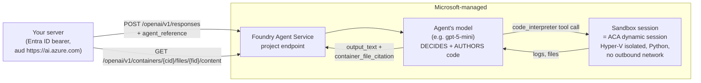

# Azure Foundry Agent Service Code Interpreter — deep analysis for KARL (KK20-108)

> **Status: research/decision input — no implementation planned from this doc.** Companion to
> [`code-interpreter-backend-options.md`](code-interpreter-backend-options.md) (the backend decision matrix — this doc
> is the deep-dive its "Azure managed" column deserves) and the
> [rollout plan](../implementation-plans/code-interpreter-artifacts-rollout.md). Researched July 2026 against the
> current Microsoft Foundry docs (page updated 2026-07-16); every load-bearing claim below was independently
> fact-checked against learn.microsoft.com (28/29 confirmed, 1 corrected — noted inline).

## TL;DR

1. **Foundry Code Interpreter is not an execution API — it is an LLM with a sandbox.** Code runs only when a Foundry
   *agent's model* decides to write and run Python inside a managed sandbox. There is **no "execute this exact code"
   endpoint** anywhere in the Foundry Agent Service surface. LibreChat's contract (`POST /exec` → verbatim execution →
   `{stdout, stderr, code, files[]}`) cannot be honestly satisfied by a service that puts a second model between
   LibreChat and the sandbox.
2. **The sandbox underneath is Azure Container Apps dynamic sessions** — Microsoft says so explicitly. ACA dynamic
   sessions *does* expose a deterministic, model-free REST API. So "use Azure's code interpreter" decomposes into:
   use **Foundry CI** (agent-wrapped → rejected) or use **its own sandbox directly** (ACA dynamic sessions + a Tier-3
   adapter → the one viable Azure shape, already Option B in the backend decision doc).
3. **For artifacts: category error.** Artifacts render in the user's browser (Sandpack) from model-emitted
   `:::artifact` text — there is no server execution on that path at all. Foundry CI outputs are text + downloadable
   static files (matplotlib PNGs); it has no rendering surface, no React/JS ecosystem, and no API that renders anything
   for an end user. Artifacts work identically whichever code-exec backend is chosen — **or with none**.
4. **Recommendation unchanged:** self-hosted ClickHouse code-interpreter stays the primary (native contract, bash +
   multi-language, no per-session metering, data in-cluster); **ACA dynamic sessions + adapter** remains the Azure
   escape hatch. **Foundry Agent Service CI: rejected as a LibreChat backend** — but noted as a possible *future,
   additive* "analysis mode" via the Responses API (Tier-5, see Shape C) and as the natural choice **if** Knauf ever
   builds standalone Foundry agents outside LibreChat.

---

## 1. How Foundry Code Interpreter actually works (verified)

### 1.1 Architecture



The decisive property is the box in the middle: **the model authors the code**. `tool_choice` can force *a*
code-interpreter call, but the code that executes is always the wrapper model's re-emission — it may reformat, "fix",
split, refuse, or silently retry-with-rewrites. Nothing in the API accepts a caller-supplied string for verbatim
execution.

### 1.2 The current (GA) lifecycle — Responses API generation

Two API generations exist. The **new GA surface** (agents + conversations + Responses API) is the one to reason about;
the **classic** assistants-style threads/runs surface is deprecated (retires **2027-03-31**; the older Azure OpenAI
Assistants API retires **2026-08-26**).

Python (`azure-ai-projects`, `AIProjectClient`):

```python
project = AIProjectClient(endpoint=PROJECT_ENDPOINT, credential=DefaultAzureCredential())
openai = project.get_openai_client()
file = openai.files.create(purpose="assistants", file=open(csv_path, "rb"))          # 1. upload input
agent = project.agents.create_version(agent_name="MyAgent", definition=PromptAgentDefinition(
    model="gpt-5-mini", instructions="You are a helpful assistant.",
    tools=[CodeInterpreterTool(container=AutoCodeInterpreterToolParam(file_ids=[file.id]))]))  # 2. agent + tool
conversation = openai.conversations.create()                                          # 3. conversation
response = openai.responses.create(conversation=conversation.id, input="chart, please",
    extra_body={"agent_reference": {"name": agent.name, "type": "agent_reference"}})   # 4. model-driven run
# 5. generated files arrive ONLY as container_file_citation annotations on output_text
# 6. bytes: openai.containers.files.content.retrieve(file_id=..., container_id=...)
```

REST equivalents (project endpoint `https://<resource>.ai.azure.com/api/projects/<project>`, bearer scope
`https://ai.azure.com/.default`): `POST /openai/v1/files` → `POST /agents?api-version=v1` →
`POST /openai/v1/responses` → `GET /openai/v1/containers/{cid}/files/{fid}/content`.

Note the failure mode Microsoft documents themselves: *files are only discoverable if the model cites them* — "if no
`container_file_citation` exists, the agent didn't generate a file. **Rephrase the prompt.**" That is prompt-and-hope,
not a file API contract.

### 1.3 Runtime facts

| Fact | Value | Source |
|---|---|---|
| Language | **Python only** (fixed data-science package set; no runtime `pip install`) | code-interpreter how-to |
| Sandbox | **ACA dynamic sessions**, Hyper-V boundary per session, Microsoft-managed | code-interpreter § Sandboxed execution |
| Network | **No outbound access** (does not inherit agent subnet) | same |
| Session | Active ≤ 1 h, **30-min idle timeout**; one session per conversation; concurrent conversations = concurrent billed sessions | same + FAQ |
| Region | Same region as the Foundry project | same |
| Files | Upload `purpose="assistants"`; ≤ 512 MB/file, 10k files/agent-thread, 300 GB total (fixed, not increasable) | limits & quotas |
| Rate limits | None separate — throttling at the model deployment (TPM/RPM) | quotas & limits |
| Models | Broad support (gpt-4o/4.1/5.x incl. KARL's deployments), region-dependent | tool-support matrix |

### 1.4 Auth, pricing, governance

- **Auth: Entra ID only** on the project endpoint (`DefaultAzureCredential` — managed identity or service principal;
  no API-key mode). RBAC: *Foundry User* to create/edit agents, *Foundry Agent Consumer* to invoke. Contrast: the plain
  Azure OpenAI resource endpoint (what KARL uses today) supports API-key auth.
- **Pricing:** **$0.03 per session (US base)** *on top of* model tokens — you pay the wrapper model's input+output
  tokens per run **plus** the session fee. Session = per conversation per active hour. The `$0.033` figure seen in
  third-party posts is not in any first-party source (likely regional uplift); verify the target region in the Azure
  pricing calculator before budgeting. Foundry Agent Service itself has no platform fee for prompt agents.
- **Governance:** basic setup = Microsoft-managed storage; **standard setup** = BYO Storage/Cosmos/AI-Search (all agent
  data in-tenant, CMK) + optional BYO VNet (private endpoints, delegated subnet). Content filtering follows the model
  deployment's policy. Sandbox data-plane residency = project region.

---

## 2. Implementation on LibreChat — the four honest shapes

LibreChat's two consumer surfaces (must both survive): **(1)** the manual **Run button** — deterministic execution of
the code block shown; **(2)** **agent auto-run** — `execute_code` capability → `bash_tool` (+ `read_file`), sandbox
executes tool input **verbatim**, no second LLM. Contract:
`POST {LIBRECHAT_CODE_BASEURL}/exec {lang, code, files?} → {session_id, stdout, stderr, code, files[]}` + upload /
download / delete routes, JWT-minted auth ([`packages/api/src/auth/codeapi.ts`](../../../packages/api/src/auth/codeapi.ts)).

### Shape A — Tier-3 adapter: LibreChat Code API ⇢ Foundry agent runs — **REJECTED**

The adapter would map `session_id`→conversation, stage `/upload` files into `container.file_ids`, and on `/exec` send a
Responses call to a wrapper agent instructed to "run exactly this code". Every leg fails:

| Requirement | What Foundry CI does to it |
|---|---|
| Verbatim execution | **Broken.** Model re-authors the code; may reformat/fix/split/refuse/self-heal. `tool_choice` forces *a* call, not *your code*. |
| `lang` (bash!) | **Hard blocker.** Python-only. KARL's agents path sends **bash** via `bash_tool` — unsatisfiable (prompting the model to wrap bash in `subprocess.run` is doubly nondeterministic). |
| `stdout` | Lossy — raw logs live in `code_interpreter_call` items; multi-call retries interleave; the user-facing text is the model's summary. |
| `stderr` + exit `code` | **Not modeled anywhere.** Tracebacks may be eaten by model auto-retry; the adapter must fabricate exit codes by regex — corrupting LibreChat's error loop. |
| Latency | 5–30 s per `/exec` (model generation + sandbox + summarization + polling) vs sub-second-to-seconds direct. The Run button becomes sluggish. |
| Cost | **Double tokens** (KARL's model authored the code; the wrapper model re-processes it) + $0.03/session — pure negative-value overhead. |
| Files | Generated files only exist if the model **cites** them; uncited files are invisible. |

### Shape B — Replace LibreChat's agent runtime with Foundry agents — **REJECTED (strategic)**

Routing KARL chats through Foundry Agent Service isn't "swap the backend", it's "stop being a LibreChat fork":
modelSpecs/`&karl_prompt` (Tier-0 governance), memory, rag_api/pgvector + Azure DI file-search, KK20-175 web_search
wiring, MCP, marketplace/permissions, artifacts prompt injection — all LibreChat-native, none with a Foundry mapping.
Server-side conversation state would split the source of truth with Mongo. And the API itself just churned
(classic → Responses), with its predecessor retiring 2026-08-26 — coupling KARL's core loop to it repeats the
Assistants mistake.

### Shape C — Azure OpenAI **Responses API** `code_interpreter` passthrough — **not wired; possible future *additive* feature**

Verified two-sided:

- **Azure side: real.** The Azure OpenAI v1 Responses API supports `tools:[{"type":"code_interpreter","container":
  {"type":"auto","file_ids":[...]}}]` on KARL's model families, against the **existing key-authenticated** Azure OpenAI
  resource — no Foundry project needed. Container idles out after 20 min; $0.03/container; files via
  `container_file_citation` + the containers content endpoint.
- **LibreChat side: absent.** [`packages/api/src/endpoints/openai/transform.ts`](../../../packages/api/src/endpoints/openai/transform.ts)
  special-cases only `web_search`/`url_context` as `addParams` flags (the KK20-175 mechanism) — there is **no generic
  provider-tool passthrough**, and `grep` finds **zero** occurrences of `code_interpreter_call` or
  `container_file_citation` in the repo: stream items would be dropped and cited files unreachable (no containers
  download proxy exists).

So this is **not** a Tier-0 `addParams` trick away — it's Tier-5 feature work (stream item types, annotation rendering,
an authenticated containers-download proxy, upload plumbing). Even built, it satisfies **neither** existing surface: no
Run button (execution only happens when the model decides mid-generation), no bash_tool. It would be a third, parallel
"ChatGPT-style data analysis" mode. Park it as a candidate upstream contribution, not a backend.

### Shape D — ACA dynamic sessions, used **directly** — **the viable Azure shape** (= backend-options Option B)

Foundry CI's own sandbox has a public, deterministic, LLM-free API:
`POST {pool}/executions?identifier=<session>` `{properties:{codeInputType:"inline",executionType:"synchronous",code}}`
→ real stdout/stderr; `/files` upload/download (`/mnt/data`); Entra auth (managed identity + *Azure ContainerApps
Session Executor*, `aud=https://dynamicsessions.io`); Hyper-V isolation; 220 s/execution cap, 128 MB upload cap.
A Tier-3 adapter mapping the LibreChat Code API onto it preserves verbatim execution and both surfaces (Run button:
fully; bash_tool: **only** via a custom-container session pool — the built-in pools are Python and **Node.js**
[corrected during fact-check: not Python-only]; a custom pool means running your own image, at which point running the
ClickHouse interpreter image on AKS is the same effort with a native contract). Full treatment: Option B in
[`code-interpreter-backend-options.md`](code-interpreter-backend-options.md).

---

## 3. Does Azure Code Interpreter cover the artifacts requirements? **No — category error.**

Artifacts have **no server-side execution requirement to satisfy**. The pipeline is: LibreChat injects the artifacts
prompt → the chat model emits `:::artifact` **text** → a Sandpack iframe in the **user's browser** bundles and renders
React/HTML/Mermaid against a fixed JS allowlist (recharts 2.12.7, shadcn/ui, …) with CDN/bundler egress from the
browser. `LIBRECHAT_CODE_BASEURL` is invisible to this path.

| Artifacts requirement | Foundry CI provides? |
|---|---|
| Model emits `:::artifact` directive | N/A — prompt contract of KARL's own chat model; CI receives Python, not markup |
| Client-side Sandpack render (interactive, in-browser) | **No** — CI returns text + file IDs; no rendering surface exists in the API (the Foundry portal playground itself only downloads images) |
| Artifacts system-prompt injection | No, and irrelevant — that's LibreChat server-side |
| JS library allowlist resolved by the browser bundler | **No** — CI is a fixed *Python* package set; no npm/React ecosystem |
| Browser egress to bundler/Tailwind CDN | No overlap — CI's sandbox can't make outbound requests at all (opposite direction) |
| Works with zero exec backend | Vacuously — artifacts run today in KARL's local eval with the toggle on, backend-independent |

**The one real adjacency:** "show me a chart." A CI/sandbox chart is a **static matplotlib PNG** delivered as a file
(identical flow on the ClickHouse backend); an artifact chart is an **interactive recharts component**. Decision line:
uploaded-file computation / exportable image → sandbox PNG; small in-context data + interactivity → artifact. That
routing is prompt engineering (our `karl-artifacts` / `karl-data-analysis` skills already encode it), not
infrastructure. **Artifacts must not appear as a criterion in any code-backend comparison** — they work identically
either way.

---

## 4. Comparison: Foundry Agent CI vs ACA dynamic sessions (direct) vs self-hosted ClickHouse

| Dimension | **Foundry Agent Service CI** | **ACA dynamic sessions (direct + Tier-3 adapter)** | **Self-hosted ClickHouse code-interpreter** |
|---|---|---|---|
| Fits LibreChat's `/exec` contract | ✗ — LLM authors the code; no verbatim API | ✓ via adapter (contract mapping) | ✓ **natively — it IS the contract** |
| Manual Run button | Slow, billed, non-verbatim | ✓ deterministic | ✓ deterministic |
| Agent auto-run (`bash_tool`) | ✗ broken (Python-only, no exit codes) | Partial — custom-container pool required for bash | ✓ bash + Python/Node/Bun natively |
| Languages | Python | Python, Node (built-in pools); anything via custom container | Python, Node, Bun, Bash (+ seedable) |
| Determinism | Model-mediated (may rewrite/refuse/retry) | Deterministic | Deterministic |
| stdout/stderr/exit code | Summarized text; no stderr/exit-code model | Real stdout/stderr | Real `{stdout, stderr, code}` |
| Latency per exec | 5–30 s (model + sandbox + summarize) | Sub-second–seconds (+220 s cap) | Sub-second–seconds (300 s default cap) |
| Cost model | Model tokens ×2 + **$0.03/session**/conversation/hour | ~$0.03/session-hour, ~zero idle | Fixed infra, always-on; no metering |
| Isolation | Hyper-V (ACA sessions), MS-operated | Hyper-V, MS-operated | NsJail (shared kernel) or libkrun microVM (needs `/dev/kvm`) — you operate |
| Sandbox network egress | None | None (built-in pools) | Locked by egress-gateway (policy-controlled) |
| File flows | Only model-cited files retrievable; 20–30 min container idle reset | `/mnt/data` files API; 128 MB cap | Native upload/batch/download; ~150 MB artifacts; session storage in MinIO/S3 |
| Auth from KARL | Entra-only project endpoint (new auth stack) | Entra managed identity + Session Executor role | LibreChat-minted JWT — **already wired upstream** |
| Data residency | Project region; MS-managed (or standard setup BYO) | Your subscription/region | Fully in-cluster/in-tenant |
| Integration effort | Adapter that still can't honor the contract | Small adapter service (few hundred lines) + MI/RBAC | **Zero code** — env vars + Helm deploy |
| Ops burden | None (but you inherit an agent platform) | Session pool + adapter | 8 services + storage + isolation decision |
| Platform churn risk | High — successor of an API retiring 2026-08-26; classic surface retires 2027-03-31 | Low — GA infra API | Low — Apache-2.0, pinned; upstream LibreChat's own default |
| Artifacts impact | None (category error) | None | None |

## 5. Verdict & when to revisit

- **Foundry Agent Service Code Interpreter: rejected as KARL's code-execution backend.** Architecturally it is an
  *agent product*, not a *sandbox API* — every path inserts a model between LibreChat and the sandbox, kills bash, and
  doubles cost/latency for lower fidelity. Nothing here changes the standing recommendation
  (ClickHouse self-host primary; ACA-direct adapter as the managed escape hatch).
- **Where Foundry CI IS the right tool:** standalone Knauf agents built *on* Foundry (outside LibreChat), where the
  model-drives-the-sandbox pattern is the feature, not the bug.
- **Revisit triggers:** (a) upstream LibreChat ships Responses-API `code_interpreter` rendering (watch for
  `container_file_citation` handling upstream — turns Shape C into config); (b) Knauf mandates managed-only sandboxes
  → execute Option B (ACA direct); (c) Microsoft ships a deterministic "execute code" endpoint on the Foundry surface
  (would collapse the core objection); (d) the wrapper-agent pattern becomes needed for a non-LibreChat product.

## Sources (fact-checked July 2026)

- Code Interpreter how-to (incl. sandbox = ACA dynamic sessions, session/idle, Python-only, no network):
  https://learn.microsoft.com/en-us/azure/foundry/agents/how-to/tools/code-interpreter
- ACA dynamic sessions code interpreter (deterministic API, 220 s, 128 MB, Session Executor role):
  https://learn.microsoft.com/en-us/azure/container-apps/sessions-code-interpreter
- Custom code interpreter (BYO session pool for agents):
  https://learn.microsoft.com/en-us/azure/foundry/agents/how-to/tools/custom-code-interpreter
- Foundry Agent Service pricing (no platform fee; per-tool charges): https://azure.microsoft.com/en-us/pricing/details/foundry-agent-service/
- Session pricing definition ($0.03/session, per-conversation/hour): https://learn.microsoft.com/en-us/azure/foundry/agents/faq and
  https://learn.microsoft.com/en-us/answers/questions/1664631/how-does-pricing-for-azure-assistants-api-code-int
- Limits & quotas (512 MB/file, 10k files, 300 GB; model-level rate limits): https://learn.microsoft.com/en-us/azure/ai-foundry/agents/quotas-limits
- Environment setup / RBAC / standard setup + BYO VNet: https://learn.microsoft.com/en-us/azure/foundry/agents/environment-setup
- Azure OpenAI v1 Responses API `code_interpreter` (container tool, 20-min idle): https://learn.microsoft.com/en-us/azure/ai-foundry/openai/how-to/responses
- Assistants API retirement 2026-08-26 / classic agents 2027-03-31: https://learn.microsoft.com/en-us/answers/questions/5790094/will-azure-openai-assistants-api-specifically-be-d
- Data, privacy & security for Agent Service: https://learn.microsoft.com/en-us/azure/foundry/responsible-ai/agents/data-privacy-security
- In-repo verification: `packages/api/src/endpoints/openai/transform.ts` (web_search/url_context special-casing only);
  zero `container_file_citation`/`code_interpreter_call` handling anywhere; `packages/api/src/auth/codeapi.ts` (Code API JWT).
