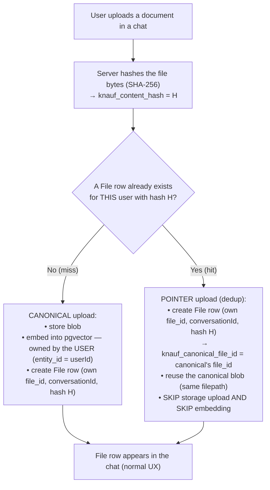
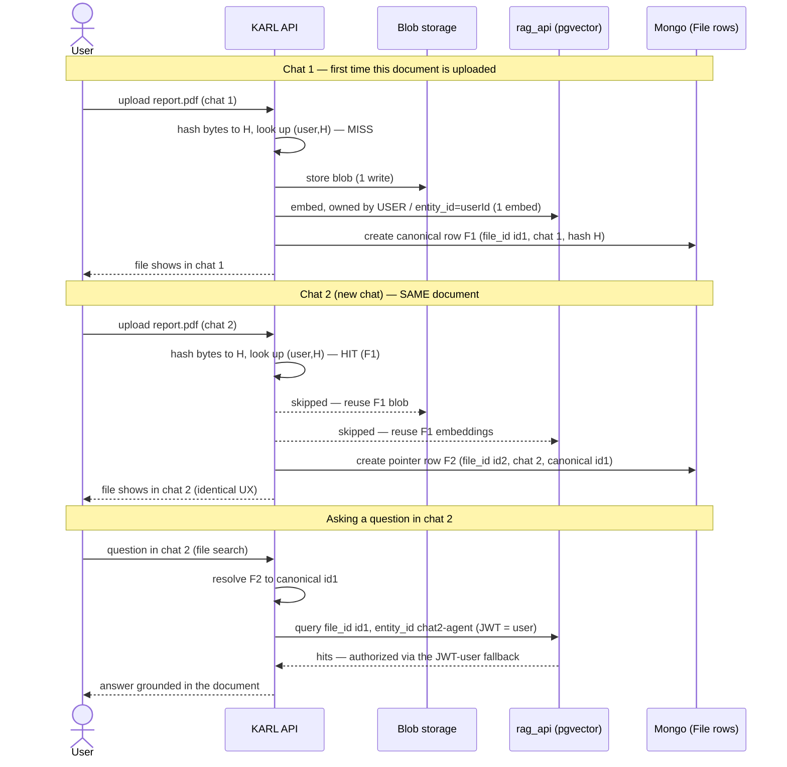

# Content-hash file deduplication — how it works (KK20-204)

> **Status:** design walkthrough. The implemented model refined the terminology: the shared asset is
> keyed by a stable **`knauf_asset_id`** carried on every deduped row (not an elected "canonical"
> row with `knauf_canonical_file_id`), and the concurrent-first-upload race is bounded by a
> **unique-owner index** rather than a pre-embed claim. Where this walkthrough says
> "canonical/pointer", read "asset owner / reuse row." The authoritative final design is the
> **Implemented — KK20-204** section of
> [implementation-plans/file-lifecycle-dedup-cleanup.md](../implementation-plans/file-lifecycle-dedup-cleanup.md).
> Pairs with KK20-203 (cascade cleanup on chat delete), which is already built.
>
> **The question this answers:** a user uploads a document in one chat, then uploads the *same*
> document again in a new chat. Does that duplicate the stored file and its embeddings?
> **Answer (after KK20-204): no.** The file appears as a normal file in the second chat, but there is
> exactly **one blob + one embedding set**, plus one lightweight DB row per chat — *provided the
> content hash matches and it's the same user*.

---

## Today vs. after KK20-204

Same PDF, same user, added to 2 chats:

| | Storage blobs | pgvector embeddings | Mongo `File` rows | User sees |
|---|---|---|---|---|
| **Today (no dedup)** | 2 | 2 sets | 2 | a normal file in each chat |
| **After KK20-204** | **1** | **1 set** | 2 (1 canonical + 1 pointer) | **a normal file in each chat — identical UX** |

The win scales: the same document across N chats → 1 blob + 1 embedding set + N small rows, instead of N × everything. Embeddings are the biggest recurring cost, so this is the main saving.

---

## The upload decision (runs on every upload)

Per-user scope is deliberate: the lookup key is `(user, knauf_content_hash)`. Two different users uploading identical content never share a blob or embedding — cross-user dedup would leak the existence of content between users (privacy). Same hash, same user → dedup.

---

## The two-chat scenario, step by step

**End state:** 1 blob, 1 embedding set (keyed by `id1`, owned by the user), 2 `File` rows (`F1` canonical, `F2` pointer). Nothing about the second upload is duplicated except a small Mongo row.

---

## Why retrieval still works in the second chat

This is the subtle part, and it's why the embeddings are stored **user-owned**. The `rag_api` `/query`:

1. Retrieves chunks by **`file_id` only** (the canonical `id1`). `entity_id` is *not* a vector filter.
2. Then authorizes: a chunk is allowed if its stored `user_id` is `None`, equals the query's
   `entity_id`, **or equals the JWT user id**.

Because the canonical file was embedded owned by the **user** (`user_id = userId`), a query coming from
*any* of that user's chats/agents (a different `entity_id`) still authorizes via the **JWT-user
fallback** — while another user's query is denied. (Verified against the deployed `rag_api` image; see
the spike result in the implementation-plan doc.) This is what makes one embedding safely reusable
across all of a user's chats without leaking across users.

---

## Data model (what's shared vs. per-chat)

| Field | Canonical row (F1) | Pointer row (F2) |
|---|---|---|
| `file_id` | `id1` | `id2` (its own) |
| `conversationId` | chat 1 | chat 2 |
| `knauf_content_hash` | `H` | `H` |
| `knauf_canonical_file_id` | — (is canonical) | `id1` |
| `filepath` (blob) | the blob | **same blob path as F1** |
| embeddings | in pgvector under `id1`, owned by user | **none of its own — uses `id1`'s** |
| `filename` | as uploaded | its own (may differ — see edge cases) |

So the **physical asset** (blob + embeddings) is shared; the **logical row** (file_id + which chat it belongs to + display name) is per-chat.

---

## Cleanup interaction (with KK20-203)

KK20-203 already deletes a chat's files on chat-delete. The subtlety dedup adds: the reference count
must be taken over the **content-hash group**, not the individual `file_id` — because the physical
asset (blob + embeddings under the canonical `id1`) is shared across *different* logical file_ids
(`id1` for F1, `id2` for F2). PR1's guard alone keys on `file_id`, so deleting the chat that holds the
canonical row would wrongly free an asset a pointer still uses. The fix is a **two-stage delete**:

1. **Delete the chat's File row — always** (keyed on the deleted ids).
2. **GC the physical asset — only when the `(user, content-hash)` group is empty**, recounted *after*
   stage 1, always targeting the **canonical `id1`** for the embeddings and the shared `filepath` for
   the blob.

| Delete | File rows | Physical asset (blob + `id1` embeddings) |
|---|---|---|
| chat 2 (pointer F2) | F2 row removed | **kept** — F1 still in the group |
| chat 1 (canonical F1) | F1 row removed | **kept** — F2 still in the group; F2 keeps resolving `id2 → id1` even though the canonical *row* is gone |
| both chats | both rows removed | **deleted once** — `id1`'s embeddings + the shared blob |

Recounting *after* the row delete (not before) makes the "two concurrent deletes both decide they're
not last → orphan" race structurally impossible; the residual double-GC is harmless (the vector delete
is 404-tolerant, the blob delete tolerates a missing file). The one real corruption path is an upload
that *hits* an existing group racing the last-row delete — so the dedup upload-HIT path must
re-validate the canonical asset still exists (under a per-`(user, content-hash)` guard shared with the
GC) before committing its pointer.

> Full design, pseudocode, and the complete edge-case + test list:
> [implementation-plans/file-lifecycle-dedup-cleanup.md](../implementation-plans/file-lifecycle-dedup-cleanup.md) (Step 3).

---

## Scope & edge cases

- **Dedup applies to CHAT/message attachments only.** Per-user dedup + the user-owned embed are
  scoped to chat attachments (`message_file`). **Agent-library** knowledge — files added to an
  agent's `file_search` in the builder — is embedded **agent-scoped** (`entity_id = agent_id`) so
  **every user with access to the agent can retrieve it**, and is deliberately **not** per-user
  deduped. This is the OpenAI-Assistants model: the agent's vector store is a *shared* visibility
  scope; a thread/message file is a *private* scope; dedup happens only *within* a scope. The
  discriminator is `messageAttachment` (already the gate that decides whether an upload mutates the
  agent's persistent `tool_resources`, and EDIT-permission-gated for library uploads).
- **Per-user only.** Different users never dedup against each other (privacy).
- **Same content, different filename** → still dedups (the hash is of the bytes); the pointer row keeps
  its own display filename.
- **Brand-new chat (no conversationId yet)** → still hashes and dedups on upload; the file is linked for
  cleanup via the message once it's used (same mechanism KK20-203 already handles).
- **Two simultaneous first-uploads of the same new content** → an atomic claim (`claimContentHash`,
  modelled on the existing `claimCodeFile`) ensures exactly one canonical row; the loser becomes a
  pointer. Worst case is a one-off double-embed, which is correctness-preserving.
- **Embedding reuse needs a canonical that was embedded.** Blob dedup always applies; embedding reuse
  applies when the matched canonical has embeddings (the file_search/Q&A case in this walkthrough).

---

## What the user experiences

Nothing unusual. The file row looks and behaves the same in every chat — same name, same content,
searchable for Q&A. "Deduplicated" is invisible to them; it only changes what the backend stores.
