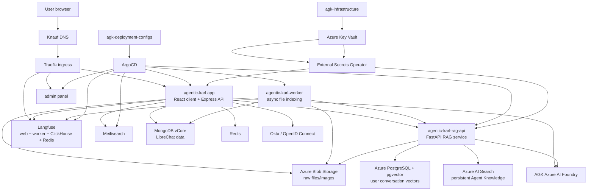
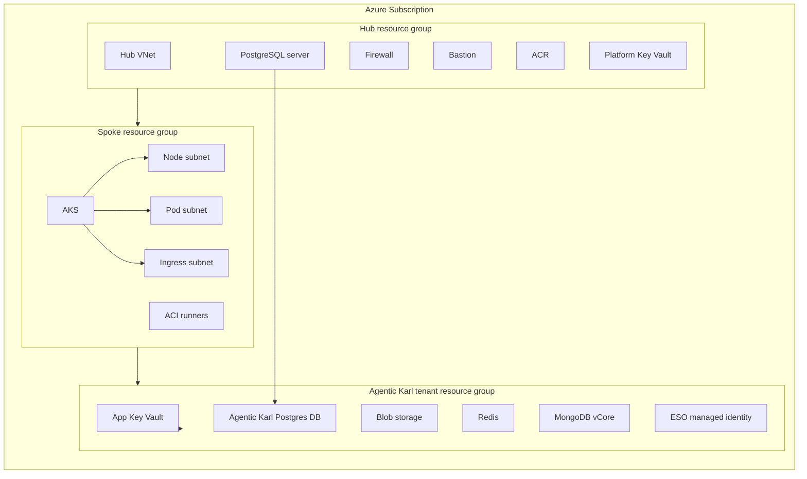
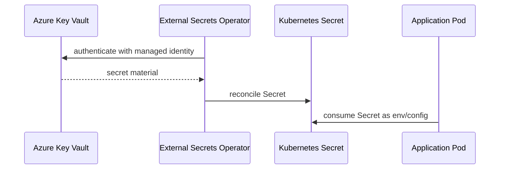
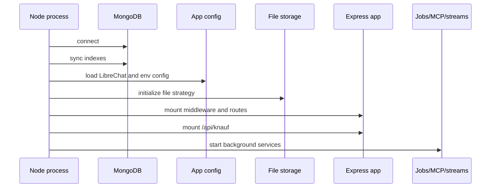
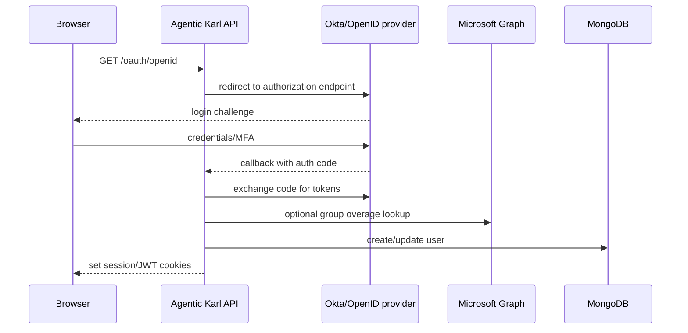
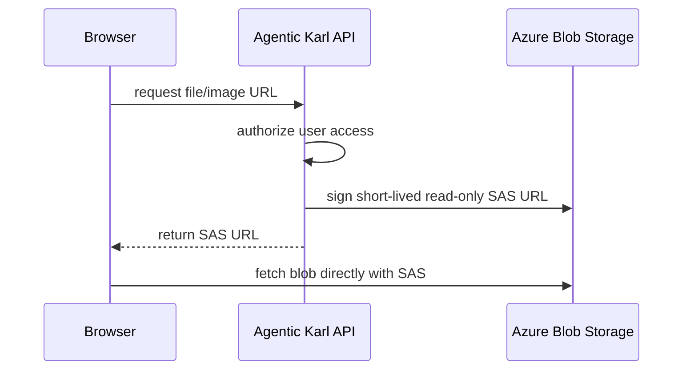
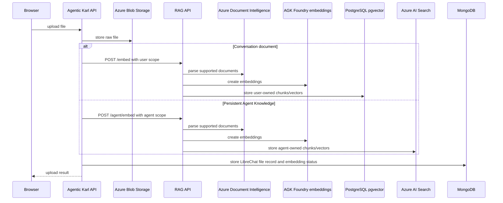
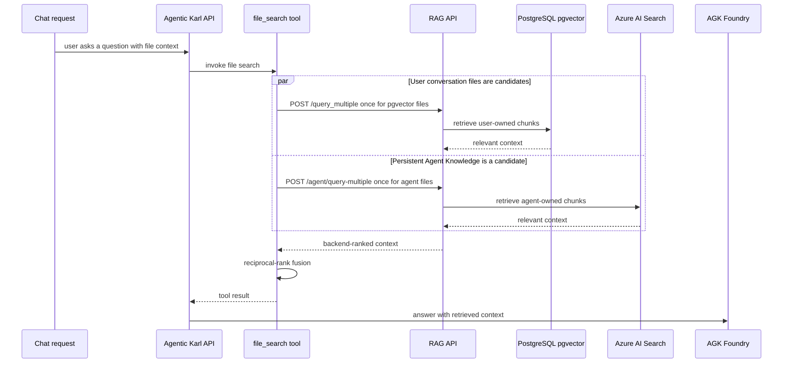
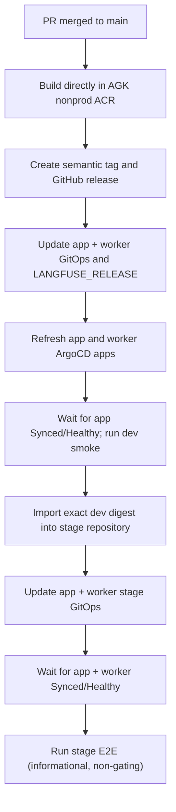
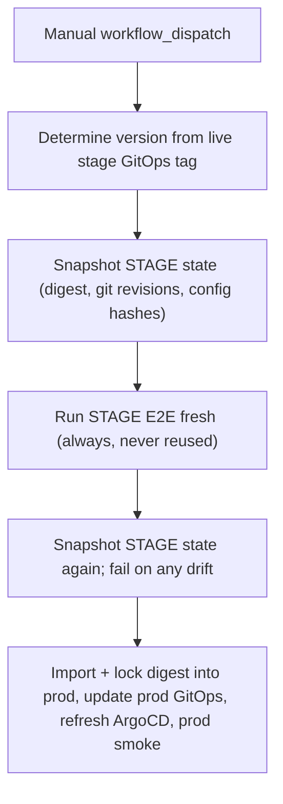

# Agentic Karl Architecture README

Last updated: 2026-08-11

Audience: engineers, platform owners, and technical stakeholders who need to understand how Agentic Karl is wired from infrastructure through application features.

Scope:

- Main application repository: `agentic-karl`
- RAG service repository: `agentic-karl-rag-api`
- AGK Terraform repository: `agk-infrastructure`
- AGK GitOps repository: `agk-deployment-configs`
- Legacy CT deployment configuration where it still matters for migration context
- Official LibreChat documentation for upstream behavior

Non-goals:

- This document does not print secret values.
- This document does not replace Terraform state, ArgoCD state, Key Vault, or Helm values as the source of truth.
- This document is an architecture handoff, not a step-by-step production change runbook.

## Contents

- [System context and ownership](#top-level-system-context)
- [Environments and infrastructure](#environment-matrix)
- [GitOps, secrets, and runtime services](#gitops-and-helm-layout)
- [Application, authentication, and AI](#application-source-layout)
- [Files, RAG, search, and admin](#file-storage-and-azure-blob)
- [Release and promotion](#release-and-promotion-flow)
- [Operations and failure routing](#operational-checks)
- [Source references](#source-references)

## Executive Summary

Agentic Karl is a Knauf fork of LibreChat deployed on the AGK Azure platform. The user-facing application is a Node/Express API plus React client. It uses MongoDB for core LibreChat and Project Knowledge metadata, Redis for caching/session support, Azure Blob Storage for raw files and images, Meilisearch for text search, AGK Azure AI Foundry for model, embedding, image, and Document Intelligence workloads, and a separate RAG API with two vector backends: Azure PostgreSQL/pgvector for user-owned conversation and Project Knowledge files, and Azure AI Search for persistent Agent Knowledge.

Deployment is GitOps-driven. Application images are built and imported into AGK Azure Container Registries, Helm values live in `agk-deployment-configs`, and ArgoCD reconciles services into AKS namespaces. Terraform in `agk-infrastructure` owns the AGK hub/spoke Azure infrastructure, tenant resources, Key Vaults, databases, storage accounts, managed identities, and workload-identity wiring used by External Secrets Operator.

The application keeps most Knauf-specific code in explicit `knauf/` directories or `[knauf]` seam blocks so the fork can be rebased against upstream LibreChat with a visible manifest in `SEAMS.md`.

## Top-Level System Context

```text
Users
  |
  | Browser
  v
Knauf DNS
  |
  v
Traefik ingress on AGK AKS (public services only)
  |
  +--> agentic-karl web/API service
  |       |
  |       +--> MongoDB vCore / Cosmos DB for MongoDB API
  |       +--> Redis
  |       +--> Azure Blob Storage
  |       +--> Meilisearch
  |       +--> AGK Azure AI Foundry
  |       +--> agentic-karl-rag-api
  |       +--> Okta / OpenID Connect
  |
  +--> agentic-karl-admin-panel service
  |
  +--> Langfuse web service

Internal namespace services:
  +-- agentic-karl-rag-api
  +-- agentic-karl-worker
  +-- agentic-karl-meilisearch
  +-- Langfuse worker/ClickHouse/Redis

Terraform: agk-infrastructure
GitOps:    agk-deployment-configs
App code:  agentic-karl
```



## Repositories And Ownership

| Repository                     | Role                                                                                                                                  | Important paths                                                                                                                  |
| ------------------------------ | ------------------------------------------------------------------------------------------------------------------------------------- | -------------------------------------------------------------------------------------------------------------------------------- |
| `agentic-karl`                 | LibreChat fork and application source. Contains API, client, packages, Helm overlay values, release workflows, Knauf seams, and docs. | `api/`, `client/`, `packages/`, `librechat.yaml`, `infrastructure/`, `.github/workflows/`, `knauf/`, `SEAMS.md`                  |
| `agentic-karl-rag-api`         | Knauf RAG service. Owns document parsing, embeddings, pgvector routes, Azure AI Search routes, and its release pipeline.              | `app/routes/document_routes.py`, `app/routes/agent_routes.py`, `app/services/vector_store/azure_search.py`, `.github/workflows/` |
| `agk-infrastructure`           | Terraform for AGK hub/spoke platform and Agentic Karl tenant resources.                                                               | `terraform/subscription/*/base/hub`, `terraform/subscription/*/base/*`, `terraform/subscription/*/tenant/agentic-karl`           |
| `agk-deployment-configs`       | GitOps source for AGK ArgoCD applications and Helm values.                                                                            | `agentic-karl/{dev,stage,prod}/services/*`, `agentic-karl/*/common-namespace-resources`                                          |
| Admin panel upstream           | `ghcr.io/clickhouse/librechat-admin-panel`; AGK import and deployment lifecycle is owned by `agk-deployment-configs`.                 | `.github/workflows/promote-admin-panel.yaml`, `scripts/promote-admin-panel.sh`                                                   |
| Langfuse upstream              | Upstream Langfuse/ClickHouse/Redis images; AGK promotion/GitOps live in `agk-deployment-configs`, data resources in infrastructure.   | `.github/workflows/promote-langfuse.yaml`, `scripts/promote-langfuse.sh`, tenant `langfuse/` Terraform root                      |
| `Customer-Tech-Shared`         | Shared Terraform modules consumed by AGK infrastructure.                                                                              | `infrastructure/terraform/modules/*`                                                                                             |
| `agentic-karl-quality`         | Stage E2E and k6 quality gates used by the app promotion rail.                                                                        | GitHub Actions workflows and test profiles                                                                                       |
| `ct-shared-deployment-configs` | Legacy CT deployment configuration used for migration context.                                                                        | Legacy `agentic-karl` app configuration                                                                                          |
| Upstream LibreChat             | Upstream application framework, config conventions, agents, files, RAG, Meilisearch behavior.                                         | Official docs at `librechat.ai/docs`                                                                                             |

## Environment Matrix

| Environment   | Namespace            | Public app URL                                 | Admin URL                                            | AKS cluster           | ACR                   | Key Vault                 | Subscription                                                        |
| ------------- | -------------------- | ---------------------------------------------- | ---------------------------------------------------- | --------------------- | --------------------- | ------------------------- | ------------------------------------------------------------------- |
| Dev / nonprod | `agentic-karl-dev`   | `https://agentic-karl.agk.dev.knauf.digital`   | `https://agentic-karl-admin.agk.dev.knauf.digital`   | `aks-agk-nonprod-001` | `acragkhubnonprod001` | `kv-agntkarl-nonprod-001` | `CT-SHARED-RESOURCES` (`ad3f0a71-cc5b-4d00-8289-23623cf2064c`)      |
| Stage         | `agentic-karl-stage` | `https://agentic-karl.agk.stage.knauf.digital` | `https://agentic-karl-admin.agk.stage.knauf.digital` | `aks-agk-nonprod-001` | `acragkhubnonprod001` | `kv-agntkarl-nonprod-001` | `CT-SHARED-RESOURCES` (`ad3f0a71-cc5b-4d00-8289-23623cf2064c`)      |
| Prod          | `agentic-karl-prod`  | `https://agentic-karl.knauf.com`               | `https://agentic-karl-admin.knauf.digital`           | `aks-agk-prod-001`    | `acragkhubprod001`    | `kv-agntkarl-prod-001`    | `CT-SHARED-RESOURCES-PROD` (`e0515a24-7205-481b-b657-944901020e32`) |
| Legacy CT dev | legacy namespace     | `https://agentic-karl.dev.knauf.digital`       | n/a                                                  | legacy CT shared AKS  | `acrctshared001`      | legacy CT KV              | legacy CT shared platform                                           |

Versions observed from fetched `agk-deployment-configs/origin/main` on 2026-08-11. This is a dated snapshot; GitOps remains authoritative:

| Component                  | Dev desired image/tag                                                             | Stage desired image/tag                                                             | Prod desired image/tag                                                             |
| -------------------------- | --------------------------------------------------------------------------------- | ----------------------------------------------------------------------------------- | ---------------------------------------------------------------------------------- |
| Main app + indexing worker | `agentic-karl-dev/agentic-karl:v0.237.0`                                          | `agentic-karl-stage/agentic-karl:v0.236.0`                                          | `agentic-karl-prod/agentic-karl:v0.223.0`                                          |
| RAG API                    | `agentic-karl-dev/agentic-karl-rag-api:v0.8.0.15`                                 | `agentic-karl-stage/agentic-karl-rag-api:v0.8.0.14`                                 | `agentic-karl-prod/agentic-karl-rag-api:v0.8.0.15`                                 |
| Meilisearch                | `getmeili/meilisearch:v1.52.0`                                                    | `getmeili/meilisearch:v1.52.0`                                                      | `getmeili/meilisearch:v1.52.0`                                                     |
| Admin panel                | `agentic-karl-dev/librechat-admin-panel:eaba3220a57f51184b8c790220f07a59227b6d1a` | `agentic-karl-stage/librechat-admin-panel:eaba3220a57f51184b8c790220f07a59227b6d1a` | `agentic-karl-prod/librechat-admin-panel:eaba3220a57f51184b8c790220f07a59227b6d1a` |
| Langfuse web + worker      | `agentic-karl-dev/{langfuse,langfuse-worker}:3.194.1`                             | `agentic-karl-stage/{langfuse,langfuse-worker}:3.194.1`                             | `agentic-karl-prod/{langfuse,langfuse-worker}:3.194.1`                             |
| Langfuse ClickHouse        | `agentic-karl-dev/clickhouse-server:24.10.3`                                      | `agentic-karl-stage/clickhouse-server:24.10.3`                                      | `agentic-karl-prod/clickhouse-server:24.10.3`                                      |
| Langfuse Redis             | `agentic-karl-dev/redis:7-alpine`                                                 | `agentic-karl-stage/redis:7-alpine`                                                 | `agentic-karl-prod/redis:7-alpine`                                                 |

All AGK-owned repositories use the environment’s ACR: `acragkhubnonprod001.azurecr.io` for dev/stage and `acragkhubprod001.azurecr.io` for prod.

### Live stage verification boundary

Read-only Azure and HTTPS checks on 2026-08-11 confirmed the stage Search, Mongo, Redis, Blob, workload identity, PostgreSQL databases, private endpoints, ACR image, Key Vault secret-name inventory, and public app/admin/Langfuse endpoints. No secret values were read.

This did **not** prove Kubernetes deployment/pod readiness, ExternalSecret refresh state, or ArgoCD sync/health: private AKS DNS was unavailable from the audit host and the cached ArgoCD session was invalid. Reconnect VPN/private DNS and authenticate to nonprod ArgoCD before making those claims.

Hardening/ownership drift to resolve rather than copy:

- The stage storage account and tenant Key Vault currently report public-network access enabled; Blob public access is disabled and containers are private.
- Dev, stage, and prod Mongo Terraform currently reference the `Customer-Tech-Shared` Cosmos module with mutable `ref=main` rather than an immutable tag or commit.

## Infrastructure Topology

AGK uses a hub/spoke Azure layout managed in Terraform.

```text
Subscription
  |
  +-- Hub resource group
  |     +-- Hub virtual network
  |     +-- Azure Firewall
  |     +-- Bastion
  |     +-- Azure Container Registry
  |     +-- Platform Key Vault
  |     +-- PostgreSQL flexible server
  |
  +-- Spoke resource group
  |     +-- AKS cluster
  |     +-- ACI runners
  |     +-- Route tables
  |     +-- Node subnet
  |     +-- Pod subnet
  |     +-- Ingress subnet
  |
  +-- Tenant resource group: Agentic Karl
        +-- App Key Vault
        +-- Blob storage account
        +-- Redis
        +-- MongoDB vCore / Cosmos DB for MongoDB API
        +-- External Secrets managed identity
        +-- App-specific database bindings and secrets
```



### Environment Infrastructure Details

Stage deliberately shares the nonprod platform substrate while isolating application data and workload identity. Its resources are owned by the existing nonprod tenant and tenant-app Terraform roots; there is no separate stage state file.

| Area                     | Dev                                                                | Stage                                                       | Prod                                                            |
| ------------------------ | ------------------------------------------------------------------ | ----------------------------------------------------------- | --------------------------------------------------------------- |
| Hub RG                   | `rg-agk-hub-nonprod-westeurope`                                    | same as dev                                                 | `rg-agk-hub-prod-westeurope`                                    |
| Spoke RG                 | `rg-agk-nonprod-westeurope`                                        | same as dev                                                 | `rg-agk-prod-westeurope`                                        |
| Tenant RG                | `rg-agentic-karl-tenant-nonprod-westeurope`                        | same as dev                                                 | `rg-agentic-karl-tenant-prod-westeurope`                        |
| AKS                      | `aks-agk-nonprod-001`                                              | `aks-agk-nonprod-001`                                       | `aks-agk-prod-001`                                              |
| ACR                      | `acragkhubnonprod001`                                              | `acragkhubnonprod001`                                       | `acragkhubprod001`                                              |
| App Key Vault            | `kv-agntkarl-nonprod-001`                                          | `kv-agntkarl-nonprod-001`                                   | `kv-agntkarl-prod-001`                                          |
| Mongo                    | `cosmos-agk-nonprod-westeurope-001`                                | `cosmos-agk-nonprod-westeurope-stage-001`                   | `cosmos-agk-prod-westeurope-001`                                |
| Redis                    | `redis-agk-nonprod-westeurope-redis-agk-dev-001`                   | `redis-agk-nonprod-westeurope-redis-agk-stage-001`          | `redis-agk-prod-westeurope-redis-agk-prod-001`                  |
| Blob storage             | `agkblobdevwesteu`                                                 | `agkblobstagewesteu`                                        | `agkblobprodwesteu`                                             |
| Blob container           | `files`                                                            | `files`                                                     | `files`                                                         |
| Postgres server          | `pgsql-agk-hub-nonprod-westeurope-001.postgres.database.azure.com` | same as dev                                                 | `pgsql-agk-hub-prod-westeurope-001.postgres.database.azure.com` |
| RAG database             | `agentic-karl-dev`                                                 | `agentic-karl-stage`                                        | `agentic-karl-prod`                                             |
| Langfuse database        | `langfuse-dev`                                                     | `langfuse-stage`                                            | `langfuse-prod`                                                 |
| Langfuse Blob containers | `langfuse-events`, `langfuse-media`, `langfuse-exports`            | same names in stage storage                                 | same names in prod storage                                      |
| Azure AI Search          | `agentic-karl-search-dev`                                          | `agentic-karl-search-stage`                                 | `agentic-karl-search-prod`                                      |
| ESO managed identity     | `mi-agentic-karl-dev-westeurope-aks-external-secrets-001`          | `mi-agentic-karl-stage-westeurope-aks-external-secrets-001` | `mi-agentic-karl-prod-westeurope-aks-external-secrets-001`      |

### Networking

AGK AKS uses Azure CNI pod subnet mode.

Stage uses the same nonprod VNet and subnet ranges as dev. Namespace and network policies provide workload isolation; Mongo, Redis, and Search have distinct approved private endpoints. The stage Blob account is the current exception: it has no private endpoint and its public network default is `Allow`.

| Network        | Dev / nonprod    | Prod             |
| -------------- | ---------------- | ---------------- |
| Spoke CIDR     | `10.160.0.0/16`  | `10.161.0.0/16`  |
| Node subnet    | `10.160.0.0/22`  | `10.161.0.0/22`  |
| Ingress subnet | `10.160.4.0/28`  | `10.161.4.0/28`  |
| ACI subnet     | `10.160.5.0/24`  | `10.161.5.0/24`  |
| Pod subnet     | `10.160.32.0/19` | `10.161.32.0/19` |

Network policies are default-deny with explicit allows for:

- DNS
- Same-namespace service traffic
- Traefik ingress
- Internet egress on 80/443
- Private endpoint traffic such as PostgreSQL, Redis, and platform-specific private CIDRs

## GitOps And Helm Layout

`agk-deployment-configs` is the ArgoCD source of truth for deployed AGK services.

```text
agk-deployment-configs/
  agentic-karl/
    dev/
      common-namespace-resources/
      network-policy/
      services/
        agentic-karl/
        agentic-karl-worker/
        agentic-karl-rag-api/
        agentic-karl-meilisearch/
        agentic-karl-admin-panel/
        langfuse-web/
        langfuse-worker/
        langfuse-clickhouse/
        langfuse-redis/
    stage/
      common-namespace-resources/
      network-policy/
      services/                 # same nine-service shape as dev/prod
    prod/
      common-namespace-resources/
      network-policy/
      services/
        agentic-karl/
        agentic-karl-worker/
        agentic-karl-rag-api/
        agentic-karl-meilisearch/
        agentic-karl-admin-panel/
        langfuse-web/
        langfuse-worker/
        langfuse-clickhouse/
        langfuse-redis/
```

Service ownership:

| Service                      | Role                           | Notes                                                                             |
| ---------------------------- | ------------------------------ | --------------------------------------------------------------------------------- |
| `agentic-karl`               | Main web/API application       | Multi-source ArgoCD application: GitOps values plus service repo values           |
| `agentic-karl-worker`        | Async file-indexing worker     | Uses the app image; promoted in lock-step with the main app                       |
| `agentic-karl-rag-api`       | RAG/vector API                 | Local GitOps service values; image is built from Knauf overlay                    |
| `agentic-karl-meilisearch`   | Text search index              | Local GitOps service values                                                       |
| `agentic-karl-admin-panel`   | Admin UI                       | Separate image and ingress                                                        |
| `langfuse-web`               | Langfuse UI/API                | Separate per-environment ingress and project bootstrap                            |
| `langfuse-worker`            | Langfuse background processing | Consumes the same environment’s PostgreSQL, ClickHouse, Redis, and Blob resources |
| `langfuse-clickhouse`        | Trace/event storage            | Private namespace service with persistent volume                                  |
| `langfuse-redis`             | Langfuse queue/cache           | Namespace-local Redis deployment                                                  |
| `common-namespace-resources` | Shared namespace resources     | Service account, SecretStore, External Secrets identity wiring                    |

### ArgoCD

| Environment   | ArgoCD URL                                 | Main app                          | Namespace            |
| ------------- | ------------------------------------------ | --------------------------------- | -------------------- |
| Dev / nonprod | `https://argocd.agk.nonprod.knauf.digital` | `agentic-karl-dev-agentic-karl`   | `agentic-karl-dev`   |
| Stage         | `https://argocd.agk.nonprod.knauf.digital` | `agentic-karl-stage-agentic-karl` | `agentic-karl-stage` |
| Prod          | `https://argocd.agk.prod.knauf.digital`    | `agentic-karl-prod-agentic-karl`  | `agentic-karl-prod`  |

### Value Precedence

The main `agentic-karl` app is a multi-source ArgoCD application:

1. GitOps values from `agk-deployment-configs`
2. Service repo values from `agentic-karl/infrastructure/<env>/values.yaml`

The service repo overlay is loaded later, so it can override collisions. RAG API, Meilisearch, and admin panel are local-only GitOps services because they do not use the same service-repo overlay pattern.

## Secrets And Workload Identity

Secrets are stored in Azure Key Vault and projected into Kubernetes through External Secrets Operator.

```text
Azure Key Vault
  |
  | Workload identity
  v
External Secrets Operator
  |
  v
Kubernetes Secret
  |
  v
Pod environment variables / mounted secret values
```



Common secret/config categories:

| Category         | Examples                                                                                | Consumer                  |
| ---------------- | --------------------------------------------------------------------------------------- | ------------------------- |
| Mongo            | `MONGO_URI`                                                                             | Main app                  |
| Redis            | `REDIS_URI`                                                                             | Main app                  |
| Blob storage     | `AZURE_STORAGE_CONNECTION_STRING`, `AZURE_STORAGE_ACCOUNT_NAME`, `AZURE_CONTAINER_NAME` | Main app, file services   |
| Azure AI Foundry | Environment-specific inference, embedding, image, and Document Intelligence credentials | Main app, worker, RAG API |
| OpenID           | `OPENID_CLIENT_SECRET`, `OPENID_SESSION_SECRET`                                         | Main app auth             |
| JWT/session      | JWT and session signing secrets                                                         | Main app                  |
| Meilisearch      | master/API key                                                                          | Main app, Meilisearch     |
| RAG database     | Postgres credentials                                                                    | RAG API                   |

Known External Secrets workload identity client IDs:

| Environment   | Client ID                              |
| ------------- | -------------------------------------- |
| Dev / nonprod | `b573fdae-1009-46d4-8c58-16694e48f65f` |
| Stage         | `d141fd36-84ad-44d5-adf7-17ff7be6b78f` |
| Prod          | `af3876d3-0183-4213-8877-e66daff78ef2` |

Dev and stage share the nonprod Key Vault but use separate workload identities. Terraform-generated stage secrets use `agentic-karl-stage-*` or `langfuse-stage-*` names. The app’s stage OpenID client secret is the manually managed `AGK-STAGE-OPENID-CLIENT-SECRET`; shared application secrets retain their established `AGK-*` names. Inspect mappings in each service’s GitOps values instead of inferring reuse from the shared vault.

Langfuse environment wiring:

| Env   | URL                                        | Namespace            | Project public key                 |
| ----- | ------------------------------------------ | -------------------- | ---------------------------------- |
| Dev   | `https://langfuse.agk.dev.knauf.digital`   | `agentic-karl-dev`   | `pk-lf-agk-dev-agentic-karl-001`   |
| Stage | `https://langfuse.agk.stage.knauf.digital` | `agentic-karl-stage` | `pk-lf-agk-stage-agentic-karl-001` |
| Prod  | `https://langfuse.knauf.digital`           | `agentic-karl-prod`  | `pk-lf-agk-prod-agentic-karl-001`  |

Current stage drift: Langfuse web consumes `langfuse-stage-LANGFUSE-INIT-PROJECT-SECRET-KEY`, and the secret exists, but the main app’s `LANGFUSE_SECRET_KEY` mapping remains commented out while `LANGFUSE_ENABLED=true`. Stage SDK trace export is therefore not proven until the mapping is enabled and verified.

Do not copy secret values into docs, PRs, tickets, or logs.

## Runtime Service Map

| Runtime component     | Technology                  | Primary responsibility                                                         | Main dependencies                                                                      |
| --------------------- | --------------------------- | ------------------------------------------------------------------------------ | -------------------------------------------------------------------------------------- |
| React client          | Vite/React/TypeScript       | Browser UI, chat, agents, files, branding, analytics consent                   | Main API, startup config, user auth state                                              |
| Express API           | Node.js/Express             | Auth, conversation APIs, files, agents, config, model calls, Knauf routes      | Mongo, Redis, Blob, RAG API, Meilisearch, OpenID, AGK Foundry                          |
| Async indexing worker | Node.js                     | Pull queued file-indexing jobs and coordinate RAG ingestion                    | Mongo, Blob, RAG API, Foundry, OTEL/Datadog                                            |
| RAG API               | FastAPI/Python              | Document ingestion, parsing, embeddings, and vector search across two backends | PostgreSQL/pgvector, Azure AI Search, AGK Foundry embeddings and Document Intelligence |
| Meilisearch           | Meilisearch                 | Text search for conversations/messages                                         | Main app, Meili master key                                                             |
| Admin panel           | Separate web app            | Administrative UI                                                              | Main API, SSO                                                                          |
| Langfuse web/worker   | Node.js services            | Trace ingestion, UI, and background processing                                 | PostgreSQL, ClickHouse, Redis, Blob, Okta                                              |
| MongoDB vCore         | Cosmos DB for MongoDB API   | LibreChat persistent data, file assets, Project Knowledge associations         | Main API, worker                                                                       |
| Redis                 | Azure Cache for Redis       | Cache/session/rate-limit support depending on app config                       | Main API                                                                               |
| Azure Blob Storage    | Azure Storage               | Private raw file/image/avatar storage                                          | Main API, browser via SAS                                                              |
| Azure PostgreSQL      | Flexible Server + pgvector  | RAG documents/vectors                                                          | RAG API                                                                                |
| Azure AI Search       | Azure AI Search             | Persistent Agent Knowledge vectors                                             | RAG API                                                                                |
| AGK Azure AI Foundry  | Private AIServices accounts | Chat, embeddings, image generation, Document Intelligence                      | Main API, worker, RAG API                                                              |
| Okta / OpenID Connect | Identity provider           | Login and group/role checks                                                    | Main API                                                                               |

## Application Source Layout

The application is a LibreChat monorepo.

```text
agentic-karl/
  api/
    server/
      index.js
      routes/
      services/
      knauf/
    app/
      clients/
      services/
  client/
    src/
      main.jsx
      App.jsx
      routes/
      knauf/
  packages/
    api/
    data-provider/
    data-schemas/
  librechat.yaml
  infrastructure/
  knauf/
  SEAMS.md
```

### Backend Boot Sequence

Primary entrypoint: `api/server/index.js`.

High-level startup flow:

```text
start process
  |
  +-- connect to Mongo
  +-- run index synchronization
  +-- load app configuration
  +-- initialize file storage strategy
  +-- initialize Express middleware
  +-- mount API routes
  +-- mount Knauf routes under /api/knauf
  +-- serve client assets
  +-- start server
  +-- start MCP/migrations/stream/job services as configured
```



Core route families:

| Route family      | Purpose                          |
| ----------------- | -------------------------------- |
| `/oauth`          | OpenID/OAuth login and callbacks |
| `/api/auth`       | Auth/session endpoints           |
| `/api/admin/*`    | Admin APIs                       |
| `/api/actions`    | Action handling                  |
| `/api/keys`       | User/provider key handling       |
| `/api/user`       | User profile/settings            |
| `/api/search`     | Search APIs                      |
| `/api/messages`   | Message APIs                     |
| `/api/convos`     | Conversation APIs                |
| `/api/prompts`    | Prompt APIs                      |
| `/api/endpoints`  | Endpoint/model metadata          |
| `/api/models`     | Model metadata                   |
| `/api/config`     | Startup config                   |
| `/api/assistants` | Assistants APIs                  |
| `/api/files`      | File upload/retrieval/deletion   |
| `/images`         | Image serving/proxy paths        |
| `/api/share`      | Shared conversation APIs         |
| `/api/agents`     | Agent APIs                       |
| `/api/mcp`        | MCP integration APIs             |
| `/api/knauf`      | Knauf-owned extension routes     |

### Frontend Boot Sequence

Primary entrypoints:

- `client/src/main.jsx`
- `client/src/App.jsx`
- `client/src/routes/index.tsx`
- `client/src/routes/Root.tsx`

High-level flow:

```text
browser loads app
  |
  +-- React root mounts
  +-- startup config is fetched from API
  +-- auth/user state is resolved
  +-- routes render inside Root
  +-- chat, agents, files, marketplace, and settings mount as allowed by config/permissions
  +-- Knauf top bar, branding, analytics, legal pages, and simplified agent builder overlay upstream UI
```

### Knauf Application Overlay

Knauf-specific code is intentionally isolated where practical.

| Area                     | Path                                                     | Responsibility                                                                                                                            |
| ------------------------ | -------------------------------------------------------- | ----------------------------------------------------------------------------------------------------------------------------------------- |
| Client overlay           | `client/src/knauf`                                       | Top bar, branding/legal pages, analytics consent, simplified agent builder, model selector, image-generation controls, pending-file drain |
| API overlay              | `api/server/routes/knauf`                                | Analytics diagnostics/config and prompt autogeneration                                                                                    |
| API helpers              | `api/server/knauf`                                       | Model-spec compatibility helpers                                                                                                          |
| Shared permission policy | `packages/api/src/knauf/permissions/userRestrictions.ts` | Role and permission restriction policy                                                                                                    |
| RAG service              | `Knauf-Group/agentic-karl-rag-api`                       | Knauf-owned parsing, pgvector, Azure AI Search, observability, and release behavior                                                       |
| Docs/reference           | `knauf/docs`                                             | Knauf-owned design, reference, and planning docs                                                                                          |
| Seam manifest            | `SEAMS.md`                                               | Inventory of upstream seam blocks and net-new Knauf files                                                                                 |

## Authentication And Authorization

Authentication uses OpenID Connect through the backend OAuth routes.

Primary files:

- `api/server/routes/oauth.js`
- `api/strategies/openidStrategy.js`

Flow:

```text
User clicks login
  |
  v
/oauth/openid
  |
  v
OpenID provider
  |
  v
/oauth/openid/callback
  |
  +-- validate identity
  +-- map email claims
  +-- enforce allowed domains if configured
  +-- enforce required/admin role checks if configured
  +-- resolve group overage through Microsoft Graph OBO when needed
  +-- optionally store profile image
  +-- issue app session/JWT cookies
```



Authorization layers:

| Layer                      | Responsibility                                              |
| -------------------------- | ----------------------------------------------------------- |
| OpenID allowed domains     | Restrict login to approved email domains                    |
| Required role/group checks | Restrict app access to configured IdP groups/roles          |
| Admin role checks          | Assign or restrict admin capabilities                       |
| Knauf user restrictions    | Disable or limit risky user permissions in production       |
| Agent and file ACLs        | Enforce per-user access to agents, files, and conversations |

Important production controls:

- `KNAUF_RESTRICT_USER_PERMISSIONS`
- `KNAUF_RESTRICT_PROD_USER_PERMISSIONS`
- `KNAUF_DISABLE_FIRST_USER_ADMIN`

OpenID client IDs, issuer URLs, and callback domains live in GitOps/service values. Client secrets and session secrets live in Key Vault.

| Env   | Client ID              | Issuer                                                | Client-secret mapping            |
| ----- | ---------------------- | ----------------------------------------------------- | -------------------------------- |
| Dev   | `0oawcorb2pfMcXkHU417` | `https://dev.identity.knauf.digital/oauth2/default`   | `AGK-OPENID-CLIENT-SECRET`       |
| Stage | `0oayvp3k66kqouUCa417` | `https://stage-knaufcustomer.okta.com/oauth2/default` | `AGK-STAGE-OPENID-CLIENT-SECRET` |
| Prod  | `0oae5vnxw30lWRJmh417` | `https://login.knauf.com`                             | `AGK-OPENID-CLIENT-SECRET`       |

## Model And AI Configuration

Primary config file: `librechat.yaml`.

Current runtime behavior:

- `model-router-chat` is the stable app alias for `model-router` over the Foundry **project** endpoint Responses API. `librechat.yaml` sets `serverless: true` and `useResponsesApi: true`; the account-level endpoint does not support this route.
- `agent-default` maps prompt drafting and created-agent personalities to `AZURE_FOUNDRY_AGENT_DEPLOYMENT`.
- Dev currently selects direct `gpt-5.6-sol`; stage and prod select direct `gpt-5.5`.
- All three environments currently select `gpt-image-2` for image generation.
- RAG uses the environment’s Foundry endpoint for `text-embedding-3-large` and Document Intelligence calls.
- `cst-karl-dev` remains a shared-resource/legacy compatibility account used by CST KARL; it is not the primary AGK model endpoint described above.
- The default KARL model spec uses Responses API with an `8192` output safety fuse. Router candidates do not share one `verbosity` contract, so provider-side `verbosity` is intentionally absent.

Foundry infrastructure:

| Env         | Subscription/RG                           | Account                                     | Project                                  | Router mode verified 2026-08-11 |
| ----------- | ----------------------------------------- | ------------------------------------------- | ---------------------------------------- | ------------------------------- |
| Dev + stage | nonprod / `rg-agk-hub-nonprod-westeurope` | `foundry-agk-hub-nonprod-swedencentral-001` | `proj-agk-hub-nonprod-swedencentral-001` | `quality`                       |
| Prod        | prod / `rg-agk-hub-prod-westeurope`       | `foundry-agk-hub-prod-swedencentral-001`    | `proj-agk-hub-prod-swedencentral-001`    | `balanced`                      |

Both router policies contain the exact OpenAI pool `gpt-5.4-nano`, `gpt-5.4-mini`, `gpt-5.4`, and `gpt-5.5`. GPT-5.6 Sol is outside the router and selected directly where configured.

The table records live Azure state and matches current Terraform: nonprod is `quality`; prod is `balanced`.

Live deployment capacity observed 2026-08-11:

| Deployment               |   Nonprod |      Prod | Purpose                                     |
| ------------------------ | --------: | --------: | ------------------------------------------- |
| `model-router`           |     10000 |     10000 | Default KARL, memory, titles                |
| `gpt-5.6-sol`            |     10000 |     15000 | Direct-agent deployment available to GitOps |
| `gpt-5.5`, `gpt-5.5-1`   | 5000 each | 5000 each | Direct deployment/fallback capacity         |
| `text-embedding-3-large` |      5000 |     10000 | RAG embeddings                              |
| `gpt-image-1`            |        20 |        10 | Deployed, not currently selected            |
| `gpt-image-2`            |        10 |        12 | Current image-generation target             |

All are `GlobalStandard`. Capacity is quota, not provisioned throughput. Re-query Azure before making capacity or routing decisions; do not infer current state from this dated table.

Terraform declares `gpt-5.5` with `replicas = 2`; the shared Foundry module expands it into the managed `gpt-5.5` and `gpt-5.5-1` deployments shown above.

## File Storage And Azure Blob

The main app uses Azure Blob Storage for raw file, image, and avatar storage.

Primary implementation:

- `api/server/services/Files/Azure/crud.js`
- `librechat.yaml` with `fileStrategy: "azure_blob"`

Behavior:

- Blobs are private by default.
- Browser access uses short-lived read-only SAS URLs.
- SAS expiry defaults are short; GitOps currently uses `AZURE_URL_EXPIRY_SECONDS=600`.
- The app can sign SAS URLs with account-key credentials or Managed Identity/User Delegation SAS support depending on environment.
- SAS URLs are HTTPS-only and read-only.
- Expired URLs are refreshed by the backend when requested through authorized app flows.



Important environment values:

| Variable                          | Purpose                                       |
| --------------------------------- | --------------------------------------------- |
| `AZURE_STORAGE_CONNECTION_STRING` | Storage account connection string path        |
| `AZURE_STORAGE_ACCOUNT_NAME`      | Storage account name for identity-based flows |
| `AZURE_CONTAINER_NAME`            | Blob container, usually `files`               |
| `AZURE_STORAGE_PUBLIC_ACCESS`     | Should remain false for private blobs         |
| `AZURE_URL_EXPIRY_SECONDS`        | SAS URL lifetime                              |

## RAG And File Search

Agentic Karl stores original bytes in Azure Blob Storage and routes searchable document content to one of two vector backends according to upload origin.

| Upload origin                                            | Mongo context                                        | Vector owner              | Backend                                    |
| -------------------------------------------------------- | ---------------------------------------------------- | ------------------------- | ------------------------------------------ |
| Conversation upload in normal KARL                       | `message_attachment`                                 | user                      | PostgreSQL/pgvector                        |
| Conversation upload while using an agent                 | `message_attachment`                                 | user                      | PostgreSQL/pgvector                        |
| Project Knowledge file associated with a chat project    | user-owned file plus `ChatProjectSource` association | user (project-associated) | PostgreSQL/pgvector                        |
| Persistent Agent Knowledge uploaded in the agent builder | `agents`                                             | agent                     | Azure AI Search when enabled               |
| Image uploaded in any chat                               | `message_attachment`                                 | user/message              | no vector backend; direct multimodal input |

The active chat endpoint does not select the backend. A conversation upload remains user-scoped even when an `agent_id` is present. Persistent Agent Knowledge is the only intended Azure AI Search file class. Project Knowledge associates ready user-owned files with a project and injects them into the latest outbound turn of every authorized conversation in that project. One agent run may query both vector backends.

Primary app files:

- `api/server/services/Files/process.js`
- `api/server/services/Files/VectorDB/crud.js`
- `api/app/clients/tools/util/fileSearch.js`

Primary RAG service files in `Knauf-Group/agentic-karl-rag-api`:

- `app/routes/document_routes.py`
- `app/routes/agent_routes.py`
- `app/services/vector_store/azure_search.py`

High-level ingestion:



High-level retrieval:



RAG API behavior:

| Endpoint / behavior          | Purpose                                                |
| ---------------------------- | ------------------------------------------------------ |
| `/health`                    | Health probe                                           |
| `/ids`                       | ID lookup/listing                                      |
| `/documents`                 | pgvector document deletion                             |
| `/documents/{id}/context`    | Document context retrieval                             |
| `/embed`                     | Ingest a conversation document into pgvector           |
| `/embed-upload`              | Upload and embed endpoint                              |
| `/query`                     | Query one pgvector file                                |
| `/query_multiple`            | Current app batch route for pgvector candidates        |
| `/agent/embed`               | Ingest persistent Agent Knowledge into Azure AI Search |
| `/agent/query`               | Query one Azure AI Search agent file                   |
| `/agent/query-multiple`      | Current app batch route for Azure AI Search candidates |
| `/agent/documents/{file_id}` | Delete an Azure AI Search agent file                   |
| `/evaluate`                  | Evaluation endpoint                                    |

Important distinction:

- Meilisearch is not the vector store.
- Azure Blob Storage is not a vector store.
- PostgreSQL/pgvector contains user conversation-upload vectors.
- Azure AI Search contains persistent Agent Knowledge vectors when `AZURE_SEARCH_ENABLED=true`.
- AGK Foundry performs inference and content filtering. A Prompt Shield error does not indicate Azure AI Search ingestion.
- Meilisearch indexes text search for app data such as conversations/messages.
- With `AZURE_SEARCH_ENABLED=false`, current compatibility behavior falls Agent Knowledge back to pgvector. AGK environments are expected to enable the Azure AI Search path.

### RAG Parsing

The Knauf-owned `agentic-karl-rag-api` service parses documents before sending chunks to the selected vector backend.

RAG service responsibilities:

- Use Azure Document Intelligence for configured extensions such as PDF, DOCX, PPTX, and HTML.
- Fall back to the upstream loader where appropriate.
- Provide a lean native XLSX loader with max-character and summary settings.
- Add bounded ingestion logging and failure classification.
- Release and deploy independently from the main application.

Detailed current behavior, including user dedup asset IDs, concurrent batch retrieval, cross-backend RRF, deletion, and citations: [`knauf/docs/architecture/files/rag-search.md`](../architecture/files/rag-search.md).

## Meilisearch

Meilisearch supports application search, not RAG vector retrieval.

| Setting                | Value                                                                       |
| ---------------------- | --------------------------------------------------------------------------- |
| Desired image          | See the dated Environment Matrix snapshot; verify current GitOps before use |
| Internal host from app | `http://agentic-karl-meilisearch`                                           |
| Service port           | 80 forwarding to container port 7700                                        |
| Secret                 | Meili master/API key from Key Vault                                         |

## Admin Panel

The admin panel is deployed as a separate service.

| Item                | Dev                                                | Stage                                                | Prod                                       |
| ------------------- | -------------------------------------------------- | ---------------------------------------------------- | ------------------------------------------ |
| Service             | `agentic-karl-admin-panel`                         | `agentic-karl-admin-panel`                           | `agentic-karl-admin-panel`                 |
| Public URL          | `https://agentic-karl-admin.agk.dev.knauf.digital` | `https://agentic-karl-admin.agk.stage.knauf.digital` | `https://agentic-karl-admin.knauf.digital` |
| Internal API URL    | `http://agentic-karl`                              | `http://agentic-karl`                                | `http://agentic-karl`                      |
| Public app API base | Main app public host                               | Main app public host                                 | Main app public host                       |
| Auth                | SSO only                                           | SSO only                                             | SSO only                                   |

The admin panel is intentionally separated from the main app so it can have its own ingress, image, and deployment lifecycle while still talking to the main app API.

## Release And Promotion Flow

### Main App Release To Dev, Then Continuous Delivery To Stage

Workflow: `.github/workflows/release_pipeline.yaml`



Dev release steps:

1. A merged PR to `main` triggers the release workflow.
2. ACR Tasks builds the versioned image directly as `acragkhubnonprod001.azurecr.io/agentic-karl-dev/agentic-karl:<version>`.
3. The workflow creates the semantic tag and GitHub release.
4. An auto-merged GitOps PR updates the app and worker tags plus `LANGFUSE_RELEASE`; it does not update the service-repo overlay tag.
5. The workflow waits for the app ArgoCD application and dev smoke; the worker has separate rollout gates and refresh handling.

Stage continuous-delivery steps (same workflow, run automatically once dev smoke passes — there is no separate deploy-to-stage workflow):

6. The exact dev image digest is imported into stage's ACR namespace (idempotent; refuses to retarget an existing immutable stage tag).
7. An auto-merged GitOps PR bumps the app and worker stage tags.
8. The workflow waits for the stage app and worker ArgoCD applications to report Synced/Healthy.
9. STAGE E2E (`stage-e2e.yaml` in `agentic-karl-quality`) is dispatched for early-warning visibility only — a failure warns and is recorded in the step summary but does not fail the release job. It does **not** gate prod promotion; `promote_pipeline.yaml` always re-runs E2E fresh immediately before promoting (see below).

### Smoke Workflow

Workflow: `.github/workflows/agk-deploy-smoke.yaml`

Purpose:

- Validate Azure login.
- Validate Key Vault reads.
- Validate GitHub writes.
- Validate stage-to-prod ACR import/delete permissions in isolated smoke repositories.
- Validate deployment-config repo writes.
- Validate ArgoCD API read access.

It should not change production release tags.

### Promote Tested Stage To Prod

Workflow: `.github/workflows/promote_pipeline.yaml` — manual (`workflow_dispatch`) only, and the **sole gate to prod**.



There is no separate deploy-to-stage workflow or provenance artifact anymore (removed — see SEAMS.md, KK20-195). Instead, this workflow snapshots stage's live state (image digest, app + GitOps git revisions, and content-hash of the app/worker `values.yaml`) immediately before dispatching a fresh STAGE E2E run, then re-snapshots the identical state after E2E completes. If anything drifted between the two snapshots (stage was redeployed during/after its own test run), the promotion aborts for safety. Only if the before/after snapshots match exactly does it import the exact digest into prod, update prod app and worker GitOps in lock-step, refresh ArgoCD, and run the production health smoke.

The main app workflow promotes the app image used by both app and worker. RAG promotion remains owned by the RAG repository.

### RAG API Release And Promotion

Owning repository: `Knauf-Group/agentic-karl-rag-api`.

- Merging a RAG PR builds and deploys a versioned RAG image to AGK dev.
- The RAG release workflow updates the dev GitOps image tag and verifies the RAG ArgoCD application.
- The manual RAG stage workflow imports the dev tag with `--force`, updates stage GitOps, and verifies stage ArgoCD. It does not record an immutable digest/provenance artifact.
- The current RAG production workflow also imports the dev tag with `--force` directly to prod, bypassing stage validation.
- RAG deploys independently from the main app in every environment.

`agentic-karl` and `agentic-karl-rag-api` have independent versions and workflows. A change spanning both repositories requires manually coordinating/bumping and releasing both; one workflow never versions the other. Release the compatible RAG contract before the dependent app image.

### Admin Panel And Langfuse Promotion

GitOps owns manual upstream-image import workflows for the admin panel and Langfuse. Current workflows support dev, stage, and prod independently. These components do not use the main app’s ordered digest/provenance gate. The scripts accept all three environments, although their usage banners still omit `stage`.

## Feature Wiring

| Feature            | Frontend area                                         | Backend/config area                                        | External dependencies                                                                                          |
| ------------------ | ----------------------------------------------------- | ---------------------------------------------------------- | -------------------------------------------------------------------------------------------------------------- |
| Chat               | `client/src` upstream chat surfaces plus Knauf chrome | Express chat/message/conversation routes, Foundry config   | AGK Foundry, Mongo, Redis                                                                                      |
| Karl default model | model selector and model specs                        | `librechat.yaml`, model-spec helpers                       | AGK Foundry `model-router` through `model-router-chat`                                                         |
| Custom agents      | agent builder and Knauf simplified builder            | `/api/agents`, `packages/api` agent logic                  | Mongo, files, tool config                                                                                      |
| File upload        | file picker/upload UI                                 | `/api/files`, file processing service                      | Azure Blob, RAG API, Mongo                                                                                     |
| File search        | agent/tool UI and file-search tool                    | VectorDB CRUD, RAG query utility                           | RAG API, PostgreSQL/pgvector for conversation uploads, Azure AI Search for Agent Knowledge, Foundry embeddings |
| Project Knowledge  | project workspace files section                       | project source routes/models plus latest-turn file context | Mongo, Blob, PostgreSQL/pgvector, async indexing worker                                                        |
| Image generation   | Knauf image-generation chip/tools                     | OpenAI image tool wiring                                   | Environment AGK Foundry `gpt-image-2` deployment                                                               |
| Search             | app search UI                                         | `/api/search`                                              | Meilisearch, Mongo                                                                                             |
| Auth               | login/logout and auth-aware routes                    | OAuth/OpenID strategy                                      | Okta/OpenID, Microsoft Graph for group overage                                                                 |
| Admin              | separate admin panel                                  | admin APIs                                                 | Main app API, SSO                                                                                              |
| Analytics/consent  | `client/src/knauf/analytics`                          | `/api/knauf` analytics config/diagnostics                  | Configured analytics provider, browser consent                                                                 |
| Legal/branding     | `client/src/knauf/components/Public`, branding tests  | startup config/footer defaults                             | Main API config                                                                                                |

## Code-Level Dependency Boundaries

The fork-management rule is: keep Knauf changes explicit and reviewable.

Patterns used:

- Prefer Knauf-owned files under `knauf/`, `client/src/knauf`, `api/server/routes/knauf`, `api/server/knauf`, or `packages/api/src/knauf`.
- When an upstream file must change, mark the block with `[knauf]` comments.
- Keep `SEAMS.md` updated for upstream seam blocks and net-new Knauf files.
- Reuse upstream APIs and components rather than reimplementing behavior unless a Knauf-owned boundary is clearer.
- Use docs in `knauf/docs/reference` to explain architectural decisions that would otherwise be hidden in Helm values or workflows.

Important source-of-truth files:

| File/path                                                           | Purpose                                                            |
| ------------------------------------------------------------------- | ------------------------------------------------------------------ |
| `SEAMS.md`                                                          | Full seam manifest                                                 |
| `librechat.yaml`                                                    | Core LibreChat application config                                  |
| `api/server/index.js`                                               | Backend boot and route mounting                                    |
| `api/server/routes/oauth.js`                                        | OAuth route wiring                                                 |
| `api/strategies/openidStrategy.js`                                  | OpenID strategy behavior                                           |
| `api/server/services/Files/process.js`                              | File processing pipeline                                           |
| `api/server/services/Files/Azure/crud.js`                           | Azure Blob file storage                                            |
| `api/server/services/Files/VectorDB/crud.js`                        | RAG/vector upload integration                                      |
| `api/app/clients/tools/util/fileSearch.js`                          | Runtime file-search tool                                           |
| `client/src/knauf`                                                  | Knauf UI layer                                                     |
| `api/server/routes/knauf`                                           | Knauf API layer                                                    |
| `packages/api/src/knauf/permissions/userRestrictions.ts`            | Knauf permission restrictions                                      |
| `agentic-karl-rag-api/app/routes/document_routes.py`                | pgvector ingestion/query/delete routes                             |
| `agentic-karl-rag-api/app/routes/agent_routes.py`                   | Azure AI Search ingestion/query/delete routes                      |
| `.github/workflows/release_pipeline.yaml`                           | Main release to dev, then continuous delivery to stage (informational E2E) |
| `.github/workflows/promote_pipeline.yaml`                           | Sole gate to prod: live stage snapshot, fresh E2E, snapshot-drift check, then promote |
| `agentic-karl-rag-api/.github/workflows/release_pipeline.yaml`      | RAG build and dev deployment                                       |
| `agentic-karl-rag-api/.github/workflows/deploy_stage_pipeline.yaml` | RAG dev-to-stage deployment                                        |
| `agentic-karl-rag-api/.github/workflows/promote_pipeline.yaml`      | RAG dev-to-prod promotion                                          |

## Operational Checks

Use these checks to orient quickly without changing production state.

Set `KNAUF_ROOT` to the directory containing the four Knauf repositories first.

```text
# App repo
git -C "$KNAUF_ROOT/agentic-karl" status --short
git -C "$KNAUF_ROOT/agentic-karl" rev-list --left-right --count origin/main...HEAD
node "$KNAUF_ROOT/agentic-karl/knauf/scripts/seams.js" diff-check
node "$KNAUF_ROOT/agentic-karl/knauf/scripts/seams.js" check

# GitOps repo
git -C "$KNAUF_ROOT/agk-deployment-configs" status --short
git -C "$KNAUF_ROOT/agk-deployment-configs" fetch origin main

# Infrastructure repo
git -C "$KNAUF_ROOT/agk-infrastructure" status --short
git -C "$KNAUF_ROOT/agk-infrastructure" fetch origin main

# Azure account orientation
az account show --query '{name:name,id:id,tenantId:tenantId,user:user.name}' -o table

# ArgoCD application state
argocd app get agentic-karl-dev-agentic-karl --server argocd.agk.nonprod.knauf.digital --grpc-web
argocd app get agentic-karl-stage-agentic-karl --server argocd.agk.nonprod.knauf.digital --grpc-web
argocd app get agentic-karl-prod-agentic-karl --server argocd.agk.prod.knauf.digital --grpc-web

# Kubernetes state with an existing explicit context
kubectl --context aks-agk-nonprod-001 -n agentic-karl-dev get deployments,pods,externalsecrets,secretstores
kubectl --context aks-agk-nonprod-001 -n agentic-karl-stage get deployments,pods,externalsecrets,secretstores
```

When using Azure CLI, verify the subscription before reading or changing resources. The same tenant contains nonprod and prod subscriptions, and names are similar enough that accidental cross-environment work is a real risk.

## Common Failure Points

| Symptom                                              | Likely area to inspect                                                                        |
| ---------------------------------------------------- | --------------------------------------------------------------------------------------------- |
| App deploy is healthy but model calls fail           | Foundry env values, Key Vault secret projection, endpoint/deployment names, `librechat.yaml`  |
| Login works for some users but not others            | OpenID allowed domains, required role/group config, group overage lookup, admin role mapping  |
| File uploads succeed but file search returns nothing | RAG API health, RAG API DB connection, embedding model/key, file embedding status in Mongo    |
| File links expire                                    | SAS expiry and refresh path, Azure Blob signing mode, storage account credentials/identity    |
| Conversation search fails                            | Meilisearch service, host env, key secret, indexing jobs                                      |
| RAG parses PDFs poorly                               | RAG API image version, Azure Document Intelligence endpoint/key, supported extension config   |
| Environment behavior differs                         | Dev/stage/prod GitOps values, overlay precedence, Key Vault secret drift, and promotion state |
| User permissions differ after deploy                 | Knauf restriction env flags and startup permission payload                                    |

## Shareable Mental Model

```text
Terraform creates Azure platform and tenant resources.
  |
  v
Key Vault stores secrets; workload identity lets ESO project them to AKS.
  |
  v
GitOps values describe Kubernetes services, images, ingress, env, and secrets.
  |
  v
ArgoCD reconciles those values into AKS namespaces.
  |
  v
The main app serves React and Express APIs.
  |
  +-- Mongo stores app data.
  +-- Redis supports runtime cache/session behavior.
  +-- Blob stores private raw files/images.
  +-- RAG API + Postgres/pgvector power user conversation and Project Knowledge search.
  +-- RAG API + Azure AI Search power persistent Agent Knowledge.
  +-- Meilisearch powers app text search.
  +-- AGK Foundry powers chat, embeddings, Document Intelligence, and image generation.
  +-- OpenID provider powers login and role checks.
```

## Source References

Local source references:

- `agentic-karl/SEAMS.md`
- `agentic-karl/librechat.yaml`
- `agentic-karl/api/server/index.js`
- `agentic-karl/api/server/routes/oauth.js`
- `agentic-karl/api/strategies/openidStrategy.js`
- `agentic-karl/api/server/services/Files/process.js`
- `agentic-karl/api/server/services/Files/Azure/crud.js`
- `agentic-karl/api/server/services/Files/VectorDB/crud.js`
- `agentic-karl/api/app/clients/tools/util/fileSearch.js`
- `agentic-karl/client/src/knauf`
- `agentic-karl/api/server/routes/knauf`
- `agentic-karl/packages/api/src/knauf/permissions/userRestrictions.ts`
- `agentic-karl-rag-api/app/routes/document_routes.py`
- `agentic-karl-rag-api/app/routes/agent_routes.py`
- `agentic-karl/.github/workflows/release_pipeline.yaml`
- `agentic-karl/.github/workflows/promote_pipeline.yaml`
- `agentic-karl/.github/workflows/agk-deploy-smoke.yaml`
- `agentic-karl-rag-api/.github/workflows/release_pipeline.yaml`
- `agentic-karl-rag-api/.github/workflows/deploy_stage_pipeline.yaml`
- `agentic-karl-rag-api/.github/workflows/promote_pipeline.yaml`
- `agk-infrastructure/terraform/subscription`
- `agk-deployment-configs/agentic-karl`

Official LibreChat references:

- [LibreChat YAML configuration](https://www.librechat.ai/docs/configuration/librechat_yaml)
- [RAG API configuration](https://www.librechat.ai/docs/configuration/rag_api)
- [Meilisearch configuration](https://www.librechat.ai/docs/configuration/meilisearch)
- [Agents object structure](https://www.librechat.ai/docs/configuration/librechat_yaml/object_structure/agents)
- [File configuration](https://www.librechat.ai/docs/configuration/librechat_yaml/object_structure/file_config)
