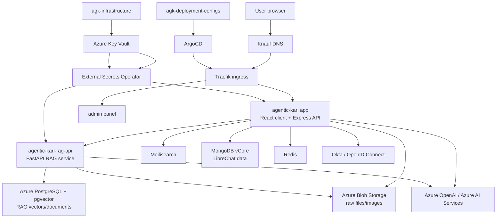
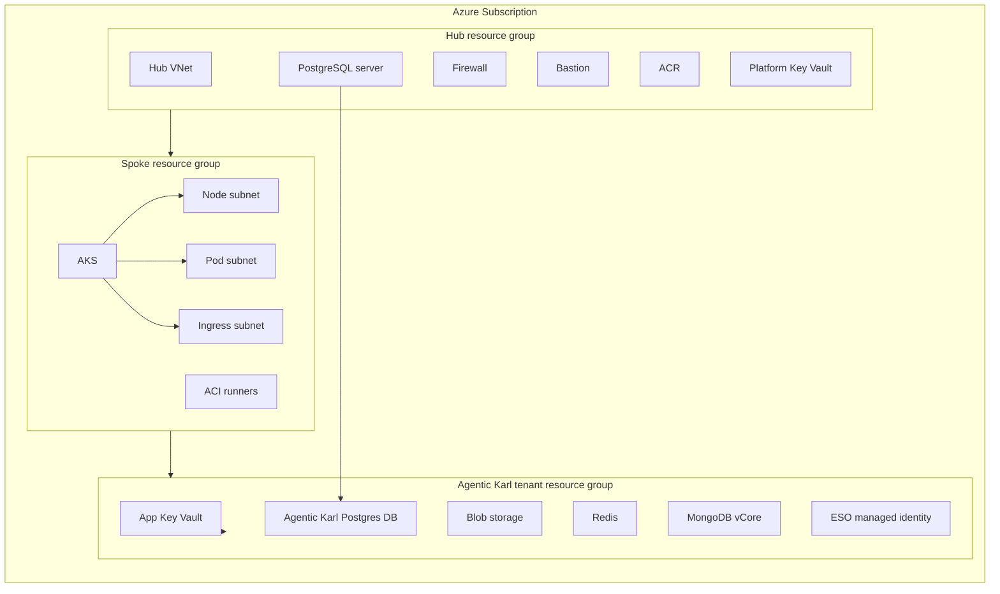
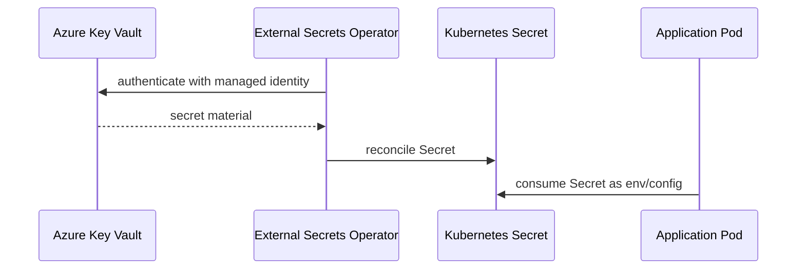
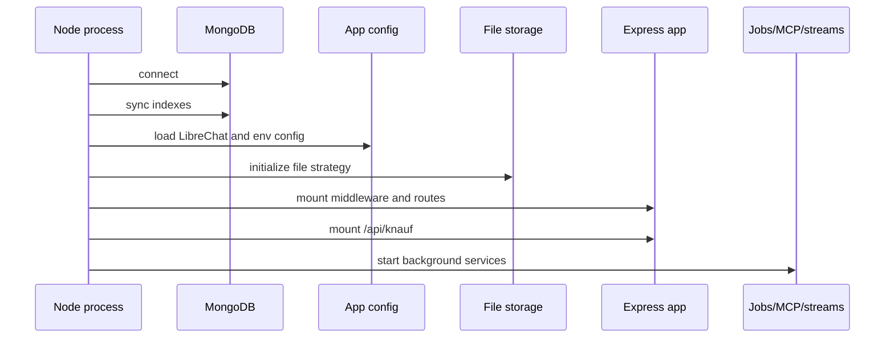
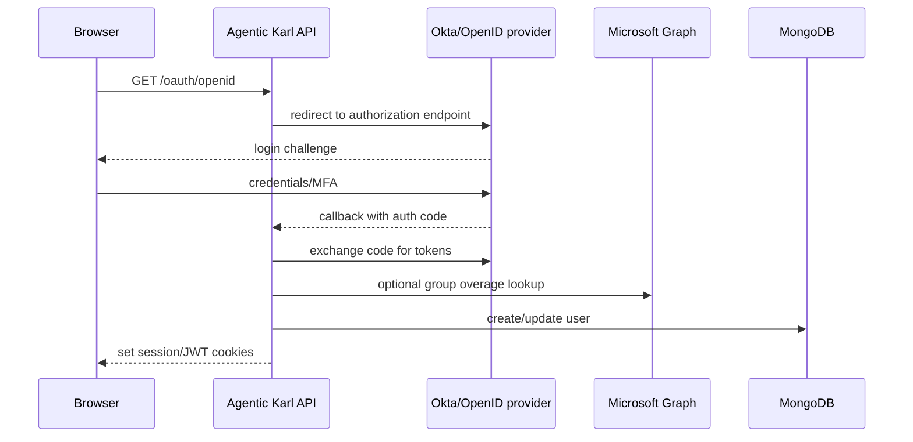
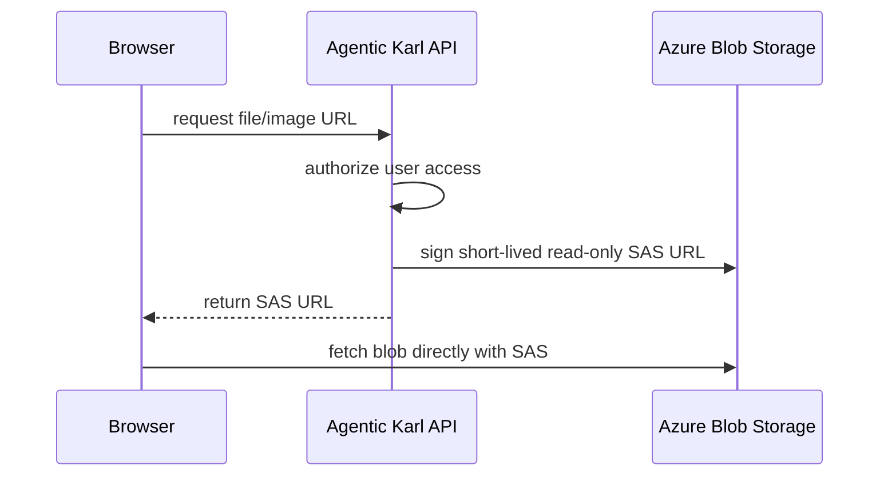
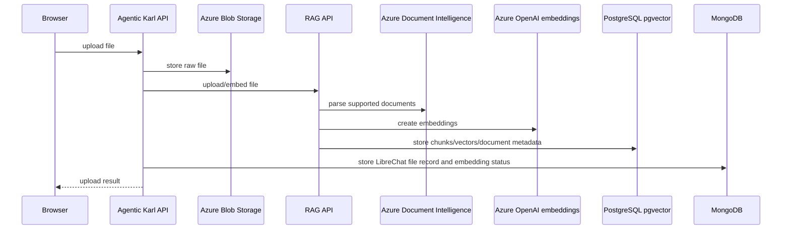
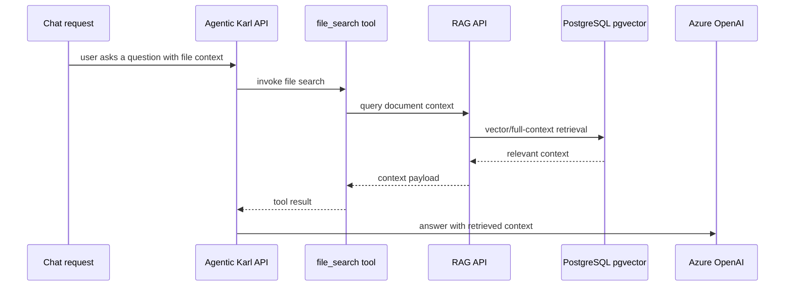
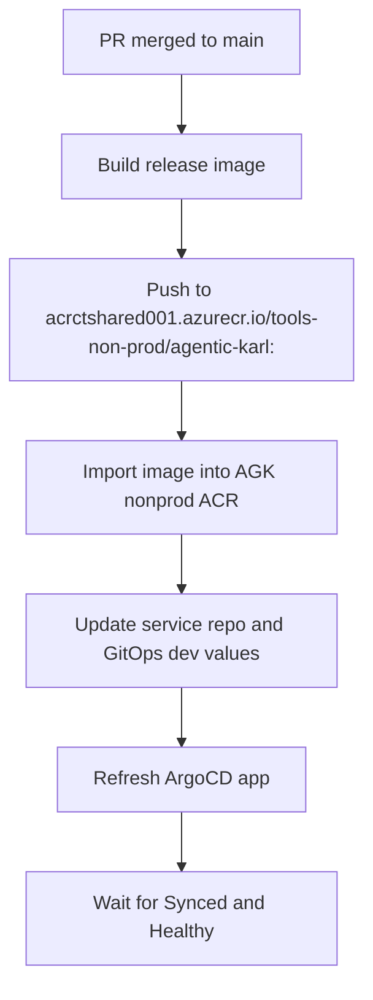
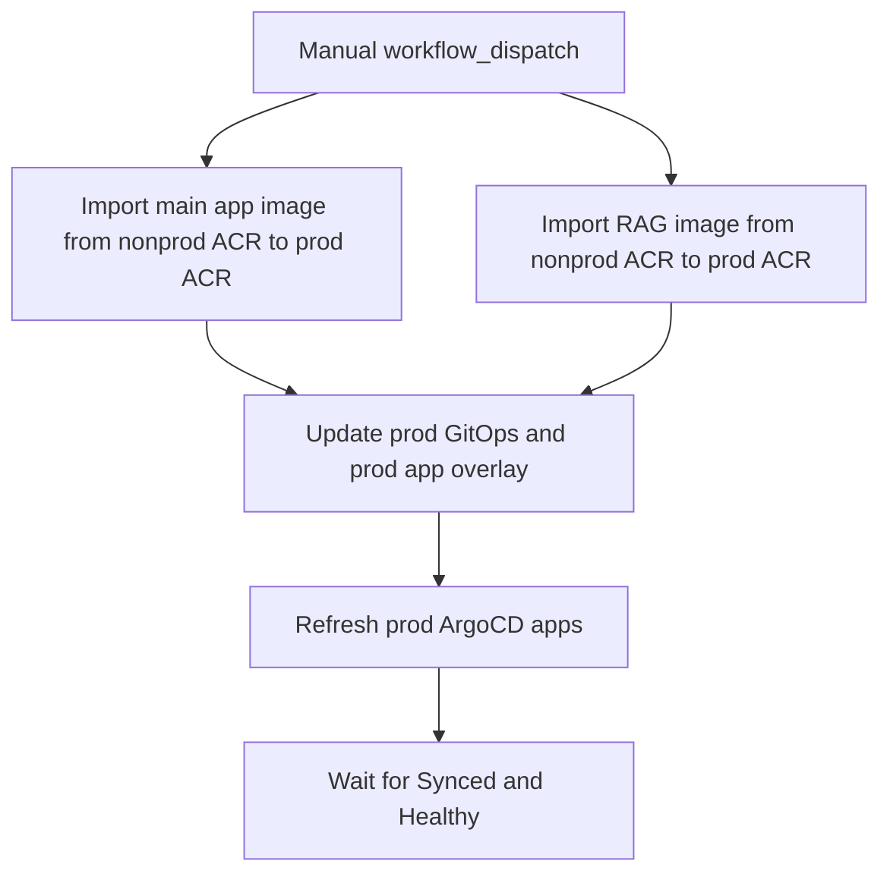

# Agentic Karl Architecture README

Last updated: 2026-06-18

Audience: engineers, platform owners, and technical stakeholders who need to understand how Agentic Karl is wired from infrastructure through application features.

Scope:

- Main application repository: `agentic-karl`
- AGK Terraform repository: `agk-infrastructure`
- AGK GitOps repository: `agk-deployment-configs`
- Legacy CT deployment configuration where it still matters for migration context
- Official LibreChat documentation for upstream behavior

Non-goals:

- This document does not print secret values.
- This document does not replace Terraform state, ArgoCD state, Key Vault, or Helm values as the source of truth.
- This document is an architecture handoff, not a step-by-step production change runbook.

## Executive Summary

Agentic Karl is a Knauf fork of LibreChat deployed on the AGK Azure platform. The user-facing application is a Node/Express API plus React client. It uses MongoDB for core LibreChat data, Redis for caching/session support, Azure Blob Storage for raw files and images, Meilisearch for text search, Azure OpenAI for model inference and image generation, and a separate RAG API backed by Azure PostgreSQL with pgvector for file-search retrieval.

Deployment is GitOps-driven. Application images are built and imported into AGK Azure Container Registries, Helm values live in `agk-deployment-configs`, and ArgoCD reconciles services into AKS namespaces. Terraform in `agk-infrastructure` owns the AGK hub/spoke Azure infrastructure, tenant resources, Key Vaults, databases, storage accounts, managed identities, and workload-identity wiring used by External Secrets Operator.

The application keeps most Knauf-specific code in explicit `knauf/` directories or `[knauf]` seam blocks so the fork can be rebased against upstream LibreChat with a visible manifest in `SEAMS.md`.

## Top-Level System Context

```text
Users
  |
  | Browser
  v
Knauf DNS
  |
  v
Traefik ingress on AGK AKS
  |
  +--> agentic-karl web/API service
  |       |
  |       +--> MongoDB vCore / Cosmos DB for MongoDB API
  |       +--> Redis
  |       +--> Azure Blob Storage
  |       +--> Meilisearch
  |       +--> Azure OpenAI / Azure AI Services
  |       +--> agentic-karl-rag-api
  |       +--> Okta / OpenID Connect
  |
  +--> agentic-karl-admin-panel service
  |
  +--> agentic-karl-rag-api service
  |
  +--> agentic-karl-meilisearch service

Terraform: agk-infrastructure
GitOps:    agk-deployment-configs
App code:  agentic-karl
```



## Repositories And Ownership

| Repository | Role | Important paths |
|---|---|---|
| `agentic-karl` | LibreChat fork and application source. Contains API, client, packages, Helm overlay values, release workflows, Knauf seams, and docs. | `api/`, `client/`, `packages/`, `librechat.yaml`, `infrastructure/`, `.github/workflows/`, `knauf/`, `SEAMS.md` |
| `agk-infrastructure` | Terraform for AGK hub/spoke platform and Agentic Karl tenant resources. | `terraform/subscription/*/base/hub`, `terraform/subscription/*/base/*`, `terraform/subscription/*/tenant/agentic-karl` |
| `agk-deployment-configs` | GitOps source for AGK ArgoCD applications and Helm values. | `agentic-karl/dev/services/*`, `agentic-karl/prod/services/*`, `agentic-karl/*/common-namespace-resources` |
| `ct-shared-deployment-configs` | Legacy CT deployment configuration used for migration context. | Legacy `agentic-karl` app configuration |
| Upstream LibreChat | Upstream application framework, config conventions, agents, files, RAG, Meilisearch behavior. | Official docs at `librechat.ai/docs` |

## Environment Matrix

| Environment | Namespace | Public app URL | Admin URL | AKS cluster | ACR | Key Vault | Subscription |
|---|---|---|---|---|---|---|---|
| Dev / nonprod | `agentic-karl-dev` | `https://agentic-karl.agk.dev.knauf.digital` | `https://agentic-karl-admin.agk.dev.knauf.digital` | `aks-agk-nonprod-001` | `acragkhubnonprod001` | `kv-agntkarl-nonprod-001` | `CT-SHARED-RESOURCES` (`ad3f0a71-cc5b-4d00-8289-23623cf2064c`) |
| Prod | `agentic-karl-prod` | `https://agentic-karl.knauf.com` | `https://agentic-karl-admin.knauf.com` | `aks-agk-prod-001` | `acragkhubprod001` | `kv-agntkarl-prod-001` | `CT-SHARED-RESOURCES-PROD` (`e0515a24-7205-481b-b657-944901020e32`) |
| Legacy CT dev | legacy namespace | `https://agentic-karl.dev.knauf.digital` | n/a | legacy CT shared AKS | `acrctshared001` | legacy CT KV | legacy CT shared platform |

Mainline versions observed from fetched `origin/main`:

| Component | Dev image | Prod image | Tag |
|---|---|---|---|
| Main app | `acragkhubnonprod001.azurecr.io/agentic-karl-dev/agentic-karl` | `acragkhubprod001.azurecr.io/agentic-karl-prod/agentic-karl` | `v0.73.0` |
| RAG API overlay | `acragkhubnonprod001.azurecr.io/agentic-karl-dev/agentic-karl-rag-api` | `acragkhubprod001.azurecr.io/agentic-karl-prod/agentic-karl-rag-api` | `0.1.1` |
| Meilisearch | public image | public image | `getmeili/meilisearch:v1.35.1` |
| Admin panel | `acragkhubnonprod001.azurecr.io/agentic-karl-dev/librechat-admin-panel` | `acragkhubprod001.azurecr.io/agentic-karl-prod/librechat-admin-panel` | `eaba3220a57f51184b8c790220f07a59227b6d1a` |

Current local checkout note:

- The local branch used while preparing this document was `codex/agk-ui-filesearch-review`.
- The branch was behind `origin/main`; deployed-mainline facts in this document use fetched `origin/main` and GitOps `origin/main` values, not stale local branch overlays.

## Infrastructure Topology

AGK uses a hub/spoke Azure layout managed in Terraform.

```text
Subscription
  |
  +-- Hub resource group
  |     +-- Hub virtual network
  |     +-- Azure Firewall
  |     +-- Bastion
  |     +-- Azure Container Registry
  |     +-- Platform Key Vault
  |     +-- PostgreSQL flexible server
  |
  +-- Spoke resource group
  |     +-- AKS cluster
  |     +-- ACI runners
  |     +-- Route tables
  |     +-- Node subnet
  |     +-- Pod subnet
  |     +-- Ingress subnet
  |
  +-- Tenant resource group: Agentic Karl
        +-- App Key Vault
        +-- Blob storage account
        +-- Redis
        +-- MongoDB vCore / Cosmos DB for MongoDB API
        +-- External Secrets managed identity
        +-- App-specific database bindings and secrets
```



### Environment Infrastructure Details

| Area | Dev / nonprod | Prod |
|---|---|---|
| Hub RG | `rg-agk-hub-nonprod-westeurope` | `rg-agk-hub-prod-westeurope` |
| Spoke RG | `rg-agk-nonprod-westeurope` | `rg-agk-prod-westeurope` |
| Tenant RG | `rg-agentic-karl-tenant-nonprod-westeurope` | `rg-agentic-karl-tenant-prod-westeurope` |
| AKS | `aks-agk-nonprod-001` | `aks-agk-prod-001` |
| ACR | `acragkhubnonprod001` | `acragkhubprod001` |
| App Key Vault | `kv-agntkarl-nonprod-001` | `kv-agntkarl-prod-001` |
| Mongo | `cosmos-agk-nonprod-westeurope-001` | `cosmos-agk-prod-westeurope-001` |
| Redis | `redis-agk-nonprod-westeurope-redis-agk-dev-001` | `redis-agk-prod-westeurope-redis-agk-prod-001` |
| Blob storage | `agkblobdevwesteu` | `agkblobprodwesteu` |
| Blob container | `files` | `files` |
| Postgres server | `pgsql-agk-hub-nonprod-westeurope-001.postgres.database.azure.com` | `pgsql-agk-hub-prod-westeurope-001.postgres.database.azure.com` |
| RAG database | `agentic-karl-dev` | `agentic-karl-prod` |
| ESO managed identity | `mi-agentic-karl-dev-westeurope-aks-external-secrets-001` | `mi-agentic-karl-prod-westeurope-aks-external-secrets-001` |

### Networking

AGK AKS uses Azure CNI pod subnet mode.

| Network | Dev / nonprod | Prod |
|---|---|---|
| Spoke CIDR | `10.160.0.0/16` | `10.161.0.0/16` |
| Node subnet | `10.160.0.0/22` | `10.161.0.0/22` |
| Ingress subnet | `10.160.4.0/28` | `10.161.4.0/28` |
| ACI subnet | `10.160.5.0/24` | `10.161.5.0/24` |
| Pod subnet | `10.160.32.0/19` | `10.161.32.0/19` |

Network policies are default-deny with explicit allows for:

- DNS
- Same-namespace service traffic
- Traefik ingress
- Internet egress on 80/443
- Private endpoint traffic such as PostgreSQL, Redis, and platform-specific private CIDRs

## GitOps And Helm Layout

`agk-deployment-configs` is the ArgoCD source of truth for deployed AGK services.

```text
agk-deployment-configs/
  agentic-karl/
    dev/
      common-namespace-resources/
      services/
        agentic-karl/
        agentic-karl-rag-api/
        agentic-karl-meilisearch/
        agentic-karl-admin-panel/
    prod/
      common-namespace-resources/
      services/
        agentic-karl/
        agentic-karl-rag-api/
        agentic-karl-meilisearch/
        agentic-karl-admin-panel/
```

Service ownership:

| Service | Role | Notes |
|---|---|---|
| `agentic-karl` | Main web/API application | Multi-source ArgoCD application: GitOps values plus service repo values |
| `agentic-karl-rag-api` | RAG/vector API | Local GitOps service values; image is built from Knauf overlay |
| `agentic-karl-meilisearch` | Text search index | Local GitOps service values |
| `agentic-karl-admin-panel` | Admin UI | Separate image and ingress |
| `common-namespace-resources` | Shared namespace resources | Service account, SecretStore, External Secrets identity wiring |

### ArgoCD

| Environment | ArgoCD URL | Main app | Namespace |
|---|---|---|---|
| Dev / nonprod | `https://argocd.agk.nonprod.knauf.digital` | `agentic-karl-dev-agentic-karl` | `agentic-karl-dev` |
| Prod | `https://argocd.agk.prod.knauf.digital` | `agentic-karl-prod-agentic-karl` | `agentic-karl-prod` |

### Value Precedence

The main `agentic-karl` app is a multi-source ArgoCD application:

1. GitOps values from `agk-deployment-configs`
2. Service repo values from `agentic-karl/infrastructure/<env>/values.yaml`

The service repo overlay is loaded later, so it can override collisions. RAG API, Meilisearch, and admin panel are local-only GitOps services because they do not use the same service-repo overlay pattern.

## Secrets And Workload Identity

Secrets are stored in Azure Key Vault and projected into Kubernetes through External Secrets Operator.

```text
Azure Key Vault
  |
  | Workload identity
  v
External Secrets Operator
  |
  v
Kubernetes Secret
  |
  v
Pod environment variables / mounted secret values
```



Common secret/config categories:

| Category | Examples | Consumer |
|---|---|---|
| Mongo | `MONGO_URI` | Main app |
| Redis | `REDIS_URI` | Main app |
| Blob storage | `AZURE_STORAGE_CONNECTION_STRING`, `AZURE_STORAGE_ACCOUNT_NAME`, `AZURE_CONTAINER_NAME` | Main app, file services |
| OpenAI / Azure OpenAI | API keys and Azure OpenAI credentials | Main app, RAG API |
| OpenID | `OPENID_CLIENT_SECRET`, `OPENID_SESSION_SECRET` | Main app auth |
| JWT/session | JWT and session signing secrets | Main app |
| Meilisearch | master/API key | Main app, Meilisearch |
| RAG database | Postgres credentials | RAG API |

Known External Secrets workload identity client IDs:

| Environment | Client ID |
|---|---|
| Dev / nonprod | `b573fdae-1009-46d4-8c58-16694e48f65f` |
| Prod | `af3876d3-0183-4213-8877-e66daff78ef2` |

Do not copy secret values into docs, PRs, tickets, or logs.

## Runtime Service Map

| Runtime component | Technology | Primary responsibility | Main dependencies |
|---|---|---|---|
| React client | Vite/React/TypeScript | Browser UI, chat, agents, files, branding, analytics consent | Main API, startup config, user auth state |
| Express API | Node.js/Express | Auth, conversation APIs, files, agents, config, OpenAI/Azure OpenAI calls, Knauf routes | Mongo, Redis, Blob, RAG API, Meilisearch, OpenID, Azure OpenAI |
| RAG API | FastAPI/Python | Document ingestion, parsing, embeddings, vector search, document context | PostgreSQL/pgvector, Azure OpenAI embeddings, Azure Document Intelligence |
| Meilisearch | Meilisearch | Text search for conversations/messages | Main app, Meili master key |
| Admin panel | Separate web app | Administrative UI | Main API, SSO |
| MongoDB vCore | Cosmos DB for MongoDB API | LibreChat persistent data | Main API |
| Redis | Azure Cache for Redis | Cache/session/rate-limit support depending on app config | Main API |
| Azure Blob Storage | Azure Storage | Private raw file/image/avatar storage | Main API, browser via SAS |
| Azure PostgreSQL | Flexible Server + pgvector | RAG documents/vectors | RAG API |
| Azure OpenAI | Azure OpenAI | Chat, embeddings, image generation | Main API, RAG API |
| Azure AI Services | Azure Document Intelligence endpoint | Document parsing for selected file types | RAG API overlay |
| Okta / OpenID Connect | Identity provider | Login and group/role checks | Main API |

## Application Source Layout

The application is a LibreChat monorepo.

```text
agentic-karl/
  api/
    server/
      index.js
      routes/
      services/
      knauf/
    app/
      clients/
      services/
  client/
    src/
      main.jsx
      App.jsx
      routes/
      knauf/
  packages/
    api/
    data-provider/
    data-schemas/
  librechat.yaml
  infrastructure/
  knauf/
  SEAMS.md
```

### Backend Boot Sequence

Primary entrypoint: `api/server/index.js`.

High-level startup flow:

```text
start process
  |
  +-- connect to Mongo
  +-- run index synchronization
  +-- load app configuration
  +-- initialize file storage strategy
  +-- initialize Express middleware
  +-- mount API routes
  +-- mount Knauf routes under /api/knauf
  +-- serve client assets
  +-- start server
  +-- start MCP/migrations/stream/job services as configured
```



Core route families:

| Route family | Purpose |
|---|---|
| `/oauth` | OpenID/OAuth login and callbacks |
| `/api/auth` | Auth/session endpoints |
| `/api/admin/*` | Admin APIs |
| `/api/actions` | Action handling |
| `/api/keys` | User/provider key handling |
| `/api/user` | User profile/settings |
| `/api/search` | Search APIs |
| `/api/messages` | Message APIs |
| `/api/convos` | Conversation APIs |
| `/api/prompts` | Prompt APIs |
| `/api/endpoints` | Endpoint/model metadata |
| `/api/models` | Model metadata |
| `/api/config` | Startup config |
| `/api/assistants` | Assistants APIs |
| `/api/files` | File upload/retrieval/deletion |
| `/images` | Image serving/proxy paths |
| `/api/share` | Shared conversation APIs |
| `/api/agents` | Agent APIs |
| `/api/mcp` | MCP integration APIs |
| `/api/knauf` | Knauf-owned extension routes |

### Frontend Boot Sequence

Primary entrypoints:

- `client/src/main.jsx`
- `client/src/App.jsx`
- `client/src/routes/index.tsx`
- `client/src/routes/Root.tsx`

High-level flow:

```text
browser loads app
  |
  +-- React root mounts
  +-- startup config is fetched from API
  +-- auth/user state is resolved
  +-- routes render inside Root
  +-- chat, agents, files, marketplace, and settings mount as allowed by config/permissions
  +-- Knauf top bar, branding, analytics, legal pages, and simplified agent builder overlay upstream UI
```

### Knauf Application Overlay

Knauf-specific code is intentionally isolated where practical.

| Area | Path | Responsibility |
|---|---|---|
| Client overlay | `client/src/knauf` | Top bar, branding/legal pages, analytics consent, simplified agent builder, model selector, image-generation controls, pending-file drain |
| API overlay | `api/server/routes/knauf` | Analytics diagnostics/config and prompt autogeneration |
| API helpers | `api/server/knauf` | Model-spec compatibility helpers |
| Shared permission policy | `packages/api/src/knauf/permissions/userRestrictions.ts` | Role and permission restriction policy |
| RAG overlay | `knauf/rag-api-overlay` | Docker/Python overlay for parsing and logging behavior |
| Docs/reference | `knauf/docs` | Knauf-owned design, reference, and planning docs |
| Seam manifest | `SEAMS.md` | Inventory of upstream seam blocks and net-new Knauf files |

## Authentication And Authorization

Authentication uses OpenID Connect through the backend OAuth routes.

Primary files:

- `api/server/routes/oauth.js`
- `api/strategies/openidStrategy.js`

Flow:

```text
User clicks login
  |
  v
/oauth/openid
  |
  v
OpenID provider
  |
  v
/oauth/openid/callback
  |
  +-- validate identity
  +-- map email claims
  +-- enforce allowed domains if configured
  +-- enforce required/admin role checks if configured
  +-- resolve group overage through Microsoft Graph OBO when needed
  +-- optionally store profile image
  +-- issue app session/JWT cookies
```



Authorization layers:

| Layer | Responsibility |
|---|---|
| OpenID allowed domains | Restrict login to approved email domains |
| Required role/group checks | Restrict app access to configured IdP groups/roles |
| Admin role checks | Assign or restrict admin capabilities |
| Knauf user restrictions | Disable or limit risky user permissions in production |
| Agent and file ACLs | Enforce per-user access to agents, files, and conversations |

Important production controls:

- `KNAUF_RESTRICT_USER_PERMISSIONS`
- `KNAUF_RESTRICT_PROD_USER_PERMISSIONS`
- `KNAUF_DISABLE_FIRST_USER_ADMIN`

OpenID client IDs, issuer URLs, and callback domains live in GitOps/service values. Client secrets and session secrets live in Key Vault.

## Model And AI Configuration

Primary config file: `librechat.yaml`.

Key runtime behavior:

- `fileStrategy: "azure_blob"`
- Tools include `image_gen_oai` and `calculator`
- Memory is enabled with MongoDB
- Azure OpenAI endpoint group: `cst-karl-dev`
- Azure OpenAI API version: `2025-01-01-preview`
- Main UI model alias: `gpt-5.4`
- Azure deployment mapping: `gpt-5.4` -> `gpt-54`
- Additional model: `gpt-4o`
- Responses API enabled for the default Karl model spec
- `web_search: true` passed through endpoint add params
- Temperature/top-p and similar params are dropped where incompatible with Responses API/model behavior

Model specs:

| Model spec | Endpoint | Model | Purpose |
|---|---|---|---|
| `karl` | `azureOpenAI` | `gpt-5.4` | Default Karl chat experience with Knauf prompt |
| `karl-personality-precise` | `azureOpenAI` | `gpt-5.4` | Precise personality preset |
| `karl-personality-balanced` | `azureOpenAI` | `gpt-5.4` | Balanced personality preset |
| `karl-personality-creative` | `azureOpenAI` | `gpt-5.4` | Creative personality preset |
| `karl-autogenerate-prompt` | `azureOpenAI` | `gpt-4o` | Internal prompt autogeneration helper |

Azure AI shared account:

| Item | Value |
|---|---|
| Subscription | `CT-SHARED-RESOURCES-PROD` (`e0515a24-7205-481b-b657-944901020e32`) |
| Resource group | `rg-ct-sharedprod-westeurope` |
| Account | `cst-karl-dev` |
| Region | `swedencentral` |
| OpenAI endpoint | `https://cst-karl-dev.openai.azure.com/` |
| AI Services endpoint | `https://cst-karl-dev.services.ai.azure.com/` |

Known deployment roles:

| Deployment | Role |
|---|---|
| `gpt-54` | Primary chat model deployment for `gpt-5.4` |
| `gpt-5` | Additional GPT-5 family deployment |
| `gpt-4o` | Prompt-generation and compatibility workloads |
| `text-embedding-3-large` | RAG embeddings |
| `gpt-image-1` | Image generation |

## File Storage And Azure Blob

The main app uses Azure Blob Storage for raw file, image, and avatar storage.

Primary implementation:

- `api/server/services/Files/Azure/crud.js`
- `librechat.yaml` with `fileStrategy: "azure_blob"`

Behavior:

- Blobs are private by default.
- Browser access uses short-lived read-only SAS URLs.
- SAS expiry defaults are short; GitOps currently uses `AZURE_URL_EXPIRY_SECONDS=600`.
- The app can sign SAS URLs with account-key credentials or Managed Identity/User Delegation SAS support depending on environment.
- SAS URLs are HTTPS-only and read-only.
- Expired URLs are refreshed by the backend when requested through authorized app flows.



Important environment values:

| Variable | Purpose |
|---|---|
| `AZURE_STORAGE_CONNECTION_STRING` | Storage account connection string path |
| `AZURE_STORAGE_ACCOUNT_NAME` | Storage account name for identity-based flows |
| `AZURE_CONTAINER_NAME` | Blob container, usually `files` |
| `AZURE_STORAGE_PUBLIC_ACCESS` | Should remain false for private blobs |
| `AZURE_URL_EXPIRY_SECONDS` | SAS URL lifetime |

## RAG And File Search

Agentic Karl uses dual storage for uploaded files:

1. Store the raw file in the app file store, currently Azure Blob Storage.
2. Send the content to the RAG API for parsing, embeddings, and vector storage.

Primary app files:

- `api/server/services/Files/process.js`
- `api/server/services/Files/VectorDB/crud.js`
- `api/app/clients/tools/util/fileSearch.js`

Primary overlay:

- `knauf/rag-api-overlay/Dockerfile.knauf-rag`
- `knauf/rag-api-overlay/document_loader.py`
- `knauf/rag-api-overlay/VERSION`

High-level ingestion:



High-level retrieval:



RAG API behavior:

| Endpoint / behavior | Purpose |
|---|---|
| `/health` | Health probe |
| `/ids` | ID lookup/listing |
| `/documents` | Document operations |
| `/documents/{id}/context` | Document context retrieval |
| `/embed` | Embedding endpoint |
| `/embed-upload` | Upload and embed endpoint |
| `/query` | Query one collection/document context |
| `/query_multiple` | Query multiple contexts |
| `/evaluate` | Evaluation endpoint |

Current GitOps values:

| Setting | Dev / nonprod | Prod |
|---|---|---|
| Internal URL from app | `http://agentic-karl-rag-api` | `http://agentic-karl-rag-api` |
| Postgres host | `pgsql-agk-hub-nonprod-westeurope-001.postgres.database.azure.com` | `pgsql-agk-hub-prod-westeurope-001.postgres.database.azure.com` |
| Embedding model | `text-embedding-3-large` | `text-embedding-3-large` |
| Azure OpenAI base URL | `https://cst-karl-dev.openai.azure.com/openai/v1` | `https://cst-karl-dev.openai.azure.com/openai/v1` |
| Azure DI endpoint | `https://cst-karl-dev.services.ai.azure.com/` | `https://cst-karl-dev.services.ai.azure.com/` |

Important distinction:

- Meilisearch is not the vector store.
- RAG vectors and document context live behind the RAG API and PostgreSQL/pgvector.
- Meilisearch indexes text search for app data such as conversations/messages.

### RAG Overlay Parsing

The Knauf RAG overlay extends upstream RAG behavior without importing the overlay into the main app.

Overlay responsibilities:

- Use Azure Document Intelligence for configured extensions such as PDF, DOCX, PPTX, and HTML.
- Fall back to the upstream loader where appropriate.
- Provide a lean native XLSX loader with max-character and summary settings.
- Add logging behavior through the overlay shim.
- Keep the overlay version in `knauf/rag-api-overlay/VERSION`.

## Meilisearch

Meilisearch supports application search, not RAG vector retrieval.

| Setting | Value |
|---|---|
| Image | `getmeili/meilisearch:v1.35.1` |
| Internal host from app | `http://agentic-karl-meilisearch` |
| Service port | 80 forwarding to container port 7700 |
| Secret | Meili master/API key from Key Vault |

## Admin Panel

The admin panel is deployed as a separate service.

| Item | Dev / nonprod | Prod |
|---|---|---|
| Service | `agentic-karl-admin-panel` | `agentic-karl-admin-panel` |
| Public URL | `https://agentic-karl-admin.agk.dev.knauf.digital` | `https://agentic-karl-admin.knauf.com` |
| Internal API URL | `http://agentic-karl` | `http://agentic-karl` |
| Public app API base | Main app public host | Main app public host |
| Auth | SSO only | SSO only |

The admin panel is intentionally separated from the main app so it can have its own ingress, image, and deployment lifecycle while still talking to the main app API.

## Release And Promotion Flow

### Main App Release To Dev

Workflow: `.github/workflows/release_pipeline.yaml`



Dev release steps:

1. A merged PR to `main` triggers the release workflow.
2. The workflow publishes the image to the CT shared release registry.
3. `deploy-agk-dev` imports the same tag into `acragkhubnonprod001`.
4. The workflow updates `agentic-karl/infrastructure/dev/values.yaml` and GitOps dev values.
5. ArgoCD is refreshed and the workflow waits for `Synced` and `Healthy`.

### Smoke Workflow

Workflow: `.github/workflows/agk-deploy-smoke.yaml`

Purpose:

- Validate Azure login.
- Validate Key Vault reads.
- Validate GitHub writes.
- Validate ACR import/delete permissions.
- Validate deployment-config repo writes.
- Validate ArgoCD API read access.

It should not change production release tags.

### Promote Dev To Prod

Workflow: `.github/workflows/promote_pipeline.yaml`



Promotion imports both the main app and RAG API images from nonprod ACR to prod ACR, updates prod values, refreshes prod ArgoCD, and waits for healthy reconciliation.

### RAG Overlay Build

Workflow: `.github/workflows/build-rag-api-overlay.yaml`

The RAG overlay image is built with `az acr build`. Its tag comes from `knauf/rag-api-overlay/VERSION` unless an explicit workflow input overrides it.

## Feature Wiring

| Feature | Frontend area | Backend/config area | External dependencies |
|---|---|---|---|
| Chat | `client/src` upstream chat surfaces plus Knauf chrome | Express chat/message/conversation routes, Azure OpenAI config | Azure OpenAI, Mongo, Redis |
| Karl default model | model selector and model specs | `librechat.yaml`, model-spec helpers | Azure OpenAI deployment `gpt-54` |
| Custom agents | agent builder and Knauf simplified builder | `/api/agents`, `packages/api` agent logic | Mongo, files, tool config |
| File upload | file picker/upload UI | `/api/files`, file processing service | Azure Blob, RAG API, Mongo |
| File search | agent/tool UI and file-search tool | VectorDB CRUD, RAG query utility | RAG API, PostgreSQL/pgvector, Azure OpenAI embeddings |
| Image generation | Knauf image-generation chip/tools | OpenAI image tool wiring | Azure OpenAI deployment `gpt-image-1` |
| Search | app search UI | `/api/search` | Meilisearch, Mongo |
| Auth | login/logout and auth-aware routes | OAuth/OpenID strategy | Okta/OpenID, Microsoft Graph for group overage |
| Admin | separate admin panel | admin APIs | Main app API, SSO |
| Analytics/consent | `client/src/knauf/analytics` | `/api/knauf` analytics config/diagnostics | Configured analytics provider, browser consent |
| Legal/branding | `client/src/knauf/components/Public`, branding tests | startup config/footer defaults | Main API config |

## Code-Level Dependency Boundaries

The fork-management rule is: keep Knauf changes explicit and reviewable.

Patterns used:

- Prefer Knauf-owned files under `knauf/`, `client/src/knauf`, `api/server/routes/knauf`, `api/server/knauf`, or `packages/api/src/knauf`.
- When an upstream file must change, mark the block with `[knauf]` comments.
- Keep `SEAMS.md` updated for upstream seam blocks and net-new Knauf files.
- Reuse upstream APIs and components rather than reimplementing behavior unless a Knauf-owned boundary is clearer.
- Use docs in `knauf/docs/reference` to explain architectural decisions that would otherwise be hidden in Helm values or workflows.

Important source-of-truth files:

| File/path | Purpose |
|---|---|
| `SEAMS.md` | Full seam manifest |
| `librechat.yaml` | Core LibreChat application config |
| `api/server/index.js` | Backend boot and route mounting |
| `api/server/routes/oauth.js` | OAuth route wiring |
| `api/strategies/openidStrategy.js` | OpenID strategy behavior |
| `api/server/services/Files/process.js` | File processing pipeline |
| `api/server/services/Files/Azure/crud.js` | Azure Blob file storage |
| `api/server/services/Files/VectorDB/crud.js` | RAG/vector upload integration |
| `api/app/clients/tools/util/fileSearch.js` | Runtime file-search tool |
| `client/src/knauf` | Knauf UI layer |
| `api/server/routes/knauf` | Knauf API layer |
| `packages/api/src/knauf/permissions/userRestrictions.ts` | Knauf permission restrictions |
| `knauf/rag-api-overlay` | RAG API overlay |
| `.github/workflows/release_pipeline.yaml` | Main release to dev |
| `.github/workflows/promote_pipeline.yaml` | Dev-to-prod promotion |
| `.github/workflows/build-rag-api-overlay.yaml` | RAG overlay build |

## Operational Checks

Use these checks to orient quickly without changing production state.

```text
# App repo
git status --short
git rev-list --left-right --count origin/main...HEAD
node knauf/scripts/seams.js diff-check
node knauf/scripts/seams.js check

# GitOps repo
git -C /Users/ZaharA/knauf/agk-deployment-configs status --short
git -C /Users/ZaharA/knauf/agk-deployment-configs fetch origin main

# Infrastructure repo
git -C /Users/ZaharA/knauf/agk-infrastructure status --short
git -C /Users/ZaharA/knauf/agk-infrastructure fetch origin main

# Azure account orientation
az account show --query '{name:name,id:id,tenantId:tenantId,user:user.name}' -o table
```

When using Azure CLI, verify the subscription before reading or changing resources. The same tenant contains nonprod and prod subscriptions, and names are similar enough that accidental cross-environment work is a real risk.

## Common Failure Points

| Symptom | Likely area to inspect |
|---|---|
| App deploy is healthy but model calls fail | Azure OpenAI env values, Key Vault secret projection, endpoint/model deployment names, `librechat.yaml` |
| Login works for some users but not others | OpenID allowed domains, required role/group config, group overage lookup, admin role mapping |
| File uploads succeed but file search returns nothing | RAG API health, RAG API DB connection, embedding model/key, file embedding status in Mongo |
| File links expire | SAS expiry and refresh path, Azure Blob signing mode, storage account credentials/identity |
| Conversation search fails | Meilisearch service, host env, key secret, indexing jobs |
| RAG parses PDFs poorly | RAG overlay version, Azure Document Intelligence endpoint/key, supported extension config |
| Prod behavior differs from dev | GitOps values, service repo overlay precedence, Key Vault secret drift, promotion workflow state |
| User permissions differ after deploy | Knauf restriction env flags and startup permission payload |

## Shareable Mental Model

```text
Terraform creates Azure platform and tenant resources.
  |
  v
Key Vault stores secrets; workload identity lets ESO project them to AKS.
  |
  v
GitOps values describe Kubernetes services, images, ingress, env, and secrets.
  |
  v
ArgoCD reconciles those values into AKS namespaces.
  |
  v
The main app serves React and Express APIs.
  |
  +-- Mongo stores app data.
  +-- Redis supports runtime cache/session behavior.
  +-- Blob stores private raw files/images.
  +-- RAG API + Postgres/pgvector power file search.
  +-- Meilisearch powers app text search.
  +-- Azure OpenAI powers chat, embeddings, and image generation.
  +-- OpenID provider powers login and role checks.
```

## Source References

Local source references:

- `agentic-karl/SEAMS.md`
- `agentic-karl/librechat.yaml`
- `agentic-karl/api/server/index.js`
- `agentic-karl/api/server/routes/oauth.js`
- `agentic-karl/api/strategies/openidStrategy.js`
- `agentic-karl/api/server/services/Files/process.js`
- `agentic-karl/api/server/services/Files/Azure/crud.js`
- `agentic-karl/api/server/services/Files/VectorDB/crud.js`
- `agentic-karl/api/app/clients/tools/util/fileSearch.js`
- `agentic-karl/client/src/knauf`
- `agentic-karl/api/server/routes/knauf`
- `agentic-karl/packages/api/src/knauf/permissions/userRestrictions.ts`
- `agentic-karl/knauf/rag-api-overlay`
- `agentic-karl/.github/workflows/release_pipeline.yaml`
- `agentic-karl/.github/workflows/promote_pipeline.yaml`
- `agentic-karl/.github/workflows/agk-deploy-smoke.yaml`
- `agentic-karl/.github/workflows/build-rag-api-overlay.yaml`
- `agk-infrastructure/terraform/subscription`
- `agk-deployment-configs/agentic-karl`

Official LibreChat references:

- [LibreChat YAML configuration](https://www.librechat.ai/docs/configuration/librechat_yaml)
- [RAG API configuration](https://www.librechat.ai/docs/configuration/rag_api)
- [Meilisearch configuration](https://www.librechat.ai/docs/configuration/meilisearch)
- [Agents object structure](https://www.librechat.ai/docs/configuration/librechat_yaml/object_structure/agents)
- [File configuration](https://www.librechat.ai/docs/configuration/librechat_yaml/object_structure/file_config)
