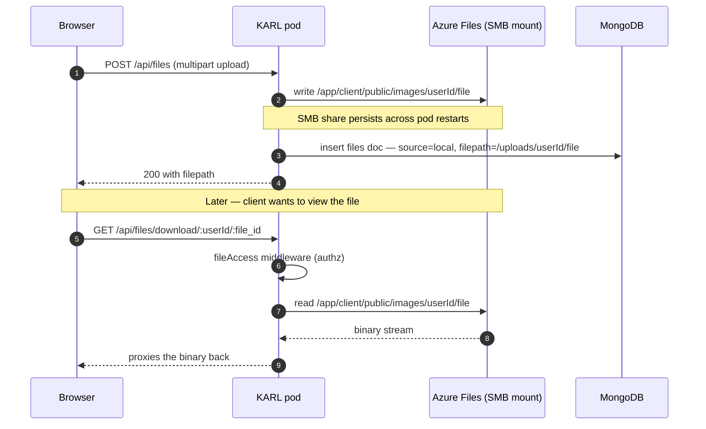
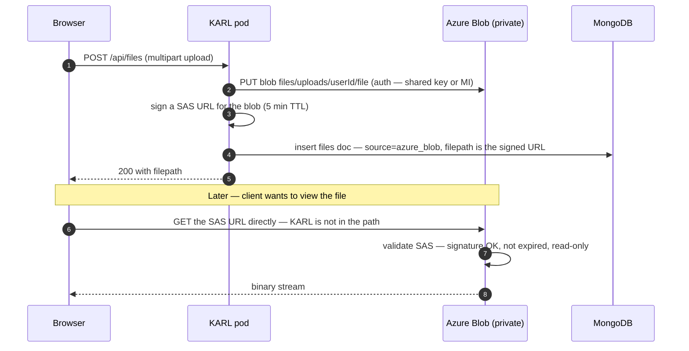
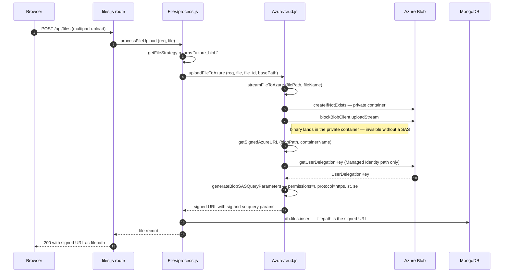
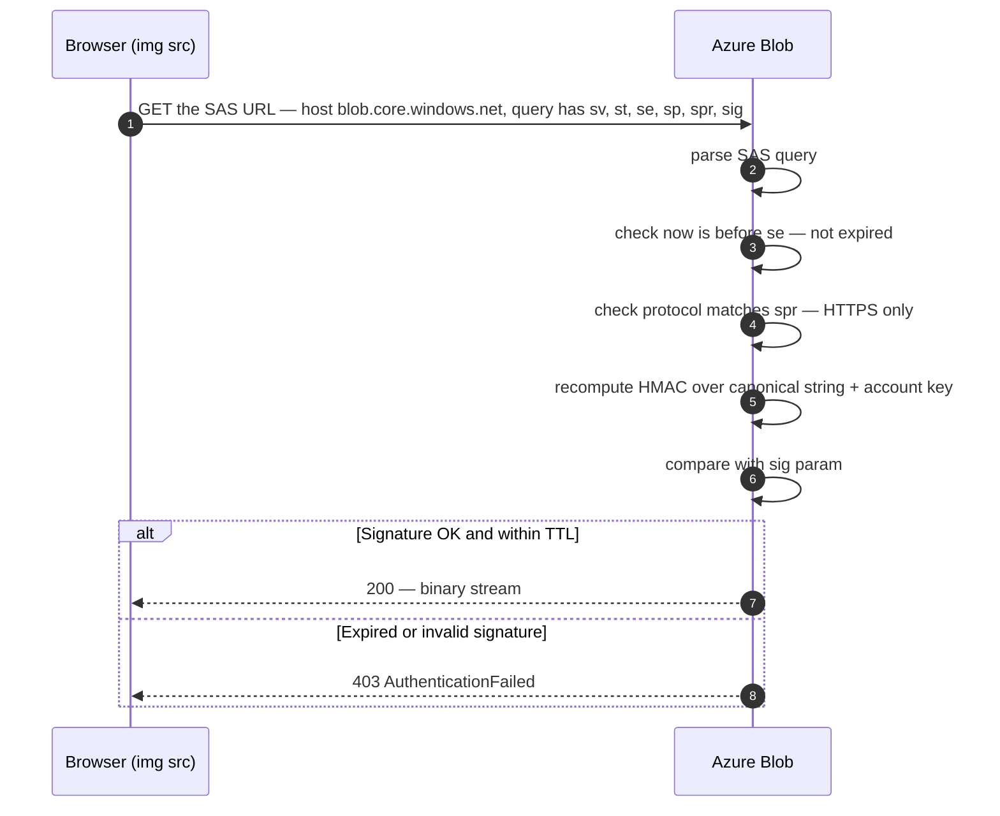
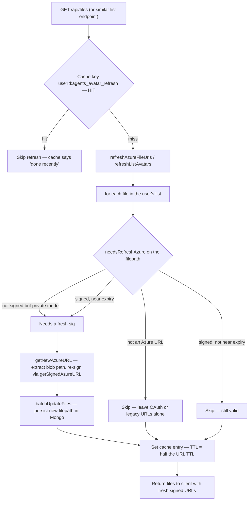
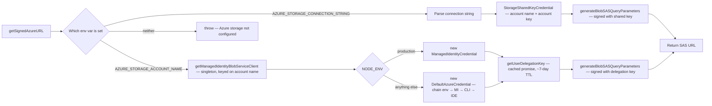
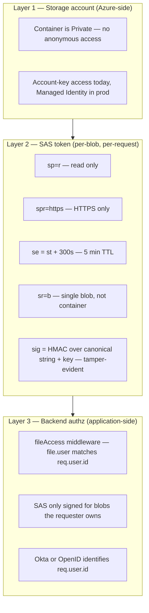

# Azure Blob Storage — flows, concepts & diagrams

Stable how-it-works reference for how KARL stores and serves user files via Azure Blob Storage with **SAS-signed URLs**. Covers what's running today, what it replaced, and the concepts (SAS, TTL, caching) you need to reason about it.

> Companion docs: rollout status + still-pending workstreams live in [`../implementation-plans/azure-blob-and-private-files.md`](../implementation-plans/azure-blob-and-private-files.md). This doc is the *architecture*; that doc is the *plan*.

---

## 1. The 30-second version

- Files (avatars, image attachments, file_search PDFs, etc.) live in a **private** Azure Blob Storage container.
- The backend never proxies the binary. It hands the client a **SAS URL** — a normal `https://…/blob` URL with a signed query string proving the client is allowed to read this one blob for the next 5 minutes.
- The client fetches the binary **directly from Azure**, not from KARL's pods.
- The signed URL is **stored in MongoDB** alongside the file's other metadata.
- When the URL is about to expire, the backend **refreshes** it (re-signs the same blob path with a fresh expiry) and writes it back.

Why this shape:

- **No persistent disk on the pod** — KARL runs on AKS, pods are ephemeral, multi-replica. Local files vanish on restart and don't cross replicas.
- **No public container** — Knauf compliance requires private storage. Plain blob URLs don't work; you need a signed credential per request.
- **No backend bandwidth burning** — proxying the binary through the backend means 1× ingress + 1× egress on every file view. Direct fetch from Azure offloads it.

---

## 2. Before vs. after — the same upload, two architectures

### Before: `fileStrategy: "local"` + SMB-mounted persistent share



What hurts:
- Every read costs the backend 1× ingress (from SMB) + 1× egress (to client). Bandwidth scales with viewers, not uploads.
- SMB share = single shared storage account, single network endpoint. Per-user isolation doesn't exist at the storage layer.
- Without the SMB share, pods can't see each other's uploads. With it, you've reintroduced shared-state coupling.

### After: `fileStrategy: "azure_blob"` + SAS URLs



What changes:
- Read traffic skips KARL entirely. Bandwidth is between client and Azure.
- The container is **private** — no anonymous reads. The SAS in the URL is the access token.
- The URL is a normal HTTPS link the browser handles natively (`` works, downloads work, no special client code).

---

## 3. SAS URL anatomy — what each part does

```
https://karlblob.blob.core.windows.net/files/uploads/<userId>/<file_id>__name.pdf
       └──────────────────┬───────────┘└──┬─┘└──────────┬────────────────────┘
            account host       container       blob path (the resource)

  ?sv=2023-11-03            ← SAS spec version (cryptographic schema)
  &spr=https                ← Protocol restriction — HTTPS only, no HTTP replay
  &st=2026-05-22T10%3A00%3A00Z  ← Signed start time (when the URL becomes valid)
  &se=2026-05-22T10%3A05%3A00Z  ← Signed expiry  (when it stops working) — the TTL
  &sr=b                     ← Resource scope: b = single blob (not container)
  &sp=r                     ← Permissions: r = read only (no write, no delete)
  &sig=YMq7nGKap…           ← HMAC signature over all of the above + the blob path
```

Three security properties built into the URL:

| Property | Mechanism | What it gives you |
|---|---|---|
| **Authenticity** | `sig` — HMAC-SHA256 of the canonical string, keyed by the storage account key (or a User Delegation Key derived from Managed Identity). | Can't forge a SAS without the key. Tamper any other param → signature breaks → Azure refuses. |
| **Time-bounded** | `st`/`se` checked server-side. | A leaked URL only works until `se`. Default TTL = **5 minutes** in our setup. |
| **Least privilege** | `sp=r` + `sr=b`. | Compromise of one URL only lets the holder **read** that **one blob**. No list, no write, no delete, no other blobs. |

`spr=https` is the "must come over HTTPS" tag — without it, a TLS-stripping attacker could replay the URL over HTTP. We force it on every signed URL.

---

## 4. Upload flow — what actually happens in code



Key steps the diagram glosses over:

- **`createIfNotExists({ access: undefined })`** — `undefined` here means "create as private, no anonymous access". In dev with `AZURE_STORAGE_PUBLIC_ACCESS=true` we'd pass `"blob"` instead. The default is `false` so a missing env var doesn't create a public container.
- **`getUserDelegationKey`** is called on the Managed Identity path only. The key is cached as a **promise** (not the resolved value) — N concurrent first-callers all await the same in-flight fetch instead of each firing their own AAD round-trip. Cached for ~7 days minus a 5-minute renewal buffer.
- **`generateBlobSASQueryParameters`** is pure local crypto. No network call. The key here is the User Delegation Key (MI) or `StorageSharedKeyCredential` (Account Key).

---

## 5. Image fetch — yes, it's a signed URL

**The browser fetches the blob directly from Azure using the SAS URL.** KARL is not in the path on the read. The SAS URL is just a normal `https://…` link.



Practical implications:

- **``** in the UI works zero-effort. No special fetch code.
- **Once leaked, can't be revoked** until `se`. That's why TTL is **short** (5 min) — leaked URLs decay fast.
- **Doesn't go through `req.user`** — Azure has no idea who the user is. Per-user authorization is enforced at signing time (`fileAccess` middleware on KARL's backend), not at fetch time.

---

## 6. Why URLs need to be **cached** (in MongoDB)

You might ask: *why store the SAS URL in MongoDB instead of regenerating one every time someone asks for the file?*

Two reasons:

1. **Cost on hot paths.** Listing 50 files in `/api/files` would cost 50 signing operations on every page-load. Signing is cheap but not free — especially in Managed Identity mode where the User Delegation Key may need refreshing.
2. **Stable URL across page loads.** A `` rendered on the page benefits from browser-level URL caching. If the URL changed every request, the browser would treat each render as a new image and re-fetch.

So we store the signed URL with the file's metadata. But — SAS URLs **expire**. After 5 minutes the stored URL is dead. We need a way to refresh it without re-signing on every request.

That's the **refresh chain**.

---

## 7. The refresh chain — `needsRefresh*` + `getNew*URL` + `refresh*FileUrls`



Three knobs hold this together:

- **`needsRefresh*` returns `false` for URLs we don't own.** Without this, a Google OAuth avatar URL would trigger a refresh attempt, `getNewAzureURL` would return `undefined`, and we'd persist `undefined` over the working avatar. Mirrors S3's `X-Amz-Signature` host-check.
- **`needsRefresh*` returns `true` for plain Azure URLs in private mode.** This is the "legacy transition" case — pre-fix URLs without `sig` need signing on first list.
- **The per-user cache short-circuits all of this.** If we refreshed this user's files in the last 2.5 minutes, don't iterate them again.

---

## 8. TTL math — why URL TTL ≠ cache TTL

Three timers, all related, easy to confuse:

```
─────── time ─────────────────────────────────────────────────────►

         ┌─────────────────────────────────────────────┐
URL TTL: │ st                                       se │  ← 5 min (default)
         └──────────────────────┬──────────────────────┘
                                │  bufferSeconds = 3600s
                                │  "if URL expires within an hour, refresh it"
                                ▼
         ┌───────────────────┐                              ← (effectively "always refresh"
Refresh  │ refresh window    │                                because 1 hour > 5-min URL TTL,
buffer:  └───────────────────┘                                so cache entry expires first)

         ┌────────────┐
Cache    │ cache TTL  │  ← 2.5 min  (= URL TTL / 2)
entry:   └─┬──────────┘
           │
           ▼
       After cache TTL expires, next `/api/files` call re-runs the refresh chain.
```

The invariant we need to hold: **cache TTL ≤ URL TTL / 2**.

Why halve it: if the cache TTL equalled the URL TTL, then in the worst case a URL signed at T=0 (expires T=5min) could be re-cached at T=4:59 (cache hit returns "skip refresh"). At T=5:01 the URL has expired but the cache entry is still alive until T=4:59+5min = T=9:59. Result: ~5 minutes of serving expired URLs.

Halving guarantees that when the cache says "you refreshed recently", the URLs covered by that cache entry have at least half their TTL still left. The minimum floor is 1 minute (prevents pathological rapid re-refreshes when someone sets `AZURE_URL_EXPIRY_SECONDS` very low).

This is what `getFileURLRefreshCacheTime(strategy)` does — pick the cache TTL = `Math.max(urlTTL_ms / 2, ONE_MINUTE)`.

> **The bug we just fixed**: the agent-list cache was hardcoded to **30 minutes** with the S3 cache namespace, regardless of strategy. With Azure's 5-min URL TTL, cached entries served expired SAS for ~25 minutes of the cache window. Strategy-aware namespace + `getFileURLRefreshCacheTime` resolves it.

---

## 9. Signing modes — Account Key (dev) vs Managed Identity (prod)



Why two modes:

- **Account Key** (`AZURE_STORAGE_CONNECTION_STRING`): the storage account's master key is in the env. Anyone with that key can do anything to any blob. Fine for dev, **dangerous in prod**. If the key leaks (logs, snapshots, cluster secret leak), revocation is "rotate the key" — invalidates every SAS ever signed with the old key, including legitimate ones in flight.
- **Managed Identity → User Delegation SAS**: no account key in the cluster. The AKS pod has an AAD identity. KARL asks Azure "give me a delegation key" (Azure verifies the identity, returns a key valid for ≤7 days). KARL signs SAS with that delegation key. Compromise of one delegation key only affects ~7 days of in-flight URLs; rotating the AAD identity is fast and doesn't break the world.

Production should always be Managed Identity. The deployment-configs PR is what wires the AKS Workload Identity → Storage Blob Data Contributor role. After that proves out, you can flip the storage account to **"Allow storage account key access: Disabled"** in the portal — at which point even if someone tries to use the account key, Azure refuses.

The **singleton** in `getManagedIdentityBlobServiceClient(accountName)` is what makes this fast: the credential's AAD token cache lives on the credential instance. Recreating the credential per-request means every signed-URL request cold-starts the AAD cache.

---

## 10. The three-layer security model (recap)

Once you understand the flows, this diagram says it all:



**The blob path's userId (`files/uploads/<userId>/...`) is a naming convention, not Azure-enforced.** Per-user isolation lives at Layer 3 — if the backend correctly signs only blobs the requesting user owns, and SAS TTL is short enough to bound leak damage, this is the same pattern Slack/GitHub/etc. use for hosted assets. If KARL's `fileAccess` middleware is bypassed (it shouldn't be), Azure can't catch it.

---

## 11. Where the code lives

| Concern | File |
|---|---|
| Signing, refresh, extractor, delete | [`api/server/services/Files/Azure/crud.js`](../../../api/server/services/Files/Azure/crud.js) |
| Avatar processing (signed URL out) | [`api/server/services/Files/Azure/images.js`](../../../api/server/services/Files/Azure/images.js) |
| Container client + startup | [`packages/api/src/cdn/azure.ts`](../../../packages/api/src/cdn/azure.ts) |
| Strategy factory (picks Azure vs S3 vs local) | [`api/server/services/Files/strategies.js`](../../../api/server/services/Files/strategies.js) |
| Upload routing (text-extraction vs blob) | [`api/server/services/Files/process.js`](../../../api/server/services/Files/process.js) |
| `/api/files` list + refresh dispatch | [`api/server/routes/files/files.js`](../../../api/server/routes/files/files.js) |
| User-avatar refresh dispatch | [`api/server/controllers/UserController.js`](../../../api/server/controllers/UserController.js) |
| Agent-avatar refresh dispatch + cache | [`api/server/controllers/agents/v1.js`](../../../api/server/controllers/agents/v1.js) |
| Refresh-cache TTL helper | [`api/server/utils/getFileStrategy.js`](../../../api/server/utils/getFileStrategy.js) |
| Cache namespaces | [`api/cache/getLogStores.js`](../../../api/cache/getLogStores.js) |
| Tests | `api/test/server/services/Files/Azure/crud.test.js` |

For the rollout sequence and what's still pending, see [`../implementation-plans/azure-blob-and-private-files.md`](../implementation-plans/azure-blob-and-private-files.md).
