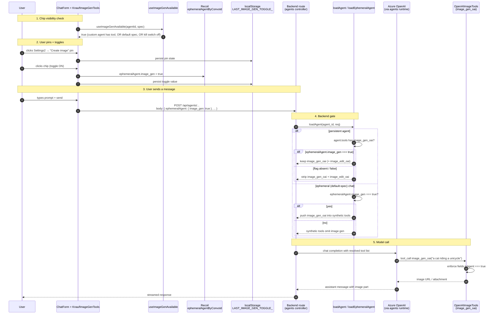
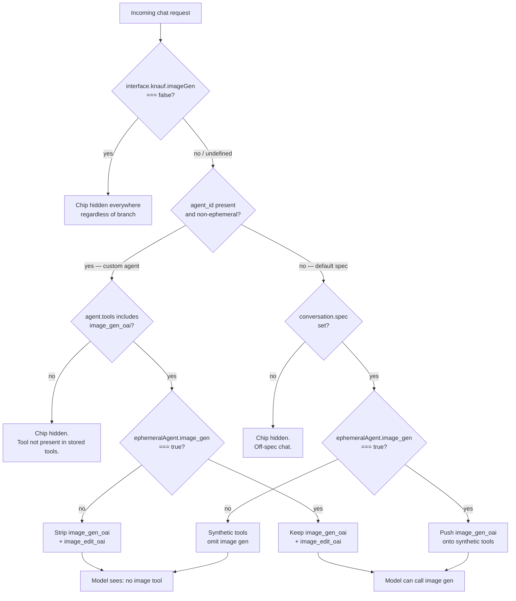
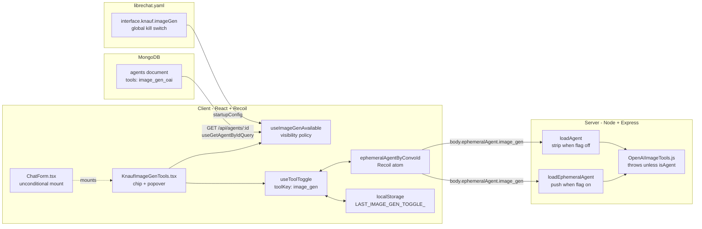

# Image generation toggle — current behaviour & chat-side extension

Companion to the [SEAMS.md](../../../SEAMS.md) entries under ticket KK20-168. Those rows capture *where* the inline seams live; this doc explains *why* the toggle is structured the way it is, and lays out what a true non-agent extension would require.

> If you're skimming for one answer: **the "image generation toggle" is two separate gates**, with a third global kill switch on top. An admin enables `image_gen_oai` on the agent record in MongoDB; a user then toggles it per conversation via a chip in the composer. The chip is also reachable on default Knauf model spec chats (no custom agent) so the feature does not require a custom agent. `interface.knauf.imageGen` is the global kill switch — flip it to `false` and the chip disappears everywhere.

---

## 1. Why this doc exists

Engineers reading the KK20-168 seam rows see five touchpoints:

- `client/src/components/Chat/Input/ChatForm.tsx` (unconditional UI mount; spec forwarded)
- `client/src/knauf/components/Chat/KnaufImageGenTools.tsx` (composer chip + popover)
- `client/src/knauf/hooks/Chat/useImageGenAvailable.ts` (centralised visibility policy)
- `packages/api/src/agents/load.ts` (backend gate, two branches)
- `packages/data-provider/src/types.ts` + `config.ts` (request payload field + interface flag)

Nothing in those rows explains *why* both an admin opt-in and a per-conversation opt-in exist, why the front-end chip is universally available on default-spec chats while the backend strips tools that the front-end hides on persistent-agent chats, or how the kill switch composes with the per-branch policy. This doc closes that gap. It also documents what would be required to surface image generation outside the agents pipeline — a future scope decision, not work shipped today.

---

## 2. Current behaviour

### 2.1 Admin opt-in — the agent `tools` array

The agent schema in [packages/data-schemas/src/schema/agent.ts](../../../packages/data-schemas/src/schema/agent.ts) defines `tools: [String]`. An agent has image generation "available" when `image_gen_oai` appears in that array. Today that is set via the **upstream** agent builder ([client/src/components/SidePanel/Agents/AgentConfig.tsx](../../../client/src/components/SidePanel/Agents/AgentConfig.tsx)), not through the Knauf simplified builder — [KnaufAgentConfig.tsx](../../../client/src/knauf/components/Agents/KnaufAgentConfig.tsx) and its capability registry [capabilities.ts](../../../client/src/knauf/components/Agents/capabilities.ts) list only `browseInternet`. The detailed admin builder is where image gen gets enabled per agent.

The tool key itself is registered in [packages/api/src/tools/toolkits/oai.ts](../../../packages/api/src/tools/toolkits/oai.ts) — two literal strings, `image_gen_oai` (generation) and its companion `image_edit_oai` (edit/remix). Admins install only `image_gen_oai`; the OAI toolkit auto-pairs `image_edit_oai` at request build time, which is why both keys appear in the backend strip logic.

The tools registry itself is admin-gated globally by the [librechat.yaml](../../../librechat.yaml) `includedTools` list — `image_gen_oai` must appear there to be available at all. If an admin removes it from the YAML, every other gate becomes moot.

### 2.2 User opt-in — the composer chip

[KnaufImageGenTools.tsx](../../../client/src/knauf/components/Chat/KnaufImageGenTools.tsx) renders a Settings2 button next to the paperclip. The button opens a popover with one row, *Create image*, plus a pin button. Pinning promotes a `CheckboxButton` chip directly into the composer; clicking the chip flips the per-conversation toggle.

State machinery:

- `useToolToggle({ toolKey: 'image_gen', localStorageKey: LocalStorageKeys.LAST_IMAGE_GEN_TOGGLE_, … })` writes into the Recoil atom `ephemeralAgentByConvoId` ([client/src/hooks/Plugins/useToolToggle.ts](../../../client/src/hooks/Plugins/useToolToggle.ts)).
- Pin state and last-toggle value are mirrored to `localStorage` so reopening the conversation preserves the chip's visibility, but **default per-conversation state is OFF** — the user must explicitly enable image gen each chat (product owner spec).
- The chip is mounted **unconditionally** from [ChatForm.tsx](../../../client/src/components/Chat/Input/ChatForm.tsx); visibility is decided inside the component via `useImageGenAvailable` (§2.3). This is a change from the original KK20-168 ship, which mounted only on `isAgentsEndpoint(endpoint)` and was therefore invisible on default Karl spec chats.

### 2.3 Visibility policy — `useImageGenAvailable`

[useImageGenAvailable](../../../client/src/knauf/hooks/Chat/useImageGenAvailable.ts) is the single source of truth for "should the chip appear here?" Both the mount in `ChatForm.tsx` and the chip itself consult it. Three branches:

1. **Global kill switch.** `interface.knauf.imageGen === false` returns `false` everywhere. Default is `true` (the librechat.yaml seed) — admins flip it to `false` to disable the surface without removing `image_gen_oai` from `includedTools`.
2. **Custom-agent branch.** When `agentId` is set and not the ephemeral marker, the hook reads the agent record via `useGetAgentByIdQuery` and returns `true` iff `agent.tools.includes('image_gen_oai')`. This is the original KK20-168 behaviour: admin install on the agent record is the per-agent admission control.
3. **Default-spec branch.** When `agentId` is absent (or ephemeral) and `conversation.spec` is set, the hook returns `true`. Any Knauf model spec chat (`karl`, personality presets, etc.) qualifies; off-spec chats do not. The backend gate (§2.4) still enforces per-chat opt-in via `ephemeralAgent.image_gen`, so the chip being visible does not mean the model gets the tool.

### 2.4 Backend gate — `loadAgent` / `loadEphemeralAgent`

[packages/api/src/agents/load.ts](../../../packages/api/src/agents/load.ts) is the load-bearing seam. It is two branches, one per agent kind:

**Ephemeral (default chat with `agent: 'functions'`).** `loadEphemeralAgent` builds a synthetic agent from request body fields. Around line 80, it pushes `image_gen_oai` onto the tool list **only when** `req.body.ephemeralAgent.image_gen === true`. Without the flag, the synthetic agent has no image gen tool. This branch is what makes the default-spec chat path work — the user toggles the chip, the request body carries the flag, and the synthetic agent gets the tool.

**Persistent (custom agent created in the builder).** `loadAgent` fetches the agent from MongoDB. Around line 176, if the stored `tools` array contains `image_gen_oai` *and* the request's `ephemeralAgent.image_gen` is not strictly true, it **strips** both `image_gen_oai` and `image_edit_oai` from the resolved agent. The admin-installed tool is shadow-removed for that one conversation turn.

The two branches converge on the same invariant: **the tool reaches the LLM iff `ephemeralAgent.image_gen === true` in the request body.** Admin install is necessary but not sufficient on the persistent branch; per-chat toggle is the actual on/off switch at request time on both branches.

Why both UI and backend gates? The UI gate is convenience — don't show a control the agent doesn't have. The backend strip is defense in depth — a malicious client could omit the flag while still calling an agent that has `image_gen_oai` installed, and without the strip the LLM would see the tool. Today both gates default to "off", so the only way to invoke image gen is by going through the chip.

Test coverage lives in [packages/api/src/agents/load.image-gen.knauf.spec.ts](../../../packages/api/src/agents/load.image-gen.knauf.spec.ts) (backend, six cases) and [useImageGenAvailable.spec.ts](../../../client/src/knauf/hooks/Chat/useImageGenAvailable.spec.ts) (front-end, nine cases covering all three branches).

### 2.5 The tool implementation itself

[api/app/clients/tools/structured/OpenAIImageTools.js](../../../api/app/clients/tools/structured/OpenAIImageTools.js) is the runtime tool. Notable for §5: **it throws when `fields.isAgent !== true`** (line 63). The tool is currently coupled to the agents runtime — it consumes agent context, attachment plumbing, and the agent response stream. This guard becomes the hard architectural constraint when we discuss the non-agent extension path below.

---

## 3. Diagrams

### 3.1 End-to-end sequence — toggle, send, image

### 3.2 Decision flow — does `image_gen_oai` reach the model?

### 3.3 Component map — where the five pieces live

---

## 4. Default Karl spec branch — how it ships

The default-spec branch is the change this PR ships on top of the original KK20-168 work. It does not require a custom agent — any conversation on a Knauf model spec (`karl`, personality presets) is eligible. The three pieces:

**Front end.** The chip mount in [ChatForm.tsx](../../../client/src/components/Chat/Input/ChatForm.tsx) is now unconditional and forwards `conversation?.spec` alongside `agent_id`. The chip itself consults [useImageGenAvailable](../../../client/src/knauf/hooks/Chat/useImageGenAvailable.ts), which returns `true` on the default-spec branch when `spec` is set and the global kill switch is not flipped. No per-agent tool installation is needed for this branch.

**Config.** A new `interface.knauf.imageGen: true` seeded in [librechat.yaml](../../../librechat.yaml) and a matching `imageGen: z.boolean().optional()` field added to the Knauf-namespaced interface block in [packages/data-provider/src/config.ts](../../../packages/data-provider/src/config.ts). Flipping the yaml value to `false` hides the chip on every surface — custom-agent chats included — without removing `image_gen_oai` from `includedTools` or affecting agents that call it programmatically. Default is `true`; the schema treats undefined as enabled.

**Back end.** No changes. [loadEphemeralAgent](../../../packages/api/src/agents/load.ts) already pushes `image_gen_oai` onto the synthetic tool list when `ephemeralAgent.image_gen === true`. The existing parallel handling for `web_search`, `file_search`, `execute_code` proves the path: any spec-driven ephemeral conversation reaches `loadEphemeralAgent` via [agents/build.js](../../../api/server/services/Endpoints/agents/build.js) (`agent_id` falls back to `EPHEMERAL_AGENT_ID` when the endpoint is not the agents endpoint, then `loadAgent` dispatches to `loadEphemeralAgent` for ephemeral IDs).

Implications worth flagging:

- **Cost surface.** Image gen is opt-in per send — toggling the chip is a deliberate user action and each generation is a paid call. The chip is now default-visible on every default-spec chat; the risk is normalisation driving usage up. Worth a PMO talking point.
- **Permissions.** The chip is not role-gated. If image gen should be admin-only or role-gated, the policy belongs in `useImageGenAvailable` (one place to add it). See `FEAT-03` in [CLAUDE.local.md](../../../CLAUDE.local.md) for the broader admin/user split.
- **Upstream-sync risk.** `interface.knauf.imageGen` lives under the existing Knauf-namespaced sub-schema, parallel to `defaultAgentId`. Upstream cannot collide with it. The ChatForm mount predicate is wrapped in a `[knauf]` block and tracked in SEAMS.md.

---

## 5. Extending to a true non-agent chat path

**Goal.** Image generation in a flow that bypasses the agents controller entirely — e.g. a direct chat-completions or Responses-API call.

### 5.1 Why this is much harder

The fork has **no separate non-agent chat path today** — every Karl model spec routes through `agentOptions.agent: 'functions'` and lands in the agents controller via the `buildEndpointOption` middleware. Building a non-agent surface means re-introducing a chat-completions code path that was never built, plus dealing with three structural constraints:

1. **`OpenAIImageTools.js` throws when `isAgent !== true`** ([api/app/clients/tools/structured/OpenAIImageTools.js:63](../../../api/app/clients/tools/structured/OpenAIImageTools.js#L63)). The tool consumes agent runtime state — per-conversation file plumbing, the agent message-part protocol, the streaming envelope. A non-agent path either lifts this guard *and* substitutes equivalent plumbing, or splits the tool into agent + non-agent adapters.
2. **The non-agent chat-completions controller has no tool resolution layer.** Today, only the agents pipeline turns a tool key into a runtime-callable function. Adding tool-calling to chat-completions is a non-trivial controller change.
3. **The UI has no non-agent message renderer for tool calls.** Image results land in the assistant message as a structured part — non-agent rendering would need an equivalent component.

### 5.2 What it would take

Order of operations, smallest to largest:

1. Lift or split the `isAgent` guard in `OpenAIImageTools.js`. Either a flag-based fallback or two adapter files (`OpenAIImageTools.agent.js` / `OpenAIImageTools.chat.js`) sharing a common implementation.
2. Add a tool-resolution layer to whichever chat-completions controller becomes the non-agent path.
3. Plumb image-result message parts into the non-agent renderer. Without this the user gets a tool call with no visible output.
4. Settle the UX surface — composer chip works, but where does the resulting image attach in a non-agent message?

### 5.3 Recommendation

**Don't do this unless an explicit product requirement demands bypassing agents.** §4 already delivers "toggle on default chat → image returned" without a runtime refactor. The non-agent path is documented here primarily so future work doesn't re-explore it from scratch.

---

## 6. Comparison

| Dimension | Shipped (custom-agent + default-spec) | §5 — true non-agent |
|---|---|---|
| Scope of change | shipped under KK20-168 | runtime refactor |
| Backend changes | none beyond original KK20-168 | yes — tool-resolution layer, lift isAgent guard |
| UX delta | chip on every Knauf model spec chat (custom + default) | chip on plain chat-completions surface |
| Admin kill switch | `interface.knauf.imageGen: false` | same + per-surface flag |
| Cost surface | per-chat user opt-in | per-chat user opt-in |
| Upstream-sync risk | medium (Knauf-namespaced schema + tracked [knauf] markers) | high (rebuilds a chat-completions tool path that upstream is also migrating) |
| Estimated effort | shipped | ≥ 1 epic |

---

## 7. Cross-references

- [SEAMS.md](../../../SEAMS.md) — KK20-168 rows for `ChatForm.tsx` (two — original mount + broadened predicate), `KnaufImageGenTools.tsx`, `useImageGenAvailable.ts`, `useImageGenAvailable.spec.ts`, `load.ts`, `types.ts`, `config.ts` (knauf.imageGen), `LocalStorageKeys`.
- [librechat.yaml](../../../librechat.yaml) — `includedTools: image_gen_oai` (line 19), `interface.knauf.imageGen` (default `true`).
- [packages/api/src/tools/toolkits/oai.ts](../../../packages/api/src/tools/toolkits/oai.ts) — definitions of `image_gen_oai` and `image_edit_oai`.
- [CLAUDE.local.md](../../../CLAUDE.local.md) — FEAT-03 (admin/user view split) and FEAT-04 (agent-config capability flags) for adjacent work.
- [knauf/docs/reference/code-change-protocol.md](code-change-protocol.md) — tier ladder and SEAMS append-only convention.
