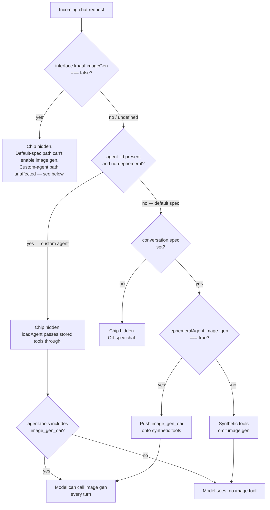
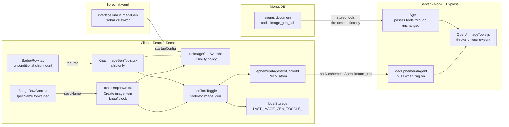

# Image generation toggle — current behaviour & chat-side extension

Companion to the [SEAMS.md](../../../SEAMS.md) entries under ticket KK20-168. Those rows capture *where* the inline seams live; this doc explains *why* the toggle is structured the way it is, and lays out what a true non-agent extension would require.

> If you're skimming for one answer: **there are two surfaces.** On a default Knauf model spec chat (no custom agent), the user toggles image gen per conversation via a chip in the composer. On a custom agent chat, the chip is hidden — if the admin installed `image_gen_oai` on the agent, the tool fires unconditionally. `interface.knauf.imageGen` is a global kill switch that hides the chip on the default-spec surface.

---

## 1. Why this doc exists

Engineers reading the KK20-168 seam rows see five touchpoints:

- `client/src/components/Chat/Input/BadgeRow.tsx` (unconditional chip mount inside the `showEphemeralBadges` cluster; `specName` forwarded — `ChatForm.tsx` now carries only a tombstone marker where the mount used to live)
- `client/src/knauf/components/Chat/KnaufImageGenTools.tsx` (composer chip only — the popover menu item lives in upstream `ToolsDropdown` via `KnaufToolsDropdown`)
- `client/src/knauf/hooks/Chat/useImageGenAvailable.ts` (centralised visibility policy)
- `packages/api/src/agents/load.ts` (backend gate, two branches)
- `packages/data-provider/src/types.ts` + `config.ts` (request payload field + interface flag)

Nothing in those rows explains *why* both an admin opt-in and a per-conversation opt-in exist, why the front-end chip is universally available on default-spec chats while the backend strips tools that the front-end hides on persistent-agent chats, or how the kill switch composes with the per-branch policy. This doc closes that gap. It also documents what would be required to surface image generation outside the agents pipeline — a future scope decision, not work shipped today.

---

## 2. Current behaviour

### 2.1 Admin opt-in — the agent `tools` array

The agent schema in [packages/data-schemas/src/schema/agent.ts](../../../packages/data-schemas/src/schema/agent.ts) defines `tools: [String]`. An agent has image generation "available" when `image_gen_oai` appears in that array. Today that is set via the **upstream** agent builder ([client/src/components/SidePanel/Agents/AgentConfig.tsx](../../../client/src/components/SidePanel/Agents/AgentConfig.tsx)), not through the Knauf simplified builder — [KnaufAgentConfig.tsx](../../../client/src/knauf/components/Agents/KnaufAgentConfig.tsx) and its capability registry [capabilities.ts](../../../client/src/knauf/components/Agents/capabilities.ts) list only `browseInternet`. The detailed admin builder is where image gen gets enabled per agent.

The tool key itself is registered in [packages/api/src/tools/toolkits/oai.ts](../../../packages/api/src/tools/toolkits/oai.ts) — two literal strings, `image_gen_oai` (generation) and its companion `image_edit_oai` (edit/remix). Admins install only `image_gen_oai`; the OAI toolkit auto-pairs `image_edit_oai` at request build time, which is why both keys appear in the backend strip logic.

The tools registry itself is admin-gated globally by the [librechat.yaml](../../../librechat.yaml) `includedTools` list — `image_gen_oai` must appear there to be available at all. If an admin removes it from the YAML, every other gate becomes moot.

### 2.2 User opt-in — the menu item and the chip

The user-facing surface is split across two places that share Recoil state via `useToolToggle('image_gen')`:

- **The "Create image" menu item lives inside the upstream [ToolsDropdown.tsx](../../../client/src/components/Chat/Input/ToolsDropdown.tsx)** via a `[knauf]` block — same Settings2 popover that hosts web_search, file_search, execute_code, artifacts, MCP. One popover, all tools. The item carries a pin button just like its neighbours.
- **The pinned/toggled chip is rendered by [KnaufImageGenTools.tsx](../../../client/src/knauf/components/Chat/KnaufImageGenTools.tsx)** in the composer row when (a) image gen is available and (b) the toggle is on or pinned. The component is mounted unconditionally from [BadgeRow.tsx](../../../client/src/components/Chat/Input/BadgeRow.tsx) (inside the `showEphemeralBadges` chip cluster, after `FileSearch`); the visibility predicate (`useImageGenAvailable`) returns false on the surfaces that shouldn't see the chip.

State machinery:

- `useToolToggle({ toolKey: 'image_gen', localStorageKey: LocalStorageKeys.LAST_IMAGE_GEN_TOGGLE_, … })` writes into the Recoil atom `ephemeralAgentByConvoId` ([client/src/hooks/Plugins/useToolToggle.ts](../../../client/src/hooks/Plugins/useToolToggle.ts)).
- Pin state and last-toggle value are mirrored to `localStorage` so reopening the conversation preserves the chip's visibility, but **default per-conversation state is OFF** — the user must explicitly enable image gen each chat (product owner spec).
- The menu item inside `ToolsDropdown` reaches the active modelSpec name via a `specName` field added to [BadgeRowContext](../../../client/src/Providers/BadgeRowContext.tsx) (also a `[knauf]` block). `ToolsDropdown` itself only renders on default-spec chats (`showEphemeralBadges === true` in `BadgeRow`), so on custom-agent chats the popover is absent and the chip is automatically hidden.

### 2.3 Visibility policy — `useImageGenAvailable`

[useImageGenAvailable](../../../client/src/knauf/hooks/Chat/useImageGenAvailable.ts) is the single source of truth for "should the chip appear here?" Both the chip mount in `BadgeRow.tsx` and the `KnaufToolsDropdown` popover-item wrapper consult it. Three branches:

1. **Global kill switch.** `interface.knauf.imageGen === false` returns `false` everywhere. Default is `true` (the librechat.yaml seed) — admins flip it to `false` to disable the surface without removing `image_gen_oai` from `includedTools`.
2. **Custom-agent branch — always hidden.** When `agentId` is set and not the ephemeral marker, the hook returns `false`. Custom-agent chats never show the chip. If the admin installed `image_gen_oai` on the agent, the tool fires unconditionally — no per-chat opt-in, no toggle. See §2.4 for the backend consequence.
3. **Default-spec branch.** When `agentId` is absent (or ephemeral) and `conversation.spec` is set, the hook returns `true`. Any Knauf model spec chat (`karl`, personality presets, etc.) qualifies; off-spec chats do not. The backend gate (§2.4) still enforces per-chat opt-in via `ephemeralAgent.image_gen`, so the chip being visible does not mean the model gets the tool.

### 2.4 Backend gate — `loadEphemeralAgent` only

[packages/api/src/agents/load.ts](../../../packages/api/src/agents/load.ts) carries one `[knauf]` block, on the ephemeral branch:

**Ephemeral (default chat with `agent: 'functions'`).** `loadEphemeralAgent` builds a synthetic agent from request body fields. Around line 80, it pushes `image_gen_oai` onto the tool list **only when** `req.body.ephemeralAgent.image_gen === true`. Without the flag, the synthetic agent has no image gen tool. This is what makes the default-spec chat path work — the user toggles the chip, the request body carries the flag, and the synthetic agent gets the tool.

**Custom (persistent) agent.** `loadAgent` fetches the agent from MongoDB and passes its stored `tools` through unchanged. Admin-installed `image_gen_oai` therefore fires every turn — there is no per-chat gate on this path. This is the intended product behaviour: installing the tool on a custom agent is the per-agent commitment; the chat-time toggle is reserved for the default-spec branch where the chip is the only admission control.

Test coverage lives in [packages/api/src/agents/load.image-gen.knauf.spec.ts](../../../packages/api/src/agents/load.image-gen.knauf.spec.ts) (backend, 5 cases — 3 pinning custom-agent pass-through + 2 ephemeral-branch cases) and [useImageGenAvailable.spec.ts](../../../client/src/knauf/hooks/Chat/useImageGenAvailable.spec.ts) (front-end, 9 cases covering all three branches).

### 2.5 The tool implementation itself

[api/app/clients/tools/structured/OpenAIImageTools.js](../../../api/app/clients/tools/structured/OpenAIImageTools.js) is the runtime tool. Notable for §5: **it throws when `fields.isAgent !== true`** (line 63). The tool is currently coupled to the agents runtime — it consumes agent context, attachment plumbing, and the agent response stream. This guard becomes the hard architectural constraint when we discuss the non-agent extension path below.

---

## 3. Diagrams

### 3.1 End-to-end sequence — toggle, send, image

```mermaid
sequenceDiagram
  autonumber
  participant U as User (default-spec chat)
  participant CF as BadgeRow + KnaufImageGenTools
  participant H as useImageGenAvailable
  participant R as Recoil<br/>ephemeralAgentByConvoId
  participant LS as localStorage<br/>LAST_IMAGE_GEN_TOGGLE_
  participant API as Backend route<br/>(agents controller)
  participant L as loadEphemeralAgent
  participant LLM as Azure OpenAI<br/>(via agents runtime)
  participant T as OpenAIImageTools<br/>(image_gen_oai)

  Note over U,CF: 1. Chip visibility check
  CF->>H: useImageGenAvailable(agentId, spec)
  H-->>CF: true (no custom agent, spec set, kill switch off)

  Note over U,CF: 2. User pins + toggles
  U->>CF: clicks Settings2 → "Create image" pin
  CF->>LS: persist pin state
  U->>CF: clicks chip (toggle ON)
  CF->>R: ephemeralAgent.image_gen = true
  CF->>LS: persist toggle value

  Note over U,API: 3. User sends a message
  U->>CF: types prompt + send
  CF->>API: POST /api/agents/...<br/>body: { ephemeralAgent: { image_gen: true }, ... }

  Note over API,L: 4. Backend gate (ephemeral branch only)
  API->>L: loadEphemeralAgent(req)
  alt ephemeralAgent.image_gen === true
    L-->>API: push image_gen_oai into synthetic tools
  else flag absent / false
    L-->>API: synthetic tools omit image gen
  end

  Note over API,T: 5. Model call
  API->>LLM: chat completion with resolved tool list
  LLM->>T: tool_call image_gen_oai("a cat riding a unicycle")
  T->>T: enforce fields.isAgent === true
  T-->>LLM: image URL / attachment
  LLM-->>API: assistant message with image part
  API-->>U: streamed response

  Note over U,T: Custom-agent chats: chip hidden; if image_gen_oai<br/>is in the stored tools, the tool fires every turn —<br/>loadAgent passes the tools array through unchanged.
```

### 3.2 Decision flow — does `image_gen_oai` reach the model?



### 3.3 Component map — where the five pieces live



---

## 4. The two surfaces — what ships

Image generation has two surfaces, by design:

**Default Karl spec chat (chip).** Any conversation on a Knauf model spec (`karl`, personality presets) with no custom agent selected. The chip in the composer is the admission control — user toggles per send, request body carries `ephemeralAgent.image_gen`, [loadEphemeralAgent](../../../packages/api/src/agents/load.ts) pushes `image_gen_oai` onto the synthetic tool list. Mount in [BadgeRow.tsx](../../../client/src/components/Chat/Input/BadgeRow.tsx) is unconditional and forwards the active `specName`; visibility is decided by [useImageGenAvailable](../../../client/src/knauf/hooks/Chat/useImageGenAvailable.ts). The hook returns `true` for this branch when `spec` is set and the global kill switch is not flipped.

**Custom agent chat (no chip, tool fires unconditionally).** An admin equips a custom agent with `image_gen_oai` via the upstream agent builder. There is no chip, no per-chat opt-in. [loadAgent](../../../packages/api/src/agents/load.ts) passes the stored tools through unchanged, so the LLM sees `image_gen_oai` every turn. The product call: installing the tool on a custom agent is the deliberate per-agent commitment; the chat-time toggle is reserved for the default-spec branch where the chip is the only admission control.

**Config seam — `interface.knauf.imageGen`.** Seeded `true` in [librechat.yaml](../../../librechat.yaml), declared on the Knauf-namespaced interface block in [packages/data-provider/src/config.ts](../../../packages/data-provider/src/config.ts). Flipping the yaml value to `false` hides the chip on the default-spec surface (custom-agent chats are unaffected — they have no chip to hide). Removing `image_gen_oai` from `includedTools` is the harder kill that takes the tool away from custom agents too.

Implications worth flagging:

- **Cost surface — custom agents.** Image gen fires on every chat with a custom agent that has `image_gen_oai` installed. There is no per-conversation gate. Admins should reserve the install for agents where image gen is a deliberate first-class capability.
- **Cost surface — default-spec.** Per-send opt-in via the chip. Each generation is a paid call. The chip is default-visible on every default-spec chat; risk of normalising usage upward is real.
- **Permissions.** The chip is not role-gated. If image gen should be admin-only or role-gated, the policy belongs in `useImageGenAvailable` (one place to add it). See `FEAT-03` in [CLAUDE.local.md](../../../CLAUDE.local.md) for the broader admin/user split.
- **Upstream-sync risk.** `interface.knauf.imageGen` lives under the existing Knauf-namespaced sub-schema. Upstream cannot collide with it. The BadgeRow chip mount and `loadEphemeralAgent` push are wrapped in `[knauf]` blocks and tracked in SEAMS.md.

---

## 5. Extending to a true non-agent chat path

**Goal.** Image generation in a flow that bypasses the agents controller entirely — e.g. a direct chat-completions or Responses-API call.

### 5.1 Why this is much harder

The fork has **no separate non-agent chat path today** — every Karl model spec routes through `agentOptions.agent: 'functions'` and lands in the agents controller via the `buildEndpointOption` middleware. Building a non-agent surface means re-introducing a chat-completions code path that was never built, plus dealing with three structural constraints:

1. **`OpenAIImageTools.js` throws when `isAgent !== true`** ([api/app/clients/tools/structured/OpenAIImageTools.js:63](../../../api/app/clients/tools/structured/OpenAIImageTools.js#L63)). The tool consumes agent runtime state — per-conversation file plumbing, the agent message-part protocol, the streaming envelope. A non-agent path either lifts this guard *and* substitutes equivalent plumbing, or splits the tool into agent + non-agent adapters.
2. **The non-agent chat-completions controller has no tool resolution layer.** Today, only the agents pipeline turns a tool key into a runtime-callable function. Adding tool-calling to chat-completions is a non-trivial controller change.
3. **The UI has no non-agent message renderer for tool calls.** Image results land in the assistant message as a structured part — non-agent rendering would need an equivalent component.

### 5.2 What it would take

Order of operations, smallest to largest:

1. Lift or split the `isAgent` guard in `OpenAIImageTools.js`. Either a flag-based fallback or two adapter files (`OpenAIImageTools.agent.js` / `OpenAIImageTools.chat.js`) sharing a common implementation.
2. Add a tool-resolution layer to whichever chat-completions controller becomes the non-agent path.
3. Plumb image-result message parts into the non-agent renderer. Without this the user gets a tool call with no visible output.
4. Settle the UX surface — composer chip works, but where does the resulting image attach in a non-agent message?

### 5.3 Recommendation

**Don't do this unless an explicit product requirement demands bypassing agents.** §4 already delivers "toggle on default chat → image returned" without a runtime refactor. The non-agent path is documented here primarily so future work doesn't re-explore it from scratch.

---

## 6. Comparison

| Dimension | Shipped — default-spec chip | Shipped — custom-agent always-on | §5 — true non-agent |
|---|---|---|---|
| Admission control | per-chat chip toggle | admin install on agent record | TBD |
| Where it lives | composer chip + `useImageGenAvailable` | agent's stored `tools` array | non-agent chat-completions controller |
| Backend gate | `loadEphemeralAgent` push when flag on | `loadAgent` pass-through (no gate) | tool resolution layer + lift isAgent guard |
| Cost surface | per-send user opt-in | every turn with that agent | TBD |
| Admin kill switch | `interface.knauf.imageGen: false` | remove `image_gen_oai` from `includedTools` (also kills default-spec) | both + per-surface flag |
| Upstream-sync risk | medium (Knauf-namespaced schema + tracked [knauf] block) | low (no custom seam — uses upstream tools array as-is) | high (rebuilds a chat-completions tool path) |
| Estimated effort | shipped | shipped | ≥ 1 epic |

---

## 7. Cross-references

- [SEAMS.md](../../../SEAMS.md) — KK20-168 rows for `BadgeRow.tsx` (chip mount + `ToolsDropdown`→`KnaufToolsDropdown` import swap), `ChatForm.tsx` (tombstone marker where the mount used to live), `ToolsDropdown.tsx` (`extraItems` prop), `BadgeRowContext.tsx` (`specName` forwarding), `KnaufToolsDropdown.tsx`, `KnaufImageGenTools.tsx`, `useImageGenAvailable.ts`, `useImageGenAvailable.spec.ts`, `load.ts` (`loadEphemeralAgent` ephemeral branch — the persistent strip introduced under the same ticket was later removed), `types.ts`, `config.ts` (knauf.imageGen), `LocalStorageKeys`.
- [librechat.yaml](../../../librechat.yaml) — `includedTools: image_gen_oai` (line 19), `interface.knauf.imageGen` (default `true`).
- [packages/api/src/tools/toolkits/oai.ts](../../../packages/api/src/tools/toolkits/oai.ts) — definitions of `image_gen_oai` and `image_edit_oai`.
- [CLAUDE.local.md](../../../CLAUDE.local.md) — FEAT-03 (admin/user view split) and FEAT-04 (agent-config capability flags) for adjacent work.
- [knauf/docs/reference/code-change-protocol.md](code-change-protocol.md) — tier ladder and SEAMS append-only convention.
