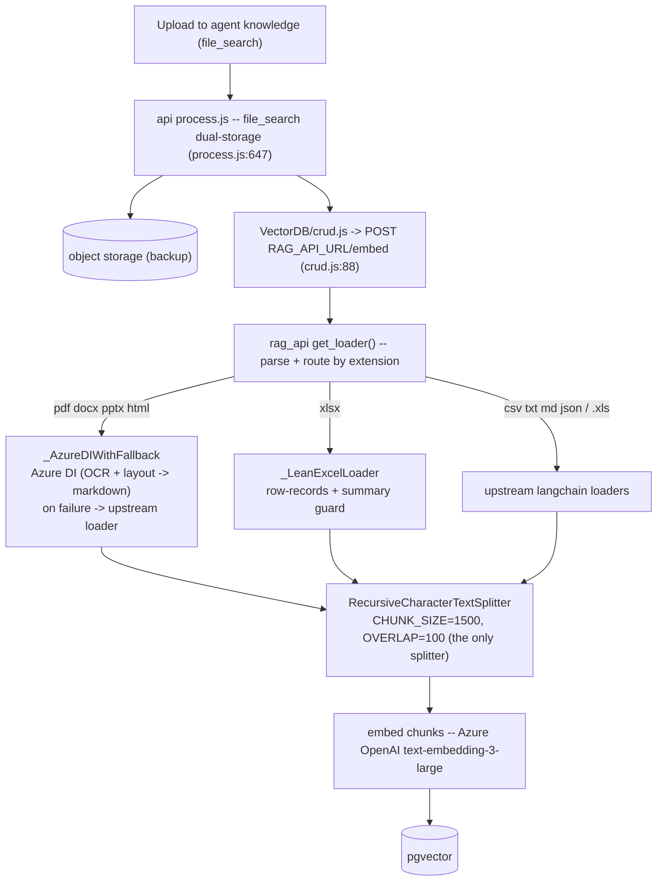
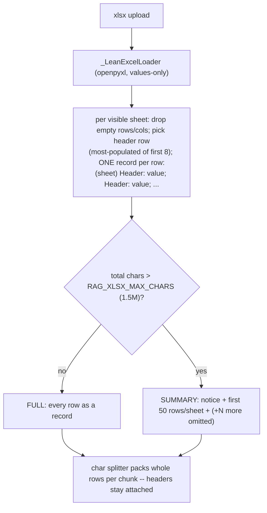
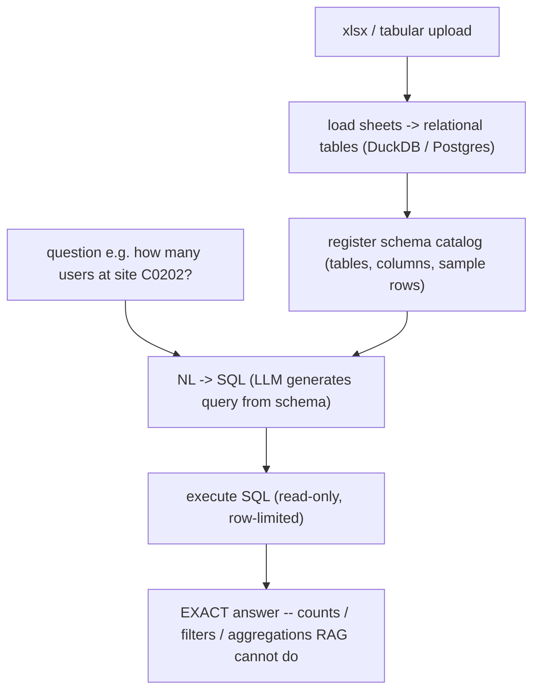

# RAG File-Search Architecture

> How agent **file-search** ingests, chunks, embeds, and retrieves uploaded files in KARL — including the Azure Document Intelligence overlay, the native spreadsheet handling, and the planned text-to-SQL path for large tabular data.

---

## Overview

Agent **file-search** (the knowledge panel) lets a user attach files to an agent; their content is parsed, embedded into a vector store, and retrieved at query time to ground the agent's answers (RAG). Parsing + embedding run in the separate **`rag_api`** service (reached via `RAG_API_URL`), which KARL extends with a thin Docker overlay (`knauf/rag-api-overlay/`, built `FROM` the upstream image) that:

- routes **PDF / DOCX / PPTX / HTML** to **Azure AI Document Intelligence** (OCR + layout), with a graceful fallback to the upstream loaders on any DI failure;
- routes **`.xlsx`** to a native lean Excel loader that emits one self-describing record per row, with a summary guard for huge workbooks;
- leaves everything else (`csv/txt/md/json`, legacy `.xls`) on the stock loaders.

Parser choices are evidence-based — see the benchmark harness in `knauf/parser-eval/` (Azure DI wins the document head-to-heads; the native loader is best/cheapest for spreadsheets).

---

## 1. Ingestion



A file uploaded with `tool_resource=file_search` hits the dual-storage branch in `process.js:647`: the raw file is backed up to object storage, then `VectorDB/crud.js:88` POSTs it to `RAG_API_URL/embed`. Inside `rag_api`, `get_loader()` (our overlay) parses + routes it, the **single** `RecursiveCharacterTextSplitter` (`CHUNK_SIZE=1500`, `CHUNK_OVERLAP=100`) chunks the text, each chunk is embedded (Azure OpenAI `text-embedding-3-large`), and the vectors land in pgvector.

> The splitter is **character-based, not table/markdown-aware** — it splits on `\n\n` → `\n` → space → char. That is why the spreadsheet path (§3) shapes its output into self-contained per-row lines.

---

## 2. Retrieval (query time)


At query time the `fileSearch` tool (`fileSearch.js:119`) POSTs the question to `RAG_API_URL/query` (top-k = 5); pgvector returns the nearest chunks by cosine distance and the agent answers from them. System-prompt context augmentation uses the same `/query` (k = 4) — `createContextHandlers.js:33`.

---

## 3. Parser routing & the spreadsheet approach

`get_loader()` (`knauf/rag-api-overlay/document_loader.py`) routes by extension:

| Input | Parser | Notes |
|---|---|---|
| pdf, docx, pptx, html | `_AzureDIWithFallback` | Azure DI OCR+layout → markdown; on any DI error → upstream loader (so an upload never hard-fails) |
| **xlsx** | `_LeanExcelLoader` | per-row records + summary guard (below) |
| csv, txt, md, json, legacy `.xls` | upstream langchain loaders | DI adds nothing here |

### Why spreadsheets need special handling
A spreadsheet rendered as a markdown table is one giant block; the character splitter cuts it mid-table and the header survives only in the first chunk — so most chunks become header-less values. Instead, `_LeanExcelLoader` emits **one self-describing record per row**:



For each **visible** sheet it drops empty rows/cols, picks the header row (the most-populated of the first 8 rows, so a title row above the header doesn't poison labels), and emits:

```
# <sheet>
(<sheet>) <Header1>: <v1>; <Header2>: <v2>; ...
```

Each record is a single line `< CHUNK_SIZE`, so the splitter keeps whole rows **with their headers** in every chunk.

**Example — normal sheet (FULL).** `fragen_antworten…xlsx` (761,799 chars, under the cap):
```
# Fragen_Antworten
(Fragen_Antworten) Lfd. Nr.: 1; Tabellen-Seite: 1; Fragetyp: GV 2026-BF; Frage-Nr.: 153; Kennung: GV 2026-BF 153; Frage: Wenn im Rahmen ...
```

**Large-workbook guard.** If the assembled text exceeds `RAG_XLSX_MAX_CHARS` (default 1.5 M), it emits a per-sheet **summary** (first `RAG_XLSX_SUMMARY_ROWS` = 50 rows/sheet) instead — so a giant workbook ingests in seconds rather than becoming ~13 k chunks.

**Example — huge workbook (SUMMARY).** `Users 1st release…xlsx` (~21.5 M chars / 21,660 rows → 250,352 chars):
```
[knauf] Large workbook summary — 21,660 rows across 5 sheet(s); full content omitted
from search to keep ingestion fast. Showing up to 50 rows per sheet — ask a specific
lookup or open the source file.

# Users sites (17,062 rows x 5 cols)
(Users sites) Last Name: Salvi; First Name: Theo; Email: Theo.Salvi@knauf.com; Site: C0202 - ...
... (+17,012 more rows omitted)
```

The agent can describe and sample such a workbook, but **cannot count or aggregate** over it — that is what §4 addresses.

---

## 4. Large tabular data → text-to-SQL (future / Tier 1)

Semantic RAG retrieves *similar chunks*; it cannot answer *"how many users at site C0202?"* or *"list everyone in DACH"* — those need counting/filtering across **all** rows. A 21 k-row directory is a **database**, not a document. The industry-standard answer is **structured retrieval (text-to-SQL)**:



Structured files would be loaded into relational tables (DuckDB/Postgres); the LLM generates SQL from the registered schema; the query runs **read-only** (statement timeout + row caps) and returns an **exact** answer that scales to millions of rows. It coexists with RAG by **routing on file type** — documents → RAG, spreadsheets/structured → text-to-SQL. **Out of scope for the current rollout; documented as the next step.**

---

## Config reference

| Var | Default | Purpose |
|---|---|---|
| `RAG_AZURE_DI_ENDPOINT` | — | Azure DI (AI Services data-plane) endpoint, e.g. `https://cst-karl-dev.services.ai.azure.com/` |
| `RAG_AZURE_DI_KEY` | — | DI key (**secret**; same `cst-karl-dev` account key as `AZURE_OPENAI_API_KEY`) |
| `RAG_AZURE_DI_API_MODEL` | `prebuilt-layout` | DI model |
| `RAG_AZURE_DI_MODE` | `markdown` | DI output mode |
| `RAG_AZURE_DI_FILE_EXTS` | `pdf` (KARL: `pdf,docx,pptx,html`) | extensions routed to DI; xlsx excluded on purpose |
| `RAG_XLSX_MAX_CHARS` | `1500000` | xlsx summary trigger (`0` = unlimited) |
| `RAG_XLSX_SUMMARY_ROWS` | `50` | rows/sheet shown in the summary |
| `CHUNK_SIZE` / `CHUNK_OVERLAP` | `1500` / `100` | rag_api splitter (characters) |
| `EMBEDDINGS_PROVIDER` / `EMBEDDINGS_MODEL` | `openAI` / `text-embedding-3-large` | embeddings |

## Code map

| Concern | Location |
|---|---|
| file_search dual-storage | `api/server/services/Files/process.js:647` |
| POST `/embed` (ingest) | `api/server/services/Files/VectorDB/crud.js:88` |
| POST `/query` (retrieval) | `api/app/clients/tools/util/fileSearch.js:119` |
| `/query` context augmentation | `api/app/clients/prompts/createContextHandlers.js:33` |
| parser routing + DI fallback + xlsx | `knauf/rag-api-overlay/document_loader.py` (`get_loader`, `_AzureDIWithFallback`, `_LeanExcelLoader`) |
| overlay image | `knauf/rag-api-overlay/Dockerfile.knauf-rag` |
| parser benchmark + evidence | `knauf/parser-eval/` |

## Related
- `knauf/rag-api-overlay/README.md` — overlay build + env detail.
- `knauf/parser-eval/README.md` — the DI-vs-upstream-vs-liteparse benchmark behind these routing decisions.
