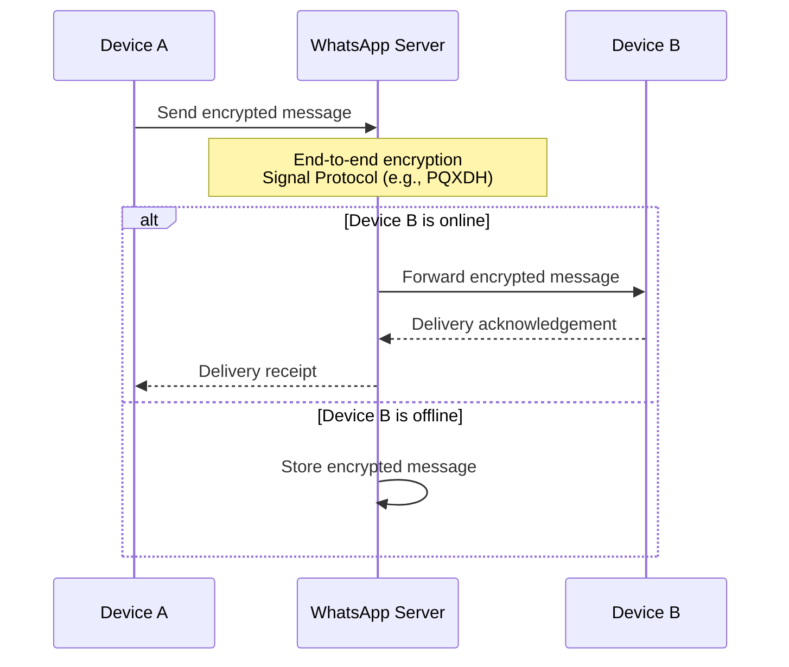
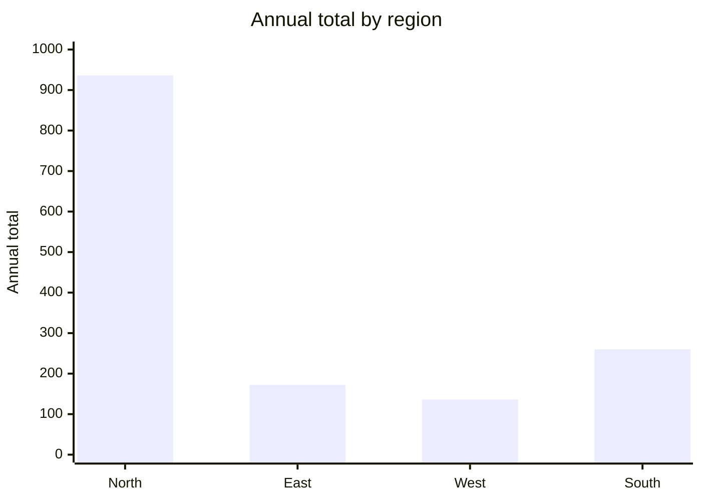

# Reliable Mermaid diagrams

Target Mermaid **11.15.0**. Produce complete source that preserves the user's
meaning and renders without relying on undocumented parser recovery.

Before choosing a diagram type or repairing type-specific syntax, read:

```
read_file  skills/karl-mermaid/references/diagram-patterns.md
```

## Generate

1. Pick the simplest supported diagram type. Prefer `flowchart`,
   `sequenceDiagram`, `classDiagram`, `erDiagram`, `stateDiagram-v2`, `gantt`,
   `pie`, or `xychart-beta`. Use the reference's selection table rather than
   forcing every relationship into a flowchart.
2. Use short ASCII identifiers. Put human-readable text in quoted labels or
   `as` aliases.
3. Close every `alt`, `opt`, `loop`, `par`, `rect`, and `critical` block with
   `end`.
4. Emit the complete diagram. Never use ellipses or “rest unchanged”.
5. Use the surrounding Mermaid fence or artifact format required by the system
   instructions. Put only Mermaid source inside it.
6. Keep the first render readable. If it needs more than roughly 25 nodes or
   participants, group or split it instead of shrinking labels into illegibility.

## Syntax guardrails

- Quote flowchart labels containing punctuation:
  `node["Label (detail): value"]`.
- Define every sequence participant before messages or notes. Use
  `participant Server as WhatsApp Server`; never attach a note to an undefined
  name such as `System`.
- In sequence messages and notes, encode literal semicolons as `#59;`. Use
  `<br/>` for visible line breaks; never output the two characters `\n`.
- Keep arrows conventional: `->>` for a request and `-->>` for a response.
- In `xychart-beta`, emit complete `x-axis`, `y-axis`, and `bar`/`line`
  statements. Keep every series length equal to the number of x-axis labels.
- Avoid experimental directives, custom themes, HTML scripts, and unsupported
  diagram types unless the user explicitly needs them.

Working sequence pattern:



Working `xychart-beta` pattern:



## Repair

When the renderer returns an error:

1. Read the exact failing source and renderer message.
2. Preserve the diagram type, facts, ordering, and existing artifact identifier.
3. Make the smallest syntax correction.
4. Re-emit the complete corrected diagram once. Never retry identical source.

Use these diagnostics:

| Error or symptom                                                         | Correction                                                                                  |
| ------------------------------------------------------------------------ | ------------------------------------------------------------------------------------------- |
| `Syntax error in text`                                                   | Check raw semicolons, literal `\n`, punctuation in unquoted labels, and unclosed blocks.    |
| A note names an unknown participant                                      | Declare that participant or attach the note to an existing one.                             |
| `Cannot read properties of undefined (reading 'data')` in `xychart-beta` | Finish every axis and series; ensure at least one complete series and matching lengths.     |
| Error appears only while the answer is streaming                         | Finish the diagram; do not change its meaning merely to silence a transient partial render. |

If no Mermaid parser tool is available, do not claim machine validation. Apply
this checklist and let KARL's preview perform the final render.
