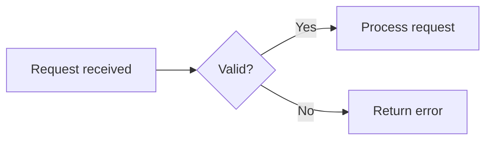
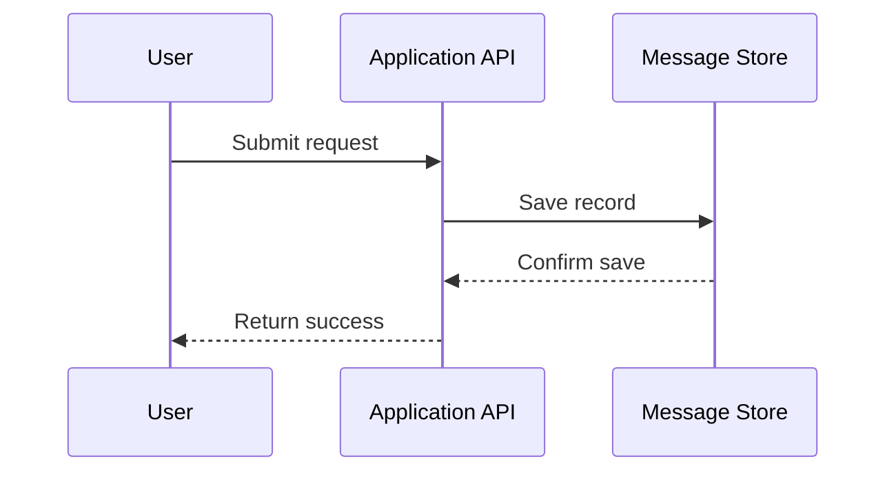
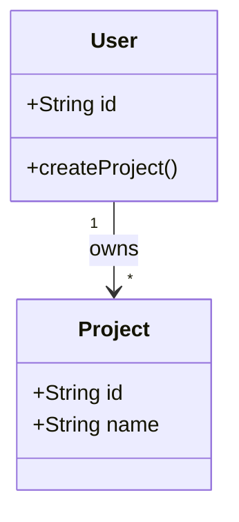
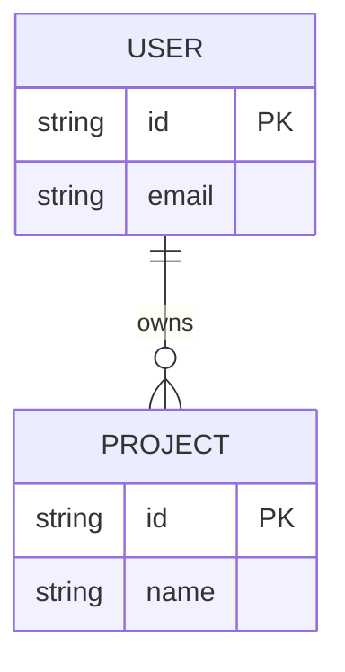
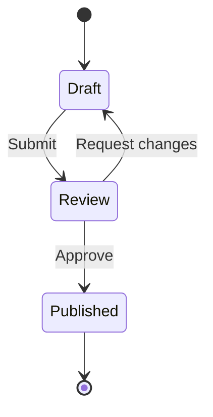
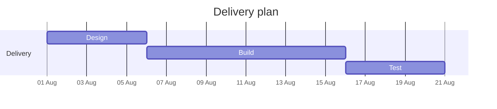
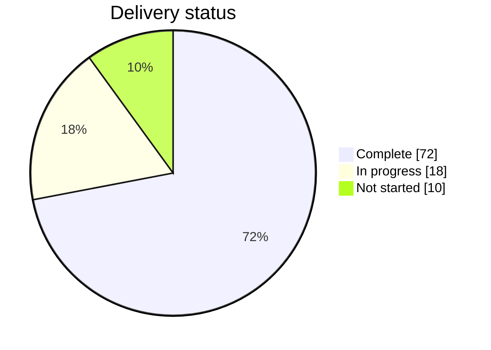
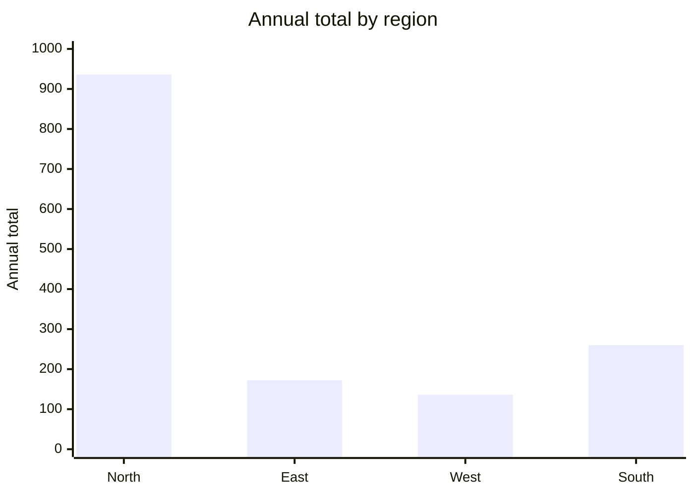

# Mermaid diagram patterns

Use these Mermaid 11.15.0 patterns when selecting or repairing a diagram. Choose
the simplest type that expresses the user's main question; do not combine
unrelated views into one oversized diagram.

## Choose a type

| User needs to show                                    | Use               | Do not use it for                               |
| ----------------------------------------------------- | ----------------- | ----------------------------------------------- |
| Steps, decisions, dependencies, or architecture       | `flowchart`       | Events whose time order is the main point       |
| Messages between actors over time                     | `sequenceDiagram` | Static ownership or data structure              |
| Software types, members, inheritance, or associations | `classDiagram`    | Database column-level modeling                  |
| Entities, attributes, and cardinality                 | `erDiagram`       | Runtime call order                              |
| Lifecycle states and allowed transitions              | `stateDiagram-v2` | General process steps without persistent states |
| Scheduled work and dependencies                       | `gantt`           | Numeric comparison or event logs                |
| A small part-to-whole breakdown                       | `pie`             | Trends, negative values, or many categories     |
| Numeric comparison or trend                           | `xychart-beta`    | Process or architecture relationships           |

If the request mixes views, lead with the view that answers the question. Add a
second diagram only when the two views remain useful independently.

## Flowchart

Use stable ASCII node IDs and quote every human-readable label. Prefer `LR` for a
pipeline and `TD` for a hierarchy. Label decision edges rather than adding
separate “yes” and “no” nodes.

Common repairs:

- Quote labels containing parentheses, colons, slashes, or punctuation.
- Give every node an ID; do not use its display text as an implicit ID.
- Keep each subgraph's `end` paired and avoid reusing a subgraph ID as a node ID.

## Sequence diagram

Use when horizontal order is actors and vertical order is time. Declare every
participant before any message or note. Attach notes only to declared aliases.

Common repairs:

- Close every `alt`, `opt`, `loop`, `par`, `rect`, and `critical` with `end`.
- Use ` ` for visible note line breaks, not literal `\n`.
- Encode literal semicolons in message or note text as `#59;`.
- Add an `else` branch inside the same `alt`; do not start a second `alt`.

## Class diagram

Use for code-level structure. Keep member syntax simple and put the relationship
label after a colon.

Common repairs:

- Use one member per line inside `{}`.
- Keep class identifiers free of spaces; use a quoted relationship label for
  human-readable meaning.
- Choose one relationship deliberately: inheritance `<|--`, composition `*--`,
  aggregation `o--`, or association `-->`.

## Entity relationship diagram

Use for persistent data and cardinality. Keep entity and attribute identifiers
short; describe business rules outside attribute names.

Common repairs:

- Put the relationship between entity blocks, not inside them.
- Use Mermaid cardinalities such as `||`, `o|`, `|{`, and `o{`.
- Keep attribute declarations to `type name` plus optional `PK`, `FK`, or `UK`.

## State diagram

Use when an item occupies one state at a time and events permit transitions.
Reserve `[*]` for the initial or terminal pseudo-state.

Common repairs:

- Use short state IDs; declare `state "Human label" as StateId` for long labels.
- Put the triggering event after `:`.
- Do not model ordinary process actions as states unless the subject persists in
  them.

## Gantt chart

Use for schedule, duration, and task dependency. Always declare `dateFormat`.
Give tasks stable IDs when another task uses `after`.

Common repairs:

- Match every explicit date to `dateFormat`.
- Reference the task ID, not the display label, after `after`.
- Keep commas separating label, ID/start, and duration.

## Pie chart

Use only for a few non-negative parts of one whole. Prefer a bar chart when
precise comparison matters or categories do not form a whole.

Common repairs:

- Quote every category.
- Use finite, non-negative numbers without percent signs.
- Remove zero-value and tiny categories when they make labels unreadable.

## XY chart

Use for numeric comparison or a single trend. Always emit both axes and at least
one complete series. Every series length must match the x-axis label count.

Common repairs:

- Finish `x-axis`, `y-axis`, and every `bar` or `line` statement.
- Use a numeric y-axis range that contains every value.
- Do not mix category counts: four labels require exactly four values per series.

## Readability limits

- Prefer one main message per diagram.
- Keep labels short; explain detail in surrounding prose.
- Group repeated flowchart nodes with a subgraph.
- Split diagrams above roughly 25 nodes or participants into independently
  meaningful views.
- Preserve facts and ordering during repair. Simplification must not invent or
  remove domain behavior.
